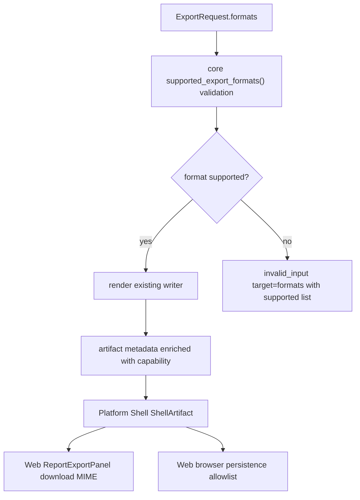

# export-format-capability-matrix design

## 0. 术语约定

- Export Format Capability：导出格式能力记录，描述 format id、extension、MIME、writer、artifact kind、inline/persistence/Web 默认状态和 supported/unsupported 状态。grep 现状中没有同名类型，新增时避免和 `ExportFormat` 混用。
- ExportFormat：当前 core/Web 的支持格式类型。现状只代表可执行格式集合，不能承载 MIME、extension 或 unsupported reason。
- ShellArtifact：Platform Shell 返回给端侧的 artifact 投影，现有字段是 id、format、path、bytes_base64、metadata。能力矩阵只补 metadata/帮助函数，不改变 ShellResponse 基本形状。
- Browser Persistence Allowlist：Web 把 inline artifact 写入 Browser Project Repository 前的格式 guard。它必须消费同一能力口径，而不是另写一份格式 set。

## 1. 决策与约束

### 需求摘要

做一层最小的导出格式能力矩阵，先统一当前 `png/cdxml/xlsx` 的 supported 信息，并把 `csv/svg/pdf/pptx/cdx` 记录为 unsupported/experimental 后续入口。成功标准是 core、Shell、Web fixture、ReportExportPanel 下载 MIME、browser persistence guard 和文档都能引用同一口径；本 feature 不开放新导出格式。

### 复杂度档位

走默认小型跨层 contract 变更档位，无额外高并发、权限、云端或持久 schema migration 偏离。唯一偏离是 **多端同步风险 = 中等**：同一格式白名单现在分散在 Python、TypeScript、fixture 和 docs，需要用测试守住一致性。

### 关键决策

- 能力矩阵以 core `rxnflow.export` 为权威来源：因为 writer、validation 和 artifact metadata 都从 core 出发；Web 可复制一份由测试对齐的只读表，但不能成为格式状态 authority。
- 本 feature 不把 `csv/svg/pdf/pptx/cdx` 加入 `ALLOWED_EXPORT_FORMATS`：否则会变成格式实现 feature，超出最小闭环。它们只出现在 capability table 的 `unsupported` 或 `experimental` 记录中。
- ShellArtifact 不新增顶层必填字段：现有 Web/local-http response normalize 已稳定。MIME/extension/writer/status 先进入 artifact metadata 和 helper 输出，减少跨 transport 破坏面。
- Web download MIME 和 persistence allowlist 改为从 Web 侧 capability helper 读取；Web 侧 helper 的 supported 集合要有测试和 core 文档对齐，后续若生成 typed capability JSON 再替换。

### 明确不做

- 不实现 CSV writer，不把 `csv` 加入 Web checkbox。
- 不实现 SVG graph snapshot、PDF、PPTX 或 CDX writer。
- 不修改 `export-artifacts-v1` section schema。
- 不新增 Shell command 或 HTTP route。
- 不在 Web 前端生成任何导出 bytes。

## 2. 名词与编排

### 2.1 名词层：值对象 / 接口契约

**现状**

- `rxnflow/export.py` 定义 `ExportFormat = Literal["png", "cdxml", "xlsx"]` 和 `ALLOWED_EXPORT_FORMATS`，但没有 extension、MIME、artifact kind、inline/persistence 或 unsupported reason。
- `rxnflow/export_artifact_codec.py` 用 `ALLOWED_EXPORT_FORMATS` 校验长期 artifact record format，和 core supported set 绑定。
- `rxnflow/platform.py` 的 `_shell_artifact()` 只投影 artifact.format/path/bytes/metadata，不补 MIME 或 extension。
- `web/src/shell/types.ts` 的 `ExportFormat` 只列 `png/cdxml/xlsx`；`ShellArtifact.format` 允许 string fallback。
- `web/src/shell/fixtureTransport.ts`、`web/src/app/ReportExportPanel.tsx` 和 `web/src/app/exportArtifactPersistence.ts` 各自硬编码 `png/cdxml/xlsx`。

**变化**

- 新增 core `ExportFormatCapability` dataclass 和 `EXPORT_FORMAT_CAPABILITIES` tuple，提供：

```python
@dataclass(frozen=True)
class ExportFormatCapability:
    format: str
    extension: str
    mime_type: str
    writer_id: str | None
    artifact_kind: str
    supports_inline_bytes: bool
    supports_browser_persistence: bool
    web_default_enabled: bool
    status: str
    unsupported_reason: str | None = None
```

- 新增 helper：

```python
def export_format_capabilities_by_format() -> dict[str, ExportFormatCapability]: ...
def supported_export_formats() -> frozenset[str]: ...
def export_format_capability(format_id: str) -> ExportFormatCapability | None: ...
```

输入→输出示例：

```python
capability = export_format_capability("cdxml")
assert capability.extension == "cdxml"
assert capability.mime_type == "chemical/x-cdxml"
assert capability.status == "supported"

assert "csv" not in supported_export_formats()
assert export_format_capability("csv").status == "unsupported"  # type: ignore[union-attr]
```

- `_artifact_metadata()` 与 `_shell_artifact()` 产生的 artifact metadata 增加 `extension`、`mime_type`、`artifact_kind` 和 `format_status`，供 Web download 和后续 docs/preview 读取。
- Web 新增 `exportFormatCapabilities.ts`，提供 `reportExportFormats`、`exportFormatCapability(format)`、`supportedBrowserPersistedExportFormats()`、`mimeTypeForExportFormat(format)` 和 `extensionForExportFormat(format)`。
- `ReportExportPanel` 的 checkbox 和 download MIME 使用 Web capability helper；`exportArtifactPersistence` 的 allowlist 使用 capability helper。首轮 UI 仍只显示 supported + `webDefaultEnabled` 的 `png/cdxml/xlsx`。

### 2.2 编排层：主流程与控制流



**现状**

导出请求在 `_validate_export_request()` 中直接查 `ALLOWED_EXPORT_FORMATS`，渲染在 `_render_format()` 中按字符串分支，artifact metadata 在 `_artifact_metadata()` 中由 writer 结果拼出。Web fixture 和 UI 也直接写死三种格式，导致新增 CSV/SVG 时容易漏改某一端。

**变化**

- core validation 从能力矩阵派生 supported set，错误 details 仍返回 sorted supported formats。
- render 分支暂不变，只是 writer 完成后用 capability 补 metadata。
- Shell 不新增命令；`export.profile` 主流程不变，只把 enriched metadata 透传。
- Web fixture 用 Web capability helper 解析 export formats 和 writer/mime metadata；ReportExportPanel 与 persistence 从同一 helper 取 MIME/extension/allowlist。

**跨层纪律**

- 错误语义：unsupported format 仍是 `invalid_input target=formats`，details.supported 只列当前 supported 格式。
- 幂等性：能力表是只读常量；不引入 runtime 配置。
- 顺序约束：先落 core helper 和 tests，再替换 Web hard-coded lists。
- 扩展点：后续 CSV/SVG 只需要把 capability status 改为 supported、补 writer 和 tests，再让 Web helper 跟进。
- 可观测点：artifact metadata、docs 和 Web download MIME 都应能看到 capability 口径。

### 2.3 挂载点清单

- Core export registry：`rxnflow.export` — 新增导出格式能力矩阵和 helper，作为 format capability authority。
- Web export format helper：`web/src/app/exportFormatCapabilities.ts` — 新增 Web 侧只读能力表，供 Report Export Panel、fixture 和 persistence 复用。
- Public docs：`docs/dev/report-export-artifacts.md` / `docs/user/report-export-artifacts.md` — 更新格式能力与 unsupported 边界说明。

### 2.4 推进策略

1. Core 名词骨架：新增 capability dataclass/table/helper，`ALLOWED_EXPORT_FORMATS` 从 supported helper 派生。
   退出信号：Python 单测可断言 supported/unsupported/MIME/extension。
2. Core artifact metadata 接入：导出 artifact metadata 补 capability 字段，unsupported 错误 supported list 不变。
   退出信号：现有 PNG/CDXML/XLSX 导出测试更新并通过。
3. Web helper 与 UI/persistence 接入：新增 Web capability helper，替换 ReportExportPanel MIME/list、fixture parsing/writer metadata、persistence allowlist。
   退出信号：component tests 覆盖 MIME、allowlist 和 unsupported skip。
4. 文档与 roadmap 回写：更新用户/开发者文档中当前 supported/unsupported 格式口径。
   退出信号：docs 不再把格式状态写成散落硬编码。
5. 验证收口：运行 Python/Web 单测、build 和 YAML 校验。
   退出信号：关键测试通过，roadmap item 保持 in-progress 等待实现验收。

## 3. 验收契约

### 关键场景清单

- 触发：core 查询 `export_format_capabilities_by_format()` → 期望返回 `png/cdxml/xlsx/csv/svg/pdf/pptx/cdx` 记录，其中 supported set 仍只有 `png/cdxml/xlsx`。
- 触发：core 导出 PNG/CDXML/XLSX → 期望 artifact metadata 包含对应 `extension`、`mime_type`、`artifact_kind`、`format_status=supported` 和既有 writer_id。
- 触发：core 请求 `formats=("csv",)` → 期望仍返回 `invalid_input target=formats`，details.supported 不包含 csv。
- 触发：Web Report Export Panel 渲染默认 formats → 期望 checkbox 仍只有 png/cdxml/xlsx，下载 href MIME 来自 capability helper。
- 触发：Web persistence 遇到 unsupported artifact format → 期望 skip，不写 `exports/...` 或 `export-artifacts-v1` record，错误 code/target 保持可见。
- 触发：fixture export.profile → 期望 writer_id、mime_type、extension metadata 与 Web capability helper 对齐。

### 明确不做的反向核对项

- `ExportFormat` / Web checkbox 不应新增 `csv/svg/pdf/pptx/cdx` supported 入口。
- 不应出现新的 CSV/SVG/PDF/PPTX/CDX writer 分支。
- 不应修改 `EXPORT_ARTIFACTS_SCHEMA_VERSION` 或 `export-artifacts-v1` 字段结构。
- 不应新增 Shell command、HTTP route、Web 前端导出 bytes 生成逻辑。

## 4. 与项目级架构文档的关系

Acceptance 阶段需要把以下现状提炼回架构文档：

- `core-platform.md`：Report Export 增加 Export Format Capability 作为格式白名单/metadata authority。
- `web-workbench.md`：Report Export Panel 和 export artifact persistence 消费 Web capability helper，不再各自硬编码 MIME/allowlist。
- `ARCHITECTURE.md`：术语表补 Export Format Capability，已知导出边界仍说明 CSV/SVG/PDF/PPTX/CDX 未支持。
