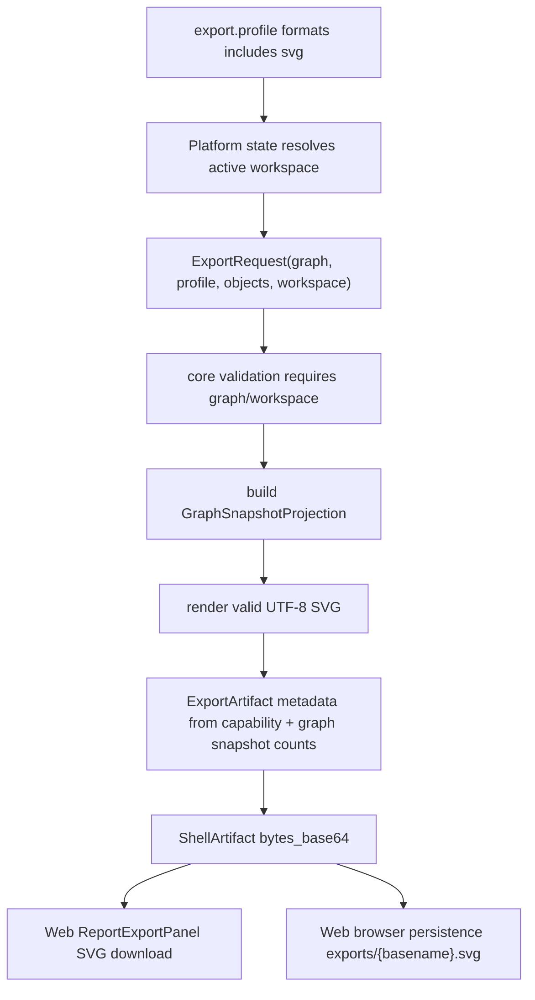

# export-graph-snapshot-svg design

## 0. 术语约定

- Graph Snapshot SVG：由 core 侧 `ReactionGraph` / `WorkspaceSnapshot` 稳定投影生成的 SVG artifact；不是 Web DOM screenshot，也不是 GraphCanvas 当前交互层截图。
- Graph Snapshot Projection：生成 SVG 所需的稳定输入，包括 node position、edge label、path order、active path、selection 和 viewport；不包含 hover、pending edge、rubber-band、minimap draft 或 history stack。
- SVG ExportFormat：`svg` 从 Export Format Capability 的 experimental 变成 supported 后进入 core/Web 可执行格式集合，artifact kind 为 `graph_snapshot`。
- Workspace-backed Export：`export.profile` 可以继续基于 active profile 导出 PNG/CDXML/XLSX/CSV，同时把当前 workspace 传给 core，以便 `svg` writer 生成 graph snapshot。

## 1. 决策与约束

### 需求摘要

实现 roadmap item `export-graph-snapshot-svg`：从 graph/workspace projection 生成报告用 SVG graph snapshot artifact，覆盖 XML escaping、空图、active path 和 viewport bounds。成功标准是 core 可以独立导出 `svg` bytes，Platform Shell `export.profile` 可以返回 SVG ShellArtifact，Web Report Export Panel 默认包含 SVG checkbox、download MIME 和 browser-local persistence；Web 不在前端生成 SVG bytes。

### 复杂度档位

走中等跨层 contract 变更档位。偏离点是 `ExportRequest` 需要获得 workspace context：图谱快照需要 selection/viewport/active path，这些不属于 `EnergyProfile`。方案采用小扩展 `workspace: WorkspaceSnapshot | None`，避免让 exporter 读取 Web DOM 或 Platform session 内部状态。

### 关键决策

- SVG renderer 放在 core export 边界，输入只来自 `ReactionGraph` 与可选 `WorkspaceSnapshot`，输出为 UTF-8 SVG bytes。
- `svg` capability 变为 supported，writer id 使用 `python-svg-graph-snapshot-v1`，artifact kind 保持 `graph_snapshot`。
- `svg` 导出要求至少有 `graph` 或 `workspace`；若两者都缺失，返回 `invalid_input target=graph`。
- 若 `workspace` 存在，以 `workspace.graph`、`workspace.viewport`、`workspace.selection` 和 `workspace.active_path_id` 为准；若只传 `graph`，使用 graph 自带 node position 和默认 viewport/selection。
- Web 只消费 Shell inline bytes、生成 data URL、写 `exports/{basename}.svg`；不调用 DOM capture、不读取 canvas transform、不生成 SVG。

### 明确不做

- 不生成 PNG graph snapshot，不新增 rasterization、canvas screenshot、DOM capture 或 image asset pipeline。
- 不实现 PDF/PPTX/CDX/HTML report 或 Report Composer Manifest。
- 不修改 `reaction-graphs-v1`、`workspaces-v1`、`export-artifacts-v1` 或 Project Content schema。
- 不在 SVG 中嵌入远程资源、外部图片、脚本、foreignObject 或 Web-only CSS。
- 不把 hover、pending edge、rubber-band draft、minimap draft、history stack 或当前 DOM transform 写入 artifact。

## 2. 名词与编排

### 2.1 名词层：值对象 / 接口契约

**现状**

- `rxnflow.export.ExportFormat` 当前为 `png/cdxml/xlsx/csv`；`svg` 在 capability table 中为 `experimental`，writer_id=None，`supports_browser_persistence=False`，`web_default_enabled=False`。
- `ExportRequest` 已有 `graph` 字段，但没有 `workspace` 字段；`export.profile` 当前传入 `graph/profile/objects`。
- `WorkspaceSnapshot` 已包含 `graph`、`selection`、`viewport`、`active_path_id` 和 `preview`，Platform session 已保存 active workspace。
- Web `ExportFormat`、capability helper、fixture transport 和 persistence 当前只把 `png/cdxml/xlsx/csv` 视为 supported/default/persistable。

**变化**

- core/Web `ExportFormat` 增加 `svg`。
- core capability 中 `svg` 变为：

```python
ExportFormatCapability(
    "svg",
    "svg",
    "image/svg+xml",
    "python-svg-graph-snapshot-v1",
    "graph_snapshot",
    True,
    True,
    True,
    "supported",
)
```

- `ExportRequest` 增加可选 `workspace`：

```python
ExportRequest(
    formats=("svg",),
    graph=graph,
    workspace=workspace,
    basename="rxnflow-profile",
)
```

- SVG artifact metadata 复用 capability metadata，并额外包含 `graph_id`、`workspace_id`、`node_count`、`edge_count`、`path_count`、`active_path_id`、`selected_node_count`、`selected_edge_count`、`selected_path_count`、`viewport_x`、`viewport_y`、`viewport_zoom`、`svg_width` 和 `svg_height`。
- Web helper 把 `svg` 纳入 supported/default/browser persistence；download file name 和 persistence path suffix 使用 `.svg`。

### 2.2 编排层：主流程与控制流



**现状**

`svg` 请求在 validation 阶段被拒绝。Web 不显示 svg checkbox，fixture transport 会过滤 svg，browser persistence 会 skip svg。GraphCanvas 已经有 SVG visual layer，但它包含 DOM/interaction state，不是可复用的 core artifact。

**变化**

- core validation 允许 `svg`，并要求 `request.workspace` 或 `request.graph`。
- `_render_format("svg")` 只读取 graph/workspace 投影，生成 valid SVG XML。node 缺 position 时使用 deterministic fallback layout；edge 只引用已存在 endpoints；path/selection/active path 以 CSS class/data attribute 和 metadata 表达。
- Platform Shell `export.profile` 不新增 command；它把 `state.workspace` 传入 `ExportRequest`。
- Web ReportExportPanel 的 checkbox 从 `reportExportFormats()` 自动包含 svg；fixture transport 可返回 svg artifact metadata；persistence guard 允许 svg 并写 `exports/{basename}.svg`。

**跨层纪律**

- 错误语义：缺少 graph/workspace 时 `svg` 返回 `invalid_input target=graph`；未知格式仍 `invalid_input target=formats`。
- 幂等性：同一 graph/workspace/basename 重复导出得到稳定 SVG bytes 和 artifact id/path；browser persistence 仍按 artifact id/path upsert。
- 顺序约束：先 core renderer/capability，再 Shell request context，再 Web helper/fixture/persistence，最后 docs/QA。
- 扩展点：后续 PDF/PPTX/HTML report 应消费 graph snapshot artifact 或 Report Composer Manifest，不直接复用 Web DOM capture。
- 可观测点：SVG XML parse、metadata counts、download MIME、persisted path/checksum、docs format table。

### 2.3 挂载点清单

- Core report export：`rxnflow.export` — SVG capability、workspace-aware request、projection builder、SVG renderer、validation 和 metadata。
- Platform Shell export.profile：`rxnflow.platform` — active workspace 传入 `ExportRequest`，ShellArtifact 透传 svg bytes/metadata。
- Project content export artifact codec：`rxnflow.export_artifact_codec` — 通过 `ALLOWED_EXPORT_FORMATS` 接受 svg records，不升级 schema。
- Web export surface：`exportFormatCapabilities.ts` / fixture transport / ReportExportPanel / export artifact persistence — SVG checkbox、fixture artifact、download MIME、browser-local `exports/...` 保存。
- Public docs / CodeStable：用户/开发者导出指南、architecture、requirements 和 roadmap 回写。

### 2.4 推进策略

1. Core SVG snapshot contract：扩展 ExportFormat/capability/ExportRequest validation 和 metadata。
   退出信号：Python 单测可断言 svg supported、缺 graph/workspace 错误、metadata counts。
2. Core SVG renderer：实现 projection-based SVG builder，覆盖 XML escaping、empty graph、fallback positions、edge/path/selection/viewport。
   退出信号：ElementTree 可解析 SVG，node/edge/path count、active path、selection 和 viewBox 可断言。
3. Platform Shell 与 persistence 投影：`export.profile` 传 workspace，export-artifacts-v1 roundtrip 接受 svg。
   退出信号：Platform shell tests 覆盖 svg ShellArtifact、base64、writer/MIME/extension metadata。
4. Web helper/UI/persistence：更新 Web ExportFormat、capability helper、fixture、ReportExportPanel 和 persistence tests。
   退出信号：Web tests 看到 svg checkbox、`data:image/svg+xml;base64`、fixture metadata 和 `exports/{basename}.svg` persistence。
5. 文档与架构回写：更新用户/开发者指南、architecture、requirements、roadmap item。
   退出信号：docs 不再说 SVG unsupported，边界仍排除 PDF/PPTX/CDX/DOM capture。
6. 验证收口：运行 Python/Web 单测、build、浏览器 desktop/narrow smoke、YAML 和 diff 检查。
   退出信号：关键验证命令通过，未新增 schema/route/frontend SVG writer。

## 3. 验收契约

### 关键场景清单

- 触发：core 查询 supported formats → 期望包含 `svg`，但 PDF/PPTX/CDX 仍不 supported。
- 触发：core 导出 `formats=("svg",)` 且有 workspace → 期望返回 valid UTF-8 SVG bytes，root 可被 XML parser 解析，metadata graph/workspace/counts/viewport 正确。
- 触发：graph 为空 → 期望生成 valid empty graph SVG，metadata node/edge/path count 为 0，不报错。
- 触发：node/edge/path label 包含 XML 特殊字符 → 期望 SVG text/data attributes 正确 escaping，可解析且文本保留语义。
- 触发：node 缺 position → 期望 deterministic fallback position，不读取 Web layout helper 或 DOM。
- 触发：workspace 含 active path 和 selection → 期望 SVG 中可观察 active/selected class 或 data attribute，metadata selected counts 正确。
- 触发：Platform Shell `export.profile` formats 包含 svg 且 include_bytes=true → 期望 ShellArtifact 带 svg format、base64 bytes、writer/MIME/extension metadata。
- 触发：Web Report Export Panel 渲染默认 formats → 期望 checkbox 包含 `png/cdxml/xlsx/csv/svg`，SVG download href 为 `data:image/svg+xml;base64,...`。
- 触发：active browser project 下导出 SVG → 期望写入 `exports/{basename}.svg`，`export-artifacts-v1` record format/path/checksum 正确。

### 明确不做的反向核对项

- 不应新增 PNG graph snapshot、PDF/PPTX/CDX/HTML report writer 或 supported set。
- 不应新增 Web DOM capture、canvas screenshot、Blob SVG builder、foreignObject、script 或远程资源引用。
- 不应新增 Shell command、HTTP route、Project Content schema 或 Web 前端 SVG bytes 生成逻辑。
- 不应读取 hover/pending edge/rubber-band/minimap/history 等 UI-only transient state。

## 4. 与项目级架构文档的关系

Acceptance 阶段需要回写：

- `core-platform.md`：Report Export supported set 增加 SVG graph snapshot，记录 workspace-backed projection、metadata 和 DOM-free 边界。
- `web-workbench.md`：Report Export Panel / export persistence 当前 supported formats 增加 SVG，Web 仍不生成 SVG bytes。
- `ARCHITECTURE.md`：术语和约束中把 SVG 从 experimental 调整为 supported；PDF/PPTX/CDX 仍未支持。
- `.codestable/requirements/web-workbench-shell.md` 与 `project-content-persistence.md`：若验收确认用户可见 SVG 导出和持久化，需要补用户故事/边界。
