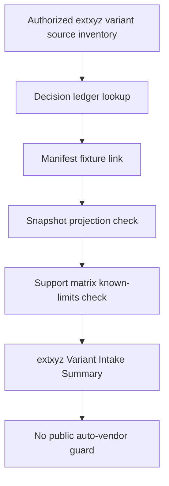

# extxyz-public-variant-intake design

## 0. 术语约定

- **extxyz Variant Intake**：公开、用户授权或项目自写 extxyz 样例进入 parser fixture corpus 前的可审计流程，覆盖 source metadata、decision ledger、manifest、snapshot、support matrix 和 known limits。
- **Authorized extxyz Variant**：允许进入 executable corpus 的 extxyz 文件；可以是 project-authored，也可以是后续用户授权 redacted 文件或许可证明确允许的 public file。
- **extxyz Variant Summary**：测试侧派生汇总，证明 extxyz source inventory、decision ledger、manifest 和 support matrix 对齐，列出 vendored/promoted files、executable fixture ids、known-limits 字段和 unresolved files。
- **Advanced extxyz Fields**：ASE extxyz 常见但 RxnFlow 当前不映射到领域模型的字段，例如 lattice/PBC、forces、stress、magmoms、per-atom charges、calculator metadata。
- **Frame-level extxyz Parsing**：当前 `xyz-ase` parser 对 multi-frame extxyz 的行为：每帧生成一个 `ChemicalObjectDraft`，不推断 ReactionPath、拓扑、TS candidate 或 energy profile。

术语 grep 结论：现有代码已经使用 `ase-extxyz-project-authored`、`ase-extxyz-synthetic`、`xyz-ase`、`unit_assumed`、`missing_section`、`calculator-energy` 和 `multiframe`。本 feature 复用这些概念，不把 lattice/PBC/forces/stress 升级成 runtime supported fields。

## 1. 决策与约束

### 需求摘要

public fixture intake roadmap 的下一步是 extxyz external variant intake。当前 `ase-extxyz-project-authored` source 已有 3 个 project-authored vendored files，覆盖 energy/charge/spin、missing energy、multi-frame metadata 和 calculator energy fallback。它们已经是 `allowed/promoted`，support matrix 的 `ase-extxyz-synthetic` entry 也说明 energy 按 ASE eV 语义转 Hartree，multi-frame 只生成逐帧 `ChemicalObjectDraft`。

当前缺口是：真实 extxyz 常见的 lattice/PBC、forces、stress、magmoms、per-atom metadata 等字段没有 fixture-backed intake 边界。后续用户提供 extxyz 或选择 public 数据集时，agent 也需要一套不误 vendor、不误标 supported 的流程。

本 feature 的目标是补齐 extxyz intake 的测试侧契约和少量项目授权变体：新增或扩展 project-authored extxyz fixture 来覆盖 advanced fields 的存在形状；parser 仍只投影 geometry、energy、charge/spin 和 label；support matrix/guide 明确 advanced fields 当前是 known limits 或 unsupported/reference-only 语义。

### 明确不做

- 不下载或 vendor 外部 public extxyz 数据集。
- 不把未授权用户文件、网页示例或 ASE 文档片段复制进 fixture corpus。
- 不新增 lattice/PBC、forces、stress、magmoms、per-atom charges 或 calculator metadata 的领域模型字段。
- 不让 extxyz multi-frame 生成 ReactionPath、direction/topology、TS candidate 或 energy profile。
- 不修改 Import Workflow、Platform Shell、Web UI 或 report export。
- 不改变 energy conversion：extxyz energy 仍按 ASE eV 转 Hartree，并发出 `unit_assumed` warning。
- 不让普通 tests 访问网络。

### 复杂度档位

测试侧/dev tooling feature，默认低复杂度。偏离点：

- extxyz advanced fields 很多，必须用 support matrix known limits 固定当前不映射的字段，避免 future agent 把 fixture 存在误读成字段支持。
- extxyz 文件可能来自 project-authored、user-redacted 或 public source；本轮只允许 project-authored authorized variants 进入 corpus，后续 public/user-redacted 文件必须另起 promotion 或 intake feature。
- ASE 可能把 energy 放在 `atoms.info` 或 calculator results；当前 parser 两者都当 electronic energy 处理，设计不改变该边界。

### 关键决策

1. **先固定 intake 契约，再扩外部数据**：本 feature 不选择第三方 public extxyz 数据集；先把 source/decision/manifest/support matrix 对齐规则和 project-authored advanced-field 变体固定下来。
2. **authorized variant 可 promoted，public original 不自动 promoted**：project-authored fixture 可保持 `allowed/promoted`；外部 public/user-redacted extxyz 后续必须有明确 source policy 和 decision ledger 记录。
3. **advanced fields 先作为 known limits**：lattice/PBC/forces/stress/magmoms 等字段可存在于 fixture 输入，但 parser 不映射、不新增领域字段，support matrix 必须明确 unsupported/known limit。
4. **frame-level 语义不变**：multi-frame extxyz 继续输出多个 `ChemicalObjectDraft`，不生成 reaction path 或 energy profile。
5. **普通测试 no-network**：所有新增验证只读本地 fixture/YAML，不 fetch ASE docs 或外部数据。

## 2. 名词与编排

### 2.1 名词层：值对象 / 接口契约

**现状**

- `ParserSourceInventory` 记录 `ase-extxyz-project-authored`，当前 3 个 `fixture_policy: vendored` files。
- `ParserPublicFixtureDecisionLedger` 把这 3 个 files 标为 `allowed/promoted`，fallback 指向同名 executable fixtures。
- `ParserFixtureManifest` 有 3 个 extxyz fixture：`extxyz-h2-energy-charge-spin`、`extxyz-h2-missing-energy`、`extxyz-multiframe-metadata-calculator-energy`。
- `ParserSupportMatrix` 的 `ase-extxyz-synthetic` entry 记录 geometry supported、electronic energy partial、charge/spin partial、unit metadata partial，并声明 multi-frame 不推断 reaction path。
- `rxnflow.parsers.xyz` 的 `_parse_extxyz` 使用 ASE 读取 frames，只投影 label、charge、spin、geometry、electronic energy。

**变化**

新增测试侧派生契约：

```python
@dataclass(frozen=True)
class ParserExtxyzVariantIntakeSummary:
    source_id: str
    vendored_file_ids: tuple[str, ...]
    promoted_file_ids: tuple[str, ...]
    executable_fixture_ids: tuple[str, ...]
    advanced_known_limit_fields: tuple[str, ...]
    unresolved_file_ids: tuple[str, ...]
```

最小 helper shape：

```python
def summarize_extxyz_variant_intake(
    source_inventory: ParserSourceInventory,
    decision_ledger: ParserPublicFixtureDecisionLedger,
    manifest: ParserFixtureManifest,
    support_matrix: ParserSupportMatrix,
    *,
    source_id: str = "ase-extxyz-project-authored",
) -> ParserExtxyzVariantIntakeSummary:
    ...
```

约束：

- `source_id` 必须存在且 `program == "ase-extxyz"`。
- vendored files 必须都有 decision ledger 记录。
- project-authored vendored files 必须是 `allowed/promoted`，且 fallback fixture id 必须存在于 manifest。
- executable fixture ids 必须出现在 support matrix 的 extxyz entry `fixture_ids` 中。
- advanced known-limit fields 至少覆盖 `lattice_pbc`、`forces`、`stress`、`magmoms` 中本轮写入 support matrix 的字段。
- `unresolved_file_ids` 必须为空；缺 decision、promotion 状态不一致、fallback fixture 缺失、support matrix 漏 fixture、source program 不匹配时要暴露。

### 2.2 编排层：主流程与控制流



**现状**

extxyz coverage 已能证明 basic energy/charge/spin、missing energy 和 multi-frame calculator energy fallback，但没有专门的 intake summary 证明 source inventory、decision ledger、manifest 和 support matrix 对齐；advanced extxyz fields 也没有 fixture-backed known-limits guard。

**变化**

- 增加 extxyz variant intake summary helper。
- 增加 project-authored advanced-field extxyz fixture，至少覆盖 lattice/PBC/forces/stress 这类真实 extxyz 常见字段的输入形状。
- 新 fixture 只验证当前 parser 保留 geometry、label、energy eV->Hartree 和 warning 行为；advanced fields 不进入 `ChemicalObjectDraft`。
- 扩展 source inventory、decision ledger、manifest、snapshot 和 support matrix，使新 fixture 是 authorized/promoted/project-authored，而不是 public original。
- 增加 focused tests，证明 extxyz promoted files、manifest fixtures、support matrix fixture ids 和 known limits 对齐，且普通 tests 不访问网络。
- 更新 developer guide，说明 public/user-redacted extxyz 后续如何走 source policy + decision ledger + promotion adapter。

**跨层纪律**

- 错误语义：intake summary 用 `AssertionError` 或 `unresolved_file_ids` 暴露 YAML/fixture 不一致，不自动修正。
- 许可证纪律：只有 project-authored 或明确授权/可再分发 extxyz 才能 `allowed/promoted`。
- 领域语义纪律：advanced fields 出现在 fixture 不等于 parser 支持；support matrix 必须显式 known limit。
- 幂等性：helper 只读 YAML/manifest，不写文件、不访问网络。
- adapter 边界：`rxnflow.parsers.xyz` runtime 只在必要时修正已有 extxyz projection bug；不新增 advanced field mapping。
- 可观测点：focused tests、golden snapshot、YAML validation、scope diff、developer guide 和 acceptance 报告。

### 2.3 挂载点清单

- `tests/parser_fixture_harness.py`：新增 extxyz variant intake summary dataclass/helper。
- `tests/test_parser_fixture_harness.py`：新增 focused tests，覆盖 promoted vendored files、fallback fixture、support matrix known limits、advanced fields 不进入 runtime projection。
- `tests/fixtures/parsers/`：新增或扩展 project-authored extxyz fixture、snapshot、source inventory、decision ledger、manifest 和 support matrix。
- `docs/dev/parser-fixture-corpus.md`：补 extxyz External Variant Intake 维护说明。
- CodeStable 回写：roadmap item in-progress，acceptance 归并 architecture/roadmap。

不挂入 ImportRegistryWorkflow、Platform Shell、Web UI、report export 或外部 fetch workflow。

### 2.4 推进策略

1. **Intake summary contract**：定义 extxyz variant intake summary dataclass/helper，从 inventory + decision ledger + manifest + support matrix 派生当前 authorized extxyz 状态。
   - 退出信号：summary 覆盖 `ase-extxyz-project-authored` 全部 vendored files，promoted files 与 executable fixture ids 对齐，unresolved 为空。
2. **Advanced-field fixture boundary**：补 project-authored extxyz variant 和 snapshot，覆盖 lattice/PBC/forces/stress 等 advanced fields 的输入形状，但 runtime projection 仍只含当前支持字段。
   - 退出信号：fixture parse 成功，geometry/label/energy warning 符合当前 parser 行为，advanced fields 没有进入 ChemicalObjectDraft 或 supported field 声明。
3. **Support matrix/docs guards**：扩展 support matrix known limits、focused tests 和 developer guide，固定 public/user-redacted extxyz 后续 intake 纪律。
   - 退出信号：ordinary tests no-network，support matrix 不把 advanced fields 标成 supported，docs 明确外部 extxyz 必须走 decision ledger，YAML validation 和 `git diff --check` 通过。

## 3. 验收契约

### 关键场景清单

1. 能从当前 `sources.yaml` / `public-fixture-decisions.yaml` / `manifest.yaml` / `support-matrix.yaml` 派生 `ParserExtxyzVariantIntakeSummary`。
2. summary 覆盖 `ase-extxyz-project-authored` 的全部 vendored file ids，无 missing/extra/unresolved。
3. 每个 project-authored extxyz vendored file 都是 `allowed/promoted`，并带同名或明确对应的 fallback fixture。
4. 每个 promoted extxyz fallback fixture 存在于 manifest，且 source.kind 为 `synthetic` 或项目授权等价语义。
5. support matrix 中 `ase-extxyz-synthetic` 的 executable fixture ids 覆盖所有 promoted extxyz fixtures。
6. 新增 advanced-field extxyz fixture parse 成功，输出仍只包含 geometry、label、charge/spin 和 electronic energy 等当前支持字段。
7. lattice/PBC、forces、stress、magmoms 等 advanced fields 在 support matrix 中保持 unsupported/known-limits，不被声明为 parser supported fields。
8. multi-frame extxyz 仍输出多个 `ChemicalObjectDraft`，不生成 ReactionPath、direction/topology、TS candidate 或 energy profile。
9. extxyz energy 仍按 ASE eV 语义转 Hartree，并保留 `unit_assumed` warning；missing energy 仍保留 `missing_section` warning。
10. Docs 明确 external/public/user-redacted extxyz 后续必须走 source policy、decision ledger 和 promotion adapter，不允许自动 vendor。
11. Scope guard 证明未修改 Import Workflow、Platform Shell、Web UI、report export 或外部 fetch workflow。

### 明确不做的反向核对项

- 不下载或 vendor 外部 public extxyz 数据集。
- 不复制未授权用户文件、网页示例或 ASE 文档片段。
- 不新增 lattice/PBC、forces、stress、magmoms、per-atom charges 或 calculator metadata 的领域模型字段。
- 不让 extxyz multi-frame 生成 ReactionPath、direction/topology、TS candidate 或 energy profile。
- 不修改 import workflow、Platform Shell、Web UI 或 report export。
- 不改变 extxyz energy eV -> Hartree 转换和 warning 语义。
- 不让普通 tests 访问网络。

## 4. 与项目级架构文档的关系

Acceptance 阶段需要更新：

- `.codestable/architecture/ARCHITECTURE.md`：在 Parser Fixture Corpus / Parser Fixture Harness 当前边界中补 extxyz variant intake summary/guards 和 advanced-field known-limits 口径。
- `.codestable/architecture/core-platform.md`：在 Parser Fixture Harness 当前能力、XYZ/extxyz fixture coverage 和已知限制中补 extxyz variant intake summary。
- `docs/dev/parser-fixture-corpus.md`：补 extxyz External Variant Intake 维护入口、authorized/project-authored/public/user-redacted 区分和当前 advanced-field known-limits。
- `.codestable/roadmap/rxnflow-parser-public-fixture-intake/*`：验收时把 `extxyz-public-variant-intake` 标为 done，并同步主文档。
