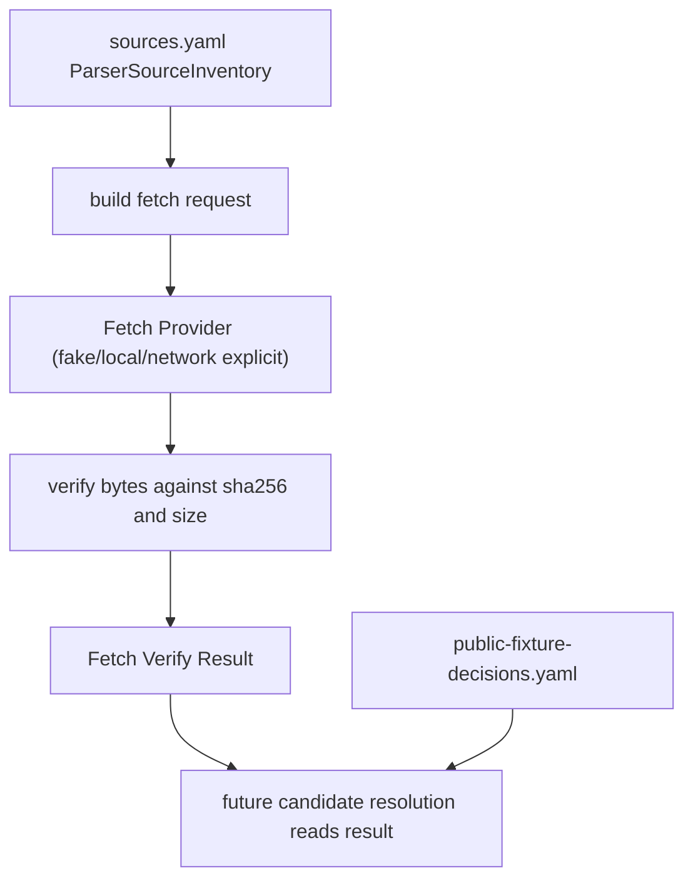

# parser-public-candidate-fetch-verify design

## 0. 术语约定

- **Candidate Fetch Verify**：面向开发者/agent 的 dev-only 复核入口，根据 `sources.yaml` 中的 `source_id + file_id` 拉取或读取候选文件，并核对 byte size 与 sha256。
- **Fetch Verify Request**：一次复核请求，至少包含 `source_id`、`file_id`，可选输出目录和网络开关。
- **Fetch Verify Result**：一次复核结果，包含 source/file、upstream URL/path、expected/actual sha256、byte size、ok、fetched_at 和 error。
- **Fetch Provider**：执行实际读取的可替换 provider；普通单元测试使用本地 fake/provider，不访问网络。
- **Explicit Artifact**：用户或 dev 命令显式指定的输出位置；fetch verify 默认只写临时目录，不自动写入 `tests/fixtures/parsers/files/`。
- **Decision Gate**：上一 feature 落地的 `public-fixture-decisions.yaml`，promotion 仍必须先查它，本 feature 不改变 decision。

术语 grep 结论：当前已有 `Parser Source Inventory`、`Public Fixture Decision Ledger`、`Fixture Manifest` 和 `Parser Support Matrix`；本 feature 新增 dev-only fetch verify，不进入 parser runtime API，不替代 decision ledger。

## 1. 决策与约束

### 需求摘要

`sources.yaml` 已记录 MAPLE、cclib-data 和 ASE extxyz source file 的 upstream path、size 与 sha256，`public-fixture-decisions.yaml` 已记录 promotion 决策。但开发者/agent 还缺一个可复核入口：给定 `source_id + file_id` 后，能确认当前上游文件是否仍匹配 inventory 中的 hash/size，并把 mismatch 明确报告出来。

本 feature 的目标是建立 dev-only fetch/hash verify 契约和辅助入口，让后续 MAPLE/cclib candidate resolution 可以先复核 source inventory。它不下载并提交 fixture，不自动更新 hash，不绕过 decision ledger，也不让普通 tests 访问网络。

### 明确不做

- 不 vendor MAPLE、cclib-data、ASE examples 或任何新的第三方 public output 文件。
- 不把 fetched 文件写入 `tests/fixtures/parsers/files/`。
- 不修改 `manifest.yaml`、golden snapshots、support matrix `fixture_ids` 或 parser support 状态。
- 不改变 `public-fixture-decisions.yaml` 中任何 decision/promotion。
- 不把 sha256 mismatch 自动修成新 hash；mismatch 只作为复核结果暴露。
- 不在普通 unit tests、fixture harness 默认加载路径或 CI focused tests 中访问网络。
- 不运行 Gaussian、ORCA、MAPLE、ASE 或任何外部计算任务。
- 不修改 parser runtime、ImportRegistryWorkflow、Platform Shell、Web UI 或报告导出。
- 不把 fetch 成功描述为文件已可再分发或已可 promotion。

### 复杂度档位

测试侧/dev tooling feature，默认低复杂度。偏离点：

- 涉及可选网络 I/O，因此必须把 provider 和普通单元测试隔离。
- source inventory 中不同 source 可能有 commit/branch/version/local_reference_path 组合，helper 需要只生成清晰 request/result，不把所有 Git hosting 规则写死成 runtime dependency。
- 后续可能要支持 GitHub raw、sparse checkout、本地 reference path 和用户授权文件，本 feature 只定义最小可扩展 contract。

### 关键决策

1. **dev-only helper，而不是 runtime parser 功能**：fetch verify 只服务 source inventory 复核，不属于 `rxnflow.parsers` runtime API。
2. **provider 可替换**：单元测试使用 fake provider；真实网络实现只在显式 dev command/script 中启用。
3. **默认不落 corpus**：默认写临时目录；只有用户显式传 artifact 目录才保存 verify payload/文件，并且仍不写入 fixture `files/`。
4. **结果结构化**：mismatch、unknown source/file、missing URL/commit/path、network failure 都输出为 structured result 或 `AssertionError` guard，方便后续 feature 消费。
5. **decision ledger 前置不变**：fetch verify 只证明 upstream bytes 是否匹配 inventory，不证明 license 或 promotion 允许。

## 2. 名词与编排

### 2.1 名词层：值对象 / 接口契约

**现状**

- `ParserSourceInventory` / `ParserSourceInventorySource` / `ParserSourceInventoryFile` 已在 `tests/parser_fixture_harness.py` 落地。
- source file 已有 `path`、`size_bytes`、`sha256`、`fixture_policy` 和 `parser_intent`。
- `Public Fixture Decision Ledger` 已能阻止 review-required candidate 被误 promoted。
- 当前没有 fetch verify request/result dataclass，也没有根据 source inventory 生成可复核 URL/path 的 helper。

**变化**

新增测试侧/dev-only 契约：

```python
@dataclass(frozen=True)
class ParserPublicCandidateFetchRequest:
    source_id: str
    file_id: str
    url: str
    upstream_path: str
    commit_or_version: str | None
    expected_sha256: str
    expected_size_bytes: int

@dataclass(frozen=True)
class ParserPublicCandidateFetchResult:
    source_id: str
    file_id: str
    url: str
    upstream_path: str
    expected_sha256: str
    actual_sha256: str | None
    expected_size_bytes: int
    actual_size_bytes: int | None
    ok: bool
    fetched_at: str
    error: str | None
```

最小 helper shape：

```python
def build_parser_public_candidate_fetch_request(
    source_inventory: ParserSourceInventory,
    source_id: str,
    file_id: str,
) -> ParserPublicCandidateFetchRequest:
    ...

def verify_parser_public_candidate_bytes(
    request: ParserPublicCandidateFetchRequest,
    content: bytes,
    *,
    fetched_at: str,
) -> ParserPublicCandidateFetchResult:
    ...
```

约束：

- `source_id/file_id` 必须存在且 file 属于 source。
- source 必须有 `url`，并至少有 `commit`、`version` 或 `branch` 中一个可追溯定位信息。
- `expected_sha256` 必须是 `sha256:<64 hex>`，沿用 `SHA256_PATTERN`。
- verify result 的 `ok=True` 只表示 byte size 与 sha256 都匹配 inventory。
- `ok=False` 不修改 inventory，不修改 decision，不写 fixture。
- future dev command 可在 helper 外部处理 GitHub raw URL、clone/sparse checkout 或本地 reference path。

### 2.2 编排层：主流程与控制流



**现状**

开发者只能人工查看 `sources.yaml` 的 URL/path/hash，无法在测试侧复用统一 request/result 契约。

**变化**

- 增加从 inventory 构造 fetch request 的 helper。
- 增加对 bytes 做 sha256/size verify 的 helper。
- focused tests 用 fake bytes 覆盖 match、sha mismatch、size mismatch、unknown source/file、missing URL/tracking info。
- developer guide 记录显式 dev-only 用法和 no-network unit test 边界。

**跨层纪律**

- 错误语义：source/file/schema guard 继续使用 `AssertionError`；bytes mismatch 进入 result `ok=False`，不抛错。
- 幂等性：同一 request + bytes 产生同一 actual hash/size；helper 不写文件。
- 网络边界：helper 本身不访问网络；真实 fetch provider 或 script 必须由开发者显式调用。
- 扩展点：future dev command 可以注入 provider 和 artifact writer；future promotion adapter 可以读取 result 但仍必须查 decision ledger。
- 可观测点：focused unit tests、YAML validation、docs command notes、scope guard 证明没有新增 fixture files。

### 2.3 挂载点清单

- `tests/parser_fixture_harness.py`：新增 fetch request/result dataclass 和 verify helper。
- `tests/test_parser_fixture_harness.py`：新增 focused unit tests，覆盖 request build 与 hash/size verify。
- `docs/dev/parser-fixture-corpus.md`：新增 candidate fetch verify 维护说明和 no-network 边界。
- CodeStable 回写：roadmap item in-progress、后续 acceptance 归并 architecture/roadmap。

不挂入 parser runtime、ImportRegistryWorkflow、Platform Shell、Web UI、manifest、support matrix、fixture files 或 snapshots。

### 2.4 推进策略

1. **Fetch request contract**：定义 request/result dataclass 和从 source inventory 构造 request 的 helper。
   - 退出信号：unknown source/file、missing URL/tracking info、malformed hash 有 focused tests。
2. **Hash/size verify**：实现 bytes 校验 helper，输出 structured result。
   - 退出信号：match、sha mismatch、size mismatch 都能产生可观察 result，且不写文件。
3. **Docs and no-network guard**：更新 developer guide 并补 scope tests。
   - 退出信号：docs 明确 dev-only/no-network/no auto vendor；focused tests 和 `git diff --check` 通过。

## 3. 验收契约

### 关键场景清单

1. 能从 `sources.yaml` 中已知 `source_id + file_id` 构造 `ParserPublicCandidateFetchRequest`。
2. request 包含 source url、file upstream path、commit/version/branch tracking info、expected sha256 和 expected size。
3. unknown source id 被拒绝。
4. unknown file id 被拒绝。
5. file id 属于其他 source 时被拒绝。
6. 缺少 source URL 或缺少 commit/version/branch tracking info 时被拒绝。
7. malformed inventory sha256 被拒绝或不能进入 request。
8. matching bytes 产生 `ok=True`，actual sha256 和 size 与 expected 对齐。
9. sha mismatch 产生 `ok=False`，保留 expected/actual sha256，不修改 inventory。
10. size mismatch 产生 `ok=False`，保留 expected/actual size，不修改 inventory。
11. helper 不访问网络、不写文件、不写 fixture corpus。
12. Docs 明确 fetch verify 是 dev-only，普通 unit tests 不访问网络，输出只能写临时目录或显式 artifact，不自动 vendor。
13. Scope guard 证明未新增 MAPLE/cclib-data third-party files，未改 manifest/support matrix/snapshots。

### 明确不做的反向核对项

- 不 vendor MAPLE、cclib-data、ASE examples 或任何新的第三方 public output 文件。
- 不把 fetched 文件写入 `tests/fixtures/parsers/files/`。
- 不修改 manifest、snapshot、support matrix fixture ids 或 parser support 状态。
- 不改变 decision ledger 中任何 decision/promotion。
- 不让普通 tests 访问网络。
- 不运行外部计算任务。
- 不修改 parser runtime、ImportRegistryWorkflow、Platform Shell、Web UI 或报告导出。
- 不把 fetch 成功描述为可再分发或可 promotion。

## 4. 与项目级架构文档的关系

Acceptance 阶段需要更新：

- `.codestable/architecture/ARCHITECTURE.md`：在 Parser Fixture Corpus / Parser Fixture Harness 当前边界中补 Candidate Fetch Verify 的 dev-only hash/size 复核能力。
- `.codestable/architecture/core-platform.md`：在 Parser Fixture Harness 当前能力和待补项中补 fetch request/result helper，强调 helper 不访问网络、不写文件。
- `docs/dev/parser-fixture-corpus.md`：补 candidate fetch verify 维护入口、no-network unit test 边界和 mismatch 处理口径。
- `.codestable/roadmap/rxnflow-parser-public-fixture-intake/*`：验收时把 `parser-public-candidate-fetch-verify` 标为 done，并同步主文档。
