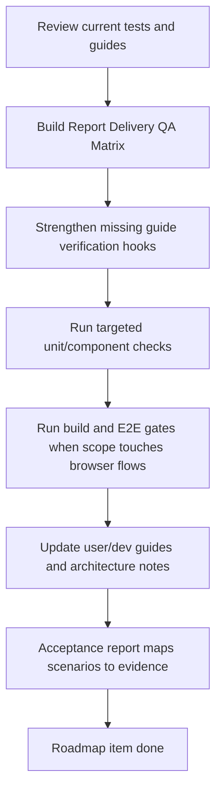

# report-preview-delivery-qa-guides design

## 0. 术语约定

- **Report Delivery QA Matrix**：把报告导出/预览路线的 unit、component、E2E、build、browser-local 和文档验证映射到具体风险项的矩阵。
- **Guide Verification Hook**：文档中列出的命令、格式、MIME、路径、状态名、错误 code 和 UI 入口必须能在测试、源码或现有指南中找到。
- **Artifact Delivery Surface**：用户当前能下载和持久化的 `png/cdxml/xlsx/csv/svg` artifacts，包括 runtime inline bytes、download MIME、browser-local `exports/...` object 和 `export-artifacts-v1` record。
- **Report Preview Surface**：Web Report Export Panel 的 Preview mode，只扫描 graph/profile/table/snapshot/artifact readiness 和 warnings，不生成 bytes、不保存项目、不调用 writer。
- **Delivery Boundary Evidence**：证明 `pdf/pptx/cdx` 当前只作为 unsupported capability 存在、不进入 Web checkbox、不写 browser-local persistence 的测试和文档证据。
- **Bundle Roundtrip Evidence**：证明 browser-local `exports/...` 与 export artifact index 能随 `.rxnflow.zip` 迁移并通过 Open Bridge 恢复的 fixture/local-http E2E 证据。

术语检索结果：`Report Preview Model`、`Report Composer Manifest`、`Delivery Format Boundary`、`Web E2E QA Harness`、`Browser Export Object`、`Browser Export Artifact Record` 已在 architecture/docs/tests 中落地。本 feature 不再创造新的 runtime 名词，只把这些证据收口到 QA/guides 层。

## 1. 决策与约束

### 需求摘要

`rxnflow-report-preview-delivery` roadmap 已完成格式能力表、CSV energy table、SVG graph snapshot、Web Report Preview Panel、Report Composer Manifest 和 PDF/PPTX/CDX Delivery Format Boundary。最后一步需要把交付路线变成可维护状态：开发者能知道哪些命令覆盖哪些报告导出风险，用户能知道当前能导出什么、保存在哪里、哪些格式暂不支持，后续贡献者不能绕过 manifest/artifact contract 或把 unsupported 格式偷偷塞进 Web/persistence。

### 明确不做

- 不新增 PDF、PPTX、CDX、HTML、DOCX 或完整组合报告 writer。
- 不改变 `png/cdxml/xlsx/csv/svg` writer bytes、format union、metadata schema、persistence path 或 Web 默认勾选逻辑。
- 不新增 Web UI 面板、营销页、导出向导、模板设置、云分享、账号、权限或远程存储。
- 不把 Report Preview Model、ReportDocument、ReportAsset、readiness、warnings 或 QA screenshots 写入 Project Content。
- 不把 Web preview DOM、React state、Browser Blob、canvas screenshot 或 Playwright screenshot 当作正式报告输出。
- 不扩展 parser/import/registry/graph/energy 计算逻辑。
- 不把 E2E screenshots、trace、HTML report 或 bad fixture samples 放进 `.rxnflow.zip`、Browser Project Repository 或报告 artifact index。

### 复杂度档位

QA/guides 收口 = L2/L3。它不新增 runtime 行为，但覆盖面横跨 Python core tests、Web helper tests、Playwright fixture/local-http E2E、developer docs、user docs 和 architecture/roadmap 回写。重点是减少口径漂移，而不是扩大测试矩阵到所有端和所有真实 parser 文件。

### 关键决策

1. **以 QA 矩阵为主，不再扩展导出能力**：本 feature 的成功标准是“证据可追溯”，不是“新增格式或新 UI”。
2. **unit/component tests 固定契约，E2E 固定用户路径**：CSV/SVG/manifest/boundary 主要由 Python/Web 单测证明；browser-local persistence、download、bundle roundtrip、窄屏 preview 由 Playwright 证明。
3. **默认 fixture E2E 与 local-http E2E 分工不变**：fixture E2E 覆盖 UI 编排和窄屏布局，local-http E2E 覆盖真实 Python bridge/export projection/bundle roundtrip；不把复杂图谱手势矩阵复制到 local-http。
4. **文档只写当前已实现行为**：PDF/PPTX/CDX 继续写成暂不支持；完整报告文件仍未开放下载；CSV/SVG 是 supported artifacts，不写成未来能力。
5. **Guide Verification Hooks 需要 grep 证据**：文档里的格式列表、路径、命令、错误 code 和状态名必须能在源码、测试或已有指南中找到。
6. **未来 writer 的边界继续以 `ReportDocument` / `ReportAsset` 为入口**：QA/guides 需要显式提醒后续 PDF/PPTX/HTML writer 不得直接消费 Web DOM/state。

### 前置依赖

roadmap 中 `web-report-preview-panel`、`report-composer-manifest` 和 `delivery-format-boundary-spike` 均已 done。当前已有：

- `tests/test_report_export_baseline.py` 覆盖 core export format capability、CSV/SVG artifact metadata 和 unsupported format validation。
- `tests/test_report_manifest.py` 覆盖 `ReportDocument` / `ReportAsset` JSON-safe manifest、warning、id/order 和 no-bytes contract。
- `web/src/app/reportPreviewModel.test.ts` 覆盖 preview readiness、artifact reuse、missing inline bytes 和 warnings。
- `web/src/app/exportFormatCapabilities.test.ts` 覆盖 Web supported/default formats、MIME、extension、writer id 和 unsupported delivery boundary。
- `web/src/app/exportArtifactPersistence.test.ts` 覆盖 browser-local `exports/...` persistence、CSV/SVG metadata、unsupported persistence skip 和 safe basename。
- `web/e2e/workbench-journey.spec.ts` / `web/e2e/local-http-bridge.spec.ts` 覆盖 fixture/local-http report export、browser project persistence、bundle roundtrip 和 narrow layout。
- `docs/dev/report-export-artifacts.md`、`docs/user/report-export-artifacts.md`、`docs/dev/graph-editor-e2e-qa.md` 已有报告导出、preview 和 E2E 说明，但缺少一份收口型 QA matrix。

## 2. 名词与编排

### 2.1 名词层：值对象 / 接口契约

**现状**

- Report export artifacts 当前支持 `png/cdxml/xlsx/csv/svg`，`pdf/pptx/cdx` 只在 capability table 中作为 unsupported boundary。
- Web Report Preview Model 是 UI-only projection，不持久化、不生成 bytes、不替代 core Report Composer Manifest。
- Report Composer Manifest 是 core-only JSON-safe manifest，`ReportAsset` 不保存 bytes。
- Browser export persistence 只写带 inline bytes 且支持 persistence 的 artifact 到 `exports/{basename}.{extension}`，并 upsert `export-artifacts-v1`。
- 现有指南分散说明导出 API、用户操作、E2E 命令和 unsupported format FAQ，但没有统一矩阵说明“哪个检查覆盖哪个行为”。

**变化**

新增 QA/guides 层契约，不新增生产 API：

```text
ReportDeliveryQaItem:
  surface: core_export | web_preview | web_persistence | report_manifest | e2e_fixture | e2e_local_http | docs
  risk: csv_schema | svg_snapshot | download_mime | browser_persistence | bundle_roundtrip | narrow_layout | unsupported_boundary | manifest_json_safe
  evidence: command_or_doc_path
  expected_signal: observable result
```

收口矩阵按以下风险分组：

| risk | 当前证据入口 | 期望信号 |
|---|---|---|
| CSV energy table | Python export tests、Web persistence tests、dev/user docs | 第一列是 structure name，schema 是 `energy-table-v1`，MIME 为 `text/csv`，缺失字段留空。 |
| SVG graph snapshot | Python export tests、Web persistence tests、docs | `artifact_kind=graph_snapshot`，MIME 为 `image/svg+xml`，使用 graph/workspace projection，不是 DOM/canvas screenshot。 |
| Report Preview | Web model tests、fixture E2E、user docs | graph/profile/table/snapshot readiness、artifact reuse 和 warnings 可扫描；preview 不生成 bytes、不保存。 |
| Report Composer Manifest | Python manifest tests、dev docs | `ReportDocument` JSON-safe，`ReportAsset` 不含 bytes，缺失资产用 warnings/unavailable 表达。 |
| Browser persistence | Web persistence tests、fixture/local-http E2E、user docs | inline artifacts 写入 `exports/...`，checksum 与 `export-artifacts-v1` 可见；unsupported formats 不写入。 |
| Download MIME | Web helper/tests/E2E/docs | artifact metadata / data URL 使用 capability table 的 MIME/extension，不在组件里散落 hard-code。 |
| Bundle roundtrip | fixture/local-http E2E、project bundle docs | `exports/...` 与 project content index 可随 `.rxnflow.zip` 导入/打开恢复。 |
| Narrow layout | fixture E2E/screenshots/docs | Report Export/Preview 在 `390x840` 不产生水平溢出，关键控件可达。 |
| Unsupported boundary | core/Web capability tests、docs | `pdf/pptx/cdx` 不进入 supported/default/persistence，未开放请求返回 `invalid_input target=formats`。 |

边界：

- `ReportDeliveryQaItem` 只是 design 口径；实现可用 Markdown 表格、测试名称和命令说明表达，不要求新增 TypeScript/Python type。
- QA matrix 只记录当前 supported artifacts 和 unsupported boundaries，不声明真实 Gaussian/ORCA/MAPLE 解析质量。
- E2E 产物仍只进入 gitignored Playwright output，不进入 Project Content 或报告文件。

### 2.2 编排层：主流程与控制流



**现状**

- QA evidence 已经存在，但分散在 core tests、Web tests、fixture/local-http E2E、developer docs、user docs 和 feature acceptance 中。
- `docs/dev/graph-editor-e2e-qa.md` 以 Graph Editor 为主，已顺带列出 report export 和 local-http export/persistence/bundle 覆盖。
- `docs/dev/report-export-artifacts.md` 以导出 API/contract 为主，缺少一节按风险列命令的 QA matrix。
- `docs/user/report-export-artifacts.md` 已说明当前导出格式、Preview 状态、browser-local 保存位置、CDXML/CDX、PDF/PPTX/CDX FAQ。

**变化**

- 开发者指南新增或扩展 Report Preview Delivery QA Matrix，列出 Python/Web/E2E/build 命令和它们覆盖的风险。
- 用户指南保持任务导向，必要时补充“导出后如何确认已保存 / 如何备份迁移 / 不支持格式为什么不出现”的入口链接，不把开发者矩阵塞给用户。
- Web E2E QA 指南补充 report preview delivery coverage，避免开发者只把它理解成 graph editor 手势测试。
- 若发现现有单测已经覆盖风险，只在 checklist/acceptance 中引用，不为覆盖率数字重复造低价值测试。
- 若发现 guide 中承诺的命令或状态没有 grep 证据，实现阶段补测试或修正文档，不让指南漂移。

**跨层纪律**

- 错误语义：unsupported format 仍是 `invalid_input target=formats`；dependency failure 只留给未来 supported writer 缺依赖。
- 幂等性：browser-local persistence 和 bundle roundtrip 的 QA 只证明当前 repository bytes 与 index 可恢复，不承诺云同步或自动保存。
- 可观测点：每个验收场景必须能指向文件路径、命令或 E2E 测试名；不接受“看起来应该覆盖”的间接说法。
- i18n：如果实现阶段修改 Web UI 文案，必须同步 `zh-CN` / `en-US` catalogs；纯文档更新不需要双语。
- 范围守护：grep 应确认未新增 `pdf/pptx/cdx` supported union、Web checkbox、persistence allowlist、writer dependency 或 screenshot writer。

### 2.3 挂载点清单

- `docs/dev/report-export-artifacts.md`：补 Report Preview Delivery QA Matrix、命令入口和风险映射。
- `docs/dev/graph-editor-e2e-qa.md`：补 report delivery 在 fixture/local-http E2E 中的覆盖边界。
- `docs/user/report-export-artifacts.md`：如需要，补用户可见的保存/备份/暂不支持格式入口说明。
- `web/src/app/*test.ts` 与 `tests/test_*.py`：只在现有证据不足时补 guard tests，不为矩阵本身新增 runtime API。
- `web/e2e/workbench-journey.spec.ts` / `web/e2e/local-http-bridge.spec.ts`：只在现有 E2E 没覆盖 bundle/persistence/narrow/download 行为时增强断言。
- CodeStable acceptance 回写：architecture / requirement / roadmap 当前状态归档。

不挂入 parser/import/registry/graph/energy engine，不新增 Web panel、Shell command、Project Content schema、delivery writer、cloud storage、account/auth 或 desktop shell。

### 2.4 推进策略

1. **Evidence audit**：核对 core/Web/E2E/docs 当前覆盖，列出哪些风险已被证明、哪些证据不足。
   - 退出信号：design/checklist 中的 QA risks 都能指向现有或待补证据。
2. **QA matrix docs**：在开发者指南中新增收口矩阵，并把 `npm run test:e2e` / `npm run test:e2e:local-http` 的报告导出职责写清楚。
   - 退出信号：开发者能从一个入口知道该跑哪些命令验证 CSV/SVG/preview/manifest/persistence/bundle/unsupported boundary。
3. **User guide alignment**：更新用户指南中保存位置、Preview 状态、`.rxnflow.zip` 备份和暂不支持格式说明，避免与开发者文档口径不一致。
   - 退出信号：用户能判断当前可导格式、browser-local 保存边界、备份方式和 PDF/PPTX/CDX 不支持原因。
4. **Guard coverage**：补或确认 Python/Web tests，固定 unsupported boundary、persistence skip、preview readiness、manifest no-bytes 和 CSV/SVG metadata。
   - 退出信号：targeted unit/component checks 通过，且没有新增方案外 writer/UI/schema。
5. **Browser flow verification**：运行 build/E2E，验证 fixture/local-http report export、bundle roundtrip、download/persistence 和窄屏布局。
   - 退出信号：相关 E2E 通过或有明确环境失败记录；无水平溢出和 console clean 由现有 helper 覆盖。
6. **Acceptance sync**：回写 architecture、roadmap、checklist 和 acceptance。
   - 退出信号：roadmap item done、YAML 校验通过，验收报告逐项映射证据。

## 3. 验收契约

### 关键场景清单

1. 触发：开发者阅读 report export dev guide → 期望看到 QA matrix，能按风险找到 Python unit、Web unit、build、fixture E2E、local-http E2E 和文档检查入口。
2. 触发：运行 Python targeted checks → 期望 CSV/SVG export metadata、supported set、unsupported `pdf/pptx/cdx` validation 和 Report Composer Manifest no-bytes/JSON-safe contract 被覆盖。
3. 触发：运行 Web targeted checks → 期望 Report Preview readiness、export format capability、browser-local persistence、unsupported persistence skip 和 MIME/extension/writer helpers 被覆盖。
4. 触发：运行 fixture E2E → 期望 Report Export/Preview 主链路、desktop/narrow layout、browser-local artifact persistence、bundle backup/restore 和 no horizontal overflow 仍通过。
5. 触发：运行 local-http E2E → 期望真实 Python bridge 下的 import preview、energy compute、PNG/CDXML/XLSX/CSV/SVG export projection、browser-local persistence 和 bundle roundtrip 仍通过。
6. 触发：用户阅读 report export user guide → 期望知道当前可导出 PNG/CDXML/XLSX/CSV/SVG，Preview 不生成文件，保存位置是 browser-local `exports/...`，`.rxnflow.zip` 是当前手动备份/迁移方式。
7. 触发：用户查 ChemDraw / CDX / PDF / PPTX → 期望文档说明 CDXML 是当前 ChemDraw 路径，CDX/PDF/PPTX 暂不可下载且不会出现在 Web 勾选项。
8. 触发：后续 delivery writer feature 设计 → 期望 dev guide 明确它必须从 `ReportDocument` / `ReportAsset` 输入开始，不得使用 Web DOM/state/screenshot。
9. 触发：scope grep → 期望没有新增 `pdf/pptx/cdx` writer、Web checkbox、persistence allowlist、runtime dependency 或 Project Content schema。
10. 触发：YAML/docs validation → 期望 checklist、roadmap items 和 Markdown frontmatter 保持可读可检索。

### 明确不做的反向核对项

- 不新增任何 PDF/PPTX/CDX/HTML/DOCX bytes writer。
- 不新增 PDF/PPTX/CDX Web checkbox、download link 或 browser persistence。
- 不改变当前 `png/cdxml/xlsx/csv/svg` writer 输出、MIME、extension 或 persistence path。
- 不把 Web preview、DOM、canvas、Blob 或 Playwright screenshot 当作正式报告输出。
- 不新增 Project Content schema、Shell command、cloud storage、account/auth 或 autosave。
- 不把 QA artifacts 写入 `.rxnflow.zip`、Browser Project Repository 或 export-artifacts index。
- 不声明真实 parser 软件版本完整支持或新的计算化学解释能力。

## 4. 与项目级架构文档的关系

Acceptance 阶段需要更新：

- `.codestable/architecture/web-workbench.md`：记录 Report Preview Delivery QA & Guides 已收口的 fixture/local-http E2E、窄屏 preview、browser-local persistence 和 bundle roundtrip 覆盖。
- `.codestable/architecture/core-platform.md`：如有必要，补充 Report Export QA matrix 对 core export / manifest / delivery boundary 的当前验证入口。
- `.codestable/architecture/ARCHITECTURE.md`：如有必要，在 Web E2E QA Harness / Export Report 术语中补收口状态，不新增 runtime 概念。
- `docs/dev/report-export-artifacts.md`：新增或扩展 QA matrix。
- `docs/dev/graph-editor-e2e-qa.md`：补报告导出/预览相关 E2E coverage 说明。
- `docs/user/report-export-artifacts.md`：补用户侧保存、备份和 unsupported format 的入口说明。
- roadmap items/main doc：验收时标记 `report-preview-delivery-qa-guides` done，整个 `rxnflow-report-preview-delivery` roadmap 可进入完成/复盘状态。
