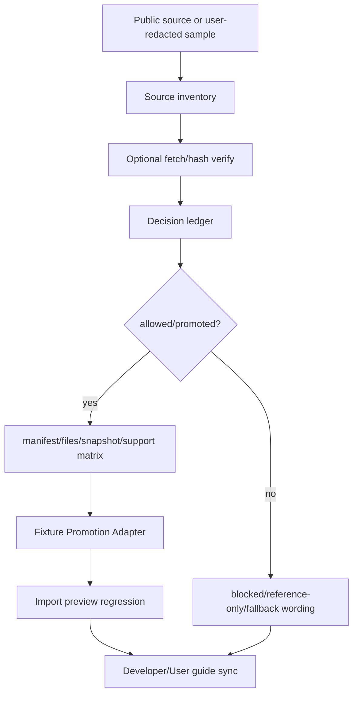

# parser-public-fixture-guides design

## 0. 术语约定

- **Parser Public Fixture Guides**：`docs/dev/parser-fixture-corpus.md` 与 `docs/user/parser-output-support.md` 中关于 public fixture intake 的维护和用户口径。
- **Intake Gate**：source inventory、Candidate Fetch Verify、public fixture decision ledger、Fixture Promotion Adapter、manifest/snapshot/support matrix 和 import preview regression 组成的准入链路。
- **Promotion/Rejection Messaging**：文档对 `allowed/promoted`、`needs-permission/blocked`、`reference-only/not-applicable` 等状态的解释。
- **Contribution Checklist**：用户或开发者贡献真实输出样例前需要确认的授权、脱敏、体积、软件信息和期望字段清单。
- **Support Boundary Wording**：用户指南中避免“完整支持真实版本”的措辞，只声明 fixture-backed preview 行为。

## 1. 决策与约束

### 需求摘要

`rxnflow-parser-public-fixture-intake` roadmap 的前置 feature 已经完成 source inventory、decision ledger、fetch verify、MAPLE/cclib resolution、extxyz variant intake、Fixture Promotion Adapter 和 promoted import preview regression。最后缺口是把这套 public fixture intake gate 同步到开发者和用户指南，让 agent/开发者知道怎样推进真实样例，也让用户知道 candidate/reference-only 和 partial support 的边界。

本 feature 更新指南和架构文档，不新增 runtime 能力。开发者指南要串起从 source inventory 到 import preview regression 的维护流程；用户指南要说明当前 public originals 未 vendor 的边界、贡献真实样例时的要求，以及 candidate/reference-only 不能被当作已支持导入。

### 明确不做

- 不新增 fixture files、source inventory entries、decision ledger entries、snapshots 或 support matrix entries。
- 不 vendor MAPLE/cclib-data/ASE public originals，也不新增 user-redacted 输出。
- 不修改 parser runtime、Import Workflow、Platform Shell、Web UI、report export 或 tests。
- 不宣称 Gaussian、ORCA、MAPLE、ASE extxyz 真实版本完整支持。
- 不把 Candidate Fetch Verify 成功描述成 license/promotion 已通过。
- 不让普通 tests 或文档验证访问网络。

### 复杂度档位

docs-only feature，默认低复杂度。主要风险不是代码行为，而是支持口径漂移：用户指南必须继续避免“完整支持真实版本”的措辞，开发者指南必须把 fetch/hash verify、license decision 和 promotion coverage 分开。

### 关键决策

1. **开发者指南写维护流程，用户指南写支持边界**：两者引用同一 public fixture intake gate，但面向不同读者，不互相复制长段实现细节。
2. **状态口径从 decision ledger 出发**：`candidate` / `reference-only` / `blocked` 只代表登记或参考，不代表 supported；只有 `allowed/promoted` 且有 manifest/snapshot/support matrix/import preview regression coverage 才能进入 executable corpus。
3. **贡献 checklist 必须显式包含授权和脱敏**：真实输出样例默认先走 review-required，除非用户或许可证证据足以允许再分发。
4. **架构只归并现状**：只更新 architecture 对指南当前内容的描述，不写未来支持承诺。
5. **无 runtime 变化**：所有改动限定在 docs、architecture、CodeStable feature/roadmap 文档。

## 2. 名词与编排

### 2.1 名词层：指南契约

**现状**

- `docs/dev/parser-fixture-corpus.md` 已说明 source inventory、Candidate Fetch Verify、MAPLE/cclib resolution、Public Fixture Decision Ledger、Fixture Promotion Adapter、source/redaction、snapshot、support matrix 和 import preview regression，但还没有把 promoted public fixture import preview regression 放进 public fixture intake 的端到端 checklist。
- `docs/user/parser-output-support.md` 仍是 2026-05-22 口径，已说明 supported/partial/candidate/reference-only/unsupported 和贡献真实输出样例，但未同步 decision ledger、promotion/rejection、project-authored extxyz promoted fixtures 和 import preview regression 的最新边界。
- Architecture 已记录 developer/user guide 的存在，但需要同步“public fixture intake gate + contribution flow + no full-version certification”这一稳定口径。

**变化**

开发者指南新增或改写 public fixture intake 维护流程：

```text
source inventory -> optional fetch/hash verify -> decision ledger
-> allowed/promoted? -> manifest/files/snapshot/support matrix
-> Fixture Promotion Adapter -> import preview regression -> guide sync
```

用户指南新增或改写支持边界：

```text
candidate/reference-only/blocked = not executable support
allowed/promoted + fixture-backed coverage = preview behavior covered
project-authored extxyz variants = promoted fixtures, not third-party original certification
```

### 2.2 编排层：主流程与控制流



**现状**

public fixture intake 的各段已经分别落地，但指南读者需要跨多个小节拼接流程；用户指南也没有完整解释为什么 MAPLE/cclib-data public originals 仍是 candidate/reference-only，而 extxyz project-authored variants 可以作为 promoted coverage。

**变化**

- 开发者指南把 intake gate 写成可执行维护流程，明确每一步的输入、输出和禁止事项。
- 用户指南把 current format boundary 和 contribution checklist 同步到 public fixture decision/promotion 口径。
- Architecture docs 只更新 guide 当前职责和 parser output support guide 当前说明范围。

**跨层纪律**

- 错误语义：许可证、脱敏或 promotion 不满足时，文档必须表达为 blocked/candidate/reference-only，不写成 supported。
- 幂等性：docs 更新不修改 fixture corpus，不生成 snapshot，不改变 support matrix。
- 扩展点：后续真实样例进入 corpus 时，仍按 intake gate 新增 feature；本指南只是流程入口。
- 可观测点：docs grep、YAML validation、scope diff、full unittest。

### 2.3 挂载点清单

- `docs/dev/parser-fixture-corpus.md`：更新 public fixture intake gate、promoted import preview regression 和开发者维护 checklist。
- `docs/user/parser-output-support.md`：更新用户向支持边界、current format boundary 和贡献真实样例 checklist。
- `.codestable/architecture/ARCHITECTURE.md` 与 `.codestable/architecture/core-platform.md`：归并指南当前口径。
- CodeStable checklist/acceptance 与 roadmap item 状态回写。

不挂入 parser runtime、Import Workflow、Platform Shell、Web UI、report export、tests 或 `tests/fixtures/parsers/` 数据文件。

### 2.4 推进策略

1. **Developer guide intake flow**：更新开发者指南，把 source inventory、fetch verify、decision ledger、promotion adapter、import preview regression 和 guide sync 串成维护流程。
   - 退出信号：指南明确 fetch verify 不等于 license/promotion，通过 `allowed/promoted` 后仍需 manifest/snapshot/support matrix/import preview coverage。
2. **User guide support boundary**：更新用户指南，说明 candidate/reference-only/blocked 不是 supported，当前 MAPLE/cclib-data public originals 未 vendor，extxyz project-authored promoted fixtures 不等于第三方版本认证。
   - 退出信号：用户指南的格式表和贡献 checklist 与 public fixture intake gate 一致，并避免完整版本支持措辞。
3. **Architecture and roadmap sync**：更新 architecture 对指南的当前职责描述，design 阶段 roadmap item 标记为 in-progress。
   - 退出信号：architecture 只记录已落地指南口径，不引入未来承诺；items.yaml 通过 YAML 校验。
4. **Validation**：运行 YAML validation、docs grep/scope diff、`git diff --check` 和全量 unittest。
   - 退出信号：无 runtime/web/tests/fixture corpus diff，普通测试不访问网络，文档没有把 blocked/reference-only/candidate 写成 supported。

## 3. 验收契约

### 关键场景清单

1. Developer guide 说明完整 public fixture intake gate：source inventory、fetch verify、decision ledger、promotion adapter、manifest/snapshot/support matrix 和 import preview regression。
2. Developer guide 明确 Candidate Fetch Verify 只校验 bytes/hash/size，不代表 license/promotion 通过。
3. Developer guide 明确 `allowed/promoted` 后仍需要 executable fixture、snapshot、support matrix 和 import preview regression coverage。
4. User guide 明确 `candidate`、`reference-only`、`blocked` 不代表 supported import preview。
5. User guide 的当前格式边界说明 MAPLE/cclib-data public originals 未 vendor，extxyz 当前 promoted coverage 是 project-authored variants。
6. User guide 贡献 checklist 包含授权、脱敏、体积、软件信息、期望字段和边界判断。
7. 两份指南都避免“完整支持真实版本”或等价承诺。
8. Architecture docs 归并指南当前职责和 public fixture intake gate 口径。
9. Roadmap item 在 design 阶段标为 `in-progress`，acceptance 阶段可标为 `done`。
10. Scope guard 证明未修改 parser runtime、Import Workflow、Platform Shell、Web UI、report export、tests 或 fixture corpus 数据。

### 明确不做的反向核对项

- 不新增 fixture files、source inventory entries、decision ledger entries、snapshots 或 support matrix entries。
- 不 vendor public originals 或 user-redacted outputs。
- 不修改 runtime parser/import/shell/web/export implementation 或 tests。
- 不把 Candidate Fetch Verify 成功写成 license/promotion 已通过。
- 不让普通 tests 或文档验证访问网络。

## 4. 与项目级架构文档的关系

Acceptance 阶段需要更新：

- `.codestable/architecture/ARCHITECTURE.md`：在 Parser Corpus Developer Guide / Parser Output Support Guide 当前边界中补 public fixture intake gate、promotion/rejection 和 contribution flow。
- `.codestable/architecture/core-platform.md`：同步 `docs/dev/parser-fixture-corpus.md` 与 `docs/user/parser-output-support.md` 的当前职责描述。
- `.codestable/roadmap/rxnflow-parser-public-fixture-intake/*`：验收时把 `parser-public-fixture-guides` 标为 done，并同步主文档。
