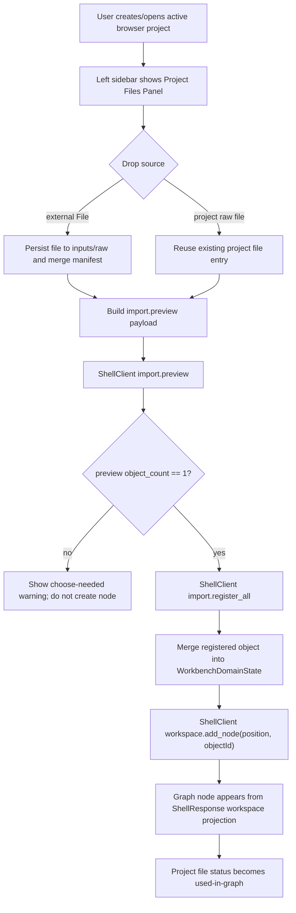

# workspace-file-drop-minimal-loop design

## 0. 术语约定

| 术语 | 定义 | 防冲突结论 |
|---|---|---|
| Workspace Source | 用户快速找到外部计算输出文件的入口，可来自浏览器 file picker / directory picker / project file list | 不等同于 RxnFlow project authority |
| Project File | 当前 browser-local RxnFlow project 已经拥有的文件，路径在 `inputs/raw/...` 或 `exports/...` | 不等同于外部本地文件夹里的 loose file |
| Project Files Panel | 左侧展示当前项目内文件的 UI 面板 | 不替代 Project Sidebar 的 project list/create/open/save |
| Raw File Drop | 把外部文件或项目内 raw file 拖到 Graph Canvas 的操作 | 不等同于 Object Registry registered-object drag |
| Drop Import Pipeline | raw file drop 后的顺序编排：persist raw -> import.preview -> import.register_all -> workspace.add_node | 不在前端解析或伪造 ChemicalObject |

术语 grep 结果：现有代码已有 `BrowserProjectRepository`、`BrowserRawResource`、`ImportInbox`、`graphObjectDragPayload` 和 `workspace.add_node`；没有 `ProjectFileEntry` / `ProjectFilesPanel` / `RawFileDropPayload`。本 feature 新增这些 Web 侧术语，避免和已有 Object Registry 对象拖拽混淆。

## 1. 决策与约束

### 需求摘要

用户希望初版主流程变成：打开或创建 project 后，左侧能看到本项目已有文件；本地文件夹 / 文件选择只是快速找到外部 log/out/xyz/extxyz 的入口；用户把文件拖到画布后，文件要进入项目 `inputs/raw/...`，再解析、登记为对象，并在落点创建画布节点。第一条 roadmap item 的成功标准是单对象文件能端到端跑通：picker -> project file -> parse/register -> canvas node with structure name and energy.

本 feature 覆盖最小闭环，不追求多对象候选选择器和结构预览增强；多对象 / 多帧文件先走保守错误或提示，后续 `canvas-chemical-node-card` 处理。

### 明确不做

- 不实现多对象 / 多帧候选选择器；`object_count !== 1` 时不自动创建多个节点。
- 不实现 molecule preview、3D/2D 结构渲染或节点详情卡增强。
- 不实现 ChemDraw/CDXML 导出。
- 不实现自动 energy.compute 或 PES Preview。
- 不实现完整 directory watcher、后台扫描整个文件夹、大文件 chunking、OPFS payload store、云同步或账号系统。
- 不让 Web 前端 import Python parser/core，也不在前端解析 Gaussian/ORCA/MAPLE/XYZ/extxyz。
- 不把 external browser directory handle 当作项目权威；项目文件仍由 Browser Project Repository 承担。

### 复杂度档位

- Frontend orchestration = L3：需要把 Project Sidebar、raw persistence、import preview/register 和 Graph Canvas drop 串成一条新流程。
- Persistence semantics = L3：raw file 必须进入 `inputs/raw/...` 并 merge manifest resource，Project Files Panel 只展示项目内对象。
- Shell integration = L2：复用既有 `import.preview` / `import.register_all` / `workspace.add_node`，不新增 Python shell command。
- UX = L3：左侧从“项目列表”扩展到“项目文件”，同时保留当前保存/导出项目语义。

### 关键决策

1. **项目文件是权威，本地文件夹只是 picker**：只有写入 Browser Project Repository 的文件才进入 Project Files Panel；外部 folder/file picker 仅作为 drop source。
2. **第一条 feature 只处理单对象 auto path**：ParsePreview `object_count === 1` 时自动 register + add node；多对象/多帧不自动建节点，显示后续 feature 提示，避免把中间帧全扔到画布。
3. **复用 raw input persistence helper**：继续使用 `inputs/raw/{sha12}-{safeName}`、`raw-{sha12}` 和 manifest resource merge，不新增 project schema。
4. **复用 existing shell commands**：drop pipeline 由 Web 编排多个已有 command；可见 objects/imports/workspace 只来自 ShellResponse。
5. **Project Files Panel 是 Project Sidebar 的子区，不替代 project 操作区**：项目 list/create/open/save/bundle 仍保留；Project Files 只显示 active project 的 files。
6. **旧面板流程是实现库存，不是 UX 约束**：Import Inbox、Object Registry 和 Graph Canvas 的已有能力可以复用，但不要求保留“先导入面板、再对象面板、再画布按钮”的旧主流程。
7. **不做旧 UI 兼容承诺**：产品未上线，旧三栏入口、旧按钮流程和旧测试路径可以删除、隐藏或重写；只保留对新 workspace-first 流程有价值的底层能力和必要项目保存/导出入口。

### 前置依赖

roadmap `rxnflow-workspace-first-canvas-mvp` 已落盘，目标 item `workspace-file-drop-minimal-loop` 前置依赖为空。现有 Web 已具备 Browser Project Repository、raw input persistence、Import Inbox preview/register、Object Registry drag-to-canvas 和 Graph Canvas `workspace.add_node`。

## 2. 名词与编排

### 2.1 名词层：值对象 / 实体 / 接口契约

**现状**

- `web/src/repository/types.ts` 的 `BrowserProjectRepository` 能按 project-relative path 读写/list bytes object。
- `web/src/app/rawInputPersistence.ts` 已提供 `persistRawInputFile()` 和 `BrowserRawResource`，写 `inputs/raw/{sha12}-{safeName}` 并 merge `.rxnflow/manifest.json`。
- `web/src/app/ImportInbox.tsx` 只展示 selected files 和 preview batch，不展示 active project 的全量 raw files。
- `web/src/app/graphObjectDragPayload.ts` 只支持 `application/x-rxnflow-graph-object` registered-object payload。
- `web/src/app/GraphCanvas.tsx` 的 drop target 只接受已登记 object payload；文件 drop 被忽略。
- `web/src/app/WorkbenchShell.tsx` 已有 `previewImport()`、`registerImportBatch()` 和 `addObjectNode()`，但它们是分散按钮流程，没有 drop pipeline。

**变化**

新增项目文件投影：

```ts
type ProjectFileKind =
  | "gaussian-log"
  | "orca-output"
  | "maple-output"
  | "xyz"
  | "extxyz"
  | "export-artifact"
  | "unknown"

type ProjectFileEntry = {
  id: string
  projectRef: string
  path: string
  name: string
  kind: ProjectFileKind
  byteSize?: number
  checksum?: string
  status: "stored" | "previewed" | "registered" | "used-in-graph" | "exported" | "error"
  rawResourceId?: string | null
  registeredObjectIds: string[]
  graphNodeIds: string[]
  artifactIds: string[]
  warnings: string[]
}
```

新增 raw file drop payload，与 registered-object payload 分离：

```ts
const graphRawFileDropMimeType = "application/x-rxnflow-raw-file"

type GraphRawFileDropPayload =
  | {
      kind: "external-file"
      sourceId: string
      name: string
      size: number
    }
  | {
      kind: "project-file"
      projectFileId: string
      path: string
    }
```

GraphCanvas 新增 handler contract：

```ts
type AddRawFileNodeRequest = {
  source:
    | { kind: "external-file"; file: File }
    | { kind: "project-file"; projectFileId: string; path: string }
  position: [number, number]
}

onAddRawFileNode(request: AddRawFileNodeRequest): Promise<void>
```

接口示例：

```ts
// 来源：ProjectFilesPanel project file row
serializeGraphRawFileDropPayload({
  kind: "project-file",
  projectFileId: "raw-abc123def456",
  path: "inputs/raw/abc123def456-ts.log",
})

// 来源：GraphCanvas drop target
onAddRawFileNode({
  source: { kind: "external-file", file },
  position: [240, 180],
})
```

### 2.2 编排层：主流程与控制流



**现状**

- Import workflow 是显式面板按钮：select files -> Preview -> Register All。
- Object-to-canvas 是另一条流程：Object Registry drag -> GraphCanvas drop -> `workspace.add_node`。
- Active project 的 raw files 只在 Import Inbox selected-file summary 中短暂显示，不作为左侧长期 project files list。
- Project bundle export 会包含 repository 中的 `inputs/raw/...`，但 UI 没有把这些 files 作为一等 project surface 展示。
- 当前三栏工作台已经有很多可用能力，但产品主线被拆散在 Import Inbox、Object Registry、Graph Canvas 和右侧 inspector 中。

**变化**

- Project Sidebar 增加 Project Files Panel，基于 `repository.listObjects(activeProjectRef, "inputs/raw/")` 和 `listObjects(..., "exports/")` 派生 `ProjectFileEntry[]`。
- 外部 file picker / directory picker 得到的文件可作为 GraphCanvas drop source；drop 后先调用 raw persistence，把 file 写入 project。
- Project Files Panel 中的 raw file row 可拖回 GraphCanvas；这条路径复用 existing project bytes，不重复写入 manifest。
- WorkbenchShell 新增 `addRawFileNode()` 编排函数，负责 drop pipeline，并把每一步状态投影到 Project Files Panel / WorkbenchDomainState。
- 单对象 preview 成功后自动 register all，再按 drop position 调用 `workspace.add_node`。多对象 preview 只显示 warning，不自动创建节点。
- drop pipeline 成功后刷新 Project Files Panel，使该 file 从 `stored/registered` 变为 `used-in-graph`。
- Import Inbox 和 Object Registry 可保留为调试/详情/备用入口，也可以在本 feature 或后续 polish 中隐藏、合并或删除；初版主流程应以 Project Files Panel + Graph Canvas 为主，不再要求用户按旧面板顺序操作。

**跨层纪律**

- 顺序约束：external file 必须先进入 project file，再 preview/register/add node。
- 错误语义：raw persistence、preview、register、add node 任一步失败都停止后续步骤，不创建半成品 graph node。
- 幂等性：同 checksum external file 重复 drop 可复用 raw resource；project file 重复 drop 可创建新的 graph node，但不重复 raw object。
- 权威来源：imports/objects/workspace 可见状态只来自 ShellResponse；project file bytes/status 来自 Browser Project Repository + Web projection。
- 范围守护：Web 不 import parser/core；不将 browser directory handle 保存为长期 authority；不自动创建多个节点。
- 可观测点：Project Files row 显示 stored/previewed/registered/used-in-graph/error；GraphCanvas status 显示 pipeline warning/error。

### 2.3 挂载点清单

- Project Sidebar 左侧 active project 区：新增 Project Files Panel，用于展示和拖拽项目内 raw/export files。
- GraphCanvas surface drop target：新增 raw file drop payload 支持，同时保留 registered-object drop。
- WorkbenchShell drop pipeline：新增 `addRawFileNode()` 编排，将 raw persistence、import preview/register 和 workspace add node 串联。
- Web i18n/CSS/tests：新增 workspace-first 文件面板、drop pipeline、warning/error/status 文案和响应式样式。

本 feature 不新增 Python Shell command、Project Content schema、Browser Project Repository interface、parser plugin、energy engine、report export writer、cloud storage 或 route。

### 2.4 推进策略

1. **Project File Projection**：建立 `ProjectFileEntry` 派生逻辑和 Project Files Panel 静态 UI。
   - 退出信号：active project 下能列出 `inputs/raw/...` 和 `exports/...`，无 active project 时显示空状态。
2. **Raw File Drag Payload**：定义 project raw file / external file drop payload，GraphCanvas 能识别 raw file drop 但先不执行 shell command。
   - 退出信号：component test 可验证 project file row drag payload 和 GraphCanvas drop position。
3. **Drop Import Pipeline**：接入 raw persistence、import.preview、single-object guard、import.register_all、workspace.add_node。
   - 退出信号：单对象 fixture/local-http 小文件 drop 后出现 ShellResponse graph node，失败时不创建节点。
4. **Project File Status Feedback**：把 stored/previewed/registered/used-in-graph/error 状态投影到 Project Files Panel。
   - 退出信号：成功 drop 后对应 project file 显示 used-in-graph；preview/register/add-node error 显示 code/target。
5. **UX / I18n / Responsive**：收紧左侧布局、按钮文案、长文件名、窄屏 Project Files 展示。
   - 退出信号：zh-CN/en-US 文案完整；桌面/窄屏不水平溢出。
6. **Verification And Scope Guard**：跑 unit/component/build/browser smoke，确认没有越界引入 parser/cloud/schema。
   - 退出信号：Web tests/build 通过；local-http smoke 可跑；scope grep 无违规依赖。

## 3. 验收契约

### 关键场景清单

1. 创建或打开 active browser project 后，左侧显示 Project Files Panel。
2. active project 没有 raw/export 文件时，Project Files Panel 显示空状态，不影响项目创建/打开/保存按钮。
3. 通过 file picker 选择单个小型输出文件并拖到画布，文件先写入 `inputs/raw/{sha12}-{safeName}`。
4. 外部文件 drop 成功后，`.rxnflow/manifest.json` 中存在对应 `kind=raw_file` resource。
5. 同 checksum 文件重复 drop 不重复追加 manifest resource。
6. 单对象 preview 成功后自动 register，WorkbenchDomainState.objects 增加对应 object。
7. register 成功后按 drop position 调用 `workspace.add_node`，画布出现来自 ShellResponse 的新 node。
8. Project Files Panel 对应 raw file 状态最终显示 `used-in-graph` 或等价用户可见状态。
9. 项目内 raw file row 可以再次拖到画布，复用已有 project file，不重复写 raw object。
10. `object_count !== 1` 的 preview 不自动创建 graph node，并显示“需要选择候选”的 warning / status。
11. raw persistence 失败时停止 preview/register/add-node，UI 显示 repository error code/target。
12. import.preview 失败时不 register、不 add node，Project Files Panel 显示 preview error。
13. import.register_all 失败时不 add node，UI 显示 register error。
14. workspace.add_node 失败时不伪造 node，UI 显示 workspace error。
15. 已登记对象拖入创建节点的原能力不是本 feature 的兼容性验收要求；如保留成本低可继续保留，若阻碍 workspace-first 流程可隐藏或移除。
16. Project Sidebar 的 Save Bridge、Export Bundle、Import Bundle 入口仍可用。
17. zh-CN / en-US 下新增静态文案完整；文件名、path、checksum、error code 原样显示。
18. 桌面 viewport 下 Project Files Panel、GraphCanvas drop 状态和 node 不重叠。
19. 窄屏 viewport 下左侧 project/file 区不造成页面水平溢出。

### 明确不做的反向核对项

- 不出现 molecule preview、CDXML/CDX、PES preview 或 energy.compute 新逻辑。
- 不新增 Python Shell command、Project Content schema、Browser Project Repository interface 或 parser plugin。
- Web 代码不 import Python parser/core，不解析 Gaussian/ORCA/MAPLE/XYZ/extxyz。
- 不把 multi-object / multi-frame preview 自动创建为多个 graph nodes。
- 不引入 OPFS chunking、Web Worker、cloud storage SDK、账号或 directory watcher。
- 不把 browser directory handle 写入 Project Content 作为长期 authority。

## 4. 与项目级架构文档的关系

Acceptance 阶段需要更新：

- `.codestable/architecture/web-workbench.md`：记录 Project Files Panel、raw file drop pipeline、single-object guard、project file authority 和 existing object drag 并存边界。
- `.codestable/requirements/web-workbench-shell.md`：补用户故事“本地文件只是快速入口，文件拖到画布后进入项目，项目文件可再次拖拽使用”。
- roadmap `rxnflow-workspace-first-canvas-mvp`：acceptance 阶段把 `workspace-file-drop-minimal-loop` 标为 done，并让下一项 `canvas-chemical-node-card` 可启动。
