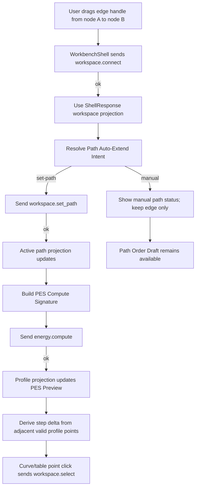

# canvas-path-authoring-pes-preview design

## 0. 术语约定

| 术语 | 定义 | 防冲突结论 |
|---|---|---|
| Workspace-First Path Authoring | 用户在画布上从节点拖线连接节点，并把无歧义连接顺序用于 active path 的主流程 | 不等同于自动反应路径搜索或化学合理性判定 |
| Path Auto-Extend Intent | `workspace.connect` 成功后，Web 根据当前 active path 和新 edge 判断是否可追加/前插 path 的 UI 编排意图 | 不新增 core path 推断算法；只在 head/tail 无歧义时发送 `workspace.set_path` |
| PES Compute Intent | active path 或能量选项变化后，Web 触发一次 `energy.compute` 的命令意图 | 不在前端重算能量；不写 Project Content |
| PES Preview Point | Web 从 `EnergyProfile.points[]`、graph node 和 expression summary 派生的展示点 | 不替代 core `EnergyPoint` dataclass，也不是导出 artifact |
| Step Delta Energy | 当前有效相对能量点与前一个有效相对能量点的差值 | 任一相邻点 missing 时为 `null`，不得当作 0 |

术语 grep 结果：现有 Web 已有 `GraphCanvas` direct edge gesture、`workspace.connect`、`workspace.set_path`、Path Order Draft、`EnergyProfilePanel`、interactive Energy Curve 和 `energy.compute`。本 feature 复用这些能力，新增的是 workspace-first 主流程编排和 PES Preview point/delta 展示口径。

## 1. 决策与约束

### 需求摘要

本 feature 目标是让用户按直觉完成第一版路径绘制和势能面预览：

1. 用户把 log/out/xyz/extxyz 等文件拖到画布得到 chemical node 后，可以从节点 edge handle 拖线到另一个节点。
2. `workspace.connect` 成功后，若连接能无歧义地创建或延长 active path，Web 继续发送 `workspace.set_path`；否则只保留 edge，并提示用户用已有 Path Order Draft 手动整理路径。
3. active path 发生变化后，右侧 PES Preview 自动触发 `energy.compute`，并展示与当前 path 对齐的相对能量、相邻 step delta、missing reason、correction count 和 warnings。
4. PES curve/table point 点击仍通过 `workspace.select(node_ids=[nodeId])` 联动画布节点。
5. 旧的手动 Compute、Path Order Draft、click-driven Connect fallback 保留；它们作为无歧义自动编排失败时的备用路径。

### 明确不做

- 不实现自动反应路径搜索、分叉选择、最短路径、拓扑排序、环检测、过渡态识别、反应配平、元素守恒或电荷守恒检查。
- 不在前端重新计算绝对能量、相对能量、校正项、单位换算或 EnergyExpression；前端只展示 ShellResponse profile projection。
- 不把 missing energy 补成 0；missing 点的 relative energy 和 step delta 都保持缺失语义。
- 不实现 CDXML/CDX/PNG/XLSX 导出变更；最小 CDXML 能量差导出属于后续 `minimal-cdxml-energy-delta-export`。
- 不新增 Project Content schema、Browser Project Repository schema、localStorage key、cloud storage、账号系统或自动保存。
- 不新增图表库、diagramming 库、D3/Recharts、WebGL 或 ChemDraw 编辑器。
- 不改变 raw file drop、Parse Candidate Chooser、Canvas Chemical Node、node composition、edge label、delete、undo/redo 或 viewport 的既有边界。

### 复杂度档位

- Frontend orchestration：L3。需要串联 connect -> optional set_path -> energy.compute，并防止重复 compute。
- UX：L3。PES Preview 需要把 step delta、missing/correction 和自动/手动路径状态显示清楚，窄屏不能溢出。
- Core/Shell contract：L1。复用既有 `workspace.connect`、`workspace.set_path`、`energy.compute`、`workspace.select`。
- Persistence：L1。本 feature 不新增持久化结构；active path/profile 仍走现有 ShellResponse 和显式保存边界。
- Testability：tested。helper、Workbench component、fixture transport、browser smoke 都可覆盖。

### 关键决策

1. **拖线连接是主入口，Connect button 是 fallback**：Direct Edge Gesture 继续从 node edge handle 发起；按钮式 Connect 保留用于键鼠不便或测试路径。
2. **active path 只做无歧义自动创建/延长**：
   - 无 active path 且连接 `A -> B` 成功：创建 `path-web-main = [A, B]`。
   - active path 末尾是 `A` 且 `B` 不在 path：追加为 `[..., A, B]`。
   - active path 开头是 `B` 且 `A` 不在 path：前插为 `[A, B, ...]`。
   - 连接发生在 path 内部、产生分叉、目标已在 path 中、或 path id/node ids stale：不发送 `workspace.set_path`，只显示 manual path status。
3. **compute intent 使用签名去重**：签名包含 `sessionId`、`pathId`、`path.node_ids`、output unit、energy key/source、baseline 和 correction policy；签名不变不重复自动 compute。
4. **step delta 是展示派生，不是能量引擎结果**：只从 ShellResponse profile 的相邻有效 relative energy values 做差；任一相邻点缺失则 `stepDeltaEnergy = null`。
5. **PES Preview 不替代后续导出模型**：它可以提供后续 CDXML feature 复用的 point projection，但不生成 artifact，也不修改 writer。

## 2. 名词与编排

### 2.1 名词层：值对象 / 实体 / 接口契约

**现状**：

- `web/src/shell/types.ts` 已有 `WorkspaceSummary`、`GraphPathSummary`、`EnergyProfileSummary`、`EnergyProfilePointSummary` 和 `EnergyExpressionSummary`。
- `web/src/app/GraphCanvas.tsx` 已有 direct edge gesture、edge/node/path selection、Path Order Draft、Network Preview 和 `onSetActivePath`。
- `web/src/app/WorkbenchShell.tsx` 的 `connectGraphNodes` 当前只发送 `workspace.connect`；`setActiveCanvasPath` 仍按 graph nodes 顺序手动设置 `path-web-main`；`runEnergyCompute` 需要显式触发。
- `web/src/app/EnergyProfilePanel.tsx` 已能 normalize profile points、展示 relative energy table、missing reason、correction marker、Curve Point Detail 和 point-to-node selection linkage，但没有 step delta 列，也没有 active path 自动 compute 状态。

**变化**：

新增 Web UI-only path authoring result：

```ts
type PathAutoExtendResult =
  | { kind: "set-path"; pathId: string; nodeIds: string[]; reason: "create" | "append-tail" | "prepend-head" }
  | { kind: "manual"; reason: "branch" | "cycle" | "internal-edge" | "stale-path" | "no-change" }
```

新增 Web UI-only PES projection：

```ts
type PesPreviewPointSummary = {
  nodeId: string
  structureName: string
  absoluteEnergy?: number | null
  relativeEnergy?: number | null
  stepDeltaEnergy?: number | null
  unit: "kcal_mol" | "kj_mol"
  missingReason?: string | null
  correctionCount: number
  warnings: ShellWarning[]
}

type PesComputeSignature = {
  sessionId: string
  pathId: string
  nodeIds: string[]
  outputUnit: "kcal_mol" | "kj_mol"
  energyKey: string
  energySource: string
  baselineNodeId?: string
  correctionPolicyKey: string
}
```

边界：

- `PathAutoExtendResult`、`PesPreviewPointSummary`、`PesComputeSignature` 不进入 Shell DTO、Project Content、Browser Project Repository 或 localStorage。
- `absoluteEnergy` 只可从 response 的 `point.expression.total` 等 Shell projection 读取；没有 projection 时为 `null`。
- `correctionCount` 只来自 `point.expression.corrections.length`；不在前端求 correction energy。
- `structureName` 优先用 profile point label，其次用 graph node label；动态 id、unit、warning/error code 不翻译。

### 2.2 编排层：主流程与控制流



**现状**：

- Direct Edge Gesture release 到合法 target 后只复用 `connectGraphNodes` 发送 `workspace.connect`。
- 用户需要额外点击 Set Path 或 Path Order Draft Apply，右侧 Energy Profile Panel 才能对某条 path 运行 compute。
- `EnergyProfilePanel` 的 table 只展示 status、structure、node、relative、unit、missing reason。
- path/energy/profile 更新都已经遵守 ShellResponse authority，Web 不直接 patch graph/profile。

**变化**：

- `WorkbenchShell` 在 `workspace.connect` 成功后，用返回的 workspace projection 调用 path auto-extend helper。
- helper 返回 `set-path` 时，继续发送 `workspace.set_path(pathId, nodeIds)`；失败只显示 ShellError，不回滚已成功创建的 edge。
- helper 返回 `manual` 时，Graph Canvas/Network Preview 显示紧凑 status，提示用户选择 path 并使用 Path Order Draft；不发送 `workspace.set_path`。
- active path projection 或 energy options 变更后，WorkbenchShell 生成 `PesComputeSignature`，签名变化才触发 `energy.compute`；手动 Compute 按钮仍可强制重算当前选项。
- `EnergyProfilePanel` 将 normalized points 投影为 PES preview points，新增 step delta column/summary，并让 curve/detail/table 继续使用 missing/correction/selected markers。
- 点选 PES point/table row 继续调用 `workspace.select`，成功后 Graph Canvas selection 来自 ShellResponse。

**跨层纪律**：

- Command authority：GraphCanvas 不直接 mutate graph/path/profile；connect、set_path、select、compute 都走 ShellClient。
- Ordering：`workspace.connect` 成功后才允许尝试 `workspace.set_path`；`workspace.set_path` 成功后才触发自动 `energy.compute`。
- Error semantics：connect 成功但 set_path 失败时，edge 保留，path/PES 显示 stale 或 error；不做本地 rollback。
- Missing semantics：missing point 可以出现在曲线和表格中，但不进入 polyline，不补 0，不生成 step delta。
- Idempotence：重复 connect 的 edge 幂等仍由 Shell/fixture 决定；自动 compute 由 signature 去重。
- UI-only isolation：auto-extend status、compute signature、PES point projection、hover/pinned point 都不写持久层。

### 2.3 挂载点清单

- WorkbenchShell path authoring orchestration：connect 成功后解析 auto-extend，并串联 optional `workspace.set_path` 和 PES compute intent。
- Path authoring helper/test：新增或扩展 Web helper，纯函数判断 create/append/prepend/manual。
- EnergyProfilePanel PES projection：新增 step delta 派生、PES table/summary 文案和 missing/correction 展示。
- GraphCanvas / Network Preview status：显示 auto-extend 成功、manual branch/internal/no-change 或 compute pending/error 的紧凑状态。
- Web i18n/CSS/test harness：补 `zh-CN` / `en-US` 文案、窄屏样式、component tests 和浏览器 smoke。

本 feature 不挂入 Python parser、EnergyProfileEngine 算法、ReportExportService writer、Project Content codec、Browser Project Repository schema、cloud/auth 或第三方 chart/diagramming dependency。

### 2.4 推进策略

1. **Path Auto-Extend Helper**：实现纯函数 path auto-extend 判断，覆盖 create、append-tail、prepend-head、branch/internal/cycle/stale/no-change。
   - 退出信号：unit tests 证明只有无歧义 head/tail 连接会返回 `set-path`，其他都返回 `manual`。
2. **Connect To Active Path Orchestration**：WorkbenchShell 在 `workspace.connect` 成功后串联 optional `workspace.set_path`，GraphCanvas 显示 manual/auto status。
   - 退出信号：component tests 覆盖拖线/Connect 后创建 path、延长 path、分叉不改 path，且可见状态来自 response。
3. **PES Compute Intent**：active path 或能量选项变化后按 signature 自动触发 `energy.compute`，保留手动 Compute fallback。
   - 退出信号：测试证明 path 变化触发一次 compute，签名不变不重复触发；compute error 可见。
4. **PES Preview Step Delta Projection**：EnergyProfilePanel 派生 `PesPreviewPointSummary`，新增 step delta table/detail/summary。
   - 退出信号：有效相邻点显示 delta；任一 missing 点 delta 为空且 missing reason 可见；correction count 来自 expression。
5. **I18n / Responsive / Accessibility**：补双语文案、状态 marker、窄屏表格/曲线布局和 keyboard/focus 细节。
   - 退出信号：桌面和 390px 窄屏无水平溢出；PES point/table row 可键盘选择。
6. **Verification And Scope Guard**：跑 Web tests/build、Python unittest、浏览器 smoke 和范围 grep。
   - 退出信号：验证通过；未新增 CDXML/CDX writer、core energy algorithm、持久层 schema 或前端 parser/energy 重算逻辑。

## 3. 验收契约

### 关键场景清单

1. 两个 canvas chemical nodes 存在且无 active path 时，从 A 拖线到 B 后，Web 先发送 `workspace.connect(A, B)`，成功后发送 `workspace.set_path(path-web-main, [A, B])`。
2. active path 为 `[A, B]` 时，从 B 拖线到 C 后，Web 追加为 `[A, B, C]`，右侧 PES Preview 针对该 path 自动 compute。
3. active path 为 `[B, C]` 时，从 A 拖线到 B 后，Web 前插为 `[A, B, C]`。
4. 对 active path 内部节点、已在 path 中的节点或明显分叉连接时，Web 不发送 `workspace.set_path`，只显示 manual path status，用户仍可用 Path Order Draft 手动调整。
5. `workspace.connect` 成功但后续 `workspace.set_path` 失败时，可见 edge 保留；path/PES 不伪造成功，错误 code/message/target 可见。
6. active path projection 变化后，`energy.compute` 被自动触发一次；同一 `PesComputeSignature` 不重复自动触发。
7. 手动点击 Compute 仍按当前 path/options 调用 `energy.compute`，不被自动 compute 机制移除。
8. PES Preview table 显示结构名称、node id、relative energy、step delta、unit、missing reason、correction count 和 warning marker。
9. 相邻两个点都有 relative energy 时，step delta 显示当前点相对前一点的差值；第一点 delta 为空或 baseline label。
10. 当前点或前一点 missing 时，step delta 为空，不显示 0；missing reason 原样可见。
11. correction count 来自 `point.expression.corrections.length`；前端不重算 correction contribution。
12. 点击 PES curve/table point 后，Web 发送 `workspace.select(node_ids=[nodeId])`，Graph Canvas selected node 来自 ShellResponse。
13. 中文 locale 下新增静态文案为简体中文；node id、path id、energy key/source、unit、warning/error code 原样显示。
14. 桌面和 390px 窄屏下，Graph Canvas、Network Preview、PES table/curve/detail 不重叠、不造成页面整体水平溢出。
15. `npm run test` 通过。
16. `npm run build` 通过。
17. `python3 -m unittest discover` 通过。
18. 浏览器 dev preview 验证页面非空白、console clean、拖线建 path 和 PES step delta 有可观察变化。

### 反向检查

- 不新增自动路径搜索、化学合理性推断、反应配平、元素守恒、电荷守恒或 TS/final 自动判定。
- 不新增或修改 CDXML/CDX/PNG/XLSX/CSV/SVG writer，也不生成 report artifact。
- 不在 Web 中 import Python core/parser/energy engine，不从 object energies 前端重算 relative energy、unit conversion、correction total 或 EnergyExpression。
- 不把 missing point 当 0，不把缺失 step delta 写成数值。
- 不新增 Project Content schema、Browser Project Repository schema、localStorage key、cloud storage、account/auth、autosave 或 directory watcher。
- 不新增 D3/Recharts/diagramming/canvas library。

## 4. 与项目级架构文档的关系

Acceptance 阶段需要更新：

- `.codestable/architecture/web-workbench.md`：记录 Workspace-First Path Authoring、Path Auto-Extend Intent、PES Compute Intent 和 step delta projection 的当前能力与 UI-only 边界。
- `.codestable/requirements/web-workbench-shell.md`：补用户可从 canvas chemical nodes 拖线形成 active path，并在右侧看到 PES step delta / missing / correction 的主流程故事。
- roadmap items/main doc：`canvas-path-authoring-pes-preview` 验收时标为 `done` 并保留后续 `minimal-cdxml-energy-delta-export` 依赖。

不更新 `.codestable/architecture/core-platform.md`，除非实现阶段发现必须改变 Shell/Core command contract；当前设计复用既有 `workspace.connect`、`workspace.set_path`、`energy.compute` 和 `workspace.select`。
