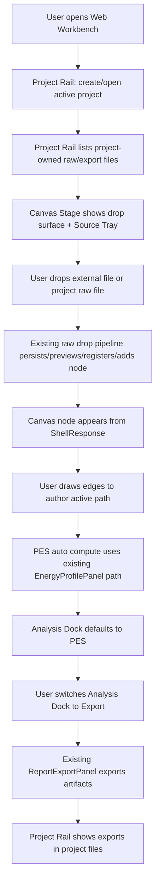

# workspace-first-flow-polish design

## 0. 术语约定

| 术语 | 定义 | 防冲突结论 |
|---|---|---|
| Workspace-First Flow Shell | 用户打开 Web 后看到的主工作台编排：Project Rail + Canvas Stage + Analysis Dock | 不等同于 Python Platform Shell，也不是新的 Shell command |
| Project Rail | 左侧项目权威区，只承载 project、project files、保存/打包等项目级动作 | 不是外部文件夹浏览器；不展示未进入项目的 loose file |
| Canvas Stage | 中央主工作区，承载 raw file drop、chemical node、path authoring 和候选选择器 | 不新增 graph schema，不替代 GraphCanvas 的 ShellResponse authority |
| Analysis Dock | 右侧分析/输出区，按任务显示 PES Preview、Export、Object Detail、Diagnostics | 不是新增持久化数据源；只是组织现有面板的 UI-only 容器 |
| Source Tray | Canvas Stage 内的轻量导入入口和 recent drop 状态 | 不替代 Project Files Panel；导入成功后文件仍必须进入 Project Rail |
| Dev Commands | Fixture Run、Invalid command 等开发/调试入口 | 初版用户主流程中降级隐藏，不作为产品主 CTA |

术语 grep 结果：现有代码已有 `WorkbenchShell`、`ProjectSidebar`、`ProjectFilesPanel`、`GraphCanvas`、`ImportInbox`、`ObjectRegistryPanel`、`EnergyProfilePanel`、`ReportExportPanel` 和 `workbench-grid` 三栏布局。本 feature 不新建领域能力，主要把这些能力重新挂到 workspace-first 信息架构里，并调整视觉密度和响应式规则。

## 1. 决策与约束

### 需求摘要

用户当前反馈是“界面功能太复杂，流程很奇怪”。按直觉，初版主流程应该是：

1. 用户打开或创建一个 RxnFlow project，左侧看到当前项目文件。
2. 用户把外部 log/out/xyz/extxyz 或项目内 raw file 拖到画布。
3. 画布直接出现结构节点，节点显示结构名和关键信息。
4. 用户在画布上拖线连接节点形成 active path。
5. 右侧优先显示 PES Preview，并能切到 Export 生成 PNG/CDXML/XLSX/CSV/SVG。
6. 保存 project 或导出 `.rxnflow.zip` 仍是项目级动作，保留在左侧。

本 feature 目标是把现有能力按这条主线收束：减少常驻面板数量，去掉用户主流程里的 fixture/debug 干扰，把导入收件箱和对象登记面板降级为上下文详情/诊断，而不是让用户必须理解内部流水线。

### 明确不做

- 不新增 Python Shell command，不改 parser、registry、reaction graph、energy engine 或 report export writer。
- 不新增 Project Content schema、Browser Project Repository schema、localStorage key、autosave、cloud storage、账号系统或目录 watcher。
- 不重新实现 raw file drop、parse candidate chooser、path authoring、PES compute 或 export artifact persistence 的领域逻辑。
- 不删除底层能力：Import Inbox、Object Registry、Command Status 可以隐藏、折叠或并入 dock，但核心调试信息仍要可达。
- 不引入大型 UI 框架、图表库、diagramming 库、D3/Recharts、WebGL 或 ChemDraw 编辑器。
- 不做 molecule viewer、2D/3D 分子结构渲染、自动反应路径搜索、TS/final 自动判定、反应配平或化学合理性检查。
- 不把当前视觉风格一次性变成品牌终稿；只做足够支撑主流程的高密度工作台视觉收束。

### 复杂度档位

- Frontend information architecture：L4。需要重排多个已有面板、主 CTA 和状态流，但不改变核心领域逻辑。
- UX / responsive：L4。桌面要形成项目-画布-分析的稳定三段式；窄屏要变成可达的堆叠/抽屉，不横向溢出。
- Shell/Core contract：L1。复用现有 ShellClient commands 和 WorkbenchDomainState projection。
- Persistence：L1。不新增持久化结构；保存/恢复仍显式走 Project Sidebar / Bridge。
- Visual system：L3。减少嵌套卡片和 beige-heavy 视觉，改成更克制的计算工作台密度、分隔线、状态色和 icon controls。

### 关键决策

1. **Canvas Stage 是第一主界面**：中间区域不再长期把 Import Inbox 压在画布上方；导入入口变成 canvas 内 drop/Source Tray，GraphCanvas 占据主要高度。
2. **Project Rail 只负责项目权威和文件**：保留 create/open/save/bridge/bundle/project files，但弱化 metrics/snapshot/debug 信息，避免左侧过长。
3. **Analysis Dock 用任务 tabs 收束右侧**：默认 tab 跟随状态选择：有 active path/profile 时优先 PES，用户需要输出时切 Export，选中 node/object 时可看 Object Detail，错误/命令回显进入 Diagnostics。
4. **Dev Commands 从主流程降级**：`Fixture Run` 可保留为 dev/runtime tools，但不和真实用户主流程并列；`Invalid command` 不在默认可见区出现。
5. **现有面板先重挂，不重写业务逻辑**：实现优先把现有 `ImportInbox`、`ObjectRegistryPanel`、`EnergyProfilePanel`、`ReportExportPanel` 变成新 shell 的子视图；必要时拆出纯 view 子组件，但不改 Shell DTO。
6. **响应式先保可用，不追求移动端完整编辑体验**：窄屏下按 Project Rail -> Canvas Stage -> Analysis Dock 顺序堆叠或使用 tab切换，必须无整体水平滚动，所有主动作可达。
7. **视觉语义服务扫描**：节点、文件、PES、export 状态用 restrained neutral + blue/green/amber/red 状态色；避免装饰性 hero、渐变大背景、嵌套卡片和过度米色。

### 前置依赖

roadmap 前置项 `workspace-file-drop-minimal-loop`、`canvas-path-authoring-pes-preview`、`minimal-cdxml-energy-delta-export` 均已完成。本 feature 可以复用 Project Files Panel、Raw File Drop pipeline、Canvas Chemical Node、Path Authoring、PES Preview 和 Report Export/CDXML 能力。

## 2. 名词与编排

### 2.1 名词层：值对象 / 实体 / 接口契约

**现状**：

- `WorkbenchShell` 直接渲染 `ProjectSidebar`、`ImportInbox` + `GraphCanvas`、`InspectorPanel` 三栏。
- `InspectorPanel` 固定堆叠 `ObjectRegistryPanel`、Shell command、`EnergyProfilePanel`、`ReportExportPanel`、Command Status。
- `ProjectSidebar` 同时展示 project create/list/active state、Project Files、bundle、snapshot、metrics，纵向信息密度很高。
- `workbench.css` 以 `workbench-grid` 三列和多个 `.rail-section` / `.inspector-section` 卡片为主，当前配色偏 paper/beige，页面读感接近多面板 demo。
- i18n 已有中英文消息，后续新增文案必须双语。

**变化**：

新增 Web UI-only shell view state：

```ts
type AnalysisDockTab = "pes" | "export" | "object" | "diagnostics"

type WorkspaceFlowShellState = {
  analysisDockTab: AnalysisDockTab
  projectRailDensity: "normal" | "compact"
  sourceTrayOpen: boolean
  devToolsOpen: boolean
}
```

新增 Analysis Dock view contract：

```ts
type AnalysisDockModel = {
  activeTab: AnalysisDockTab
  tabs: Array<{
    id: AnalysisDockTab
    labelKey: MessageKey
    badge?: string | number | null
    status?: "idle" | "ready" | "warning" | "error"
  }>
}
```

新增 Source Tray view contract：

```ts
type SourceTrayModel = {
  hasActiveProject: boolean
  rawFileCount: number
  lastDropStatus?: "idle" | "persisting" | "previewing" | "registered" | "used-in-graph" | "error"
  acceptedExtensions: string[]
}
```

边界：

- 这些类型只属于 Web UI state/model，不进入 ShellResponse、Project Content、Browser Project Repository 或 localStorage。
- `AnalysisDockTab` 只决定右侧显示哪个现有视图，不改变 `energy.compute` / `export.profile` 参数。
- `SourceTrayModel` 只展示入口和最近 drop 状态；项目文件权威仍来自 Project Files Panel。
- `projectRailDensity` / `devToolsOpen` 第一版不持久化，刷新后回默认。

### 2.2 编排层：主流程与控制流



**现状**：

- Import Inbox 是中间列的第一个大面板，即便用户主线已经是“拖文件到画布”。
- Object Registry 和 Shell command 区固定在右侧顶部，比 PES Preview / Export 更先被用户看到。
- Command Status 和 dev controls 占据用户主流程空间，容易让用户以为必须先跑 fixture 或理解 shell command。
- GraphCanvas、EnergyProfilePanel、ReportExportPanel 已有主要能力，但不处在用户预期的视觉优先级上。

**变化**：

- `WorkbenchShell` 引入 `WorkspaceFlowShell` 或等价内部布局，把页面拆成 Project Rail、Canvas Stage、Analysis Dock 三个语义区域。
- Canvas Stage 包含 GraphCanvas 主体和轻量 Source Tray；Import Inbox 的详细 parser preview 进入 Source Tray expanded state 或 Diagnostics，不再是常驻大面板。
- Analysis Dock 用 tabs / segmented controls 承载 PES、Export、Object、Diagnostics：
  - PES tab：现有 `EnergyProfilePanel`，默认优先展示 active path/profile。
  - Export tab：现有 `ReportExportPanel`。
  - Object tab：现有 `ObjectRegistryPanel` 的 active object / selected node context，列表可压缩。
  - Diagnostics tab：Command Status、dev tools、Import Inbox full preview、warnings/errors。
- Project Rail 保留 Project Files Panel 作为核心；project create/list/bridge/bundle 可折叠成 project header + actions，snapshot/metrics 降级或移除常驻展示。
- Topbar 保留 brand、locale、runtime/status，但不再把 dev command 放入主动作区。
- 窄屏下 Project Rail、Canvas Stage、Analysis Dock 按顺序堆叠，dock tabs 保持可点击；GraphCanvas 和 PES table 使用 responsive constraints 防止整体横向滚动。

**跨层纪律**：

- Shell authority：布局变化不允许前端直接 patch `WorkbenchDomainState.workspace/profile/artifacts/objects`。
- Persistence boundary：新 UI state 不写 Project Content、Browser Project Repository、localStorage 或 shell args。
- Drop semantics：文件进入画布后仍先写入项目，再 preview/register/add node；Project Rail 只展示项目内文件。
- Error semantics：隐藏/折叠 Diagnostics 不等于吞掉错误；当前错误必须在相关区域有 inline alert，并可在 Diagnostics 复查。
- i18n：所有新增静态 UI 文案进入 `messages.ts` 的 `en-US` 和 `zh-CN`。
- Responsive：任何固定宽度 toolbar、tab、表格、node label、checksum、path id 都必须允许 wrap/truncate，不制造 page-level horizontal overflow。
- Accessibility：tabs/segmented controls 使用 button/aria selected；icon-only controls 必须有 accessible name/title。

### 2.3 挂载点清单

- WorkbenchShell layout shell：把现有三栏 render 改成 Project Rail + Canvas Stage + Analysis Dock，并管理 UI-only dock/source/dev state。
- Project Rail compaction：调整 `ProjectSidebar` 的信息层级，使 Project Files 成为核心，snapshot/metrics/dev details 降级。
- Canvas Stage / Source Tray：把 Import Inbox 主流程入口压缩到画布上下文，保留 detailed preview 可达。
- Analysis Dock：用 tabs 重挂 EnergyProfilePanel、ReportExportPanel、ObjectRegistryPanel 和 Diagnostics。
- Web i18n / CSS / tests / E2E：新增双语文案、布局样式、responsive 规则、component tests 和浏览器 smoke。

本 feature 不挂入 Python core、Shell command registry、Project Content codec、Browser Repository interface、parser plugin、energy engine、report export writer、cloud/auth 或新第三方 UI dependency。

### 2.4 推进策略

1. **Flow Shell Skeleton**：新增或重构 WorkbenchShell 的语义布局，建立 Project Rail / Canvas Stage / Analysis Dock 容器和 UI-only state。
   - 退出信号：现有 fixture run / open project / graph canvas / energy / export 功能仍可通过 component tests 访问。
2. **Project Rail Compaction**：收束 ProjectSidebar 信息层级，让 active project + Project Files + save/bundle actions 成为主要内容。
   - 退出信号：active project raw/export files 可见且可拖；project create/open/save/bundle 仍可达；snapshot/metrics 不再干扰主流程。
3. **Canvas Stage Source Tray**：把 Import Inbox 降级为画布上下文入口和 detailed preview，不再长期占据画布上方大块空间。
   - 退出信号：外部 file drop、project raw file drop、多候选 chooser 和 raw persistence 状态仍通过测试；空画布有明确 drop affordance。
4. **Analysis Dock Tabs**：把 PES、Export、Object、Diagnostics 收束为右侧 tabs，并根据状态给 badge/status。
   - 退出信号：active path/profile 默认可看到 PES；Export 下载/persistence 仍可用；Object detail 和 command diagnostics 可达。
5. **Visual Density / Responsive Pass**：整理 CSS palette、spacing、cards、button/icon controls、desktop/narrow constraints。
   - 退出信号：桌面和 390px 窄屏无整体水平溢出，画布/表格/按钮文字不重叠，页面不再呈现多层 nested cards。
6. **Verification / Scope Guard**：更新 tests、跑 Web build/test/E2E smoke、Python unittest 和范围 grep。
   - 退出信号：Web targeted tests/build、必要 Playwright desktop/narrow smoke 通过；未新增 shell/core/persistence schema 或第三方 UI/chart dependency。

## 3. 验收契约

### 关键场景清单

1. 初始页面在桌面宽度下呈现 Project Rail / Canvas Stage / Analysis Dock 三个语义区域，Canvas Stage 是中间最大区域。
2. 左侧 Project Rail 中 Project Files 是 active project 下最醒目的列表区；raw files 和 export artifacts 仍显示 status/kind/path/checksum。
3. project create/open/save bridge/export bundle/import bundle 仍可达，不被新布局删除。
4. Import Inbox 不再作为中间列常驻大面板压住画布；用户可从 Canvas Stage / Source Tray 进入文件选择或查看最近 preview/detail。
5. 外部 raw file drop 到 Canvas Stage 仍按 persist raw -> preview -> register -> add node 顺序执行。
6. Project Files raw row 拖到 Canvas Stage 仍复用 project bytes，不重复写 raw object。
7. 多对象 / 多帧 preview 仍显示 Parse Candidate Chooser，取消不登记、不建节点。
8. Canvas Chemical Node 仍显示结构名、对象组成、formula、charge/spin、method、display energy、coordinate preview 和 warning。
9. 从节点拖线形成/延长 active path 后，Analysis Dock PES tab 能看到 profile、step delta、missing reason 和 correction count。
10. Analysis Dock Export tab 能导出 PNG/CDXML/XLSX/CSV/SVG，并展示 inline download、persistence、metadata 和 warnings。
11. 选中对象或节点后，Object tab 能查看对象详情和 correction form；未选中时有明确空状态。
12. Diagnostics tab 能查看 command status、warnings/errors 和 dev tools；主流程默认不显示 `Invalid command` 按钮。
13. 顶栏保留 locale switcher、runtime badge 和 run state；中文/英文新增文案都可切换。
14. 桌面 viewport 下无重叠、无 page-level horizontal overflow，GraphCanvas 仍可拖拽/连线/缩放。
15. 390px 窄屏下主区域按可用顺序堆叠或切换，所有主动作可达，无整体水平滚动。
16. `cd web && npm run test` 通过。
17. `cd web && npm run build` 通过。
18. `python3 -m unittest discover` 通过。
19. 浏览器 smoke 验证 localhost 页面非空白、console clean、fixture/open project/drop/path/PES/export 主流程可观察。

### 反向检查

- 不新增 Shell command、Python parser/core import、energy/profile 前端重算、report writer 或 CDXML/CDX writer。
- 不新增 Project Content schema、Browser Project Repository schema、localStorage key、autosave、cloud/auth 或 directory watcher。
- 不删除 raw file drop、candidate chooser、path authoring、PES compute、report export、bundle import/export 等已落地能力。
- 不把 external folder/file picker 当 project authority；Project Rail 只展示项目内文件。
- 不让 Diagnostics 折叠导致错误不可见；相关区域仍需 inline error。
- 不引入大型第三方 UI/chart/diagramming dependency。
- 不用 landing page、hero section、装饰性背景或嵌套卡片堆叠替代工作台。

## 4. 与项目级架构文档的关系

Acceptance 阶段需要更新：

- `.codestable/architecture/web-workbench.md`：记录新的 Workspace-First Flow Shell、Project Rail、Canvas Stage、Analysis Dock、Source Tray 和 Dev Commands 降级边界。
- `.codestable/requirements/web-workbench-shell.md`：补“打开项目 -> 项目文件 -> 画布拖入 -> 连接路径 -> PES/Export”的用户主流程故事，并说明 Import Inbox/Object Registry/Diagnostics 的新可见层级。
- roadmap items/main doc：`workspace-first-flow-polish` 验收时标为 `done`。
- 必要时更新 `docs/user/report-export-artifacts.md` 或后续用户指南入口，说明导出入口迁移到 Analysis Dock Export tab。

不更新 `.codestable/architecture/core-platform.md`，除非实现阶段发现必须改变 Shell/Core command contract；当前设计应只重排 Web UI 和前端状态。
