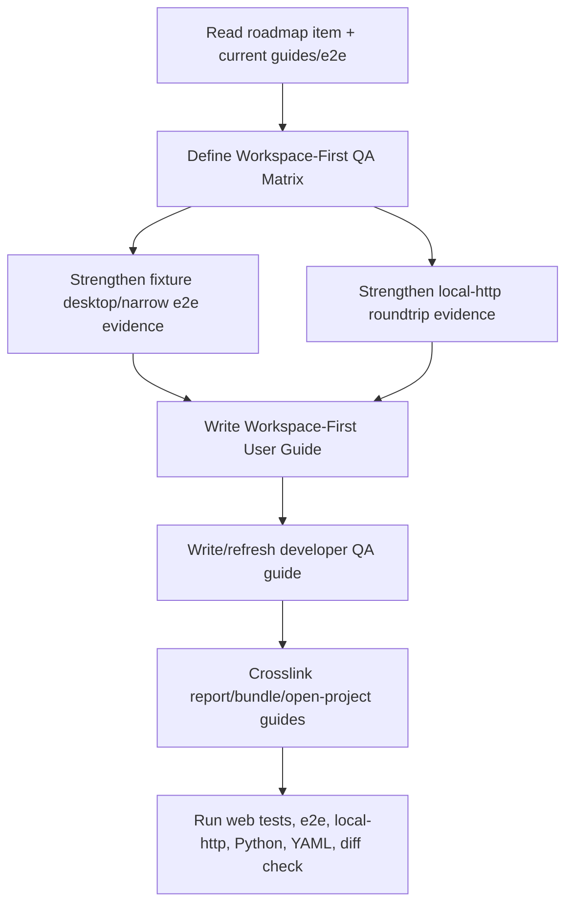

# workspace-first-flow-qa-guides design

## 0. 术语约定

| 术语 | 定义 | 防冲突结论 |
|---|---|---|
| Workspace-First QA Matrix | 把 Project Rail、Canvas Stage、Analysis Dock、保存、导出、分享和恢复串起来的验收场景表 | 现有 `graph-editor-e2e-qa` 更偏图谱交互，本 feature 只补主流程级 matrix |
| Workspace-First User Guide | 面向普通用户的 Web 工作台快速验收指南，告诉用户如何判断当前版本是否可用 | 不替代 report/export/bundle/open-project 分指南，而是提供入口和顺序 |
| Fixture Journey | 默认 `npm run test:e2e` 下不依赖 Python bridge 的浏览器主流程 | 已存在于 `workbench-journey.spec.ts`，本 feature 只强化命名、断言和文档映射 |
| Local-HTTP Roundtrip | `npm run test:e2e:local-http` 下经真实 Python local bridge 的 open/save/import/export/bundle 主链路 | 已存在于 `local-http-bridge.spec.ts`，不复制复杂 graph gesture matrix |
| QA Evidence Boundary | 自动化输出、截图、trace、报告和手工检查结果只作为 QA 证据，不进入 Project Content、Browser Repository 或导出 artifacts | 与现有 Playwright output boundary 一致 |

术语 grep 结果：现有代码已有 `web/e2e/workbench-journey.spec.ts`、`web/e2e/local-http-bridge.spec.ts`、`docs/dev/graph-editor-e2e-qa.md`、`docs/user/project-bundle-backup.md`、`docs/user/report-export-artifacts.md` 和 `docs/user/open-project-content.md`。本 feature 不引入新的运行时领域名词，主要把已有 QA 和指南按 workspace-first 主流程收束。

## 1. 决策与约束

### 需求摘要

`workspace-first-flow-polish` 已把界面收束为 Project Rail / Canvas Stage / Analysis Dock，但用户仍需要一条明确的“我现在怎么测试可用性”的路线。这个 feature 要补齐两类东西：

1. 自动化：桌面、390px 窄屏和 local-http bridge 的 e2e 场景明确覆盖保存项目、导出 `.rxnflow.zip`、重新导入后恢复 raw files / graph / PES preview / CDXML 下载边界。
2. 文档：用户指南告诉用户按什么顺序创建项目、导入/拖入文件、连接路径、查看 PES、导出 CDXML/表格、保存/打包/恢复；开发者指南告诉 agent 或开发者跑哪些命令、每条命令证明什么。

成功标准：一个不了解内部实现的用户，能按指南完成 Web 工作台最小主流程验收；一个开发者，能按 QA matrix 选择 fixture 或 local-http 回归命令，并理解哪些能力没有被这些测试证明。

### 明确不做

- 不新增产品功能、按钮、Shell command、Python parser/core/report writer 或 Project Content schema。
- 不新增 browser autosave、cloud storage、directory watcher、账号、多用户协作或新持久化策略。
- 不把 local-http E2E 扩成复杂图谱手势矩阵；复杂手势继续由 fixture E2E 负责。
- 不让指南承诺真实 Gaussian/ORCA/MAPLE/XYZ/extxyz 完整解析质量；只说明当前 fixture/local-http smoke 的证明边界。
- 不新增大型测试依赖、UI/chart/diagramming dependency 或截图比对框架。
- 不把 Playwright screenshot/trace/report 写入 Project Content、Browser Repository、`.rxnflow.zip` 或 report export index。
- 不把 CDXML 说成 CDX 或 molecule-level ChemDraw 结构；仍保持 CDXML-only 边界。

### 复杂度档位

- QA orchestration：L3。现有 e2e 已覆盖大部分路径，但需要补 scenario 命名、断言矩阵和 local-http / fixture 边界。
- User/developer guides：L3。需要把多个分散指南串成一个主流程入口，并保持和现有 report/bundle/open docs 不冲突。
- Runtime / Shell/Core contract：L1。不改命令和 schema。
- Visual/UI implementation：L1。不改工作台视觉结构，最多更新文案或测试可访问定位。

### 关键决策

1. **用户指南做入口，不复制所有细节**：新增或刷新一份 workspace-first 快速指南，按用户流程给步骤；详细 CDXML、bundle、project open/save 继续链接到已有指南。
2. **开发者 QA matrix 独立于 graph gesture guide**：`graph-editor-e2e-qa.md` 保持图谱高级交互定位；新增或刷新 workspace-first QA 指南负责主流程和 fixture/local-http 边界。
3. **fixture 与 local-http 分工不变**：fixture E2E 覆盖 UI 编排、桌面/窄屏和复杂 graph gestures；local-http E2E 覆盖真实 Python bridge、parser preview、project open/save、energy compute、export projection 和 bundle roundtrip。
4. **测试补强只加用户可观察断言**：需要补 e2e 时，只断言 Project Rail / Canvas Stage / Analysis Dock 中用户可见结果，不直接 mutate WorkbenchDomainState、IndexedDB bytes 或 ShellResponse。
5. **文档和测试一起验收**：指南里的每个主流程步骤都要能映射到一个 e2e 场景、一个现有能力说明或一个明确“不支持”边界。

### 前置依赖

roadmap 前置项 `minimal-cdxml-energy-delta-export` 和 `workspace-first-flow-polish` 均已完成。本 feature 不需要先做结构性重构。

## 2. 名词与编排

### 2.1 名词层：值对象 / 实体 / 接口契约

**现状**：

- `web/e2e/workbench-journey.spec.ts` 已有 desktop workbench journey、desktop graph editor matrix、desktop bundle backup/restore、narrow invalid bundle、narrow workbench flow 和 narrow advanced controls。
- `web/e2e/local-http-bridge.spec.ts` 已有 local-http workbench smoke 和 bundle roundtrip。
- `docs/dev/graph-editor-e2e-qa.md` 说明 graph editor E2E 与 local-http smoke 分工，但不是 workspace-first 主流程总入口。
- `docs/user/project-bundle-backup.md`、`docs/user/report-export-artifacts.md`、`docs/user/open-project-content.md` 分别解释 bundle、导出和项目恢复；缺少“按工作台从头到尾怎么验收”的顺序文档。

**变化**：

新增文档层 contract：

```ts
type WorkspaceFirstQaScenario = {
  id: string
  mode: "fixture" | "local-http" | "manual"
  viewport: "desktop" | "narrow" | "both"
  proves: string[]
  doesNotProve: string[]
  command?: "npm run test:e2e" | "npm run test:e2e:local-http"
}
```

示例：

```ts
// 来源：docs/dev/workspace-first-flow-qa.md
{
  id: "local-http-bundle-roundtrip",
  mode: "local-http",
  viewport: "desktop",
  proves: ["Open Bridge", "Save Bridge", "Export Bundle", "Import Bundle", "Open Bridge restore"],
  doesNotProve: ["complex graph gestures", "full Gaussian/ORCA/MAPLE parser support"],
  command: "npm run test:e2e:local-http",
}
```

新增用户指南 contract：

```ts
type WorkspaceFirstUserJourney = {
  steps: [
    "create-or-open-browser-project",
    "drop-or-select-raw-file",
    "create-canvas-node",
    "connect-active-path",
    "inspect-pes",
    "export-report-artifacts",
    "save-bridge-session",
    "export-and-import-bundle",
  ]
  boundaries: string[]
  relatedGuides: string[]
}
```

边界：

- 这些 contract 是文档/QA 组织方式，不进入 TypeScript production model、Shell DTO、Project Content 或 Browser Repository。
- 如果实现时需要增加 e2e helper，只允许服务用户可见动作，不增加测试专用生产 UI。

### 2.2 编排层：主流程与控制流



**现状**：

- 自动化覆盖已经存在，但读者需要在多个 spec/helper/doc 中拼出“哪个脚本证明哪段主流程”。
- 用户指南按能力分散：报告导出、项目包、项目打开各自完整，但没有从 Web 工作台第一屏开始的快速验收路线。
- 开发者指南偏 graph editor，高级手势说明清晰，但 workspace-first 保存/导出/分享/恢复主流程不是第一视角。

**变化**：

- QA matrix 把 fixture desktop/narrow 与 local-http roundtrip 显式对应到用户主流程。
- 如果当前 e2e 缺少某个 roadmap 边界的用户可见断言，补在既有 spec 或 helper 中；优先复用现有 `workbench-journey.spec.ts` / `local-http-bridge.spec.ts`，不新建平行测试体系。
- 新增或刷新用户指南，让用户知道当前如何手动验收 Web 工作台可用性，并明确 local-only / Save Bridge / Export Bundle / Import Bundle / CDXML-only 边界。
- 新增或刷新开发者 QA 指南，让 agent 在后续 frontend/bridge/report 改动时知道跑哪组命令。

**跨层纪律**：

- QA evidence 不改变 runtime state：测试和文档不能为了可测性新增生产按钮或 schema。
- Fixture/local-http 证明边界必须写清：fixture 证明 UI 编排；local-http 证明真实 bridge 主链路；两者都不等于完整第三方 parser 认证。
- Bundle / export 指南必须维持 local-only 口径：保存和备份是显式动作，不承诺云同步或 autosave。
- 所有新增用户可见 Web 文案如进入 app UI，必须补 `messages.ts` 双语；纯 docs 不需要 i18n catalog。
- E2E 仍必须检查 console clean、framework overlay absent 和 no horizontal overflow。

### 2.3 挂载点清单

- 用户指南入口：`docs/user/{workspace-first-guide}.md` — 新增 workspace-first 主流程快速验收指南。
- 开发者 QA 指南：`docs/dev/{workspace-first-qa-guide}.md` 或现有 dev QA doc — 新增/刷新 workspace-first QA matrix。
- E2E 主流程：`web/e2e/workbench-journey.spec.ts` / `web/e2e/local-http-bridge.spec.ts` — 必要时补用户可见断言和截图命名。
- 现有指南交叉链接：`docs/user/report-export-artifacts.md`、`docs/user/project-bundle-backup.md`、`docs/user/open-project-content.md`、`docs/dev/graph-editor-e2e-qa.md` — 增加 workspace-first 入口和边界链接。
- CodeStable 回写：roadmap items/main doc、architecture/requirements acceptance 回写 — 记录 QA/guides 现状。

不挂入 Python core、Shell command registry、Project Content codec、Browser Repository interface、parser plugin、energy engine、report writer 或新第三方 dependency。

### 2.4 推进策略

1. **QA Matrix Contract**：盘点现有 fixture/local-http e2e 与用户主流程的覆盖关系。
   - 退出信号：每个 workspace-first 主流程步骤都有“自动化 / 手工 / 明确不支持”归属。
2. **Fixture E2E Evidence**：补强桌面/窄屏 fixture e2e 的用户可见断言、截图标签或 helper 说明。
   - 退出信号：`npm run test:e2e -- workbench-journey.spec.ts` 覆盖 Project Rail、Canvas Stage、Analysis Dock、PES、Export 和 bundle backup/restore。
3. **Local-HTTP Roundtrip Evidence**：补强 local-http e2e 的 open/save/import/export/bundle roundtrip 证据。
   - 退出信号：`npm run test:e2e:local-http` 覆盖真实 bridge 下 raw preview、PES/export、Save/Open Bridge 和 bundle re-import restore。
4. **User Guide**：新增 workspace-first 用户快速验收指南并交叉链接 report/bundle/open-project docs。
   - 退出信号：用户能按一份指南完成创建项目、拖入文件、连接路径、查看 PES、导出 CDXML/表格、保存、打包和恢复。
5. **Developer QA Guide**：新增/刷新开发者 QA matrix，说明命令、覆盖范围、输出边界和不证明什么。
   - 退出信号：开发者能按改动类型选择 `npm run test:e2e`、`npm run test:e2e:local-http`、build/test/Python/YAML 命令。
6. **Verification / Scope Guard**：跑 Web/Python/CodeStable 验证和范围 grep。
   - 退出信号：测试、构建、e2e、local-http、YAML、diff check 通过；未新增 runtime schema/command/dependency。

## 3. 验收契约

### 关键场景清单

1. 用户指南存在，并从 Web 工作台第一屏开始说明 Project Rail / Canvas Stage / Analysis Dock 的主流程。
2. 用户指南覆盖 create/open browser project、raw file drop/select、canvas node、path connection、PES preview、Export tab、CDXML/XLSX/CSV/PNG/SVG download、Save Bridge、Export Bundle、Import Bundle、Open Bridge restore。
3. 用户指南明确 local-only、非云同步、Save Bridge / Export Bundle 顺序、CDXML-not-CDX、parser support 不等于第三方软件完整认证。
4. 现有 report export、project bundle、open project user docs 能从 workspace-first 指南互相跳转，且入口文案不互相矛盾。
5. 开发者 QA guide 包含 fixture desktop/narrow、local-http bridge、Python unittest、Web unit/build、YAML、diff check 的命令矩阵。
6. QA guide 说明 fixture E2E 与 local-http E2E 的证明边界，不把复杂 graph gestures 复制到 local-http。
7. E2E desktop fixture flow 可观察 Project Rail / Canvas Stage / Analysis Dock，且覆盖 graph、PES、Export、browser-local persistence 和 bundle backup/restore。
8. E2E narrow fixture flow 在 390px 下主动作可达、无水平溢出。
9. local-http E2E 覆盖真实 bridge 下 small file preview、Open Bridge、Save Bridge、energy compute、五格式 export persistence、bundle export/import/open restore。
10. e2e helper/test 只通过 UI 和 public browser APIs 操作，不直接 mutate WorkbenchDomainState、ShellResponse 或 repository bytes，除非是现有 bundle download entry readback 这类测试产物检查。
11. Playwright screenshot/trace/report 输出边界仍写在 gitignored test output，不进入 Project Content、Browser Repository 或 exported report artifacts。
12. `cd web && npm run test` 通过。
13. `cd web && npm run build` 通过。
14. `cd web && npm run test:e2e -- workbench-journey.spec.ts` 通过。
15. `cd web && npm run test:e2e:local-http` 通过。
16. `python3 -m unittest discover` 通过。
17. YAML 校验和 `git diff --check` 通过。

### 反向检查

- 不新增 Shell command、Python parser/core import、Project Content schema、Browser Repository schema、localStorage key 或 export writer。
- 不新增 cloud/auth/autosave/directory watcher 或 File System Access 长期 handle。
- 不新增大型测试/截图/视觉回归依赖。
- 不把 fixture parser 结果写成真实 Gaussian/ORCA/MAPLE/XYZ/extxyz 完整支持承诺。
- 不把 CDXML 写成 CDX，也不承诺 molecule-level ChemDraw 编辑语义。
- 不让指南要求用户直接打开 `file://.../web/index.html`；Web 预览仍必须走 Vite dev server。

## 4. 与项目级架构文档的关系

Acceptance 阶段需要更新：

- `.codestable/architecture/web-workbench.md`：记录 Workspace-First QA Matrix、用户/开发者指南入口、fixture/local-http E2E 分工和 QA evidence boundary。
- `.codestable/requirements/web-workbench-shell.md`：如用户指南新增用户可感能力边界，补“用户知道如何验收工作台可用性”的用户故事或边界说明。
- roadmap items/main doc：`workspace-first-flow-qa-guides` 验收时标为 `done`。
- 必要时更新 `docs/user/report-export-artifacts.md`、`docs/user/project-bundle-backup.md`、`docs/user/open-project-content.md` 和 `docs/dev/graph-editor-e2e-qa.md` 的交叉链接。

不更新 `.codestable/architecture/core-platform.md`，除非实现阶段发现必须改变 Shell/Core command contract；当前设计应只改 QA、文档和 Web e2e。
