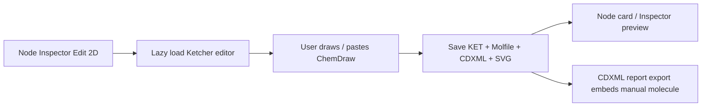

# Ketcher ChemDraw interop design

## 0. 需求摘要

用户希望在 RxnFlow 里画的 2D 分子能和 ChemDraw 互通：从 ChemDraw 复制粘贴到编辑器、在 RxnFlow 中保存、导出 CDXML 后 ChemDraw 里看到的仍是手动画的分子对象，而不是占位图或纯文字。

明确不做：本 feature 不做 2D/3D 原子联动，不开放 CDX binary 作为 UI 导出选项，不购买/接入 ChemDraw JS/MarvinJS 商业 SDK，不恢复旧 Object Registry。

复杂度档位：前端本地优先桌面 renderer 功能，涉及 UI editor、project node schema、report export writer 和依赖体积，走标准 feature；Ketcher/Indigo 必须 lazy-load，不进入首屏主链路。

## 1. 决策与约束

- 用 Ketcher React editor + ketcher-standalone Indigo WASM 取代 OpenChemLib 作为 2D 编辑和 ChemDraw 格式转换入口。
- KET 是编辑器 canonical state；Molfile 是 lightweight fallback/preview；CDXML 是 ChemDraw export canonical。
- 当前 report CDXML 继续保留能量图布局，但节点如有 manual CDXML，应嵌入分子级 CDXML 片段或以 ChemDraw 可识别对象形式参与导出。
- 自动坐标生成的 2D preview 可以先走轻量 SVG fallback，不能继续依赖 OpenChemLib。

## 2. 名词层与编排层

### 2.1 名词层：现状 → 变化

现状：`FlowNode` 只有 `manualStructureMolfile?: string`，`Molecule2DEditorDialog` 保存 OpenChemLib molfile，`buildCdxmlReport()` 只写 text/line/arrow。

变化：`FlowNode` 增加 `manualStructureKet?: string`、`manualStructureMolfile?: string`、`manualStructureCdxml?: string`、`manualStructureSvg?: string`。保存编辑器时同时保存 KET、Molfile、CDXML 和可选 SVG 缩略图；项目包 normalize/deep clone/undo/redo 保留这些字段。

### 2.2 编排层：现状 → 变化

现状：App 打开 OpenChemLib dialog，保存 molfile 后 preview 由 OpenChemLib 重新渲染。

变化：App 打开 Ketcher dialog，初始结构优先 `manualStructureKet`，其次 `manualStructureMolfile`，最后从导入坐标生成 minimal molfile。Ketcher onSave 通过 `getKet()`、`getMolfile('v3000')`、`getCDXml()`、`exportImage('svg')/fallback` 产出结构 payload。Canvas/Inspector 预览优先 `manualStructureSvg`，自动 preview 走项目内轻量 SVG fallback。

### 2.3 挂载点

- Node Inspector 的 `Edit 2D` dialog：删掉后用户不能手动画/粘贴 ChemDraw。
- `FlowNode` manual structure fields：删掉后项目不能持久化编辑结果。
- `buildCdxmlReport()` 的 manual molecule embedding：删掉后导出 CDXML 不含手画分子。
- Ketcher/Indigo dependencies 与 static resources：删掉后 editor/format conversion 不能加载。

### 2.4 推进策略

1. 依赖和资源接入：安装 Ketcher 包，确认 build 能解析。
2. Schema 与状态：扩展 node manual structure payload 和 update/reset action。
3. UI 替换：用 Ketcher dialog 替换 OpenChemLib dialog，移除 OpenChemLib import。
4. Preview 与 export：让 preview 优先 manual SVG，让 CDXML report 含 manual structure marker/fragment。
5. 验证与文档：跑测试、构建、桌面 smoke、浏览器 smoke，并更新 CodeStable/用户文档。

### 2.5 结构健康度与微重构

文件级：`App.tsx` 已偏大，但本 feature 的 App 触点只应保持 dialog state/payload callback，不在本次做大拆；`Molecule2DEditorDialog.tsx` 可原地替换实现；`reportExports.ts` 已是导出 writer 集中点，新增 helper 不另建复杂抽象。

目录级：`web/src/app/` 已较平，但 Ketcher editor 可独立为 `KetcherStructureEditorDialog.tsx`，避免继续把 OpenChemLib 名字留在新实现里。无需目录重组。

超出范围观察：后续可把 molecule viewer/editor 相关组件收进 `web/src/app/structure/`，但这属于目录重构，不阻塞本 feature。

## 3. 验收契约

- 点击 Node Inspector `Edit 2D` → 打开 Ketcher editor，而不是 OpenChemLib toolbar。
- 在 Ketcher 中保存结构 → 节点持久化 KET/Molfile/CDXML/SVG，关闭 dialog 后 `Reset 2D` 可见。
- 导出 CDXML → 生成文件中包含 manual CDXML 的结构内容标记，不再只是节点 label/能量文字。
- 没有 manual 结构的节点 → 仍显示自动轻量 2D preview，不显示 OpenChemLib loading/error。
- `npm run test`、`npm run build`、`npm run desktop:smoke`、`npm run desktop:runtime:smoke` 通过；浏览器 smoke 能打开 editor 并保存。
- 反向核对：不新增 CDX UI checkbox，不做 2D/3D 联动，不保留 OpenChemLib runtime dependency。

## 4. 架构更新

完成后更新 `.codestable/architecture/ARCHITECTURE.md`、`.codestable/architecture/web-workbench.md`、`docs/user/desktop-canvas-workbench.md`、`docs/dev/release-scope-boundary.md` 和验证指南，把 active 结构编辑器改为 Ketcher + Indigo WASM。
