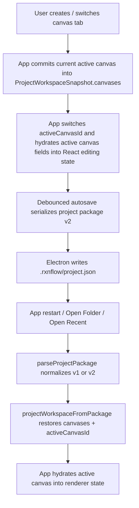

# multi-canvas-persistence design

## 0. 术语约定

| 术语 | 定义 | 防冲突结论 |
|---|---|---|
| Canvas Tab | 工作台顶部的一个画布标签，对应一组独立的 nodes / edges / barriers / viewport | 不等同于 reaction path tab，也不等同于 table sheet |
| Canvas Snapshot | 单个画布当前可恢复的轻量状态快照 | 不是整个项目快照，不包含 source 列表 |
| Project Workspace Snapshot | 当前项目在 renderer 内部的完整工作区快照 | 变化后变成“共享 source + 多画布集合 + 活动画布 UI 状态” |
| Active Canvas | 当前正在中央工作区渲染的画布 | 不等同于 active project |
| Canvas Workspace Store | 写入 `.rxnflow/project.json` 的多画布项目表示 | 仍属于当前轻量 project store，不引入旧 Project Content |

术语 grep 结论：当前仓库已有 `canvasTabs` / `activeCanvasTabId` 运行时 UI 状态，也有 roadmap 中的 `path tabs`。本 feature 明确使用 **Canvas Tab / Active Canvas**，避免和 `path tabs` 混名。

## 1. 决策与约束

### 需求摘要

用户已经在桌面工作台看到顶部多画布标签，但当前它只是 React 运行时态：

1. 用户新建多个画布后，切换、关闭 app、重新打开项目，画布集合和当前活动画布都应该恢复。
2. 每个画布要保存自己的节点、连线、barrier、viewport 与画布内 selection。
3. source file 列表仍然是项目级共享资源，不因切换画布复制多份。
4. 自动保存、`Open Folder`、启动恢复、`Export project` 都要读写同一套多画布 schema。
5. 旧单画布项目打开后要自动归一化成“至少一个画布”的新结构，用户无需手工迁移。

### 明确不做

- 不把“多画布”与 reaction `path tabs`、relative energy sheet、path zero point 或 path-scoped stoichiometry 混在同一个 schema 中实现。
- 不实现多画布之间的复制/移动节点、跨画布引用、画布颜色、画布排序拖拽、画布删除确认、画布模板库或画布权限。
- 不实现浏览器长期持久化、IndexedDB、云同步、多人协作、冲突合并或后台目录监听。
- 不把 undo/redo history、connection draft、barrier draft、候选登记面板、结构弹窗、hover 状态写入项目文件。
- 不改 Python engine / embedded engine 的解析语义；它们只需接受新的轻量 project envelope。
- 不在本 feature 中重做 table/path 语义或节点相对能量算法。

### 复杂度档位

- Persistence schema：L3。要修改 renderer snapshot、project package normalize、desktop open/save/autosave 恢复链路，并保留旧项目兼容。
- UI orchestration：L2。当前运行时 `canvasTabs` 需要从 `App.tsx` 与 `projectWorkspace.ts` 收束到项目级状态，但不新增复杂交互。
- Desktop runtime：L2。open/autosave/startup restore/zip export 都要走统一 schema；不新增新的 IPC 大类。
- Testability：tested。纯 helper、package normalize、App restore 和桌面 smoke 都能覆盖。

### 关键决策

1. **多画布是项目级工作区结构，不是单纯 UI 装饰**。
   - 当前 `files` 保持项目级共享。
   - `nodes/edges/barriers/viewport/selection` 下沉到每个 canvas。
2. **项目必须始终至少有一个 canvas**。
   - 无论新建项目、旧项目迁移还是损坏恢复，normalize 后都要得到一个默认 canvas。
3. **活动画布属于持久化 UI 状态的一部分**。
   - 保存时记录 `activeCanvasId`；恢复时优先恢复它。
   - 若该 id 缺失，则回退到第一个可用 canvas。
4. **旧单画布 schema 采用向前归一化，不保留双写**。
   - 解析时把旧 `nodes/edges/barriers/viewport` 包成一个默认 canvas。
   - 保存时统一只写新多画布结构。
5. **每个 canvas 的 selection 可以恢复，但只作为轻量便利状态**。
   - 仅保存 `selectedNodeIds / selectedEdgeIds / selectedBarrierIds`。
   - 恢复时要过滤掉不存在的 id，避免坏引用。
6. **viewMode / inspectorMode / energyDisplayOptions 先保持项目级，而不是画布级**。
   - 这是当前 UI 更稳定的边界；否则会把表格/导出/右侧栏语义和画布耦合得过深。
7. **source 列表继续共享，不复制到 canvas 内**。
   - 同一 source 可被不同画布引用，但 `importLedger` 仍按项目级 `files + all canvas nodes` 派生。

## 2. 名词与编排

### 2.1 名词层：现状 → 变化

**现状**：

- `web/src/app/App.tsx` 中有 runtime-only `CanvasTabSnapshot` / `CanvasTabState` / `canvasTabs` / `activeCanvasTabId`。
- `web/src/app/projectWorkspace.ts` 的 `ProjectWorkspaceSnapshot` 仍是单画布：`files + nodes + edges + barriers + viewport + selection + UI mode`。
- `web/src/domain/projectPackages.ts` 的 `RxnFlowProjectPackage` 也是单画布：`files/nodes/edges/barriers/viewport/importLedger`。
- `projectWorkspaceFromPackage()` 打开项目时直接把 package 的单画布内容还原到当前 renderer。

**变化**：

新增/调整 renderer 内部数据结构：

```ts
type ProjectCanvasSnapshot = {
  id: string
  label: string
  nodes: FlowNode[]
  edges: FlowEdge[]
  barriers: FlowBarrier[]
  viewport: CanvasViewport
  selectedNodeIds: string[]
  selectedEdgeIds: string[]
  selectedBarrierIds: string[]
}

type ProjectWorkspaceSnapshot = {
  files: SourceFile[]
  canvases: ProjectCanvasSnapshot[]
  activeCanvasId: string
  selectedFileId: string | null
  selectedFileIds: string[]
  lastSelectedFileId: string | null
  energyDisplayOptions: EnergyDisplayOptions
  viewMode: WorkbenchViewMode
  inspectorMode: WorkbenchInspectorMode
}
```

新增/调整项目包结构：

```ts
type RxnFlowProjectCanvas = {
  id: string
  label: string
  nodes: FlowNode[]
  edges: FlowEdge[]
  barriers: FlowBarrier[]
  viewport: CanvasViewport
  selectedNodeIds?: string[]
  selectedEdgeIds?: string[]
  selectedBarrierIds?: string[]
}

type RxnFlowProjectPackage = {
  schemaVersion: 2
  packageKind: "rxnflow-project"
  project: ProjectSummary
  files: SourceFile[]
  canvases: RxnFlowProjectCanvas[]
  activeCanvasId: string
  energyDisplayOptions?: EnergyDisplayOptions
  viewMode?: WorkbenchViewMode
  inspectorMode?: WorkbenchInspectorMode
  importLedger: ImportLedger
  savedAt: string
}
```

兼容归一化输入：

```ts
type LegacyRxnFlowProjectPackageV1 = {
  schemaVersion: 1
  packageKind: "rxnflow-project"
  project: ProjectSummary
  files: SourceFile[]
  nodes: FlowNode[]
  edges: FlowEdge[]
  barriers?: FlowBarrier[]
  viewport: CanvasViewport
  importLedger?: ImportLedger
  savedAt?: string
}
```

边界约束：

- `canvases[*].nodes[*].sourceFileId` 仍可引用项目级 `files[*].id`。
- `importLedger` 从 `files + 所有 canvas 中的 nodes` 派生，不只看 active canvas。
- `selectedFileId / selectedFileIds / lastSelectedFileId` 仍然是项目级，因为左侧 source rail 不随画布切换复制状态。
- `energyDisplayOptions/viewMode/inspectorMode` 当前保留项目级，避免一次性扩太大。

### 2.2 编排层：主流程与控制流



**现状**：

- `App.tsx` 的活跃编辑状态仍以单画布 React state 存在：`nodes/edges/barriers/viewport/selection`。
- 顶部画布 tab 切换只是把这些 state 暂存到本地 `canvasTabs[*].snapshot`。
- autosave / open / export 只序列化当前这一个画布；未把其他 tab 纳入项目保存。
- 启动恢复和 `Open Folder` 能恢复项目，但只能回到单画布内容。

**变化**：

- `ProjectWorkspaceSnapshot` 成为多画布真源；App 的单画布 React state只负责“当前 active canvas 的编辑投影”。
- 切换画布时：先把当前 active canvas 回写到 `canvases[]`，再取目标 canvas 投影进 `nodes/edges/barriers/viewport/selection`。
- 新建画布时：在 `canvases[]` 追加一个空白 canvas，并立即切到它。
- `currentProjectWorkspaceSnapshot()` 不再从裸 `nodes/edges/barriers/viewport` 直接拼整个项目，而是生成 `files + canvases + activeCanvasId + project-level UI state`。
- `serializeProjectPackage()` / `buildProjectPackage()` 统一输出 v2 多画布包；`parseProjectPackage()` 同时接受 v1/v2，并把 v1 归一化到默认 canvas。
- `projectWorkspaceFromPackage()` 先恢复整个多画布工作区，再投影 active canvas 到编辑器。
- `saveAndActivateProjectWorkspaceTransition()` / `switchProjectWorkspaceTransition()` / startup restore / replaceProjects 逻辑维持 project 级别，但内部 snapshot 变成多画布。

**跨层纪律**：

- Renderer authority：只有当前 active canvas 投影到 React 编辑态；其余 canvas 只存在于 snapshot，不直接渲染。
- Persistence authority：`.rxnflow/project.json` 只保存 `ProjectWorkspaceSnapshot` 能表达的轻量状态，不保存 edit history 或临时 draft。
- Compatibility：打开旧单画布项目必须成功；保存后升级为 v2，不再回写 v1。
- Fault tolerance：`activeCanvasId` 丢失、selection 引用悬空、空 `canvases[]` 都必须在 normalize 时修正。
- Desktop/web parity：浏览器 `.rxnflow.json` UI 验证路径也要能打开 v2，不允许只有 Electron 能读。

### 2.3 挂载点清单

- `projectWorkspace.ts`：多画布 snapshot、clone、restore、create/switch/save/delete project transition 的主名词层挂载点。
- `App.tsx`：当前 active canvas 编辑态与 `ProjectWorkspaceSnapshot.canvases[]` 的双向投影编排。
- `projectPackages.ts` / `projectPackageWorkflow.ts`：项目 envelope 升级到 v2，并负责 v1 -> v2 normalize。
- `appRuntimeEffects.ts` + Electron open/autosave/startup restore：所有桌面打开/保存路径都使用新 schema。
- tests/smoke：package normalize、workspace transition、App restore、desktop startup restore 的验证入口。

删掉这些挂载点后，本 feature 在用户视角会消失：多个画布仍可临时创建，但不能保存、重开、导出或随项目恢复。

### 2.4 推进策略

1. **Project schema 与 clone helper 升级**：先把 `ProjectWorkspaceSnapshot` 与 package types 改成多画布，并提供 v1 normalize helper。
   - 退出信号：纯单元测试证明 v1 单画布输入会归一化成一个默认 canvas，v2 输入可原样 round-trip。
2. **App active-canvas projection 收口**：把 `canvasTabs` runtime state 收束到 project workspace snapshot，active canvas 与 React 编辑态双向同步。
   - 退出信号：组件测试证明新建/切换画布后，当前画布内容互不覆盖，且 current snapshot 含全部 canvas。
3. **Open / autosave / export 路径接通**：project package serialize/restore、desktop autosave、startup restore、Export project 统一使用 v2 schema。
   - 退出信号：保存后重开项目/重启 app 时，多画布集合和 active canvas 都恢复。
4. **旧项目兼容与坏引用修正**：parse/normalize 过滤坏 selection、空 canvas、缺失 activeCanvasId，并为旧 schema 自动包默认 canvas。
   - 退出信号：旧 `.rxnflow.json` / 真实工作区均可打开，不白屏、不丢主图。
5. **验证与范围守护**：跑 web tests/build、desktop smoke/runtime smoke，并做浏览器/桌面实际 smoke。
   - 退出信号：所有验证通过；未扩展到 path tabs、云同步、history persistence 或跨画布高级编辑。

### 2.5 结构健康度与微重构

文件级：

- `web/src/app/App.tsx` 仍然偏大，而且当前多画布逻辑直接写在其中。这个 feature 应先做一次**只搬不改行为**的小重构：把“active canvas <-> workspace snapshot 投影”提成独立 helper，例如 `canvasWorkspaceState.ts` 或 `projectCanvasTabs.ts`，避免继续往 `App.tsx` 塞状态编排。
- `web/src/app/projectWorkspace.ts` 已经是纯状态 helper 的集中点，适合承接多画布 snapshot / restore / transition 变化。
- `web/src/domain/projectPackages.ts` 也是合理挂载点，适合集中处理 v1/v2 normalize，不应把 schema 兼容逻辑散回 `App.tsx`。

目录级：

- 当前 `web/src/app/` 目录虽然文件较多，但多画布持久化仍属于现有 `projectWorkspace.ts` / `projectPackageWorkflow.ts` / `appRuntimeEffects.ts` 组合职责，不需要额外重组目录。
- 可新增一个轻量 helper 文件承接 active canvas 投影，属于稳定职责扩展，不需要大范围目录搬迁。

本次微重构结论：**做微重构（拆文件）**。

- 搬什么：把 `App.tsx` 内与 `CanvasTabSnapshot` / `canvasTabs` / `activeCanvasTabId` / switch/create snapshot 投影相关的纯 helper 拆出。
- 搬到哪：`web/src/app/projectCanvasState.ts`（或同类命名）作为纯状态辅助模块。
- 如何验证行为不变：先保持现有 runtime 多画布交互可用，通过现有 App / browser smoke，再接持久化 schema。

建议沉淀的 convention：**项目级 snapshot 与当前 active 编辑投影的转换 helper，优先放在 `web/src/app/` 的纯状态模块，不继续内联在容器组件里**。如果 implement 落地稳定，可后续用 `cs-decide` 归档。

超出范围观察：

- 画布 rename / reorder / delete / duplicate 目前都还没有明确 contract，后续应单独走 feature，而不是顺手塞进本 feature。
- 如果后续要做画布级 table/filter/export 偏好，需要重新评估 `viewMode / inspectorMode / energyDisplayOptions` 是否应下沉到 canvas。

## 3. 验收契约

### 关键场景清单

1. 新建项目时默认仍有一个 `画布 1`，并且项目 snapshot 中存在至少一个 canvas。
2. 用户在 `画布 1` 放入节点 A，在 `画布 2` 放入节点 B，切换往返后两个画布内容互不覆盖。
3. 保存/自动保存后关闭 app，再打开同一工作区文件夹，之前创建的多个画布会恢复。
4. 重开项目后，打开时的 active canvas 仍是关闭前最后停留的那个，而不是总回到第一个画布。
5. 每个画布自己的 viewport 会恢复；切到不同画布时视口跟着切换。
6. 每个画布自己的 node/edge/barrier selection 会恢复，但坏引用会被过滤，不导致白屏。
7. 左侧 source 列表仍是项目级共享；切换画布不会复制或丢失 source 文件记录。
8. `Export project` 导出的 `.rxnflow.zip` 解包后，`.rxnflow/project.json` 中包含多画布结构，而不是只保存当前一个画布。
9. 旧单画布 `.rxnflow.json` 或旧工作区打开时，会被归一化为一个默认 canvas，主图仍可编辑。
10. 导入 source 并 autosave 后，重启 app 恢复的多画布项目仍然保留 `storedPath` / checksum 与 source 副本引用。
11. `npm run test -- --run` 通过。
12. `npm run build` 通过。
13. `npm run desktop:smoke` 通过。
14. `npm run desktop:runtime:smoke` 通过。
15. 浏览器 dev preview 能打开 v2 项目且不会空白或 console error。
16. 桌面实际 smoke 中，创建第二个画布、导入/拖入节点、关闭重开 app 后可见恢复结果。

### 反向检查

- 不实现 path tabs、relative energy sheets、path zero point 或 path-scoped stoichiometry persistence。
- 不新增 cloud sync、IndexedDB/OPFS、账号、多人协作、CRDT、冲突合并或后台目录 watcher。
- 不持久化 undo/redo history、candidate review sheet、structure preview dialog、3D dialog、connection/barrier draft 或 hover UI。
- 不新增跨画布复制/粘贴、跨画布引用、画布模板、画布权限、画布颜色或画布排序拖拽。
- 不改 parser / cclib / engine status / source open external viewer 的现有语义。

## 4. 与项目级架构文档的关系

Acceptance 阶段需要更新：

- `/Users/linsay/Desktop/code/rxnflow/.codestable/architecture/web-workbench.md`
  - 把当前项目 snapshot、package schema、autosave/open restore 口径从单画布改为共享 source + 多画布集合。
- `/Users/linsay/Desktop/code/rxnflow/.codestable/requirements/project-content-persistence.md`
  - 把“保存并恢复当前画布工作区状态”细化为“保存并恢复项目内全部画布及 active canvas”。
- `/Users/linsay/Desktop/code/rxnflow/docs/user/desktop-canvas-workbench.md`
  - 补用户层说明：一个项目可含多个画布，项目重开后会恢复。
- `/Users/linsay/Desktop/code/rxnflow/docs/dev/desktop-rebuild-verification.md`
  - 补多画布 open/autosave/restart 的验证步骤。

本 feature 不修改现有 `rxnflow-path-tabs-energy-sheets` roadmap，因为那份 roadmap 描述的是**单个图内的 reaction path / energy sheet 语义**，不是项目级多画布工作区。
