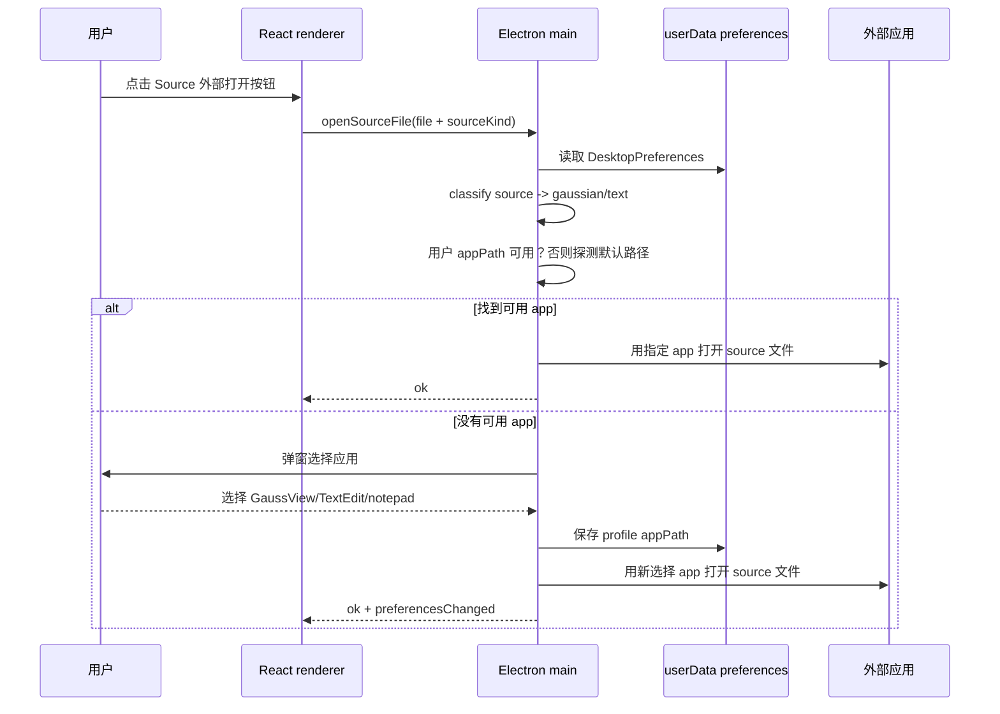

# desktop-preferences-source-openers design

## 0. 术语约定

- **DesktopPreferences / 桌面偏好**：保存在 Electron `userData` 下、只属于当前用户和当前机器的 RxnFlow 偏好。术语检索结果：当前没有统一 preferences store，只有 `rxnflow-theme` 存在 renderer `localStorage`。
- **SourceOpener / source 打开方式**：按 source 类型选择外部应用打开项目中的 source 文件。不是系统默认打开方式，也不写入项目 JSON。
- **OpenerProfile / 打开方式档位**：本 feature 只定义两个 profile：`gaussian` 用 GaussView，`text` 用文本编辑器；ORCA / MAPLE / XYZ / 未知 source 默认走 `text`。
- **AppearancePreference / 外观偏好**：`system | dark | light`。`system` 表示跟随系统外观，最终渲染仍转成当前 CSS class `theme-dark` 或 `theme-light`。
- **EnergyUnitPreference / 能量单位偏好**：相对能量显示单位，默认 `kcal/mol`，在 Settings 中配置；不改变 source 原始能量单位。
- **CanvasContextMenu / 画布右键菜单**：替代悬浮工具栏删除按钮和节点卡三点菜单的上下文操作入口。右键选中内容时提供 Delete，右键节点时提供 Rename / Set zero / Source details。

## 1. 决策与约束

### 需求摘要

用户希望 node 面板 Source 组件的外部打开按钮按文件类型用合适软件打开：Gaussian log 优先 GaussView；ORCA / MAPLE 输出用用户指定的文本编辑器（macOS 文稿/TextEdit，Windows 记事本/Notepad 等）。GaussView、记事本、文稿路径应可设置；没有用户设置时先找系统常见路径，仍找不到就弹窗引导用户选择，之后记住该格式的打开方式。左下角新增设置按钮，设置面板里放外部软件路径、主题偏好（跟随系统/深色/浅色）和能量显示单位；默认单位为 kcal。悬浮工具栏不再显示 Unit select，也不再显示 Delete selection；删除操作进入右键菜单。节点卡片三点菜单里的 Rename / Set zero / Source details 也迁移到节点右键菜单。

明确不做：

1. 不修改系统级默认打开方式，不写注册表、不改 LaunchServices。
2. 不安装、下载、捆绑 GaussView 或任何第三方软件。
3. 不把本机应用路径保存到 `.rxnflow/project.json`、source file metadata 或导出包。
4. 不开放任意 shell 命令模板，不允许用户输入带参数的命令行字符串；只选择应用可执行文件或 `.app`。
5. 不在浏览器预览里伪造外部应用打开；浏览器环境只展示设置 UI 的降级/disabled 状态和主题偏好。
6. 不删除键盘 Delete / Backspace 快捷键；本次只把可见按钮从悬浮工具栏迁到右键菜单。

### 复杂度档位

- Robustness = L3（偏离内部工具默认 L2）：外部应用路径来自用户和系统环境，必须校验存在、类型、绝对路径；打开失败要提示并允许重选。
- Security = validated（偏离 trusted）：启动外部应用不能走 shell 拼接，不能从项目文件读取 opener path，不能执行任意命令字符串。
- Structure = modules（偏离 functions）：Electron main / renderer App / ProjectRail 都已偏胖，偏好存储和 source opener 分类应落新模块。
- Compatibility = current-only：项目尚未上线，不迁移旧偏好；只把旧 `rxnflow-theme` localStorage 作为 browser fallback 或一次性读取参考。

### 关键决策

1. **偏好属于用户机器，不属于项目**：路径如 `/Applications/GaussView 6.app` 或 `C:\Windows\System32\notepad.exe` 不能随项目分享，因此只存在 Electron `userData/rxnflow-preferences.json`。
2. **source opener 分类放在桌面壳层**：renderer 只传 `projectId/storedPath/sourcePath/name/sourceKind/parserId`；Electron 根据偏好和平台解析实际 app path，避免 renderer 知道 OS 细节。
3. **默认路径只是候选，不是硬编码承诺**：常见路径存在才使用；不存在就走选择应用弹窗。macOS GaussView 候选包括 `/Applications/GaussView 6.app`、`/Applications/GaussView.app`、`/Applications/GaussView 5.app`；文本候选包括 `/System/Applications/TextEdit.app`、`/Applications/TextEdit.app`。Windows 文本候选包括 `C:\Windows\System32\notepad.exe`；GaussView 候选覆盖常见 Gaussian/GaussView 安装目录。Linux 文本候选可探测 `xdg-open` / `gedit` / `kate`，GaussView 只做常见 `gview` 路径探测。
4. **首次缺失时在点击 source 按钮中完成引导**：用户无需先打开设置；若没有可用 opener，`openSourceFile` IPC 直接弹出“选择用于 Gaussian/Text source 的应用”文件选择器，成功后保存偏好并继续打开当前文件。
5. **设置入口放 Project Rail 左下角**：和用户说的“左下角”一致，不挤顶部窗口按钮；折叠/hover rail 中也应能看到或触达该设置按钮。
6. **主题按钮并入设置，顶栏可移除或变成快捷入口**：主题不再只是 light/dark toggle，而是 `system/dark/light` 三态。实现时可保留顶栏图标作为快捷显示，但权威设置在 Settings 面板。
7. **能量单位权威入口迁到 Settings**：`EnergyDisplayOptions.outputUnit` 默认 `kcal/mol`，Settings 中可改为 `hartree` / `kcal/mol` / `kj/mol`；悬浮工具栏只保留 Energy source（如仍需要 ΔEgas/ΔGsol）和画布工具，不显示 Unit select。
8. **低频 destructive / node actions 迁到右键菜单**：悬浮工具栏不显示 Delete；节点卡不显示三点更多按钮。画布选中内容的删除、节点的 Rename / Set zero / Source details 均通过 context menu 暴露，同时保留键盘快捷键和无障碍替代入口。

### 前置依赖

无阻塞前置依赖。实现阶段需要确认 Electron `open -a <app> <file>` / Windows `spawn(exe, [file])` / Linux `spawn(app, [file])` 的封装全部不经过 shell。

## 2. 名词与编排

### 2.1 名词层

#### 现状

- `web/src/app/App.tsx` 定义 `AppTheme = "light" | "dark"`，从 `localStorage["rxnflow-theme"]` 读取并写回，顶栏按钮只做 light/dark 切换。（`initialAppTheme` / `theme-toggle-button`）
- `web/src/app/energyDisplay.ts` 定义 `defaultEnergyDisplayOptions.outputUnit = "kcal/mol"`；当前 `web/src/app/WorkbenchToolbar.tsx` 在悬浮工具栏里直接显示 Unit select 并调用 `onEnergyDisplayOptionsChange`。
- `web/src/app/WorkbenchToolbar.tsx` 当前显示 `Delete selection` 按钮，调用 `App.tsx` 的 `deleteSelection()`；键盘 Delete / Backspace 已存在，不依赖工具栏。
- `web/src/app/CanvasWorkspace.tsx` 当前节点卡右上角有 `node-more-button` 三点菜单，包含 `Rename`、`Set zero`、`Source details`。
- `web/src/app/InspectorPanels.tsx` 的 `NodeSourceBrief` 只有一个 `Open raw log` 图标按钮，调用 `onOpenSourceFile(file.id)`。
- `web/electron/preload.cjs` 暴露 `openSourceFile(payload)`；`web/electron/main.cjs` 的 `rxnflow:open-source-file` 只解析项目内 `storedPath` / 原始 `sourcePath`，然后调用 `shell.openPath(filePath)`，所以会走系统默认应用。
- `web/src/app/ProjectRail.tsx` 没有 settings/footer 入口；历史 roadmap 里把通用 settings/preferences 标为已移回 roadmap-only。

#### 变化

新增 desktop preference contract：

```ts
// 来源：web/src/app/appRuntimeEffects.ts RxnflowDesktopApi / 新 preferences 类型
export type AppearancePreference = "system" | "dark" | "light"
export type SourceOpenerProfile = "gaussian" | "text"
export type EnergyOutputUnitPreference = "hartree" | "kcal/mol" | "kj/mol"

export type DesktopPreferences = {
  schemaVersion: 1
  appearance: AppearancePreference
  energyOutputUnit: EnergyOutputUnitPreference // default "kcal/mol"
  sourceOpeners: {
    gaussian?: { appPath: string | null; label?: string | null }
    text?: { appPath: string | null; label?: string | null }
  }
}
```

`openSourceFile` payload 增加分类输入：

```ts
// 来源：web/src/app/App.tsx openSourceFileInSystemApp
openSourceFile({
  projectId,
  storedPath,
  sourcePath,
  name,
  sourceKind: file.parse?.sourceKind ?? file.kind,
  parserId: file.parse?.parserId,
})
```

新增 Electron API：

```ts
getPreferences(): Promise<{ ok: true; preferences: DesktopPreferences }>
setPreferences(patch: Partial<DesktopPreferences>): Promise<{ ok: true; preferences: DesktopPreferences }>
chooseExternalApp(profile: SourceOpenerProfile): Promise<{ canceled: boolean; appPath?: string; label?: string }>
onPreferencesChanged(callback): () => void
```

renderer 侧新增设置 UI 状态：

- `SettingsPanel`：左下角按钮打开的轻量 popover/dialog。
- `effectiveTheme`：`appearance === "system"` 时来自 `matchMedia("(prefers-color-scheme: dark)")`，否则等于用户选择。
- `energyDisplayOptions.outputUnit`：从 `DesktopPreferences.energyOutputUnit` 初始化/同步；Settings 改动后更新画布、节点卡、表格、Inspector 相对能量显示。
- `CanvasContextMenuState`：记录右键位置、目标类型（canvas selection / node / edge / barrier / empty）和可执行动作；菜单动作复用现有 rename / set zero / source details / delete selection 转换。
- `DesktopPreferences` 在 Electron 可用时来自 preload；浏览器 fallback 使用 localStorage 保存 appearance，外部 app 设置 disabled。

### 2.2 编排层



#### 现状

Source 打开是单步：renderer 找到 file → Electron main 解析 source 文件真实路径 → `shell.openPath(filePath)`。主题是 renderer 内部 localStorage 状态，不进入 Electron preference store，也没有“跟随系统”。

#### 变化

1. **启动同步偏好**：App mount 时调用 `getPreferences()`；拿不到 Electron API 时使用 browser fallback。偏好变化后写回 Electron store，并通过 `onPreferencesChanged` 同步其他窗口/未来多窗口。
2. **source 打开升级为分类 opener pipeline**：`openSourceFile` 先 resolve source 文件路径，再分类 profile，再按“用户设置 → 默认路径探测 → 选择应用弹窗”的顺序找 app，最后用无 shell 的 OS-specific spawn/open 方式打开。
3. **设置面板统一编辑偏好**：Project Rail 左下角 Settings 按钮打开 panel；panel 可切换 Appearance、Energy unit，可显示/选择/清空 Gaussian opener 和 Text opener。
4. **主题生效路径**：`appearance` 改变后，renderer 计算 `effectiveTheme` 并更新 `.app-shell.theme-*` 和 `document.documentElement color-scheme`；Electron main 可同步 `nativeTheme.themeSource`，让原生 dialog 尽量跟随。
5. **单位显示路径**：`energyOutputUnit` 改变后，更新 `energyDisplayOptions.outputUnit`；悬浮工具栏不再渲染 Unit select，所有相对能量继续通过现有 `energyDisplayOptions.outputUnit` 格式化。
6. **右键菜单路径**：Canvas surface / node card 捕获 `contextmenu`，根据命中目标打开菜单；节点右键菜单复用三点菜单的三个现有回调，选中内容右键菜单复用 `deleteSelection()`。菜单关闭时不改变当前选择，除非用户点具体动作。

#### 流程级约束

- 打开失败：返回 `{ ok:false, error, needsAppSelection?: true }` 并在 renderer 显示 project warning；用户取消选择应用不算错误，只返回 canceled/ok false。
- 幂等性：同一个 profile 选择应用后，后续同类型 source 不再弹窗，除非路径不存在或用户在设置中清空。
- 安全：应用路径只能来自 userData preference 或默认候选探测；项目 JSON 中不得携带 opener path。启动外部应用不使用 shell 字符串。
- 浏览器降级：无 Electron API 时 Source 外部打开按钮保持 disabled 或提示 “Desktop only”；设置面板只允许改 appearance。
- 无障碍：删除按钮移出工具栏后，Delete / Backspace 快捷键继续有效；右键菜单动作也应能通过键盘 ContextMenu / Shift+F10 打开。

### 2.3 挂载点清单

1. Electron preload API：`getPreferences` / `setPreferences` / `chooseExternalApp` / enhanced `openSourceFile` — 删除后 renderer 无法读写偏好或指定 opener。
2. Electron userData preference file：`rxnflow-preferences.json` schemaVersion 1 — 删除后偏好不能跨启动保留。
3. Project Rail 左下角 Settings 入口 — 删除后用户无法主动设置路径和主题。
4. Settings panel 的 Appearance / Energy unit / Source opener controls — 删除后 feature 的可配置面消失。
5. Node Source 外部打开按钮的 opener profile 行为 — 删除后仍会回到系统默认应用。
6. Canvas / node context menu 注入点 — 删除后 Delete 和节点 Rename / Set zero / Source details 没有鼠标入口。

### 2.4 推进策略

1. **偏好契约**：定义 `DesktopPreferences`、默认值、读取/写入/校验和 browser fallback。
   退出信号：启动时能拿到 `appearance=system` 默认值，坏 JSON 自动回退默认并不崩。
2. **Electron opener pipeline**：实现 source 文件路径解析、profile 分类、默认 app 探测、选择应用弹窗和无 shell 打开。
   退出信号：模拟 Gaussian source 走 gaussian profile，ORCA/MAPLE source 走 text profile；缺路径时返回清晰错误。
3. **Renderer 设置 UI**：左下角 Settings 按钮 + panel，能显示和更新 appearance / energy unit / gaussian app / text app。
   退出信号：点击设置按钮能打开 panel，修改主题、单位和 app path 会写入 preference API。
4. **主题与单位接入**：把现有 light/dark state 替换为 appearance + effectiveTheme，支持系统外观变化；把 output unit 迁到 preference，默认 kcal。
   退出信号：system 模式下切换 OS/browser `prefers-color-scheme` 能更新 app shell class；dark/light 固定不随系统变。
5. **Toolbar 与右键菜单瘦身**：移除悬浮工具栏 Unit select 和 Delete button，新增 canvas/node context menu。
   退出信号：工具栏不再出现 Unit / Delete；右键节点可 Rename / Set zero / Source details，右键选中内容可 Delete；键盘 Delete 仍可用。
6. **Source 按钮联调**：Source 组件按钮文案/tooltip 调整为“Open with external app”，调用增强 payload。
   退出信号：点击 Gaussian/ORCA/MAPLE source 触发正确 opener 行为；取消选择 app 后不会报崩溃 warning。
7. **验证收尾**：补测试、运行 build/test、浏览器验证设置面板、主题、右键菜单，Electron smoke 覆盖 preference IPC 形状。
   退出信号：Web test/build 通过，Electron main/preload 相关 smoke 通过，UI 在桌面宽度和窄屏无重叠。

### 2.5 结构健康度与微重构

##### 评估

compound convention 检索结果：未找到“目录组织 / 命名 / 归属”相关长期约束。

- 文件级 — `web/src/app/App.tsx`：约 2203 行，职责已经包含顶层状态、theme、runtime bridge、导入导出、结构弹窗；本次只应接入 preference state，不继续塞设置面板主体。
- 文件级 — `web/src/app/ProjectRail.tsx`：约 590 行，项目/文件列表和菜单已较多；新增左下角按钮可以薄接线，Settings panel 应放新组件。
- 文件级 — `web/src/app/WorkbenchToolbar.tsx`：约 165 行，职责清晰；移除 Unit / Delete 是自然瘦身，不需要重构。
- 文件级 — `web/src/app/CanvasWorkspace.tsx`：当前承担节点卡、节点菜单、画布 surface 等多种职责；右键菜单状态和菜单组件应优先放新 helper/组件，CanvasWorkspace 只接线。
- 文件级 — `web/src/app/InspectorPanels.tsx`：约 661 行，Source 组件只需改 aria/title 和 payload 回调，不承载 opener 逻辑。
- 文件级 — `web/electron/main.cjs`：约 1187 行，已有大量 IPC；本次应把 preference store / source opener resolver 放新 CJS 模块，main 只注册 IPC。
- 目录级 — `web/src/app/`：同层文件很多，但新增一个 `SettingsPanel.tsx` 和一个 preference helper 可接受；不做目录重组。
- 目录级 — `web/electron/`：已有 engine/project/recent 等 CJS 模块，本次新增 `preferences-store.cjs` / `source-openers.cjs` 属于自然归属。

##### 结论：不做前置微重构

本次不做“只搬不改行为”的前置微重构。理由：现有文件偏胖，但偏好存储、opener pipeline 和 context menu 可以通过新模块承接；前置移动 App/ProjectRail/CanvasWorkspace/InspectorPanels 会和当前长会话 UI 改动产生高冲突。

实现约束：新增业务逻辑优先放新文件；`App.tsx`、`ProjectRail.tsx`、`CanvasWorkspace.tsx`、`main.cjs` 只保留状态接线和 IPC 注册。若实现阶段发现必须拆大文件，停下来另走 `cs-refactor`。

##### 超出范围的观察

- `App.tsx` 长期需要拆分顶层 runtime/preferences/import/export state，但这涉及调用关系重划，不属于本 feature 的安全微重构。
- `workbench.css` 已非常大，设置面板样式可以短期追加；后续若继续增加设置页，应考虑 UI 样式分区或 CSS 模块化重构。

## 3. 验收契约

### 关键场景清单

1. 初次启动桌面端且没有 preference 文件 → `getPreferences` 返回 `appearance=system`、两个 opener profile 为空。
2. 设置面板从左下角 Settings 按钮打开 → 能看到 Appearance 三选项、Energy unit、Gaussian opener、Text opener。
3. 设置 Appearance 为 dark/light → app shell 切到对应主题，并持久化到下次启动。
4. 设置 Appearance 为 system → app 跟随 `prefers-color-scheme` / Electron native theme；系统变更后 effective theme 更新。
5. 初始 Energy unit 为 `kcal/mol` → 节点卡、Inspector 相对能量、表格和 barrier label 默认显示 kcal；悬浮工具栏不显示 Unit select。
6. 在 Settings 中把 Energy unit 改为 Eh / kJ → 画布相对能量显示同步更新，并持久化到下次启动。
7. 悬浮工具栏不显示 Delete selection 按钮；选中节点/edge/barrier 后键盘 Delete / Backspace 仍能删除。
8. 右键选中内容或选中节点 → context menu 出现 Delete；点击后删除当前选择。
9. 节点卡不显示三点更多按钮；右键节点 → context menu 出现 Rename / Set zero / Source details，行为与旧三点菜单一致。
10. Gaussian source 点击外部打开 → 若用户设置了 GaussView 且路径存在，用该 app 打开项目内 source 文件。
11. Gaussian source 没有用户设置但常见 GaussView 路径存在 → 使用默认探测路径打开，不弹选择应用。
12. Gaussian source 没有设置且默认路径不存在 → 弹出选择应用窗口；用户选择后保存到 gaussian profile，并打开当前文件。
13. ORCA / MAPLE source 点击外部打开 → 走 text profile；默认优先 TextEdit/Notepad 等文本编辑器，用户选择后后续同类 source 不再弹窗。
14. 用户在设置面板清空某个 opener → 下一次打开该 profile 重新走默认探测/选择应用。
15. source 文件缺失或 storedPath 不安全 → 不启动外部 app，返回清晰 warning。
16. 浏览器预览无 Electron API → 设置面板可改 appearance 和 energy unit；外部 app opener 控件 disabled 或标注 Desktop only，Source 外部打开不伪造成功。

### 明确不做的反向核对项

1. 代码不应写系统注册表、LaunchServices 或修改 OS 默认打开方式。
2. 偏好路径不应出现在 `.rxnflow/project.json`、`files[]`、`importLedger` 或导出包中。
3. 启动外部 app 不应使用 shell 字符串拼接；不应支持用户输入任意命令模板。
4. 不新增下载/安装 GaussView、TextEdit、Notepad、gedit 等外部软件的逻辑。
5. 浏览器预览不应调用 Electron-only opener API 或显示“已外部打开”的假成功状态。
6. 悬浮工具栏 DOM 中不应再出现 `aria-label="Unit"` 或 `aria-label="Delete selection"`。
7. 节点卡 DOM 中不应再出现 `node-more-button` 作为用户可见三点菜单入口。

## 4. 与项目级架构文档的关系

Acceptance 阶段需要同步：

- `.codestable/architecture/ARCHITECTURE.md`：Desktop Target / Web Renderer 描述补充用户偏好、source opener、主题三态、单位偏好和右键菜单瘦身。
- `.codestable/architecture/web-workbench.md`：补充 Project Rail Settings 入口、Settings panel 当前承载项、Source 外部打开行为、toolbar 瘦身和 canvas/node context menu。
- `.codestable/requirements/desktop-preferences.md`：验收通过后从 `draft` 升为 `current`，`implemented_by` 加 `web-workbench`，并更新 `VISION.md` 分组。
