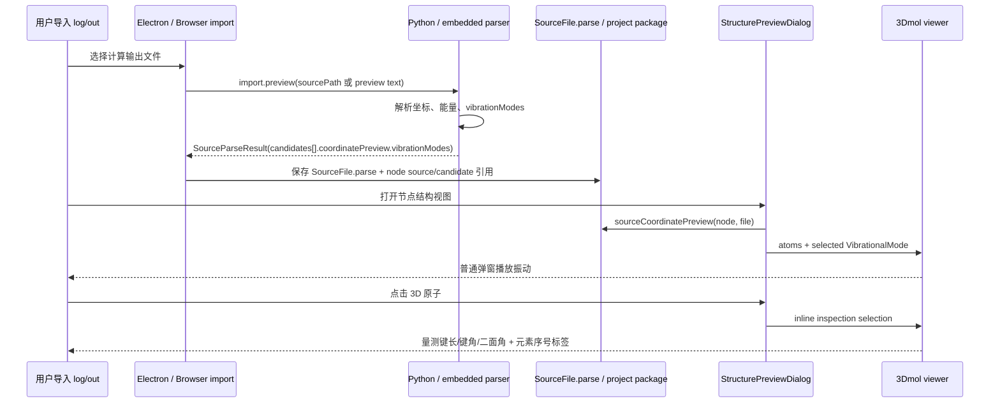

# vibration-3d-inspection design

## 0. 术语约定

- **VibrationalMode / 振动模式**：一次频率计算中的一个 normal mode，包含频率 `frequencyCm1` 和每个原子的位移向量。术语检索结果：现有 active code 没有结构化 vibration 类型，只有 3D 面板里的占位 `Play vibration` 按钮；历史 parser baseline 明确把 frequency / vibration 排除在首版之外。
- **VibrationDisplacement / 振动位移**：某个 mode 下单个原子的三维位移。数据内 `atomIndex` 使用 0-based，与 `CoordinatePreview.atoms[]` 对齐；UI 标签显示 1-based 序号，例如 `C1`、`H12`。
- **StructureMeasurement / 结构量测**：普通 3D 视图内联检查态里的用户操作结果。键长选 2 个原子，键角选 3 个原子，二面角选 4 个原子，单位分别是 Å 和 °。术语检索结果：旧 Three.js measurement 不属于 active code，当前应基于 3Dmol.js 重新设计。
- **AtomLabelMode / 原子标签模式**：3D 视图中的标签显示策略。本 feature 只新增“元素 + 序号”一种用户需要的模式，不恢复 2D/3D atom-map 编辑。

## 1. 决策与约束

### 需求摘要

用户目标：导入 Gaussian / ORCA 等计算输出后，RxnFlow 能解析振动数据；节点 3D 视图可以播放振动；在普通 3D 视图里直接选择 1/2/3/4 个原子，即可显示元素编号、键长、键角、二面角。

成功标准：同一个节点在保存 / 重开项目后仍能播放已解析振动；普通 3D 内联检查不依赖原始 log 重新解析；无振动数据时 UI 安静地禁用播放，不崩溃、不显示解释性大段文字。

明确不做：

1. 不运行外部量化计算任务，不提交 Gaussian / ORCA job。
2. 不做 IR/Raman 光谱图、频率表编辑、模式归属工作流或振动报告导出。
3. 不恢复旧自研 Three.js viewer、旧 structure measurement、2D/3D atom-map 编辑或旧 Object Registry。
4. 不把原始 log/out 作为项目长期 authority；保存恢复以结构化 project data 为准。
5. 不承诺 Gaussian/ORCA 全版本、Link1/compound job、scan/IRC/frequency 全组合兼容矩阵；首轮只覆盖 UI 可验证的常见 frequency 输出路径。

### 复杂度档位

- Robustness = L3（偏离内部工具默认 L2）：解析对象来自外部文本文件，振动向量长度必须和 atom count 对齐；错误只能降级为 warning / disabled state，不能污染项目数据。
- Structure = modules（偏离默认 functions）：`sourceParsers.ts`、`engine.py`、`embedded-engine.cjs` 和 `InspectorPanels.tsx` 已偏胖；新增振动解析、3D 交互计算应尽量落新模块，只在现有入口做薄接线。
- Testability = tested（偏离默认 testable）：parser contract、project roundtrip、3D 组件交互需要有单元/组件测试，UI 还要按项目规则浏览器验证。
- Security = validated（偏离 trusted）：项目保存/打开要校验振动 payload 的数组长度、数值和 project JSON 形状，避免坏项目文件把 viewer 弄崩。

### 关键决策

1. **继续使用 3Dmol.js，不恢复旧 Three.js viewer**。当前 architecture 明确 active 3D 结构由 `web/src/app/Molecule3DmolViewer.tsx` 承载；恢复旧 viewer 会把已经移出的测量/联动能力整体带回来，范围过大。
2. **振动数据作为 canonical structured data 保存**。解析阶段把 normal modes 写进 `SourceParseResult` / candidate 的结构数据；保存项目时跟 `files[].parse` 一起持久化。UI 不能要求重读原始 log 才能播放。
3. **`CoordinatePreview` 暂作为当前 active 结构载体扩展**。长期更准确的名字可能是 `StructurePreviewData`，但本次为了低风险接入现有 source/node 查找链路，在 `CoordinatePreview` 增加可选 `vibrationModes`，不做大规模重命名。
4. **默认播放“最可能有用”的 mode**。节点首次打开时优先选择 imaginary/负频 mode；没有负频时选择第一个有效 mode。完整 mode browser、频率表和谱图留给后续。
5. **普通 3D 视图直接承载内联检查**。结构弹窗不再提供全屏检查入口或 measurement toolbar；只保留关闭、编辑 2D、播放振动等图标按钮。键长/键角/二面角/标签由原子选择数量直接决定。

### 前置依赖

无阻塞前置依赖。`3dmol` 已是 Web 依赖；实现阶段只需确认其 click / label / render API 能满足当前交互，不能满足时使用 DOM overlay + 3Dmol 选中态组合，不引入第二套 3D 引擎。

## 2. 名词与编排

### 2.1 名词层

#### 现状

- `web/src/domain/sourceParsers.ts` 定义 `CoordinateAtom`、`CoordinatePreview`、`ParseCandidate`、`SourceParseResult`；当前只保存元素和坐标，不保存 normal modes。（`CoordinatePreview` / `ParseCandidate`）
- `rxnflow/engine.py` 有对应 dataclass：`CoordinateAtom`、`CoordinatePreview`、`ParseCandidate`、`RegisteredImportObject`；`parse_cclib_full_file()` 已读取 `atomcoords` / `atomnos`，但未读取 cclib `vibfreqs` / `vibdisps`。（`CoordinatePreview` / `parse_cclib_full_file`）
- `web/electron/embedded-engine.cjs` 是 packaged fallback engine，复制了一套 lightweight parser contract；当前也没有振动字段。
- `web/src/domain/projectPackages.ts` 的 `SourceFile.parse` 以 `SourceParseResult` 形状保存；`FlowNode` 只保存 source/candidate 引用和能量摘要，不保存坐标本体。结构视图通过 `sourceFileForNode()` + `sourceCoordinatePreview()` 回到 source parse 获取坐标。
- `web/src/app/Molecule3DmolViewer.tsx` 接收 `CoordinateAtom[]` 渲染 3Dmol ball-stick，只支持静态查看；`StructurePreviewDialog` 里已有 `Play vibration` 按钮，3Dmol 普通视图承载结构查看。

#### 变化

新增结构化类型（TypeScript / Python / embedded fallback contract 保持同形）：

```ts
// 来源：web/src/domain/sourceParsers.ts CoordinatePreview / ParseCandidate
export type VibrationDisplacement = {
  atomIndex: number // 0-based, must match CoordinatePreview.atoms[atomIndex]
  dx: number
  dy: number
  dz: number
}

export type VibrationalMode = {
  modeId: string
  modeIndex: number
  frequencyCm1: number
  kind: "imaginary" | "real" | "unknown"
  displacements: VibrationDisplacement[]
  reducedMassAmu?: number | null
  forceConstant?: number | null
  irIntensityKmMol?: number | null
  ramanActivity?: number | null
  source: "cclib" | "rxnflow-text" | "embedded-text"
}

export type CoordinatePreview = {
  atomCount: number
  has3d: boolean
  elements: string[]
  atoms?: CoordinateAtom[]
  vibrationModes?: VibrationalMode[]
  previewKind: "text" | "unavailable" | string
}
```

约束：

- `vibrationModes[].displacements.length` 必须等于 `atomCount`，否则丢弃该 mode 并产生 `vibration_shape_mismatch` warning。
- `frequencyCm1 < 0` 或 Gaussian imaginary marker 映射为 `kind="imaginary"`；普通正频为 `real`。
- `modeId` 在同一 candidate 内稳定，例如 `mode-1-imaginary-423.12`，不作为跨文件全局 ID。
- `FlowNode` 暂不新增 coordinate/vibration 字段；节点继续通过 `sourceFileId + sourceCandidateId` 获取对应 source parse，避免把同一结构数据复制到每个画布节点。

新增 UI 状态类型只属于 renderer：

```ts
// 来源：web/src/app/Molecule3DmolViewer.tsx / 新 3D inspection hook
export type StructureMeasurementMode = "distance" | "angle" | "dihedral" | null
export type StructureMeasurement = {
  id: string
  mode: "distance" | "angle" | "dihedral"
  atomIndices: number[] // 0-based selection order
  value: number
  unit: "Å" | "°"
  label: string
}
export type AtomLabelMode = "none" | "element-index"
```

### 2.2 编排层



#### 现状

导入流程是线性 pipeline：Electron 传 `sourcePath` 时 Python engine 读取 full file；失败或浏览器预览时使用 embedded/renderer lightweight parser。返回的 `SourceParseResult` 被写入 `SourceFile.parse`，候选登记生成画布节点。结构弹窗只从 `CoordinatePreview.atoms` 渲染静态 3Dmol 模型，播放按钮没有数据和行为。

#### 变化

1. **解析阶段插入 vibration extraction**：
   - Python full-file 路径优先读取 cclib `vibfreqs` / `vibdisps`，并补可用的 `vibirs` / `vibramans` / reduced mass / force constant。
   - Python text fallback 解析常见 Gaussian frequency block；ORCA 先优先 cclib，text fallback 只覆盖可以可靠识别的 normal mode block，不能可靠识别时返回无振动 + warning，不猜数据。
   - `web/electron/embedded-engine.cjs` 和 `web/src/domain/sourceParsers.ts` 提供同 contract 的 lightweight text extraction，用于 packaged fallback 和浏览器验证。
2. **持久化阶段保持 source parse authority**：`files[].parse.candidates[].coordinatePreview.vibrationModes` 随项目 JSON 保存；clone / normalize / validate 只接受有限数值数组。`FlowNode` 不复制振动数据。
3. **3D 弹窗阶段选择默认 mode**：`StructurePreviewDialog` 从 `CoordinatePreview.vibrationModes` 选择默认 mode，Play 按钮根据是否有有效 mode 启用。
4. **播放阶段由 viewer 本地动画控制**：`Molecule3DmolViewer` 在播放状态下用 `baseAtom + sin(t) * amplitude * displacement` 生成动画帧；停止时恢复原坐标。动画只影响 viewer，不写回项目数据。
5. **普通 3D 内联检查阶段接管 click selection**：普通 3D 视图不显示 measurement toolbar；按 atom click selection 数量自动决定 readout：1 个显示元素编号，2/3/4 个分别计算键长/键角/二面角并显示在左下角。选中原子通过 3Dmol 高亮，序号使用 `元素 + 1-based 序号`。

#### 流程级约束

- 错误语义：振动解析失败不使整体 source parse 失败；返回 warning 并禁用播放。坐标解析失败时 3D 视图仍显示 unavailable icon。
- 幂等性：同一 source parse 输入生成相同 mode order、modeId 和 default selected mode。
- 顺序约束：vibration displacements 必须和同一 candidate 的 latest coordinates 对齐；多 candidate / 多帧 source 不跨 candidate 复用 mode。
- 可观测点：parser warning codes 至少包含 `vibration_unavailable`、`vibration_shape_mismatch`、`vibration_parse_partial`；测试可断言。
- UI 边界：inline measurement selection 不应冒泡触发画布节点/edge selection；无需 fullscreen 或 measurement toolbar。

### 2.3 挂载点清单

1. `SourceParseResult` public payload：新增 `CoordinatePreview.vibrationModes` contract — 删除后解析出的振动无法进入 UI / project。
2. `import.preview` parser extraction：Python engine、embedded engine、renderer fallback 的 vibration extraction hook — 删除后不会产生振动数据。
3. Project package schema/normalization：`SourceFile.parse` 中 vibration payload 的 clone / normalize / validate 规则 — 删除后保存重开不能稳定保留振动。
4. Structure dialog UI：普通弹窗 Play vibration 按钮和 inline atom measurement layer — 删除后用户没有入口播放或量测。
5. 3Dmol viewer interaction layer：vibration animation、atom click selection、labels/measurement overlays — 删除后入口仍在但不可见或不可操作。

不列为挂载点：内部 parser helper、几何计算函数、测试 fixture 文件、CSS class 名、import 路径调整；它们是 implement 细节。

### 2.4 推进策略

1. **名词契约**：先落 `VibrationalMode` / `StructureMeasurement` contract 和 shape guards。
   退出信号：TypeScript/Python/embedded payload 能表达一个含 3 个原子、1 个 mode 的候选，并能拒绝 atom count 不匹配的 mode。
2. **解析节点**：接入 Python cclib + text fallback，并同步 embedded/renderer fallback 的最小 Gaussian text extraction。
   退出信号：fixture full-file preview 返回 `coordinatePreview.vibrationModes.length > 0`，无振动文件返回空数组或 undefined + warning。
3. **持久化节点**：让 source parse clone、project package roundtrip、desktop register path 都保留 vibration payload。
   退出信号：保存项目 JSON 再 parse/open 后，同一 node 的 structure dialog 仍能拿到 mode。
4. **3D 播放**：让普通 structure dialog 的 Play 按钮驱动 3Dmol viewer 振动动画。
   退出信号：有 mode 时按钮可用并能开始/停止动画；无 mode 时按钮 disabled 且无解释性大文本。
5. **普通 3D 内联检查**：实现 distance / angle / dihedral / element-index label 工具。
   退出信号：普通 3D 视图点击 1/2/3/4 个原子分别显示元素编号、键长、键角、二面角。
6. **验证收尾**：补齐 parser/unit/component 测试，运行 Web build/test 和 Python unittest，并做浏览器视觉/交互验证。
   退出信号：所有验收场景有测试或手动验证证据，且结构弹窗 UI 不出现多余注释文字。

### 2.5 结构健康度与微重构

##### 评估

compound convention 检索结果：`doc_type=decision category=convention` 下未找到“目录组织 / 命名 / 归属”相关长期约束。

- 文件级 — `web/src/domain/sourceParsers.ts`：约 1027 行，已混合多格式 text parser；本次需要加 renderer fallback vibration extraction，存在继续变胖风险。
- 文件级 — `rxnflow/engine.py`：约 2618 行，当前 local engine、parser、project validation 都在一个文件；本次会接入 Python vibration extraction，直接塞大段 parser 会进一步混杂。
- 文件级 — `web/electron/embedded-engine.cjs`：约 1835 行，是 packaged fallback 的 JS engine 镜像；本次需要同步 contract，但不宜借机重构整个 fallback。
- 文件级 — `web/src/app/InspectorPanels.tsx`：约 661 行，节点面板、候选 sheet、结构弹窗混在一起；本次只应薄接线，复杂交互放 viewer/inspection 子模块。
- 文件级 — `web/src/app/Molecule3DmolViewer.tsx`：约 122 行，当前职责单一；可以自然扩展成 viewer 壳，但 measurement math/toolbar 状态不宜全塞进去。
- 目录级 — `web/src/app/`：同层文件较多，本次若新增 1-2 个 structure inspection helper 文件仍可接受；大规模重组会和当前 UI 长会话改动冲突。
- 目录级 — `web/src/domain/`：同层 domain 文件数量可控，本次新增一个 vibration/geometry helper 可接受。
- 目录级 — `rxnflow/`：当前 Python active engine 仍集中在 `engine.py`；新增 `vibrations.py` 这类纯 helper 可降低继续膨胀。

##### 结论：不做前置微重构

本 feature 不安排“只搬不改行为”的前置微重构。理由：当前工作树已有大量 UI 改动，先做大文件搬迁会放大冲突；且本 feature 的风险点在新 contract / parser / viewer 行为，应该通过“新逻辑放新模块 + 现有入口薄接线”控制复杂度，而不是先移动历史代码。

执行约束：实现阶段新增 vibration parser / geometry measurement helper 时优先新文件；现有胖文件只保留接线、类型导出和调用入口。若实现时发现必须移动现有 parser 大段逻辑，停下来另走 `cs-refactor`，不在本 feature 偷偷做。

##### 超出范围的观察

- `rxnflow/engine.py` 与 `web/electron/embedded-engine.cjs` 长期需要 parser/project validation 分离；这已经超出“只搬不改行为”的安全微重构，建议后续单独走 `cs-refactor` 或 parser roadmap。
- `InspectorPanels.tsx` 可在后续把 `StructurePreviewDialog` 拆出独立组件，但本 feature 只要求新 3D inspection 逻辑不要继续堆在 node inspector 主体里。

## 3. 验收契约

### 关键场景清单

1. 输入含 Gaussian frequency / normal mode 数据的 full-file log → `import.preview` 返回 parsed candidate，且 `candidate.coordinatePreview.vibrationModes` 至少包含一个 mode，mode 的 displacement 数量等于 atom count。
2. 输入 cclib 可解析的 ORCA frequency output → Python full-file path 能通过 cclib 返回 vibration modes；如果 cclib 不可用或该 ORCA block 无法可靠 text parse，parse 成功但有 `vibration_unavailable` 或 `vibration_parse_partial` warning，不生成伪 mode。
3. 输入没有振动数据但有 3D 坐标的 source → 3D 结构正常显示，Play vibration 按钮不可用，不出现“没有振动数据”之类大块解释文字。
4. 保存含 vibration modes 的项目并重开 → 不读取原始 log 也能在同一节点结构弹窗里拿到 vibration modes。
5. 打开节点结构弹窗并点击 Play → 有有效 mode 时分子按该 mode 往复振动；再次点击停止并恢复静态坐标。
6. 对 transition node 且存在负频 mode → 默认播放负频/imaginary mode；没有负频时默认第一个有效 mode。
7. 普通 3D 视图中点击 1 个原子 → viewer 高亮并在左下角显示元素序号。
8. 普通 3D 视图中点击 2 个原子 → 左下角显示两原子距离，单位 Å，数值由当前坐标计算。
9. 普通 3D 视图中点击 3 个原子 → 左下角显示角度，单位 °。
10. 普通 3D 视图中点击 4 个原子 → 左下角显示二面角，单位 °，并处理 0/180° 附近数值稳定性。
11. 第 5 个不同原子会开启新的选择序列；重复点击已选原子会取消选择。
12. 普通 3D 视图量测 / 标签交互不触发画布节点选择、edge 选择或结构弹窗关闭；不出现 fullscreen toolbar。
13. vibration payload 中出现非数值、长度不匹配或 atomIndex 越界 → 对应 mode 被丢弃并产生 warning，项目打开和 viewer 不崩溃。

### 明确不做的反向核对项

1. 代码不应新增外部 Gaussian / ORCA job 提交、队列、进程启动或远程计算 API。
2. UI 不应新增 IR/Raman 谱图、频率表编辑、振动报告导出入口。
3. 不应引入第二套 Three.js viewer 或恢复历史 measurement / atom-map 代码。
4. 项目恢复不应要求读取原始 log/out；验收时可用仅含 `.rxnflow/project.json` 结构数据的场景验证。
5. 文案不应宣称 Gaussian/ORCA frequency 全版本全任务支持；warning / capability copy 必须保持窄口径。

## 4. 与项目级架构文档的关系

Acceptance 阶段需要同步：

- `.codestable/architecture/core-platform.md`：补充 local engine `import.preview` 当前可返回 vibration modes、相关 warning，以及 cclib/text fallback 边界。
- `.codestable/architecture/web-workbench.md`：补充 structure dialog / 3Dmol viewer 已支持振动播放和 inline measurement/labels；同时更新“不在 active code”里旧 measurement 的表述，说明本次是基于 3Dmol 的新实现，不是恢复旧 Three.js。
- `.codestable/architecture/ARCHITECTURE.md`：在 active Web Renderer / Local Engine 描述中补一句结构化 vibration data 的现状。
- `.codestable/requirements/structure-vibration-inspection.md`：验收通过后把 `status: draft` 更新为 `current`，`implemented_by` 加 `core-platform` 和 `web-workbench`，并在 VISION 索引中移动到 current。
