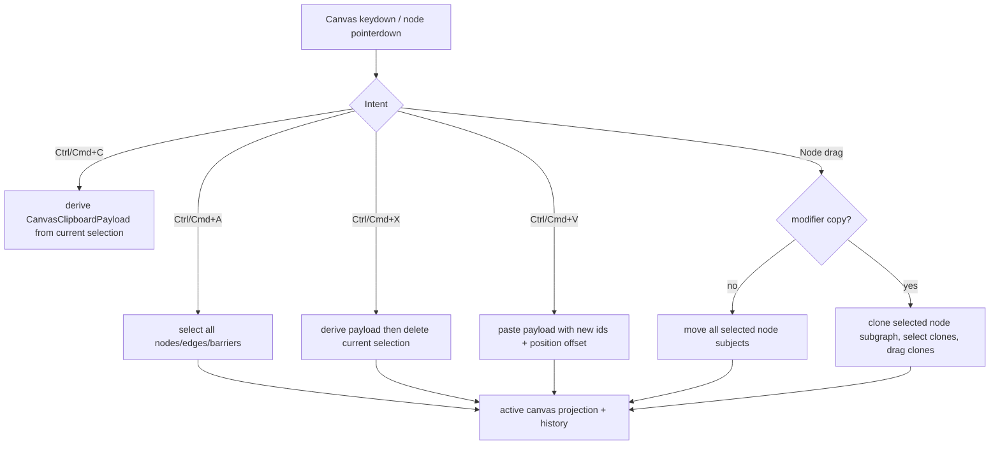

# canvas-editing-shortcuts design

## 0. 术语约定

| 术语 | 定义 | 防冲突结论 |
|---|---|---|
| Canvas Selection | 当前 active canvas 投影态里的 `selectedNodeIds` / `selectedEdgeIds` / `selectedBarrierIds` | 沿用现有数组协议，不新增 selection authority |
| Group Node Drag | 拖动已选节点之一时，整组选中节点按同一 delta 移动 | 不改变 edge / barrier 数据，edge 和 barrier 随节点位置自动重绘 |
| Modifier Copy Drag | 按住平台修饰键拖动节点时复制 selection，再拖动新副本；macOS 为 Option，Windows/Linux 为 Ctrl | 不使用 OS 全局拖放协议，只是画布内部 gesture |
| Canvas Clipboard Payload | RxnFlow 自己的当前画布剪贴板载荷，包含可复制的 nodes / edges / barriers | 第一版使用 app 内内存剪贴板，不承诺跨 app 或跨重启 |
| Scoped Canvas Shortcuts | 只有 canvas surface 或 canvas item 获得焦点且目标不是输入控件时响应的快捷键 | 不注册 Electron globalShortcut，不拦截表单输入 |

术语 grep 结果：当前代码已经有 `CanvasSelectionIds`、`CanvasDragState.kind = "rubber" | "node" | "pan"`、`deleteCanvasSelectionTransition`、`nudgeSelectedNodesTransition`、`canvasKeyboardTransitionForInput` 和 App 内 undo/redo history；没有 app 内 canvas clipboard，也没有批量 node drag 或 modifier-copy drag。

## 1. 决策与约束

### 需求摘要

本 feature 目标是让当前桌面画布具备用户自然期待的基础编辑器行为：

1. 框选多个节点后，拖动其中一个节点能批量移动所有选中节点。
2. 框选/多选后，Delete / Backspace 和右键 Delete 可批量删除 selected nodes / edges / barriers。
3. `Ctrl/Cmd+A` 全选当前 active canvas 中的 nodes / edges / barriers。
4. `Ctrl/Cmd+C` 复制当前 selection 到 app 内 canvas clipboard。
5. `Ctrl/Cmd+V` 在当前视口附近粘贴副本，并选中新副本。
6. `Ctrl/Cmd+X` 剪切当前 selection：复制后删除原 selection。
7. 拖动节点时，macOS 按住 Option、Windows/Linux 按住 Ctrl 会复制当前 node selection，并拖动新副本。
8. 已有 `Ctrl/Cmd+Z`、`Ctrl+Y`、`Shift+Cmd/Ctrl+Z`、Escape、方向键微移继续可用。

### 明确不做

- 不实现跨 app 系统剪贴板读写；`Ctrl/Cmd+C/V/X` 第一版只在 RxnFlow 当前 renderer 会话内工作。
- 不复制图片/text annotation；第一版只处理 nodes / edges / barriers。
- 不复制 source files、import ledger 或原始 log；复制出来的节点沿用原 `sourceFileId` 引用。
- 不跨 project / 跨 canvas 粘贴；第一版只在当前 active canvas 内复制粘贴。
- 不新增 Electron globalShortcut、菜单栏快捷键、系统服务或原生剪贴板格式。
- 不实现 lasso、图层、组合/取消组合、对齐分布、复杂 ChemDraw 分子结构剪贴板或跨应用 CDXML/CDX。
- 不改变 file import、node resize、edge connect handle、barrier handle、image annotation drag、pan/zoom/minimap 的既有行为。

### 复杂度档位

- Web interaction state：L3。要扩展 pointer drag、keyboard intent 和 clipboard state，但 authority 仍在当前 React active canvas。
- Persistence：L1。不改 project schema；复制/粘贴后的新图元作为普通 nodes / edges / barriers 进入现有 history 和 autosave。
- Shell / engine：L1。不改 Electron IPC、Python engine、import parser 或 project open/save contract。
- Testability：tested。核心复制/选择/拖动转移用 pure helper tests，App/Canvas component tests 覆盖快捷键和 gesture，浏览器做桌面/窄屏冒烟。

### 关键决策

1. **Clipboard 先做 app 内内存载荷**：避免把二进制图片、系统剪贴板权限和跨 app 格式混入第一版；用户最关心的同画布复制粘贴先闭环。
2. **复制只复制 selected 子图**：selection 中的 nodes 会复制；edge / barrier 只有两端节点都在复制集内才复制，避免生成悬空引用。
3. **新 id 由 paste / copy-drag 统一生成**：复制节点、edge、barrier 都映射到新 id；新节点位置整体偏移，粘贴后选中新节点和复制出的 edge/barrier。
4. **批量移动只移动 nodes**：edge / barrier 不需要独立改坐标，随节点位置重绘；只选中 edge/barrier 时拖动不触发 group node drag。
5. **修饰键复制只在 drag start 判定一次**：pointer down 时读平台修饰键；中途松开修饰键不切换 move/copy，避免 drag 过程状态跳变。
6. **快捷键仍 scoped 到 canvas**：复用 `shortcutTargetIsEditable`，输入框、textarea、select、contenteditable 内不响应画布快捷键。

## 2. 名词与编排

### 2.1 名词层

**现状**：

- `CanvasSelectionIds` 已表示 node / edge / barrier 三类 selection。（`web/src/app/canvasSelectionState.ts`）
- `CanvasDragState` 的 node drag 只保存单个 `nodeId`、单个 `origin`，pointer move 只返回一个 node position。（`web/src/app/canvasDragState.ts`）
- `nudgeSelectedNodesTransition` 已能移动多个 selected nodes；`deleteCanvasSelectionTransition` 已能删除 selection 并级联移除相关 edge / barrier。（`web/src/app/canvasDragState.ts`; `web/src/app/canvasEditState.ts`）
- `canvasKeyboardState.ts` 目前只识别 undo/redo/delete/clear/nudge；App 中 clipboard paste 只处理系统图片 paste。（`web/src/app/canvasKeyboardState.ts`; `web/src/app/App.tsx`）
- `CanvasSurface` 已有 rubber-band selection UI，但节点 drag 和右键 node 菜单会把 selection 替换为单节点。（`web/src/app/CanvasWorkspace.tsx`）

**变化**：

新增 app 内 clipboard 与复制结果契约：

```ts
type CanvasClipboardPayload = {
  nodes: FlowNode[]
  edges: FlowEdge[]
  barriers: FlowBarrier[]
  sourceSelection: CanvasSelectionIds
}

type PasteCanvasClipboardResult = {
  nodes: FlowNode[]
  edges: FlowEdge[]
  barriers: FlowBarrier[]
  selection: CanvasSelectionIds
}
```

扩展 node drag 契约：

```ts
type CanvasNodeDragSubject = {
  nodeId: string
  origin: Point
}

type CanvasNodeDragMode = "move" | "copy"

type CanvasNodeDragState = {
  kind: "node"
  pointerId: number
  nodeId: string
  start: Point
  subjects: CanvasNodeDragSubject[]
  mode: CanvasNodeDragMode
  snapshot: CanvasEditSnapshot
}
```

扩展 keyboard action：

```ts
type CanvasKeyboardAction =
  | { kind: "select-all" }
  | { kind: "copy" }
  | { kind: "paste" }
  | { kind: "cut" }
  // existing undo / redo / delete / clear / nudge / none
```

稳定规则：

- Select all = 当前 active canvas 的全部 `nodes.map(id)`、`edges.map(id)`、`barriers.map(id)`。
- Copy = 从当前 selection 派生 payload；无 selection 时 no-op。
- Paste = 复制 payload 并整体偏移；若连续 paste，同一 payload 每次继续偏移，避免完全重叠。
- Cut = copy 成功后执行现有 delete selection；进入同一个 undo history 节点或按现有 history 能恢复原图元。
- Copy drag = pointer down 在 selected node 上且平台复制修饰键按下时，先创建副本，dragState 指向副本 subjects。

### 2.2 编排层



**现状**：

- Pointer path：`CanvasSurface` forwards node pointer down to App; App calls `handleNodePointerDownAction`; pointer move previews node position; pointer up applies final single node position and pushes history if moved.
- Keyboard path：`CanvasSurface` scoped keydown calls `handleCanvasKeyboardEvent`; App handlers mutate current active canvas projection and push history.
- History path：all canvas edits use `pushEditHistory()` / `pushEditHistory(snapshot)`; undo/redo restore `CanvasEditSnapshot`.

**变化**：

- Node pointer down decides drag selection:
  - If clicked node is already selected and no Shift toggle is requested, drag subjects = all selected nodes.
  - If clicked node is not selected, drag subjects = clicked node only and selection becomes clicked node.
  - If copy modifier is active, derive clone subgraph first, push history, update selection to clones, and drag clone subjects.
- Pointer move for node drag applies the same delta to all drag subjects, using the existing live preview path where possible.
- Pointer up finalizes all subjects and pushes one history entry for the whole group move/copy drag.
- Keyboard `select-all/copy/cut/paste` is added to existing scoped handler; image paste fallback remains for system image paste when there is no canvas clipboard paste intent.
- Context menu delete uses existing `deleteSelection`, but node right-click should preserve multi-selection when right-clicking a selected node; right-clicking an unselected node still replaces selection.

**流程级约束**：

- Clipboard payload derives from current active canvas only.
- Clipboard helpers are pure and tested without DOM.
- New ids must not collide with existing node/edge/barrier ids.
- Copy/paste/cut and copy-drag all push edit history so undo restores previous state.
- Existing pan, node resize, connector drag, barrier drag, annotation drag and raw file drop targets keep stopPropagation boundaries.

### 2.3 挂载点清单

- Canvas keyboard shortcut registry：`CanvasSurface` / `appCanvasKeyboardActions` 增加 `Ctrl/Cmd+A/C/V/X`。
- Canvas pointer gesture registry：node pointer down 增加 group move 和 modifier-copy branch。
- App-level clipboard state：active renderer session 中保存 `CanvasClipboardPayload`。
- Canvas context menu selection behavior：右键 selected node 时保留 multi-selection，右键 unselected node 时替换为单节点。

本 feature 不挂入 Electron global shortcut、系统剪贴板、Python engine、project schema、import parser、report export、Settings 或 third-party canvas library。

### 2.4 推进策略

1. **Clipboard helper 契约**：新增纯 helper 处理 copy payload、paste id 映射、offset、selection 和 collision guard。
   - 退出信号：单测覆盖 selected 子图复制、悬空 edge/barrier 过滤、连续 paste 偏移、id 不冲突。
2. **Keyboard intent 扩展**：扩展 canvas keyboard transition 和 App handler，接入 select all / copy / paste / cut。
   - 退出信号：快捷键 scoped 生效，输入控件内不触发，undo/redo/delete/arrow 旧行为不回退。
3. **Group node drag**：扩展 node drag state，让 selected node group 可整体 move，并让右键 selected node 保留 multi-selection。
   - 退出信号：框选多个节点后拖动其中一个，所有 selected nodes 同步移动；批量 Delete 仍可用。
4. **Modifier copy drag**：在 node drag start 加平台复制修饰键分支，复制 selected 子图后拖动副本。
   - 退出信号：macOS Option / Windows Ctrl 复制拖动节点；普通 Ctrl/Cmd 快捷键不被误当作拖动复制。
5. **UI 验证与范围守护**：跑测试/build，并用浏览器验证桌面/窄屏手势。
   - 退出信号：画布快捷键和拖动路径可用，console clean；scope grep 未出现系统剪贴板/globalShortcut/schema/engine 改动。

### 2.5 结构健康度与微重构

##### 评估

- 文件级 — `web/src/app/App.tsx`：约 3471 行，仍是顶层装配容器；本 feature 需要接 clipboard state 和 handlers，但核心计算应下放到 helper，避免继续扩大 App 内逻辑。
- 文件级 — `web/src/app/canvasDragState.ts`：约 394 行，职责集中在 canvas drag pure transitions；扩展 group node drag 属于现有职责延伸。
- 文件级 — `web/src/app/canvasKeyboardState.ts`：约 66 行，职责集中在 keyboard intent pure resolver；适合扩展。
- 文件级 — `web/src/app/appCanvasPointerActions.ts`：约 437 行，职责是 pointer action orchestration；扩展时要避免塞入 copy/paste 计算，copy-drag 只调用 helper。
- 目录级 — `web/src/app`：约 88 个同层文件，目录已经摊平；但本 feature 只需要新增 1 个 helper/test 文件，不在本次做目录重组。
- compound 检索：未命中与 canvas clipboard / selection drag / 目录组织直接冲突的 active convention。

##### 结论：不做微重构

本次不做微重构，原因：需要改的 `canvasDragState.ts` / `canvasKeyboardState.ts` 都在既有职责内；`App.tsx` 很大但本次只做薄接线，核心逻辑放进新 helper，避免把大文件继续变胖。`web/src/app` 目录摊平是已存在问题，但本次只加一个 helper，不把目录重组混进交互 feature。

##### 超出范围的观察

- `App.tsx` 作为 renderer 容器仍过大，后续若继续加 canvas editing 能力，建议另开 `cs-refactor` 把 canvas command wiring / clipboard wiring / import wiring 拆成更清晰的 hook 或 action module。本 feature 不处理。

## 3. 验收契约

### 关键场景清单

1. 框选多个节点后，拖动其中一个 selected node，所有 selected nodes 按同一 delta 移动。
2. 右键 selected node 不丢失 multi-selection；右键 unselected node 替换为单节点 selection。
3. 框选多个节点后按 Delete / Backspace，selected nodes 及相关 edge/barrier 被删除。
4. `Ctrl/Cmd+A` 选中当前 active canvas 全部 nodes / edges / barriers。
5. `Ctrl/Cmd+C` 在有 selection 时写入 app 内 clipboard；无 selection 时 no-op。
6. `Ctrl/Cmd+V` 粘贴 clipboard 副本，新节点/edge/barrier id 不与现有图元冲突，并选中新副本。
7. `Ctrl/Cmd+X` 剪切 selection：clipboard 可再次粘贴，原 selection 被删除。
8. 连续 paste 同一 payload 时，新副本位置有递进偏移，不完全重叠。
9. 只选中 edge/barrier 时 copy/paste 不生成悬空 edge/barrier；没有两端节点的 edge/barrier 被过滤。
10. macOS Option + drag node 复制拖动；Windows/Linux Ctrl + drag node 复制拖动。
11. 普通拖动 selected node group 是移动，不复制。
12. 输入框、textarea、select、contenteditable 内的 A/C/V/X/Delete/Escape/Arrow 不触发画布快捷键。
13. 既有 `Ctrl/Cmd+Z`、redo、Escape clear、方向键微移继续可用。
14. node resize、edge connector drag、barrier handle drag、image annotation drag、pan/zoom/minimap 和 raw file drop 不回退。
15. Undo 能撤销 paste / cut / group move / copy drag 造成的画布改动。
16. 不新增 Electron globalShortcut、系统剪贴板 API、project schema、Python engine、import parser 或 report export 改动。
17. `npm --prefix web run test -- App --run` 通过。
18. `npm --prefix web run build` 通过。
19. 浏览器验证 `http://127.0.0.1:5173/`：桌面和窄屏下快捷键/拖动可用，页面无明显重叠，console 无 error。

### 明确不做的反向核对项

- 代码中不应新增 `globalShortcut`、`navigator.clipboard.write` / `read` 作为本 feature 的必需路径。
- Project package schema 不应新增 clipboard / draft / drag state 字段。
- Python engine / Electron IPC 不应新增 canvas clipboard command。
- 图片 annotation 不应被本 feature 的 copy/paste helper 复制。

## 4. 与项目级架构文档的关系

acceptance 阶段应更新 `.codestable/architecture/web-workbench.md` 的画布交互现状：

- Canvas Selection 增加 select all / copy / cut / paste；
- 框选后支持 group node drag 和批量 delete；
- 节点 drag 支持平台修饰键 copy-drag；
- clipboard 第一版是 renderer session 内存态，不是系统剪贴板或持久化项目字段。

总架构入口通常只需在 Web Renderer 当前 active 形态中补一句“常用画布剪贴板快捷键和多选拖动已支持”；core-platform / desktop shell 架构不需要更新。
