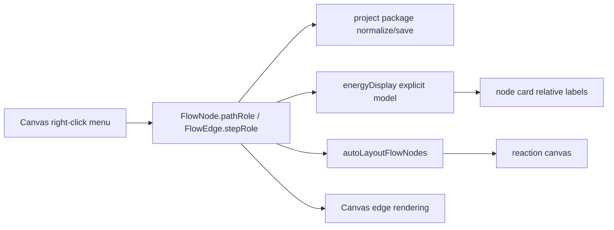

# reaction-path-semantics design

## 0. 术语约定

| 术语 | 定义 |
|---|---|
| Path state | 主反应路径上的状态节点，包含普通 intermediate / reactant / product 和 TS 节点 |
| Participant | 反应中加入或释放的自由物质，不作为主链节点计算巨大相对能量 |
| Step role | edge 的路径语义：`path`、`branch`、`addition`、`release` |
| Explicit semantics | 用户通过右键菜单写入节点或 edge 的持久化语义字段 |

## 1. 决策与约束

### 需求摘要

当前画布已经能画节点、edge、barrier，并能根据图结构猜 addition/release 能量表达式。但用户的真实反应网络包含释放物、加入物和分叉选择性路径，纯自动猜测会把 N2 / Cl / 3 这类自由物质当普通 INT，或把分叉路径误当主链，导致曲线和 ΔG 错。

本 feature 第一版只做手动语义编辑和消费：

1. 节点可标为 path state / participant / TS。
2. Edge 可标为 path / branch / addition / release。
3. 相对能量表达式优先使用显式 step role，participant 不进入相对能量表主链。
4. Auto layout 优先把 path/branch 节点放主路径，把 addition/release participant 挂到对应 step 附近。
5. Edge 在画布上用轻量视觉差异表达 addition/release/branch。

### 明确不做

- 不自动判断哪个文件是 release/addition/branch；自动建议后续另做。
- 不做完整 reaction mechanism editor、stoichiometry table 或数据库。
- 不改变 parser / cclib / source import。
- 不做跨画布路径合并。
- 不改变外部 ChemDraw 导入。

### 复杂度档位

- 数据模型：L2。只在 `FlowNode` / `FlowEdge` 增加可选语义字段，兼容旧项目。
- Canvas UI：L2。复用现有右键菜单，不新增大面板。
- Energy/layout：L3。反应路径能量只读显式语义；未标语义时按普通 path/state 处理，不自动猜 addition/release。

## 2. 名词与编排

### 2.1 名词层

**现状**：

- `FlowNode.kind` 只有 reactant / transition / intermediate / product，无法表示“这是自由 participant，不进主链”。
- `FlowEdge` 只有 `label`，无法区分 path、addition、release、branch。
- `energyDisplay.ts` 已有根据图结构猜 addition/release 的逻辑；这类自动拍板会让分叉和释放场景难以定位 bug。
- `autoLayoutFlowNodes()` 通过 energy rows 的 visibility 和 graph path 选择主链。

**变化**：

- `FlowNode.pathRole?: "state" | "participant"`。缺省等价于 `state`。
- `FlowEdge.stepRole?: "path" | "addition" | "release" | "branch"`。缺省等价于 `path`。
- 右键节点菜单可切换 State / Participant / TS。
- 右键 edge 菜单可切换 Path / Branch / Addition / Release。
- Energy rows 新增 participant term 角色，participant 默认隐藏 relative row 且相对能量为 null。

### 2.2 编排层

Energy graph 不再猜测 participant；它只按显式 step role 组装表达式：

- `addition`: participant 作为负项加入目标 path index 及后续 path state；
- `release`: participant 作为正项加入来源 path index 及后续 path state；
- `path` / `branch`: 参与主路径/分叉路径遍历；
- 未标语义的 edge 只按普通 `path` 处理，不推断 addition/release。

### 2.3 挂载点

- Project package normalize：保存 / 恢复 `pathRole` 与 `stepRole`。
- Canvas context menu：手动编辑节点和 edge 语义。
- Energy display：只消费显式语义和默认 path/state，不保留 addition/release heuristic fallback。
- Canvas geometry/drawing：participant 布局与 edge class/default label。

### 2.4 推进策略

1. 数据结构与持久化：类型、normalize、测试。
2. Energy model：删除 addition/release heuristic，改为显式语义唯一 authority。
3. Canvas UI：右键菜单编辑 node/edge 语义。
4. Layout / rendering：participant 侧挂与 edge 视觉差异。
5. 验证：单测、build、浏览器桌面冒烟。

### 2.5 结构健康度与微重构

本次不做独立微重构。`energyDisplay.ts` 已经承担相对能量表达式职责，第一版在该模块内把 addition/release 自动猜测替换为显式语义模型；`CanvasWorkspace.tsx` 和 `App.tsx` 已是画布装配主入口，但右键菜单改动很小，暂不拆新面板。

## 3. 验收契约

- 旧项目没有 `pathRole/stepRole` 时，project package 能正常打开并保持默认 state/path。
- 节点右键标为 Participant 后，节点不再显示普通 INT 相对能量，auto layout 把它放到主链上方/侧边。
- Edge 右键标为 Addition 后，该 participant 作为后续 path state 的负项进入表达式。
- Edge 右键标为 Release 后，该 participant 作为后续 path state 的正项进入表达式。
- Edge 右键标为 Branch 后，它参与路径连接但不被 addition/release 处理。
- 新语义字段保存到项目 JSON 后能恢复。

## 4. 卸载边界

删除本 feature 需要移除 `pathRole/stepRole` 类型字段、normalize 逻辑、右键菜单按钮、energy explicit model 分支、edge semantic CSS 和相关测试。
