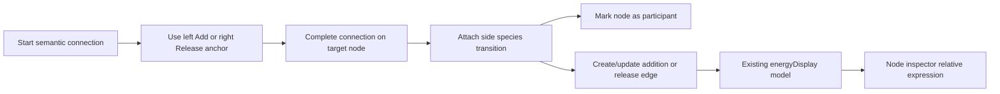

# step-composition-authoring design

## 0. 术语约定

| 术语 | 定义 | 防冲突结论 |
|---|---|---|
| Step composition | 一个 path node 周边的加入/释放物种关系，如 `A + Cl` 或 `B + 3` | 衔接既有 `addition` / `release` 语义，不引入独立能量模型 |
| Side species | 挂在 step 上的加入/释放物种 | 保存时仍使用既有 `FlowNode.pathRole = participant` |
| Add before | 把 side species 放到 path node 左侧反应物项 | 保存为指向该 path node 的 `addition` edge |
| Release after | 把 side species 放到 path node 右侧产物项 | 保存为从该 path node 指出的 `release` edge |
| Path connection | 普通状态节点之间的连线 | 不再暴露 `path` / `branch` 菜单项；分叉由拓扑自然表达 |
| Node energy expression | 节点面板里解释该节点 ΔG/ΔE 的实际相对能量表达式 | 使用 `energyDisplay` 产出的相对表达式，不显示在曲线标签上 |

## 1. 决策与约束

### 需求摘要

用户不应为了得到正确能量而理解 `participant + addition/release + branch` 的内部字段组合。新交互把核心动作收敛为连线：从游离物种连到节点左侧 `Add before` 小圆点，或从节点右侧 `Release after` 小圆点连到释放物种，系统自动写入显式语义；节点面板解释该节点 ΔG/ΔE 是怎么由 side species 和基准相减得到的。

成功标准：

- 节点右键菜单不再提供 `path state` / `participant` / `transition state`。
- Edge 右键菜单不再提供 `path` / `branch` / `addition` / `release` 四选一。
- 通过节点侧语义连线锚点建立对应 side species 关系，并更新 side species 节点为 participant。
- 普通 path/branch 不再显示为 edge 标签；side species 关系用边颜色和节点侧小圆点暴露给用户。
- 曲线标签不显示 step 公式；节点面板显示每个节点的 ΔG/ΔE 计算表达式。
- Gaussian/ORCA TS 判断优先来自 parser 证据，不再让文件名里的 `ts` 单独决定节点为 TS。

### 明确不做

- 不恢复 addition/release heuristic fallback；语义仍由用户动作显式写入。
- 不做自动化学配平、不从分子式推断加入/释放项。
- 不做多选节点一次性挂载到同一 step；第一版只支持一次连一个 side species。
- 不做完整 mechanism editor 或独立 reaction equation editor。
- 不删除项目数据中的 `stepRole` / `pathRole` 字段；本 feature 只改变作者入口和显示。

### 复杂度档位

走 Web canvas feature 默认档位。偏离点：

- Canvas interaction = L3：连线完成需要识别 `addition` / `release` 语义并同时更新 node / edge 两类集合。
- Parser semantics = L2：TS/INT 判断只调整已有 Gaussian/ORCA 解析的 kind/roleHint，不新增 parser 格式。

### 关键决策

- `branch` 不再作为用户菜单项。分叉由用户连出多条 path connection 表达，能量计算只看拓扑和 side species 关系。
- `participant` 不再作为节点菜单项。节点是否为 side species 由挂到 step 上的动作产生，避免先标节点再标边的两步操作。
- `transition` 不再作为节点菜单项。TS/INT 属于解析结果；短期用 frequency/route 证据，后续可以继续增强 parser，但不让用户在画布菜单里修正。
- Side species 连线复用既有 `addition` / `release` 持久字段，保证当前 energy model 不需要新 schema。

## 2. 名词与编排

### 2.1 名词层

**现状**

- [projectPackages.ts](/Users/linsay/Desktop/code/rxnflow/web/src/domain/projectPackages.ts:3) 已有 `NodePathRole` 和 `EdgeStepRole`。
- [energyDisplay.ts](/Users/linsay/Desktop/code/rxnflow/web/src/app/energyDisplay.ts:305) 已按显式 `participant` + `addition/release` 计算相对能量。
- [CanvasWorkspace.tsx](/Users/linsay/Desktop/code/rxnflow/web/src/app/CanvasWorkspace.tsx:1375) 会把 `stepRole` 直接显示为 edge label，导致 `Branch` 看起来像能量项。
- [sourceParsers.ts](/Users/linsay/Desktop/code/rxnflow/web/src/domain/sourceParsers.ts:887) 和 [engine.py](/Users/linsay/Desktop/code/rxnflow/rxnflow/engine.py:2799) 仍把文件名里的 `ts` 作为 TS 判断来源。

**变化**

- 新增节点侧语义锚点：path node 左侧 `Add before` 接收 participant -> path node 的 addition 连线，右侧 `Release after` 发起 path node -> participant 的 release 连线。
- 连接 draft 记录 `stepRole`：release 从右侧锚点发起时写入 draft，addition 在左侧锚点完成时写入目标语义。
- 新增 step formula projection：从 path edge 周边的 side species edge 生成 `A + Cl -> B + 3`。
- 新增 relative expression projection：`EnergyTableRow.relativeExpressionTerms` 保存节点 ΔG/ΔE 使用的实际相对表达式，供节点面板展示。
- 调整 parser kind/roleHint：Gaussian/ORCA 先看 imaginary mode 和 TS route，文件名不再单独把 log 变成 TS。

接口示例：

```ts
// 来源：web/src/app canvas pointer actions
startConnectionDraftTransition(pointerId, "product", point, "release")
// -> connection draft carries stepRole = "release"

createConnectionEdgeTransition(edges, edgeId, "product", "n2", "release")
// -> node "n2" pathRole = "participant"; edge "product" -> "n2" stepRole = "release"
```

### 2.2 编排层



**现状**

- 节点拖动结束只提交节点位置；右键菜单是唯一写入 `pathRole` / `stepRole` 的入口。
- Edge label 会把 `branch` / `addition` / `release` 当成可见标签展示。
- parser 先按文件名推断 `kind`，再通过 candidate roleHint 影响导入节点类型。

**变化**

- path node 左侧显示 `Add before` 锚点，普通连线拖到该锚点时创建/更新 participant -> path node 的 `addition` edge。
- path node 右侧显示 `Release after` 锚点，从该锚点拖出并连到释放物种时创建/更新 path node -> participant 的 `release` edge。
- 节点/edge 右键菜单只保留普通编辑动作，不再承担 reaction semantics authoring。
- Path edge label 不显示 step formula；`branch` 不再显示，side edge 仍可用 addition/release 视觉区分。
- Node inspector 在 ΔG/ΔE 行下方显示 `EnergyTableRow.relativeExpressionTerms` 对应的相对能量表达式。
- Gaussian/ORCA 的 `kind` / `roleHint` 从 parser evidence 归一后进入既有 import node 流程。

流程级约束：

- 普通节点移动不创建 side species 关系。
- 未完成有效连接时清空 draft，不创建 side species 关系。
- 重新把同一 side species 连到另一个 path node 时，移除该节点已有 addition/release side edge，再写入新的 side edge。
- Undo 应把语义连接写入视为一次画布编辑。

### 2.3 挂载点清单

- Canvas node connectors：新增 path node 左右小圆点语义连线入口。
- Node inspector：新增 ΔG/ΔE 计算表达式展示入口。
- Canvas context menu：删除节点/edge reaction semantics 菜单入口。
- Import parser projection：调整 Gaussian/ORCA `kind` / `roleHint` 的来源规则。

### 2.4 推进策略

1. 规格与清单：落 design/checklist 并校验。
   退出信号：frontmatter 和 checklist YAML 通过校验。
2. Step composition 状态：实现 addition/release attach transition、重复挂载替换、公式投影。
   退出信号：单测覆盖 addition/release attach、重复挂载、公式输出。
3. Canvas/Inspector 接线：渲染节点侧小圆点，语义连线完成时写入 side species，节点面板显示 ΔG/ΔE 表达式，清理误导菜单和 branch label。
   退出信号：相关 App/Canvas/Inspector 测试通过，浏览器可看到连线锚点和节点面板表达式。
4. Parser evidence：Gaussian/ORCA TS 判断改为 imaginary mode / TS route 优先。
   退出信号：parser/engine 相关测试覆盖文件名不再单独决定 TS。
5. 联调验证：跑前端测试、build，并用浏览器验证画布交互。
   退出信号：测试、build、浏览器冒烟通过或记录无法验证项。

### 2.5 结构健康度与微重构

##### 评估

- 文件级 — `web/src/app/App.tsx`：3755 行，职责很重；本 feature 只做 context menu 和 pointer end 接线，不在此文件新增领域逻辑。
- 文件级 — `web/src/app/CanvasWorkspace.tsx`：2085 行，混合画布渲染和小组件；本 feature 只新增语义锚点渲染入口，状态逻辑沿用 canvas pointer action。
- 文件级 — `web/src/app/appCanvasPointerActions.ts`：480 行，适合作为 pointer 编排层；只接入 attach transition。
- 文件级 — `web/src/domain/sourceParsers.ts` / `rxnflow/engine.py`：parser 文件偏长，但本次只调整 kind/roleHint evidence，不拆 parser 插件。
- 目录级 — `web/src/app`：91 个同层文件，已有 `canvas*` 模块模式；新增 `stepCompositionAuthoring.ts` 和测试延续现有扁平模式。

##### 结论：不做微重构

原因：大文件确实存在结构债，但把 App/CanvasWorkspace 拆分会超出“只搬不改行为”的安全边界。本 feature 用新增纯函数模块减少继续向大文件堆逻辑，结构性拆分后续单独走 `cs-refactor`。

##### 超出范围的观察

- `App.tsx` 和 `CanvasWorkspace.tsx` 已经明显过大，后续适合把 canvas rendering subcomponents 和 pointer orchestration 分层拆出。本 feature 不做该重构。

## 3. 验收契约

- 右键节点 → 菜单不出现 `Mark as path state`、`Mark as participant`、`Mark as transition state`。
- 右键 edge → 菜单不出现 `Step role: path`、`Step role: branch`、`Step role: addition`、`Step role: release`。
- 从 `Cl` 节点拖普通连线到 path node 左侧 `Add before` 小圆点 → `Cl` 节点显示为 `PART`，生成 addition side edge，目标节点面板表达式包含 `- Cl`。
- 从 path node 右侧 `Release after` 小圆点拖线到 `3` 节点 → `3` 节点显示为 `PART`，生成 release side edge，后续节点面板表达式包含 `+ 3`。
- 同一 side species 重新连到另一个 path node 语义锚点 → 旧 addition/release side edge 被替换，不产生重复 side edge。
- 普通分叉连线不显示 `Branch` 标签，能量不因为 `branch` 菜单缺失而改变。
- 曲线标签不显示 step formula，用户标注空间不被系统公式占用。
- Gaussian 文件名含 `ts` 但没有 imaginary mode / TS route → 不再单独导入为 TS。
- Gaussian 有一个 imaginary mode 或 route 明确 `Opt=TS` / `QST2` / `QST3` → 导入为 TS。

反向核对：

- 不新增 addition/release heuristic fallback。
- 不新增化学配平或 formula 推断 side species 的逻辑。
- 不新增多节点批量挂载。

## 4. 与项目级架构文档的关系

Acceptance 阶段需要把“reaction path semantics 的用户入口从右键菜单迁移到 step composition authoring”回写到 canvas / reaction path 相关架构说明。核心数据字段仍是既有 `pathRole` / `stepRole`，系统级数据模型无需新增 schema。
