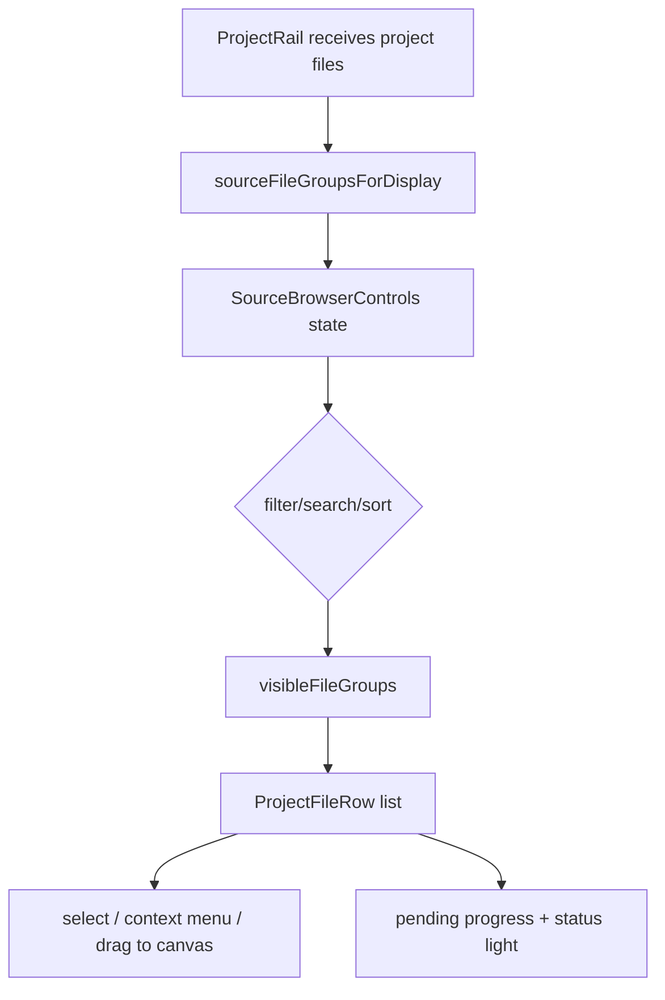

# source-browser-rail design

## 0. 术语约定

| 术语 | 定义 | 防冲突结论 |
|---|---|---|
| Source Browser | Project Rail 中展示 active project 源文件的文件浏览区 | 替代“松散 file list”的说法，不改变项目级 `files` authority |
| Source File Group | `sourceFileGroupsForDisplay(files)` 返回的 gas / sol 合并展示行 | 沿用现有分组逻辑，不引入树数据模型 |
| Attention Filter | 聚合解析失败、解析中、缺 gas/sol pairing 的待关注文件 | 只是视图过滤，不改 parse status / sol pairing 数据 |
| Native Rail Scroll | Project Rail 内唯一的原生纵向滚动容器 | 不用自绘滚动、不拦截 wheel、不把滚动绑到 drag gesture |

## 1. 决策与约束

### 需求摘要

用户反馈左侧栏不够紧凑、同屏文件太少，触控板滚动在文件列表区域会卡住；同时希望接近 VSCode 的文件栏能力：可以拖动文件到画布，也能顺滑滚动，并且有快速搜索、筛选和排序。

本 feature 的目标是：

1. Source Browser 文件行更紧凑，同屏展示更多源文件。
2. Files 区提供搜索、状态筛选和排序，不再只能靠滚动找文件。
3. Project Rail 使用单一原生滚动容器，避免嵌套滚动和 Electron drag region 干扰触控板。
4. 保留现有 source file group、gas/sol pairing、解析进度条、状态灯和拖到画布创建节点的行为。
5. 先不引入重型树组件；为后续按需接入虚拟列表留下清晰行模型边界。

### 明确不做

- 不把 source files 改成真实文件夹树；当前项目源文件仍是扁平的项目级列表，只按 gas/sol pair 分组展示。
- 不新增 `react-arborist` / `react-dnd` / `react-window` 等重型依赖作为第一版默认路径。
- 不改变 Electron dialog/drop/import parser、项目持久化 schema 或 source pairing 数据结构。
- 不改变画布上的文件 drop 语义、节点创建语义或文件右键菜单的删除语义。
- 不实现复杂查询语法、标签系统、收藏、批量重命名或文件夹管理。

### 复杂度档位

- UI interaction：L2。增加 search/filter/sort 控件和滚动容器结构，但仍在 `ProjectRail` 内完成。
- Data model：L1。不改 `SourceFile`、project package、import ledger 或 source parser。
- Performance：L2。先通过原生滚动、固定行高、减少嵌套交互改善体验；若文件数继续上升，再接虚拟列表。
- Testability：tested。搜索/筛选/排序用组件测试覆盖，浏览器检查 DOM/CSS 与视觉密度。

### 关键决策

1. **先做 domain-specific source browser，不引入通用树组件**：`react-arborist` 更适合可展开目录树，会带入 `react-dnd`、`react-window`、redux 等依赖；RxnFlow 当前需要的是计算化学 source group、pairing、parse status、progress 和 canvas drag 语义，先保留自有组件更可控。
2. **滚动只保留一个原生容器**：`project-rail-scroll` 承载 Projects + Files 的纵向滚动，Project Rail 本身 `overflow: hidden`，减少触控板滚动命中不同层造成的卡顿。
3. **Project Rail 全域 no-drag**：左侧栏是交互资源面板，不是窗口拖动区域；用 `-webkit-app-region: no-drag` 防止 Electron hit-test 吃掉 wheel / drag / select。
4. **搜索/筛选/排序只作用于展示层**：query/filter/sort 从 `SourceFileGroup` 派生，不写回项目，也不改变文件顺序 authority。
5. **后续虚拟化只替换列表渲染层**：若大项目仍出现性能问题，优先评估 `react-virtuoso` 或 `@tanstack/react-virtual`，而不是把 source browser 改成文件树。
6. **Source Browser 控件默认折叠，不改变左栏主体节奏**：搜索、筛选、排序属于辅助工具，不常驻占用 Files 区高度；默认只在 Files 标题旁显示放大镜入口，点开后才显示低对比工具条。
7. **文件状态提示不使用浏览器原生 title tooltip**：原生 tooltip 会跨出 rail 并且视觉不受控。状态原因保留在按钮 aria label 里，同时只在橙/红状态点 hover 时显示 rail 内部轻提示。
8. **Project 行和 palette 回到旧版 soft mint 语言，但避免“大按钮化”**：Project section 保留旧版淡 mint active 背景和柔和圆角；Project 行高收敛到约 34px，`PROJECTS` label 的起点与右侧 Node 面板内容区接近；文件 rows 仍单独压缩。

## 2. 名词与编排

### 2.1 名词层

**现状**：

- `ProjectRail` 接收项目、canvas、source files 和操作 callbacks，直接渲染项目列表、canvas 列表、文件列表和 settings 入口。
- `sourceFileGroupsForDisplay(files)` 已经负责把 gas/solution 对合并成展示组，并暴露 `displayName`、`displayKind`、`hasParsedGasLog`、`hasParsedSolutionLog` 等视图字段。
- 文件行已经负责 selected/active 状态、parse pending progress、missing pair 状态灯、parse issue tooltip 和 HTML drag payload。

**变化**：

新增纯展示状态：

```ts
type FileFilterMode = "all" | "attention" | "missing-pair" | "parse-error" | "parsing"
type FileSortMode = "project" | "name" | "kind" | "status"
```

新增派生视图：

```ts
visibleFileGroups = sourceFileGroupsForDisplay(files)
  .filter(byFilterMode)
  .filter(bySearchQuery)
  .sort(bySortMode)
```

搜索文本来自 group display name/kind 与文件 name/kind/parse label/formula/method/solvent/parser warnings。筛选只根据现有 missing pair、parse issue、pending parse 判断。

### 2.2 编排层



**现状**：

- Files 区直接 map 全量 `fileGroups`。
- Project Rail 和局部区域存在多层 CSS override，滚动命中不够稳定。
- Files 区没有搜索、筛选、排序，用户只能靠手动滚动定位。

**变化**：

- `ProjectRail` 外层新增 `project-rail-scroll` 作为唯一纵向滚动容器。
- Files section 头部新增 `SourceBrowserControls`，包含 search input、filter select、sort select 和 group/file count。
- 文件行固定 30px 高度，图标、文本、进度条和状态灯尺寸收紧。
- 视觉 cohesion pass 后，搜索/筛选/排序默认折叠到 Files 标题放大镜里，展开后才显示低对比 rail toolbar；active project/file 从整块高饱和底色收敛为旧版 soft mint 淡背景。
- 状态提示从 button/title 原生 tooltip 改为状态点 hover 的 rail 内部提示，避免提示浮到画布上。
- Project rows 保留旧版 soft mint 语言但不做成大按钮，文件 rows 单独压缩到中等高度。
- `visibleFileGroups.length === 0` 时显示 `No matching files`，不误导为项目没有文件。
- Project Rail 和 hover preview 内部全部声明 no-drag，保护输入、滚动和文件拖拽。

### 2.3 挂载点清单

- Project Rail source browser controls：搜索/筛选/排序展示入口。
- Project Rail scroll shell：单一原生滚动容器和 compact density CSS。
- Source file row display：保持现有 group row / drag / pending / status indicator 语义。
- ProjectRail component tests：覆盖新展示控制和既有 import action。

本 feature 不挂入 parser engine、Electron import IPC、project package schema、canvas drop parser、report export、Settings 或第三方 tree/list dependency。

### 2.4 推进策略

1. **Source Browser 控件和派生列表**：增加 search/filter/sort state，并从 `SourceFileGroup` 派生 `visibleFileGroups`。
   - 退出信号：搜索、Attention/Missing/Error/Parsing 筛选、Name/Kind/Status 排序可独立工作。
2. **原生滚动容器收敛**：把 Project Rail 内容放入单一 `project-rail-scroll`，压缩行高和间距。
   - 退出信号：文件列表区域触控板滚动命中同一个 overflow 容器，Project Rail 不作为 Electron drag region。
3. **测试与视觉验证**：补组件测试，跑相关测试/build，用浏览器检查控件、滚动 CSS、行高和视觉密度。
   - 退出信号：ProjectRail 测试通过，build 通过，浏览器 DOM/CSS 检查符合 contract。
4. **后续虚拟化评估钩子**：记录 `react-virtuoso` / `@tanstack/react-virtual` 为大列表候选。
   - 退出信号：文档明确第一版不引重型树组件，后续只在性能数据需要时替换列表渲染层。

### 2.5 结构健康度与微重构

##### 评估

- 文件级 — `web/src/app/ProjectRail.tsx`：组件已经承载 project/canvas/files/settings 四类 UI；本次新增控件会继续扩大它，但 source browser 控件仍是 Project Rail 局部展示职责。
- 文件级 — `web/src/app/workbench.css`：文件很大且已有多轮 override；本次只能追加聚焦的 final override 区块，避免中途重排旧样式引发更大 UI 回归。
- 目录级 — `web/src/app`：当前目录已经摊平；本次只新增 `ProjectRail.test.tsx`，不做目录重组。
- compound 检索：未命中 source browser / project rail list virtualization 的既有长期 convention。

##### 结论：不做微重构

本次不做微重构，原因：用户当前痛点是可用性和滚动手感，先在现有 Project Rail 表面收敛交互；如果后续要引入虚拟列表或拆分 Project Rail，应另开 refactor/feature，把 source browser 独立成 `SourceBrowser` 子模块，而不是混在这次 UI 修复里。

##### 超出范围的观察

- `workbench.css` 已经明显偏大，后续继续改 UI 时建议分层整理 design tokens、workspace shell、canvas、rail、dialogs、export 等样式边界。
- 如果 source files 经常超过几百行，应基于实际 profiler 数据接 `react-virtuoso` 或 `@tanstack/react-virtual`，不要为了“像 VSCode”直接上 tree library。

## 3. 验收契约

- 输入多个 source files → Files 区显示 compact row，并显示 group/file count。
- 在 Search 输入文件名、method、formula、solvent 或 parser warning 关键词 → 只显示匹配的 source groups。
- 选择 Attention → 显示 missing pair、parse error、parsing 任一待处理 group。
- 选择 Missing pair / Errors / Parsing → 只显示对应 group。
- 选择 Name / Kind / Status 排序 → 视图顺序变化，项目内 `files` 数据不被重排。
- Files 区无匹配结果 → 显示 `No matching files`，不是 `No local files`。
- 从文件行拖到画布 → 仍使用既有 source drag payload 创建节点。
- Electron 桌面窗口中 Project Rail 内输入、选择、滚动和拖文件不被窗口拖拽区域抢事件。
- 不新增 parser、Electron import、project schema、report export 或第三方 tree/list dependency。

## 4. 相关位置

- `web/src/app/ProjectRail.tsx` — Project Rail 装配、Source Browser 控件、展示过滤/排序、文件行。
- `web/src/app/fileDisplay.ts` — Source file group 生成和 gas/solution pair 展示规则。
- `web/src/app/workbench.css` — Project Rail 单一滚动容器、compact row 和 no-drag override。
- `web/src/app/ProjectRail.test.tsx` — Source Browser 搜索/筛选/排序组件测试。
