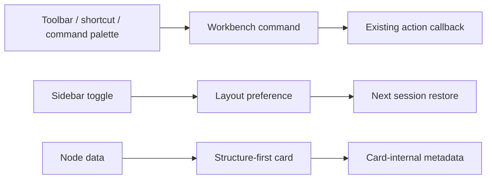

# 工作台交互基础设施与结构主体节点卡设计

## 0. 需求摘要

面向高频编辑反应路径的计算化学用户，降低工具栏学习成本和节点信息扫描成本。工具栏按职责分组并显示动作/快捷键提示，增加 `⌘/Ctrl+K` 命令面板；左右侧栏展开状态跨会话恢复；键盘焦点和状态语义可见。节点卡以 2D 结构为视觉主体，文件/来源状态、相对能量、TS/INT/P 等角色全部进入卡片内部。

成功标准：不查看 Inspector 也能从节点卡识别结构、名称、角色、相对能量与来源状态；核心命令可从工具栏、键盘或命令面板到达；重开应用后侧栏保持上次状态；Tab 操作始终有可见焦点。

明确不做：不替换画布引擎，不引入大型视觉组件库，不改变能量计算、项目 schema 或解析语义，不把连线端口和 resize/barrier 操作隐藏到卡片内容里。

## 1. 决策与约束

- 视觉方向：结构是节点的“化学身份证”，卡片采用干净的 scientific specimen 画布。常驻信息只保留名称、相对能量、电荷/多重度和异常状态灯；不显示来源文件名、能量单位或 TS/INT/R/P/PART 文本。TS 与普通节点通过暖/冷阴影区分。3D 固定在右上角，barrier/resize 与次级 connector 按 progressive disclosure 出现。默认系数 1 不显示，非 1 系数以 `{n}x` 显示并只从节点右键菜单编辑。
- 连线输入/输出、addition/release、barrier 和 resize 继续位于卡片边界，因为它们表达拓扑操作而不是节点数据。
- 工具栏拆成能量/视图、创作工具、历史/布局三个语义组；快捷键进入 tooltip 与 `aria-keyshortcuts`。
- 命令面板只编排现有动作，不复制业务实现。
- 侧栏偏好属于设备 UI 偏好，不写入项目包；使用带版本的本地偏好值。
- 复杂度走默认桌面编辑器档位；窄屏继续优先保证画布面积。

## 2. 现状 → 变化

### 2.1 名词层

现状：`CanvasTool`、`WorkbenchViewMode`、toolbar callbacks、左右 sidebar boolean 和 `ReactionNodeCard` 已存在；侧栏 boolean 每次启动固定为 true；节点 header、preview、energy strip 是三个纵向区块。

变化：新增统一的 `WorkbenchCommand` 描述（id、label、shortcut、group、enabled、run）；新增 versioned `WorkbenchLayoutPreference`（leftSidebarOpen/rightSidebarOpen）；节点卡的既有字段不变，只改变卡内呈现契约。

示例：`fit-view → { label: "Fit View", shortcut: "F", group: "View" }`；`{ leftSidebarOpen: false, rightSidebarOpen: true }` 重启后恢复。

### 2.2 编排层

现状：toolbar 直接渲染图标与 callbacks；快捷键分散在 App/CanvasSurface；节点卡纵向占位；侧栏状态不持久化。

变化：命令描述成为 toolbar、快捷键和 palette 的共享编排层；palette 过滤后调用同一 callback。侧栏 toggle 同步写入设备偏好。节点卡保留 memo 边界，把结构 preview 扩展为主体区域并叠加 header/footer metadata。

错误语义：disabled command 在 palette 中可见但不可执行；无 2D depiction 时保留紧凑 pending 引导；持久化偏好损坏时回退默认值。

### 2.3 挂载点

- Canvas toolbar 的分组与快捷键提示。
- App 级 `⌘/Ctrl+K` command palette。
- 左右侧栏 toggle 的本地布局偏好。
- Reaction node card 的 structure-first 卡内布局。
- 全局交互控件的 `:focus-visible` 与状态非颜色语义。

### 2.4 推进策略

1. 建立 command/layout preference 编排骨架，现有动作行为不变。
2. 重组工具栏并接入命令面板和键盘入口。
3. 重构节点卡静态结构与响应式视觉。
4. 补侧栏恢复、焦点与 aria-live/非颜色状态。
5. 完成测试、浏览器桌面/窄屏验收和文档回写。

### 2.5 结构健康度与微重构

`App.tsx`、`CanvasWorkspace.tsx` 和 `workbench.css` 已明显偏胖。本 feature 不继续把 command palette 与 preference helper 内联进 App：新增独立模块/组件；节点卡暂保留在 CanvasWorkspace 的 memo 边界，只做局部结构替换，避免把行为重构与视觉变更混在一起。CSS 新规则集中为单一 feature section，并减少新 `!important`。目录已有按职责拆分的 app 模块，不做目录重组。

超出范围观察：App/CanvasWorkspace 的系统性拆分和历史 CSS 层清理应后续单独走 refactor，不作为本 feature 前置。

## 3. 验收契约

- 点击 toolbar、使用快捷键或从 palette 选择同一命令 → 观察到相同动作结果。
- `⌘/Ctrl+K` → palette 打开；输入命令名称可过滤；Escape 关闭；disabled 命令不可执行。
- 折叠任一侧栏并重新加载 → 保持上次展开状态；损坏偏好 → 使用默认双栏展开。
- 节点有 2D depiction → 结构占据主要面积，名称、能量、单位、角色、来源状态均在卡内可见。
- 节点无 depiction → 显示紧凑 pending 状态，不挤掉名称和能量。
- TS/INT/P/来源 warning 除颜色外还有文本或图标语义。
- Tab 遍历 toolbar、node、connector、menu/dialog controls → 每个焦点均清晰可见。
- 900×700 → 侧栏折叠后 toolbar/palette/node card 不产生页面横向溢出。
- 不改变项目 schema、能量数值、edge/barrier 连接行为和 2D/3D viewer 数据来源。

## 4. 推进备注

用户已明确确认工具栏/快捷键/命令面板、侧栏偏好记忆、无障碍清理和 structure-first 节点卡，本文按该指令视为整体批准并进入实现。
