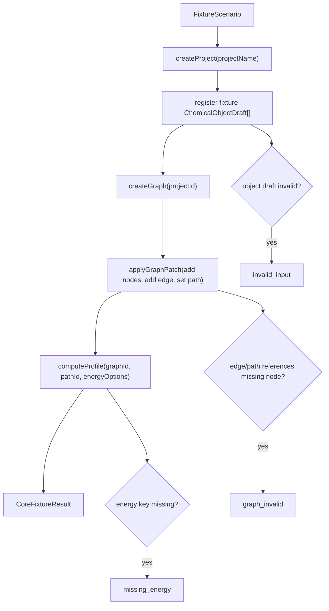

# core-fixture-vertical-slice design

## 0. 术语约定

| 术语 | 定义 | 防冲突结论 |
|---|---|---|
| Core Fixture | 内置、确定性的最小测试场景，不从 Gaussian/ORCA/XYZ 文件解析，也不声称代表真实化学体系 | 只在本 feature 中作为开发夹具使用；后续真实文件 fixture 归 `parser-plugin-baseline` |
| Vertical Slice | 从项目创建到对象登记、反应图构造、能量 profile 输出的端到端最窄链路 | 不是完整产品流程，不包含 UI、导出、真实持久化 |
| Chemical Object | 项目内可复用的化学对象，保存来源、结构/能量字段和校正项 | 沿用 roadmap 的 `ChemicalObject` 概念；本 feature 只填最少字段 |
| Reaction Graph | 由节点、边和路径组成的反应网络结构 | 本 feature 只支持两个 species 节点和一条路径，不覆盖分叉 |
| Energy Profile | 针对某条 ReactionPath 计算出的绝对/相对能量序列 | 本 feature 只覆盖单一 `electronic` energy key 和 kcal/mol 输出 |

术语 grep 结果：当前仓库除 `AGENTS.md`、roadmap 和 CodeStable reference 外没有应用代码；上述名词没有代码层冲突。

## 1. 决策与约束

### 需求摘要

本 feature 的目标是建立 RxnFlow 核心平台的第一条可执行链路：使用内置 fixture 创建一个项目，登记两个 ChemicalObject，构造一条两节点 ReactionGraph，并计算以第一个节点为基准的相对能量表。

面向对象是后续实现 parser、registry、graph editor、energy engine 的开发者和 agent。成功标准是：不依赖真实文件、不依赖 UI、不依赖导出库，也能通过一个稳定入口得到可验证的 Project / ChemicalObject / ReactionGraph / EnergyProfile 输出。

明确不做：

- 不解析 Gaussian、ORCA、XYZ 或任何真实计算输出文件。
- 不实现持久化项目目录、SQLite、数据库或文件保存格式。
- 不实现 Web UI、画布、CLI 产品命令或报告导出。
- 不处理多组分态、过渡态、分叉路径、校正项计算、热化学表达式或溶剂化公式。
- 不把 fixture 数据当成真实化学体系或推荐示例反应。

### 复杂度档位

默认按“项目内部工具”档位推进。偏离项：

- 结构 = modules（偏离默认 functions）：虽然是最小闭环，但它要为后续 parser、registry、graph 和 energy feature 提供模块边界。
- 可测试性 = tested（偏离默认 testable）：这是核心链路种子，必须有测试或等价可重复验证覆盖正常、边界、错误路径。
- Determinism = deterministic：fixture id、输入能量、计算结果应稳定，避免后续验收被随机值干扰。

### 关键决策

1. **使用非真实内置 fixture**：fixture 只表达数据流，不表达真实反应。这样可以先稳定核心接口，避免第一条 feature 被真实解析格式拖住。
2. **能量基线固定为第一个节点**：本 feature 中 `baselineNodeId` 默认取 path 的第一个 node。后续 UI/CLI 再允许用户选择基线。
3. **能量输入使用 hartree，输出使用 kcal/mol**：fixture 使用两个 `electronic` energy 值，按 `1 hartree = 627.509474 kcal/mol` 转换相对能量。这个常数需要在实现中显式命名和测试。
4. **服务先允许内存实现**：Project Store 在本 feature 只需要创建内存 manifest 和资源索引，不承诺磁盘格式；持久化格式留给 `project-storage-model`。
5. **错误走 Result 协议**：缺失能量、无效图、缺失对象引用等错误必须映射到 roadmap 中定义的 `RxnFlowErrorCode`，不得静默填默认值。

### 前置依赖

无代码级前置依赖。roadmap item `core-fixture-vertical-slice` 处于 `planned`，`depends_on: []`，可以启动。

## 2. 名词与编排

### 2.1 名词层：值对象 / 实体 / 接口契约

**现状**：仓库当前没有应用代码。系统级名词只存在于 [rxnflow-core-platform-roadmap.md](/Users/linsay/Desktop/code/rxnflow/codestable/roadmap/rxnflow-core-platform/rxnflow-core-platform-roadmap.md) 第 4 节接口契约中，包括 `ProjectManifest`、`ChemicalObject`、`ReactionGraph`、`EnergyProfile`、`Result<T>`。

**变化**：新增一组可由后续实现映射的核心名词。字段以 roadmap 契约为准，本 feature 只要求最小可运行子集。

```ts
// 来源：codestable/roadmap/rxnflow-core-platform/rxnflow-core-platform-roadmap.md 4.1-4.6
type FixtureScenario = {
  projectName: string
  objects: ChemicalObjectDraft[]
  graph: {
    nodes: ReactionNode[]
    edges: ReactionEdge[]
    path: ReactionPath
  }
  energyOptions: EnergyOptions
}

type CoreFixtureResult = {
  project: ProjectManifest
  objects: ChemicalObject[]
  graph: ReactionGraph
  profile: EnergyProfile
}
```

**接口示例：正常路径**

```ts
// 来源：本 feature 新增核心入口，具体语言/文件由 implement 阶段决定
runCoreFixtureVerticalSlice({
  projectName: "fixture-minimal-reaction",
  objects: [
    { label: "Fixture A", energies: { electronic: { value: -100.000000, unit: "hartree" } } },
    { label: "Fixture B", energies: { electronic: { value: -99.980000, unit: "hartree" } } }
  ],
  graph: {
    nodes: [
      { id: "node-a", kind: "species", label: "A", chemicalObjectIds: ["object-a"] },
      { id: "node-b", kind: "species", label: "B", chemicalObjectIds: ["object-b"] }
    ],
    edges: [{ id: "edge-a-b", from: "node-a", to: "node-b" }],
    path: { id: "path-a-b", label: "A to B", nodeIds: ["node-a", "node-b"] }
  },
  energyOptions: {
    baselineNodeId: "node-a",
    outputUnit: "kcal_mol",
    includeCorrections: false,
    energyKey: "electronic"
  }
})
```

期望输出要点：

```ts
{
  ok: true,
  value: {
    project: {
      id: "project-fixture-minimal-reaction",
      name: "fixture-minimal-reaction",
      schemaVersion: "fixture-v0",
      resources: [
        { id: "object-a", kind: "chemical_object" },
        { id: "object-b", kind: "chemical_object" },
        { id: "graph-a-b", kind: "reaction_graph" },
        { id: "profile-a-b-electronic", kind: "energy_profile" }
      ]
    },
    objects: [
      { id: "object-a", label: "Fixture A", energies: { electronic: { value: -100.000000, unit: "hartree" } } },
      { id: "object-b", label: "Fixture B", energies: { electronic: { value: -99.980000, unit: "hartree" } } }
    ],
    graph: {
      id: "graph-a-b",
      nodes: [
        { id: "node-a", kind: "species", label: "A", chemicalObjectIds: ["object-a"] },
        { id: "node-b", kind: "species", label: "B", chemicalObjectIds: ["object-b"] }
      ],
      edges: [{ id: "edge-a-b", from: "node-a", to: "node-b" }],
      paths: [{ id: "path-a-b", label: "A to B", nodeIds: ["node-a", "node-b"] }]
    },
    profile: {
      id: "profile-a-b-electronic",
      points: [
        { nodeId: "node-a", relativeEnergy: { value: 0, unit: "kcal_mol" } },
        { nodeId: "node-b", relativeEnergy: { value: 12.55018948, unit: "kcal_mol" } }
      ]
    }
  }
}
```

**接口示例：错误路径**

来源：roadmap 4.6 Energy Engine 协议。使用正常路径中的默认 fixture scenario，只把 `energyOptions.energyKey` 从 `"electronic"` 改为 `"gibbs"`。

期望返回：

```ts
{
  ok: false,
  error: {
    code: "missing_energy",
    target: "node-a",
    message: "Energy key 'gibbs' is missing for node-a"
  }
}
```

### 2.2 编排层：主流程与控制流



**现状**：没有应用代码、没有项目创建 workflow、没有 registry、没有 graph service、没有 energy engine。当前只有 roadmap 中的模块边界和接口契约。

**变化**：新增一个最小编排入口，按固定顺序串联五个核心节点：

1. 创建内存项目 manifest。
2. 将 fixture object draft 登记为 ChemicalObject。
3. 创建空 ReactionGraph。
4. 用 GraphPatch 添加两个节点、一条边、一条 path。
5. 根据 path 计算 EnergyProfile 并返回聚合结果。

**跨层纪律**：

- 错误语义：每个节点返回 `Result<T>`；编排层遇到 `ok: false` 立即停止并透传错误。
- 幂等性：同一 fixture 输入在同一进程内重复运行应得到等价输出；稳定 id 可以由 fixture 显式传入或由 deterministic id 生成策略得到。
- 顺序约束：registry 必须先于 graph；graph 必须先于 energy profile；本 feature 不并发执行。
- 扩展点位置：parser、持久化 store、真实 UI、导出服务都不插入本编排；后续 feature 替换对应节点。
- 可观测点：正常结果应能打印/序列化为结构化对象；错误结果包含 `code`、`message`、`target`。

### 2.3 挂载点清单

本 feature 不引入产品级 UI、路由、数据库 schema、导出格式或用户命令挂入点。系统可见挂载点限定为开发/测试入口：

- Core fixture scenario：`core-fixture-vertical-slice` — 新增一条内置 fixture 场景。
- Core workflow entry：`runCoreFixtureVerticalSlice` — 新增一个可由测试或后续 CLI/UI 调用的核心入口。
- Energy conversion constant：`hartree_to_kcal_mol` — 新增一个共享转换常量或等价命名条目，供本 feature 的 energy profile 使用。

### 2.4 推进策略

1. **名词骨架**：建立最小领域模型和 `Result<T>` 错误协议。
   - 退出信号：可以构造 Project、ChemicalObject、ReactionGraph、EnergyProfile 的 fixture 对象。
2. **编排骨架**：实现 `runCoreFixtureVerticalSlice` 的线性 workflow，节点先返回 stub。
   - 退出信号：入口能从 fixture 输入走到聚合输出。
3. **登记与图谱节点**：填充对象登记、graph patch、path 校验逻辑。
   - 退出信号：两个对象、两个节点、一条边、一条 path 的结果可检查。
4. **能量计算节点**：实现 hartree → kcal/mol 相对能量计算和 missing energy 错误。
   - 退出信号：A 点相对能量为 0，B 点相对能量为 12.55018948 kcal/mol。
5. **验证覆盖**：补齐正常、图无效、缺失能量、明确不做反向核对。
   - 退出信号：所有验收场景都有可重复验证证据。

## 3. 验收契约

### 关键场景清单

1. 输入默认 fixture scenario → 返回 `ok: true`，结果包含一个 ProjectManifest、两个 ChemicalObject、一个 ReactionGraph、一个 EnergyProfile。
2. 输入默认 fixture scenario → EnergyProfile 第一个点的 `relativeEnergy.value` 为 `0 kcal_mol`。
3. 输入默认 fixture scenario → EnergyProfile 第二个点的 `relativeEnergy.value` 为 `12.55018948 kcal_mol`，允许实现层在展示时另行格式化，但核心值要可精确断言。
4. 输入 path 中引用不存在 node 的 scenario → 返回 `ok: false`，错误码为 `graph_invalid`，不得继续计算 EnergyProfile。
5. 输入 `energyKey: "gibbs"` 但 object 只有 `electronic` 的 scenario → 返回 `ok: false`，错误码为 `missing_energy`，不得把缺失值当作 0。
6. 重复运行同一 fixture scenario → 输出的关键 id、路径顺序和能量点顺序稳定。

### 明确不做的反向核对项

- 代码中不应出现 Gaussian / ORCA / XYZ 文件解析入口或真实 parser 注册。
- 输出结构中不应包含 PNG、CDXML、XLSX 或导出 artifact。
- 本 feature 不应新增 Web 路由、画布组件、桌面窗口或产品 CLI 命令。
- 本 feature 不应创建项目目录、SQLite 数据库或持久化文件格式。
- Fixture 数据不应在文档或代码注释中被描述为真实反应体系。

## 4. 与项目级架构文档的关系

Acceptance 阶段需要把下列已落地内容提炼回 architecture：

- 名词：ProjectManifest、ChemicalObject、ReactionGraph、EnergyProfile、Result 错误协议的最小落地形态。
- 动词骨架：fixture vertical slice 的线性核心 workflow，即 create project → register objects → build graph → compute profile。
- 跨层纪律：缺失能量不默认为 0、相对能量必须记录基线和单位、fixture 必须 deterministic。

关联现有架构文档：[ARCHITECTURE.md](/Users/linsay/Desktop/code/rxnflow/codestable/architecture/ARCHITECTURE.md)。当前只有架构总入口，acceptance 时应新增或补充核心模块描述，而不是只贴 feature 链接。
