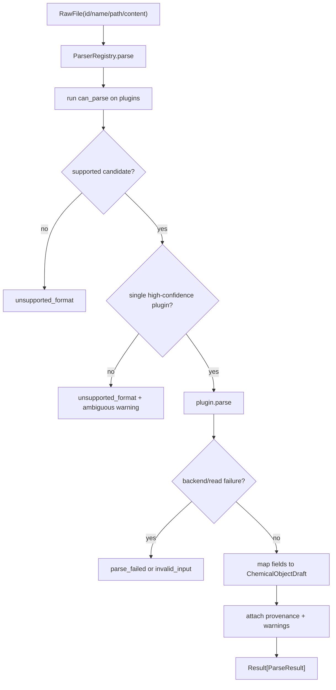

# parser-plugin-baseline design

## 0. 术语约定

| 术语 | 定义 | 防冲突结论 |
|---|---|---|
| Raw File | Project Store 登记的 `raw_file` resource 对应文件，可由 path 或 text content 承载 | 不等同于用户机器上的源文件绝对路径 |
| Parser Plugin | 一个可声明能力、解析单个 Raw File 并输出 ParseResult 的插件 | 不直接写 Project Store，也不登记 ChemicalObject |
| Parser Capability | `can_parse` 的探测结果，包含 supported、format、confidence、reason | 只做格式识别，不做完整解析 |
| Parse Result | 单次解析产物，包含 `ChemicalObjectDraft[]`、provenance 和 warnings | 不生成 ChemicalObject id，也不修改 Registry |
| Parse Warning | 解析可继续但信息不完整或有歧义时返回的警告 | 使用现有 `RxnFlowWarning` 承载 |
| Gaussian Log Plugin | 首批 Gaussian 日志解析插件 | 用 cclib 适配，不手写完整 Gaussian 大解析器 |
| ORCA Output Plugin | 首批 ORCA 输出解析插件 | 用 cclib 适配，不手写完整 ORCA 大解析器 |
| XYZ Plugin | 首批标准 XYZ / ASE extxyz 解析插件 | 标准 XYZ 给几何，extxyz 通过 ASE 读取能量、电荷、自旋等可用 metadata |
| MAPLE Output Plugin | 首批 MAPLE `.out` 和 MAPLE 风格多帧 `.xyz` 解析插件 | 不等同于运行 MAPLE；只解析已有输出文件 |

术语 grep 结果：当前代码只有 `ChemicalObjectDraft`、`Provenance`、`RxnFlowWarning`、`ProjectResource(kind="raw_file")` 等基础模型；没有 parser module、plugin registry、RawFile dataclass、ParseResult 或格式识别入口。

## 1. 决策与约束

### 需求摘要

本 feature 的目标是在核心层建立解析器插件协议，并用 Gaussian、ORCA、XYZ、MAPLE 四类 fixture 跑通“raw file → ChemicalObjectDraft”的最小闭环。完成后，后续 Import Workflow 可以在不关心具体格式的情况下：

1. 把 Project Store 中的 `raw_file` resource 读成 Raw File 输入。
2. 调用 Parser Registry 找到候选 Parser Plugin。
3. 调用插件 parse，得到 `ChemicalObjectDraft[]`、provenance 和 warnings。
4. 把 ParseResult 交给后续 Chemical Registry，而不是 parser 直接登记对象。

成功标准是：不用 UI、不写 Registry、不修改 Project Store，也能通过 Python API 对四类 fixture 文件做格式识别和基础字段解析。

明确不做：

- 不实现 Web/CLI/macOS/Windows 文件导入入口。
- 不把解析结果写入 Project Manifest 或 Chemical Registry。
- 不实现批量导入、用户确认队列、格式手动选择 UI。
- 不覆盖 Gaussian/ORCA 的所有版本、所有 job type、Link1 / compound job / scan / IRC / frequency 全组合。
- 不覆盖 MAPLE 的全部任务语义；首版只解析 `.out` 基础字段和 MAPLE 风格 `.xyz` 的 frame/image energy 注释。
- 不实现完整热化学表、振动模式、轨道、基组、溶剂模型、TD-DFT、MD 统计、NEB tree 或 IRC path 语义建模。
- 不做化学对象去重、校正项、反应图节点生成或能量曲线计算。
- 不把解析失败的字段静默填 0；缺失字段用 warning 或空字段表达。

### 复杂度档位

按“核心插件协议 + fixture 级真实解析入口”推进。偏离默认项：

- 健壮性 = L3：输入来自外部文件，需要处理不支持格式、文件缺失、编码问题、解析失败、部分字段缺失。
- 结构 = modules：需要区分共享 parser contract、registry、具体格式插件和 fixture 数据。
- 可测试性 = tested：每个插件的 can_parse/parse 正常路径、拒绝路径和 warning 路径都要有单元测试。
- Security = validated：parser 只读取调用方给定的项目内文件或显式 content，不接受插件自行遍历项目目录。
- Extensibility = plugin-oriented：后续新增格式只能实现同一插件接口，不能改 import workflow 主流程。

### 关键决策

1. **Parser 输出 draft，不登记对象**：parse 只返回 `ChemicalObjectDraft[]`，后续 `ChemicalRegistry.register` 再决定 id、去重和 provenance 固化。
2. **Parser Registry 只做选择和编排**：registry 根据 `can_parse` 分数选择插件，低置信度或多插件冲突返回 `unsupported_format` / warning，不自动猜测危险格式。
3. **Gaussian/ORCA 使用 cclib backend**：用户已接受 cclib。实现阶段可以安装/声明 cclib 依赖，并通过 adapter 隔离 cclib data object 到 RxnFlow dataclass 的映射。
4. **XYZ 支持标准 XYZ + ASE extxyz**：用户已接受 ASE extxyz。标准 XYZ 只可靠提供元素和 3D 坐标；extxyz 通过 ASE 读取 cell、pbc、energy、charge、spin 等可用 metadata，不能取到的字段返回 warning。
5. **MAPLE 作为独立首批格式**：MAPLE 仓库当前使用 `example/`，其中有 `.out`、`.inp`、MAPLE 风格多帧 `.xyz`、frequency `.sum`、AutoNEB tree `.json`、MD thermo 等。首版兼容 `.out` 基础字段和 MAPLE `.xyz` frame/image energy 注释，其他文件作为后续扩展。
6. **单位必须显式映射**：几何坐标统一写入 `angstrom`；cclib 的 `scfenergies` 等 eV 字段进入 `EnergyValue` 前转换到 hartree；MAPLE 输出中标注 Hartree 的 energy 直接进入 hartree，未标注单位时返回 `unit_assumed` warning。
7. **解析 warning 是一等输出**：字段缺失、单位假设、格式识别歧义、只解析最后一帧等都用 `RxnFlowWarning` 表达，不能只写日志。

### 前置依赖

roadmap item `parser-plugin-baseline` 依赖 `project-storage-model`，当前已 `done`。现有实现已提供 `ProjectResource(kind="raw_file")`、`ChemicalObjectDraft`、`Atom3D`、`EnergyValue`、`Provenance`、`Result<T>` 和 `RxnFlowWarning`，可直接扩展。

外部依据：

- cclib parsing API：<https://cclib.github.io/how_to_parse.html>
- cclib parsed data attributes and units：<https://cclib.github.io/data.html>
- ASE extxyz IO：<https://ase-lib.org/ase/io/formatoptions.html>
- MAPLE examples：<https://github.com/ClickFF/MAPLE/tree/main/example>

## 2. 名词与编排

### 2.1 名词层：值对象 / 实体 / 接口契约

**现状**：

- `rxnflow.models.ChemicalObjectDraft` 已包含 label、formula、charge、spin_multiplicity、method、geometry、energies、thermochemistry。
- `rxnflow.models.Provenance` 已包含 `source_file_id`、`parser_id`、`parser_version`、`parsed_at`。
- `rxnflow.result.Result` 已支持 warnings。
- `rxnflow.project.ProjectStore.add_raw_file` 会登记 `ProjectResource(kind="raw_file", path="inputs/raw/...")`，但不解析文件。
- roadmap 第 4.3 节已经定义 Parser Plugin 协议伪类型；本 feature 按用户补充把 `maple-output` / `maple-xyz` 纳入 format。

**变化**：

- 新增 Raw File 输入对象，字段对齐 roadmap：`id`、`name`、`path`、`content`、`mime_type`、`size`。
- 新增 Parser Format：`gaussian-log`、`orca-output`、`xyz`、`extxyz`、`maple-output`、`maple-xyz`、`unknown`。
- 新增 Parser Capability：`supported`、`format`、`confidence`、`reason`。
- 新增 Parse Options：`expected_format`、`strict`、`frame_policy`。
- 新增 Parse Result：`objects`、`provenance`，warnings 走 Result 容器。
- 新增 Parser Plugin 协议：`id`、`version`、`can_parse(raw_file)`、`parse(raw_file, options)`。
- 新增 Parser Registry 或等价公开 API：注册插件、选择插件、对单个 Raw File 执行 parse。

**接口示例：XYZ / extxyz 正常解析**

```python
raw = RawFile(
    id="raw-water",
    name="water.xyz",
    content="3\nwater\nO 0 0 0\nH 0 0 0.96\nH 0.92 0 0\n",
)

result = ParserRegistry.default().parse(raw)

assert result.ok
assert result.value.provenance.source_file_id == "raw-water"
assert result.value.objects[0].geometry[0].element == "O"
assert result.value.objects[0].geometry[0].unit == "angstrom"
```

**接口示例：不支持格式**

```python
raw = RawFile(id="raw-note", name="note.txt", content="not a chemistry output")

result = ParserRegistry.default().parse(raw)

assert not result.ok
assert result.error.code == "unsupported_format"
assert result.error.target == "raw-note"
```

**接口示例：Gaussian/ORCA 基础字段**

```python
result = GaussianLogPlugin().parse(raw)

assert result.ok
assert result.value.objects[0].energies["electronic"].unit == "hartree"
assert result.value.objects[0].provenance is None
assert result.value.provenance.parser_id == "gaussian-log-cclib"
```

**接口示例：MAPLE 多帧 XYZ**

```python
raw = RawFile(
    id="raw-maple-mep",
    name="inp1_nebts_mep.xyz",
    content="7\nImage 0  Energy = -29.67961370\nC 0 0 0\n...\n",
)

result = MapleOutputPlugin().parse(raw)

assert result.ok
assert result.value.objects[0].label == "Image 0"
assert result.value.objects[0].energies["electronic"].unit == "hartree"
```

### 2.2 编排层：主流程与控制流



**现状**：

当前没有 parser workflow。Project Store 只把 raw file 复制到项目目录，Core Fixture 直接构造 `ChemicalObjectDraft`，不从文件解析。

**变化**：

- 新增 parser registry workflow：读取 Raw File、按 capability 选择插件、调用 parse、返回 ParseResult。
- 新增 Gaussian/ORCA plugin workflow：通过 cclib adapter 读取计算日志，把 backend 属性映射为 `ChemicalObjectDraft`。
- 新增 XYZ/extxyz plugin workflow：标准 XYZ 解析元素和坐标；ASE extxyz 读取可用 metadata 并映射能量、电荷/自旋、cell/pbc。
- 新增 MAPLE plugin workflow：识别 MAPLE banner / `Task:` / `model` / `Energy:` / MAPLE 多帧 XYZ comment，把基础字段映射为 `ChemicalObjectDraft`。
- 新增错误分支：unsupported format、ambiguous parser、file missing/read error、backend parse failure、field mapping failure。

**跨层纪律**：

- 错误语义：不支持格式返回 `unsupported_format`；文件缺失/输入对象不合法返回 `invalid_input`；backend 抛错或无法抽取对象返回 `parse_failed`。
- 幂等性：同一 Raw File content/path 在同一插件版本下解析结果应稳定；插件不得修改文件。
- 顺序约束：Parser Registry 只接收 Project Store 之后的 Raw File；parse 完成后才进入 Chemical Registry。
- 扩展点：新增格式只新增 Parser Plugin，不修改 Project Store、Registry 或 Energy Engine。
- 可观测点：每次 ParseResult 必须有 provenance；每个缺失/假设字段尽量以 warning 表达。

### 2.3 挂载点清单

- Parser contract：RawFile、ParserFormat、ParserCapability、ParseOptions、ParseResult、ParserPlugin。
- Parser Registry：统一插件选择与 `parse(raw_file)` 入口。
- cclib adapter：Gaussian/ORCA 计算日志解析入口。
- XYZ/ASE adapter：标准 XYZ 与 ASE extxyz 结构/metadata 解析入口。
- MAPLE plugin：MAPLE `.out` 和 MAPLE 风格多帧 `.xyz` 解析入口。
- Parser fixture data：Gaussian、ORCA、XYZ/extxyz、MAPLE 的最小可测样例文件。

### 2.4 推进策略

1. **Parser contract 骨架**：落地 RawFile、ParserFormat、ParserCapability、ParseOptions、ParseResult、ParserPlugin，并保持 `Result` warnings 协议。
   - 退出信号：可以用 fake plugin round-trip 一个 ParseResult。
2. **Parser Registry 编排**：实现插件注册、capability 排序、unsupported/ambiguous 分支。
   - 退出信号：无候选、单候选、多候选冲突都有可观察 Result。
3. **XYZ / extxyz plugin**：实现标准 XYZ geometry 解析，并通过 ASE 支持 extxyz metadata。
   - 退出信号：标准 XYZ 输出 geometry；extxyz 可读取能量/cell/pbc 等可用 metadata，坐标单位为 angstrom。
4. **cclib Gaussian/ORCA adapter**：安装/声明 cclib，隔离 backend wrapper，并映射基础字段。
   - 退出信号：Gaussian/ORCA fixture 各输出至少一个 `ChemicalObjectDraft`，包含 provenance 和显式能量单位。
5. **MAPLE plugin**：解析 MAPLE `.out` 基础字段和 MAPLE 多帧 `.xyz` 的 frame/image energy 注释。
   - 退出信号：MAPLE sp `.out` 和 MAPLE MEP/trajectory `.xyz` fixture 均输出 ChemicalObjectDraft。
6. **错误路径与范围守护**：补齐 unsupported format、file missing、parse failed、partial parse warning，以及不写 Project Store/Registry 的反向测试。
   - 退出信号：parser 测试和既有 Project Store / fixture 测试全部通过。

## 3. 验收契约

### 关键场景清单

1. 输入标准 XYZ RawFile content → 返回 `ok=True`，包含一个 ChemicalObjectDraft，geometry 元素和坐标正确，单位为 `angstrom`。
2. 输入 ASE extxyz RawFile → 返回 `ok=True`，读取可用 geometry 和 metadata；无法映射的 metadata 放入 warning 或忽略，不抛未分类异常。
3. 输入 XYZ 文件但 atom count 与坐标行不一致 → 返回 `parse_failed`，不得输出半截对象。
4. 输入 Gaussian fixture → 返回 `ok=True`，包含 provenance，至少解析 charge/spin/method/geometry/electronic energy 中实现阶段确认的基础子集。
5. 输入 ORCA fixture → 返回 `ok=True`，包含 provenance，至少解析 charge/spin/method/geometry/electronic energy 中实现阶段确认的基础子集。
6. 输入 MAPLE sp `.out` fixture → 返回 `ok=True`，解析 task/model、geometry 和 Hartree energy。
7. 输入 MAPLE 多帧 `.xyz` fixture → 返回 `ok=True`，每个 frame/image 形成一个 ChemicalObjectDraft，label 保留 `Image N` / `Frame N`，energy 为 hartree。
8. 输入不支持文件 → Parser Registry 返回 `unsupported_format`，target 指向 RawFile id 或 path。
9. 多个插件都以高置信度支持同一 RawFile → 返回 ambiguous warning 或 `unsupported_format`，不得随机选择。
10. RawFile path 不存在且没有 content → 返回 `invalid_input`。
11. cclib/ASE/MAPLE adapter 抛出解析错误 → 返回 `parse_failed`，不得把 backend exception 直接抛给调用方。
12. parse 成功但缺失可选字段 → 返回 `ok=True` 且 warnings 包含 `missing_section` 或 `unit_assumed`。
13. parser 不修改 Project Manifest，不登记 ChemicalObject，不生成 ReactionGraph 或 EnergyProfile。

### 明确不做的反向核对项

- 代码中不应新增 UI、CLI、Web route、桌面文件选择器或批量导入 workflow。
- Parser Plugin 不应调用 `ProjectStore.save_project` 或写 `.rxnflow/manifest.json`。
- Parser Plugin 不应调用 Chemical Registry 或生成 ChemicalObject id。
- Parser Plugin 不应生成 ReactionGraph、EnergyProfile 或 Report Export。
- 代码中不应出现外部量化计算任务提交、队列或远程作业逻辑。
- 缺失数值字段不应被填成 0。
- MAPLE parser 不应运行 MAPLE、PyTorch、ML potential 或外部计算，只解析已有文件。

## 4. 与项目级架构文档的关系

Acceptance 阶段需要把下列内容归并回 architecture：

- 名词：RawFile、ParserFormat、ParserCapability、ParseOptions、ParseResult、ParserPlugin、ParserRegistry。
- 动词骨架：RawFile → capability selection → plugin.parse → ChemicalObjectDraft[] 的 workflow。
- 跨层纪律：parser 不写 Project Store / Registry；provenance 必填；missing/assumed 字段走 warning；unsupported/parse_failed 错误语义。
- 外部依赖边界：cclib 仅用于 Gaussian/ORCA adapter，ASE 仅用于 extxyz adapter，MAPLE parser 只读文件不运行 MAPLE。

关联架构文档：

- `codestable/architecture/core-platform.md`：更新 Parser Plugins 当前能力、数据边界和错误语义。
- `codestable/architecture/ARCHITECTURE.md`：把 Import / Parser 从待补状态推进为已有插件协议和首批 fixture 解析入口。
