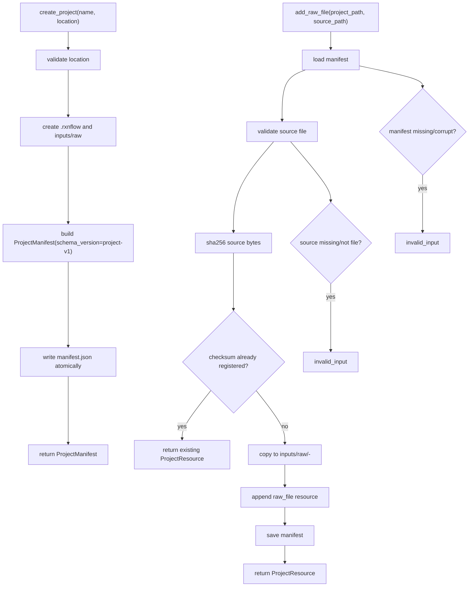

# project-storage-model design

## 0. 术语约定

| 术语 | 定义 | 防冲突结论 |
|---|---|---|
| Project Store | 负责创建、加载、保存 RxnFlow 项目目录和 manifest 的核心服务 | 现有 `rxnflow.project` 只有内存 helper，本 feature 将其扩展为真实 store |
| Project Directory | 一个 RxnFlow 项目的根目录，内部包含 manifest 和后续资源子目录 | 不等同于代码仓库目录，也不等同于用户导入文件的原始来源目录 |
| Project Manifest | 项目根目录中的结构化元数据文件，记录 project id/name/schemaVersion/resources | 对应现有 `ProjectManifest` dataclass，需要补足可序列化/反序列化协议 |
| Project Resource | manifest 中登记的资源索引项，保存资源 id、kind、项目相对路径、checksum、metadata | 不是资源本体；本 feature 只登记 raw file，不持久化 ChemicalObject/Graph/Profile 本体 |
| Raw File Resource | 被复制进项目目录的原始输入文件资源 | 只做文件登记和内容拷贝，不解析 Gaussian/ORCA/XYZ |

术语 grep 结果：当前代码只存在 `ProjectManifest`、`ProjectResource`、`create_project`、`attach_resources` 等内存 helper；没有 `ProjectStore` 类、项目目录协议、manifest 文件或加载/保存 API。

## 1. 决策与约束

### 需求摘要

本 feature 的目标是把 Project Store 从“内存 manifest helper”推进到“可落盘的项目目录协议”。完成后，核心层应能：

1. 创建一个项目目录并写入 manifest。
2. 从项目目录加载 manifest。
3. 保存更新后的 manifest。
4. 将原始文件复制进项目的资源目录，并在 manifest 中登记 `raw_file` resource。

面向对象是后续 parser、registry、UI/CLI 壳层和 agent。成功标准是：不用 UI、不解析化学文件、不引入数据库，也能通过 Python API 创建一个可重复加载的 RxnFlow 项目目录。

明确不做：

- 不实现 SQLite、数据库 migration 或对象表结构。
- 不持久化 ChemicalObject、ReactionGraph、EnergyProfile 的完整内容；本 feature 只定义资源索引和 raw file 文件存放。
- 不解析 Gaussian、ORCA、XYZ 或任何真实计算输出。
- 不实现 CLI 命令、Web 文件上传、桌面文件选择器或 UI 侧边栏。
- 不实现跨版本 migration 逻辑；只定义 `schema_version` 和不兼容版本的错误语义。
- 不删除用户源文件；`add_raw_file` 只复制文件到项目目录。

### 复杂度档位

按“项目内部核心服务”推进。偏离默认项：

- 健壮性 = L3（偏离默认 L2）：Project Store 接收文件路径和项目目录路径，必须验证外部输入、处理文件不存在/manifest 损坏/schema 不兼容等错误。
- 结构 = modules（偏离默认 functions）：需要区分领域模型、序列化、文件系统操作和服务 API。
- 可测试性 = tested（偏离默认 testable）：所有持久化路径、错误路径和幂等性都要有单元测试。
- Security = validated（偏离默认 trusted）：路径输入要解析为安全的项目相对路径，manifest 不应记录机器绝对路径。
- Idempotency = idempotent：重复添加同一未变化 raw file 不应产生重复资源。

### 关键决策

1. **manifest 使用 JSON**：初期项目 manifest 存为 `.rxnflow/manifest.json`。JSON 可由 Python 标准库读写，跨端和 agent 友好；不需要先引入 YAML/TOML 依赖。
2. **项目私有元数据放在 `.rxnflow/`**：用户项目根目录保持干净，内部元数据固定在 `.rxnflow/`；raw files 复制到 `inputs/raw/`，资源路径记录项目相对路径。
3. **资源路径只存项目相对路径**：manifest 不保存用户机器上的源文件绝对路径，保证项目目录可移动。
4. **raw file 用 sha256 去重**：`add_raw_file` 以文件内容 hash 作为稳定索引依据；同一内容重复加入返回已有资源，不追加重复记录。
5. **schema_version 固定为 `project-v1`**：当前 feature 只支持读写 `project-v1`；未来 migration 由后续 feature 处理。
6. **Project Store API 返回 Result**：所有外部路径和文件 I/O 错误映射到 `invalid_input` / `internal_error`，schema 不兼容映射到 `invalid_input` 并带 target。

### 前置依赖

roadmap item `project-storage-model` 当前为 `planned`，依赖 `core-fixture-vertical-slice` 已 `done`。现有实现已提供 `ProjectManifest`、`ProjectResource`、`Result<T>` 和基础错误模型，可直接扩展。

## 2. 名词与编排

### 2.1 名词层：值对象 / 实体 / 接口契约

**现状**：

- `rxnflow.models.ProjectManifest` 当前包含 `id`、`name`、`created_at`、`updated_at`、`schema_version`、`resources`，只在内存中使用。
- `rxnflow.models.ProjectResource` 当前包含 `id`、`kind`、`path`、`checksum`、`metadata`，但没有序列化协议和路径约束。
- `rxnflow.project.create_project(project_name)` 只返回内存 manifest。
- `rxnflow.project.attach_resources(project, resources)` 只用 `dataclasses.replace` 更新 resources。
- roadmap 第 4.2 节定义了 `ProjectStore.createProject/loadProject/saveProject/addRawFile` 的目标接口。

**变化**：

- 新增 `ProjectStore` 服务对象或等价模块 API，承担 project directory 的文件系统操作。
- 新增 manifest JSON 序列化/反序列化边界。
- 扩展 Project Store 的输入输出类型，保留现有 `ProjectManifest` / `ProjectResource` 作为领域类型。
- `create_project(project_name)` 可继续作为纯内存 helper；真实落盘入口使用 `create_project_store` 或 `ProjectStore.create_project`，避免破坏 fixture slice。

**接口示例：正常创建项目**

```python
# 来源：本 feature 新增 Project Store API，具体文件由 implement 阶段决定
store = ProjectStore()
result = store.create_project(name="demo", location="/tmp/demo.rxnflow")

assert result.ok
assert result.value.name == "demo"
assert result.value.schema_version == "project-v1"
```

期望目录：

```text
/tmp/demo.rxnflow/
  .rxnflow/
    manifest.json
  inputs/
    raw/
```

manifest 最小形态：

```json
{
  "id": "project-demo",
  "name": "demo",
  "created_at": "2026-05-02T00:00:00Z",
  "updated_at": "2026-05-02T00:00:00Z",
  "schema_version": "project-v1",
  "resources": []
}
```

**接口示例：添加 raw file**

```python
# 来源：roadmap 4.2 Project Store 协议的 addRawFile
result = store.add_raw_file(project_path="/tmp/demo.rxnflow", source_path="/tmp/input.log")

assert result.ok
assert result.value.kind == "raw_file"
assert result.value.path == "inputs/raw/<sha256-prefix>-input.log"
assert result.value.checksum.startswith("sha256:")
```

约束：`source_path` 内容被复制进项目目录，manifest 只记录项目相对路径，不记录 `/tmp/input.log`。

**接口示例：错误路径**

```python
result = store.load_project("/tmp/not-a-project")

assert not result.ok
assert result.error.code == "invalid_input"
assert result.error.target == "/tmp/not-a-project/.rxnflow/manifest.json"
```

### 2.2 编排层：主流程与控制流



**现状**：

当前 `rxnflow.project` 只有内存 helper，没有文件系统 workflow。`core-fixture-vertical-slice` 的 project 创建不落盘，也不加载 manifest。

**变化**：

- 新增 create/load/save/add raw file 四条 Project Store workflow。
- create workflow 会创建项目目录和 manifest。
- load workflow 只读取和验证 manifest，不隐式创建目录。
- save workflow 原子写 manifest，避免写一半损坏。
- add raw file workflow 先 load manifest，再复制文件和更新资源索引。

**跨层纪律**：

- 错误语义：路径不存在、manifest 缺失/损坏、schema 不兼容、source 不是文件都返回 `Result(ok=False)`。
- 幂等性：同一项目内重复添加相同 checksum 的 raw file 返回已有资源，不重复复制。
- 路径安全：manifest resource path 必须是项目相对 POSIX 风格路径，不允许 `..`、绝对路径或项目外路径。
- 顺序约束：add raw file 必须先成功 load manifest，再复制文件，最后保存 manifest。
- 可观测点：manifest JSON 可直接人工查看；资源 metadata 至少记录原始文件名和 byte size。

### 2.3 挂载点清单

- Manifest 文件位置：`.rxnflow/manifest.json` — 新增项目级持久化文件。
- Raw file 资源目录：`inputs/raw/` — 新增 raw input 文件副本存放位置。
- Project Store 入口：`ProjectStore` 或等价公开 API — 新增创建/加载/保存/添加 raw file 的核心入口。
- Schema version：`project-v1` — 新增当前支持的项目 manifest 版本。

### 2.4 推进策略

1. **名词与序列化骨架**：定义 `project-v1` manifest JSON 与 dataclass 转换边界。
   - 退出信号：ProjectManifest 可 round-trip 为 JSON dict 再还原。
2. **Project Store 编排骨架**：实现 create/load/save 三条 workflow，先不处理 raw file。
   - 退出信号：临时目录中创建项目后可重新 load 出等价 manifest。
3. **Raw file 资源节点**：实现 sha256、项目相对路径生成、文件复制和重复添加去重。
   - 退出信号：添加 raw file 后 manifest resources 增加一条，重复添加返回同一 resource。
4. **错误路径与路径安全**：补齐缺失 manifest、损坏 JSON、不兼容 schema、source missing、非法 resource path 等错误。
   - 退出信号：错误都返回 Result，不抛未分类异常。
5. **测试覆盖与 fixture 兼容**：补单元测试，并确认 core fixture vertical slice 仍通过。
   - 退出信号：Project Store 测试和现有 fixture 测试全部通过。

## 3. 验收契约

### 关键场景清单

1. 输入项目名和空临时目录路径 → 创建 `.rxnflow/manifest.json`、`inputs/raw/`，返回 `schema_version=project-v1` 的 ProjectManifest。
2. 创建项目后调用 load → 返回与 manifest 内容等价的 ProjectManifest。
3. 修改 ProjectManifest resources 后调用 save，再 load → resources 更新被保留。
4. 添加一个 raw file → 文件被复制到 `inputs/raw/`，manifest 增加一条 `kind=raw_file` resource，resource path 为项目相对路径。
5. 重复添加同一内容 raw file → 返回同一 checksum 的已有 resource，manifest 不增加重复条目。
6. load 非项目目录 → 返回 `invalid_input`，target 指向缺失 manifest。
7. load 损坏 manifest JSON → 返回 `invalid_input`，不得抛 JSONDecodeError 给调用方。
8. load schema_version 不是 `project-v1` 的 manifest → 返回 `invalid_input`，不得尝试 silent migration。
9. add raw file 的 source_path 不存在或不是普通文件 → 返回 `invalid_input`。
10. 现有 `run_core_fixture_vertical_slice()` 行为不变，仍能通过原有测试。

### 明确不做的反向核对项

- 代码中不应新增 SQLite、SQLAlchemy 或数据库 migration。
- 代码中不应出现 Gaussian/ORCA/XYZ parser 入口或文件内容解析逻辑。
- 代码中不应新增 CLI 参数解析、Web route、桌面文件选择器或 UI 组件。
- Manifest 不应保存用户源文件的绝对路径。
- 本 feature 不应持久化 ChemicalObject、ReactionGraph、EnergyProfile 的完整内容。

## 4. 与项目级架构文档的关系

Acceptance 阶段需要把下列内容归并回 architecture：

- 名词：Project Directory、`.rxnflow/manifest.json`、`project-v1`、ProjectResource path/checksum 约束。
- 动词骨架：Project Store 的 create/load/save/add raw file workflow。
- 跨层纪律：manifest 只记录项目相对路径；重复 raw file 以 checksum 去重；schema 不兼容不 silent migration。

关联架构文档：

- `codestable/architecture/core-platform.md`：更新 Project Store 现状，从“内存项目 manifest”扩展为“可落盘项目目录协议”。
- `codestable/architecture/ARCHITECTURE.md`：更新子系统索引和关键架构决定中关于持久化格式的待补项。
