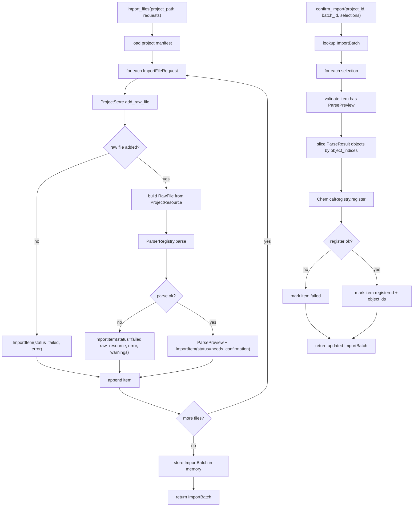

# import-registry-workflow design

## 0. 术语约定

| 术语 | 定义 | 防冲突结论 |
|---|---|---|
| Import Registry Workflow | 串联 Project Store、Parser Registry 和 Chemical Registry 的核心导入编排服务 | 新增 workflow；不是新 parser，也不是新 registry |
| Import Request | 一次导入中用户/agent 指定的单个 source file 和可选 ParseOptions | 新增输入结构；不等同于 ProjectResource |
| Import Batch | 一次单文件或批量导入的结果容器 | 新增内存状态；用于 sidebar/agent 查看进度和结果 |
| Import Item | batch 中一个 source file 的状态，包括 raw resource、parse preview、error 和 registered object ids | 新增状态项；批量导入允许逐项成功/失败 |
| Parse Preview | 等待确认的 ParseResult 摘要和 warnings | 不登记 ChemicalObject，不生成 object id |
| Import Confirmation | 用户或 agent 对 parse preview 的确认动作，确认后才调用 ChemicalRegistry.register | 支持按 item 以及可选 object index 选择 |
| Sidebar Import State | 平台壳层可读取的 batch/item 状态快照 | 不是本 feature 实现真实 UI 组件 |

术语 grep 结果：当前代码已有 `ProjectStore`、`ParserRegistry`、`RawFile`、`ParseOptions`、`ParseResult`、`ChemicalRegistry`，没有 `ImportRegistryWorkflow`、`ImportBatch`、`ImportItem`、`ParsePreview` 或确认式导入状态。

## 1. 决策与约束

### 需求摘要

本 feature 的目标是建立从“用户选择 raw output 文件”到“解析预览确认后登记 ChemicalObject”的核心导入 workflow。完成后，核心层应能：

1. 接收单文件或批量 source file 请求。
2. 调用 ProjectStore 把 source file 复制进项目并登记 `raw_file` resource。
3. 把 raw resource 转为 Parser Registry 可读的 RawFile。
4. 调用 ParserRegistry 得到 ParseResult 和 warnings，形成 parse preview。
5. 在用户/agent 确认后调用 ChemicalRegistry.register 登记 ChemicalObject。
6. 返回 sidebar-ready 的 batch/item 状态，方便后续 UI 或 agent 直接展示。

面向对象是后续 Web/桌面/CLI 壳层、项目侧边栏和 agent 自动导入流程。成功标准是：不做真实 UI、不新增 parser、不改 registry 语义，也能通过 Python API 完成导入、解析预览、确认登记和批量部分失败诊断。

明确不做：

- 不实现真实 Web 侧边栏、CLI 命令、桌面文件选择器或上传 route。
- 不新增 Gaussian/ORCA/XYZ/MAPLE 解析格式；只调用现有 ParserRegistry。
- 不修改 Parser Plugin 的字段映射、MAPLE 多帧策略或 cclib/ASE adapter。
- 不修改 ChemicalRegistry 的 fingerprint、去重或 correction 语义。
- 不持久化 ImportBatch / ParsePreview / ChemicalObject 内容；当前只持久化 raw file resource。
- 不把 ChemicalObject 写入 Project Manifest resource；对象内容持久化格式留给后续 feature。
- 不生成 ReactionGraph、EnergyProfile、PNG、CDXML 或 Excel。
- 不实现化学意义上的对象合并、构象筛选或相同分子判定。

### 复杂度档位

按“跨核心服务编排 workflow”推进。偏离默认项：

- 编排复杂度 = workflow：需要串联 ProjectStore、ParserRegistry、ChemicalRegistry，并保留中间状态。
- 错误语义 = partial success：批量导入中单个文件失败不应默认中断其它文件。
- 可测试性 = tested：正常路径、批量部分失败、确认登记、重复确认和 scope guard 都要有单元测试。
- Agent ergonomics = required：ImportBatch / ImportItem 状态必须结构化，agent 可直接判断哪些文件待确认、失败或已登记。

### 关键决策

1. **Workflow 主导编排，底层服务保持单责**：ProjectStore 仍只负责 raw file copy/manifest，ParserRegistry 仍只解析 RawFile，ChemicalRegistry 仍只登记 ParseResult。
2. **导入分两阶段**：`import_files` 只产生 raw resource + parse preview；`confirm_import` 才登记 ChemicalObject。
3. **批量导入允许部分成功**：project-level 错误直接返回 Result error；单文件 add/parse/register 错误记录到 ImportItem，batch 仍可返回。
4. **raw resource 在 parse 失败时保留**：文件已经进入项目后，即使当前 parser 不支持，也保留 raw resource，方便后续重试、手动指定格式或升级 parser。
5. **确认支持 object index 选择**：默认登记 item 中所有 draft；调用方也可指定 object indices，以避免 MAPLE 多帧/trajectory 一次登记过多对象。
6. **ImportBatch 当前为内存状态**：workflow 持有 batch/item/preview 状态；内容持久化和跨进程恢复由后续 Project State feature 处理。

### 已确认的产品假设

- 假设 A：解析失败或格式不支持的文件也保留为 raw file resource，不自动从项目目录删除。
- 假设 B：批量导入中某些文件失败时，其它文件继续处理，最终返回包含成功/失败 item 的 batch。
- 假设 C：确认登记默认登记 ParseResult 中全部 objects，但 API 支持按 object index 只登记部分对象，适配 MAPLE 多帧输出。
- 假设 D：本 feature 不做真实侧边栏 UI，只输出 sidebar-ready 的结构化状态；真实 UI 留给 platform shell 或 graph editor 相关 feature。
- 假设 E：ImportBatch / ParsePreview 暂不落盘；关闭进程后只保留 ProjectStore 中的 raw file resource。

### 前置依赖

roadmap item `import-registry-workflow` 依赖 `chemical-registry-corrections`，当前已 `done`。现有实现已提供 ProjectStore.add_raw_file、RawFile / ParseOptions / ParseResult、ParserRegistry.default().parse、ChemicalRegistry.register 和 Result warnings，可直接编排。

## 2. 名词与编排

### 2.1 名词层：值对象 / 实体 / 接口契约

**现状**：

- `ProjectStore.add_raw_file(project_path, source_path)` 会复制 source file，登记 `ProjectResource(kind="raw_file")`，但不解析。
- `ParserRegistry.parse(raw_file, options)` 会解析单个 RawFile，返回 `Result[ParseResult]`，但不登记 ChemicalObject。
- `ChemicalRegistry.register(project_id, parse_result)` 会登记 ParseResult 中的 drafts，返回 ChemicalObject，但不读取 raw file。
- 没有把上述三者串起来的 workflow，也没有“等待确认”的 parse preview 状态。

**变化**：

- 新增 `ImportFileRequest(source_path, parse_options=None)`。
- 新增 `ImportItemStatus`：`raw_added`、`parsed`、`needs_confirmation`、`registered`、`failed`。
- 新增 `ParsePreview(raw_resource_id, parser_id, parser_version, object_count, warnings, parse_result)`。
- 新增 `ImportItem(id, source_path, status, raw_resource=None, preview=None, registered_object_ids=(), error=None, warnings=())`。
- 新增 `ImportBatch(id, project_id, items)`。
- 新增 `ImportSelection(item_id, object_indices=None)`；`None` 表示登记该 item 的全部 objects。
- 新增 `ImportRegistryWorkflow(project_store, parser_registry, chemical_registry)`，提供 import/confirm/list batch 能力。

**接口示例：单文件导入并确认**

```python
workflow = ImportRegistryWorkflow(ProjectStore(), ParserRegistry.default(), ChemicalRegistry())

batch = workflow.import_files(
    project_path="/tmp/demo.rxnflow",
    requests=(ImportFileRequest("/tmp/water.xyz"),),
)

assert batch.ok
assert batch.value.items[0].status == "needs_confirmation"
assert batch.value.items[0].preview.object_count == 1

confirmed = workflow.confirm_import(
    batch.value.project_id,
    batch.value.id,
    selections=(ImportSelection(batch.value.items[0].id),),
)

assert confirmed.ok
assert confirmed.value.items[0].status == "registered"
assert confirmed.value.items[0].registered_object_ids
```

**接口示例：批量部分失败**

```python
batch = workflow.import_files(
    project_path="/tmp/demo.rxnflow",
    requests=(
        ImportFileRequest("/tmp/good.xyz"),
        ImportFileRequest("/tmp/not-supported.txt"),
    ),
)

assert batch.ok
assert [item.status for item in batch.value.items] == ["needs_confirmation", "failed"]
assert batch.value.items[1].error.code == "unsupported_format"
```

**接口示例：只确认 MAPLE 多帧中的部分对象**

```python
confirmed = workflow.confirm_import(
    project_id,
    batch_id,
    selections=(ImportSelection(item_id="item-maple", object_indices=(0, -1)),),
)
```

### 2.2 编排层：主流程与控制流



**现状**：

当前用户/agent 需要手动分别调用 `ProjectStore.add_raw_file`、构造 `RawFile`、调用 `ParserRegistry.parse`、再调用 `ChemicalRegistry.register`。中间没有统一状态，也没有确认点。

**变化**：

- 新增 import files workflow：项目加载 → raw resource 登记 → RawFile 构造 → parser parse → parse preview。
- 新增 confirm workflow：选择 parse preview → 可选对象索引过滤 → registry.register → 记录 object ids。
- 新增 list/import state workflow：平台壳层可读取项目内 ImportBatch 状态，用于侧边栏或 agent 继续操作。

**跨层纪律**：

- 错误语义：项目无法加载返回 `invalid_input`；单文件 add/parse/register 失败记录在 ImportItem.error。
- 幂等性：ProjectStore checksum 去重仍生效；重复 confirm 同一 selection 返回已登记 item，不重复调用 register。
- 顺序性：单个 item 必须按 raw_added → parse preview → confirm register 顺序推进。
- 边界约束：ImportRegistryWorkflow 可以调用 ProjectStore、ParserRegistry、ChemicalRegistry；不得调用 ReactionGraphService、EnergyProfileEngine 或 Export Service。
- 可观测点：每个 item 保留 source_path、raw_resource id、parser provenance、warnings、error 和 registered object ids。

### 2.3 挂载点清单

- Import workflow service：新增 `ImportRegistryWorkflow` 公开入口。
- Import state dataclasses：新增 ImportFileRequest、ImportBatch、ImportItem、ParsePreview、ImportSelection。
- Raw resource → RawFile adapter：新增从 ProjectResource + project path 构造 RawFile 的边界。
- Confirmation workflow：新增 parse preview 到 ChemicalRegistry.register 的确认入口。
- Sidebar state accessor：新增 list/get batch 状态入口，供后续平台壳层读取。

### 2.4 推进策略

1. **Import 状态名词骨架**：定义 request、batch、item、preview、selection 和 item status。
   - 退出信号：可构造一个包含 failed/needs_confirmation/registered item 的 ImportBatch。
2. **Raw file 导入与 RawFile adapter**：串接 ProjectStore.add_raw_file，并把 ProjectResource 转为 ParserRegistry 可解析的 RawFile。
   - 退出信号：导入单个 xyz source 后 batch item 包含 raw_resource 和 RawFile 可读路径。
3. **Parse preview workflow**：调用 ParserRegistry.parse，把 ParseResult/warnings 转成 needs_confirmation item；失败转成 failed item。
   - 退出信号：支持单文件正常解析、unsupported format 和批量部分失败。
4. **Confirmation workflow**：按 selection 调用 ChemicalRegistry.register，记录 registered object ids，并处理重复确认。
   - 退出信号：确认后 item 变成 registered，ChemicalRegistry 可读取对象；重复确认不重复登记。
5. **范围守护与回归测试**：覆盖不触碰 graph/energy/export、不新增 UI、fixture 兼容和既有 parser/registry/project 测试。
   - 退出信号：import workflow tests、project/parser/registry/fixture tests 全部通过。

## 3. 验收契约

### 关键场景清单

1. 输入单个支持格式 source file → `import_files` 返回 ImportBatch，item status 为 `needs_confirmation`，含 raw_resource、parse preview、object_count 和 parser warnings。
2. 对 needs_confirmation item 调用 `confirm_import` → item status 为 `registered`，记录 registered object ids，ChemicalRegistry 可通过 object id 读取对象。
3. 批量导入一个可解析文件和一个不支持文件 → batch ok，可解析 item 为 `needs_confirmation`，不支持 item 为 `failed`，error code 为 `unsupported_format`。
4. source_path 不存在 → 对应 item 为 `failed`，error code 为 `invalid_input`，其它 item 继续处理。
5. project_path 不是有效项目 → `import_files` 返回 `invalid_input`，不创建 batch。
6. 同一内容 raw file 重复导入 → ProjectStore 返回同一 raw_resource，workflow 不追加重复 manifest resource。
7. `confirm_import` 指定 object_indices → 只登记 ParseResult 中对应 objects。
8. 重复 confirm 同一 item → 返回已登记状态，不重复登记对象。
9. confirm 不存在 batch/item 或未解析成功 item → 返回 `invalid_input` 或将该 selection 标记为 failed。
10. parse warnings 会保存在 ImportItem / ParsePreview，供 sidebar/agent 展示。
11. 现有 ProjectStore、ParserRegistry、ChemicalRegistry、EnergyProfileEngine 和 `run_core_fixture_vertical_slice()` 行为不变。

### 明确不做的反向核对项

- 不新增 UI 组件、Web route、CLI 命令、桌面文件选择器或真实侧边栏。
- 不新增或修改 Gaussian/ORCA/XYZ/MAPLE parser plugin 解析逻辑。
- 不修改 ChemicalRegistry 的 fingerprint、correction 或自动合并策略。
- 不调用 ReactionGraphService、EnergyProfileEngine 或 Export Service。
- 不生成 ReactionGraph、EnergyProfile、ExportArtifact、PNG、CDXML 或 Excel。
- 不持久化 ImportBatch、ParsePreview 或 ChemicalObject 内容。
- 不删除用户源文件，也不自动删除已进入项目的 raw file resource。

## 4. 与项目级架构文档的关系

Acceptance 阶段需要把下列内容归并回 architecture：

- 名词：Import Registry Workflow、ImportBatch、ImportItem、ParsePreview、ImportConfirmation、Sidebar Import State。
- 动词骨架：source file → ProjectStore.add_raw_file → RawFile → ParserRegistry.parse → parse preview → confirm → ChemicalRegistry.register。
- 跨层纪律：ProjectStore/ParserRegistry/ChemicalRegistry 保持单责；batch 支持部分失败；真实 UI/CLI 不在 core workflow 内。

关联架构文档：

- `codestable/architecture/core-platform.md`：更新 Import Workflow 当前能力、数据状态、错误语义和跨模块边界。
- `codestable/architecture/ARCHITECTURE.md`：更新 Import / Parser 与 Chemical Registry 之间已有确认式导入 workflow 的说明。
