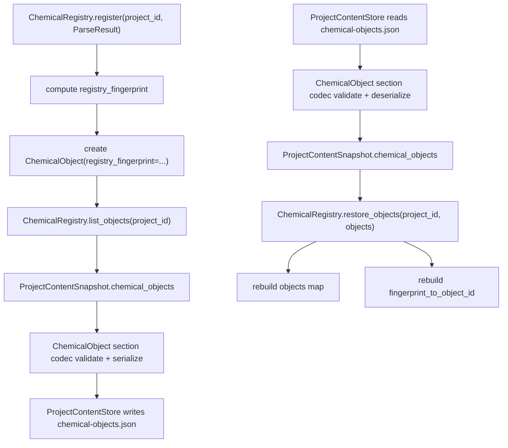

# chemical-object-persistence design

## 0. 术语约定

| 术语 | 定义 | 防冲突结论 |
|---|---|---|
| Chemical Object Persistence | `chemical-objects-v1` section 对 ChemicalObject 的长期保存与加载协议 | 区分于 `project-content-store-v1` 的 fixture 级临时 serializer |
| Stored ChemicalObject | 写入 `.rxnflow/state/chemical-objects.json` 的 ChemicalObject JSON 记录 | 不是 parser 输出的 ChemicalObjectDraft；必须已有 project object id |
| Registry Fingerprint | ChemicalRegistry 生成的同来源同 draft 内容幂等去重指纹 | 作为 Registered ChemicalObject 元数据保存；不作为化学相似度指纹 |
| Chemical Registry Restore | 从已持久化对象恢复 ChemicalRegistry 的 objects 和 fingerprint index | 不调用 ParserRegistry，不重新 parse raw file |
| append-only Correction Persistence | 保存/加载 ChemicalObject.corrections 的完整记录 | 不计算 corrected total，不改写原始 energies / thermochemistry |
| chemical-objects-v1 | Project Content 中 ChemicalObject section 的 schema version | 与 `project-content-v1` index schema 区分 |

术语 grep 结果：当前已有 `ChemicalObject`、`ChemicalObjectDraft`、`Correction`、`Provenance`、`ChemicalRegistry`、`_registry_fingerprint`、`fingerprint_to_object_id` 和 `chemical-objects-v1` fixture section。当前没有公开的 registry snapshot/restore API，`ChemicalObject` 也没有持久化 `registry_fingerprint` 字段。

## 1. 决策与约束

### 需求摘要

本 feature 是 `rxnflow-project-persistence` roadmap 的第二步。完成后，核心层应能：

1. 把真实 ChemicalRegistry 中已登记的 ChemicalObject 保存为 `chemical-objects-v1` section。
2. 保存并加载 ChemicalObject 的 label、formula、charge、spin、method、geometry、energies、thermochemistry、source_file_id、provenance、corrections 和 registry_fingerprint。
3. 加载后能恢复 ChemicalRegistry 的 project-scoped objects，并用 registry_fingerprint 重建重复 register 的幂等索引。
4. 对坏 section schema、project id 不匹配、缺失 object id/source_file_id、裸 float energy、unsupported unit、重复 object id、重复 fingerprint 冲突、重复 correction id 冲突返回结构化 Result error。
5. 继续保持 ProjectContentStore 不改 manifest、不登记 ProjectResource、不读 raw file、不调用 parser/import/graph/energy/export。

明确不做：

- 不持久化 ReactionGraph、WorkspaceSnapshot、ImportBatch、ParsePreview、EnergyProfile 或 ExportArtifact index 的完整内容；这些由后续 roadmap items 处理。
- 不把 ChemicalObject 写入 `.rxnflow/manifest.json` 或 ProjectResource。
- 不实现跨 manifest/import ledger 的 source_file_id 完整性深校验；本 feature 只保存 source_file_id，跨文件引用校验留给 `project-content-validation-migration`。
- 不重新 parse raw file，不根据 parser version 自动刷新对象。
- 不基于 formula、label、energy 接近、geometry 相似度或 registry_fingerprint 自动做化学合并。
- 不实现对象删除、重命名、手动合并、版本历史、migration、增量保存、并发锁或冲突合并。
- 不新增 CLI/Web/desktop command；端侧打开项目恢复由 `platform-shell-state-restore` 实现。

### 复杂度档位

按“领域内容仓储 + registry restore 基础”推进。偏离默认项：

- 领域严谨性 = L3：能量、热化学和 correction energy 必须显式保存 unit，不允许裸 float。
- 幂等性 = required：加载后的 ChemicalRegistry 必须保留重复登记同一 ParseResult 的幂等行为。
- 可测试性 = tested：section 往返、registry restore、错误路径和范围守护都要有单元测试。
- 持久化 = structured JSON：复用 ProjectContentStore / ProjectStorageBackend，不另起数据库或 manifest schema。

### 关键决策

1. **registry_fingerprint 放在 Registered ChemicalObject 上**：新增 `ChemicalObject.registry_fingerprint: str | None`，只在 ChemicalObject 层出现，不进入 ChemicalObjectDraft。这样 ProjectContentSnapshot 仍传递 ChemicalObject，不另起存储专用平行对象。
2. **ChemicalRegistry 暴露 snapshot/restore 入口**：新增 `list_objects(project_id)` 和 `restore_objects(project_id, objects, replace=False)`，让 Platform Restore 后续能把持久化对象灌回 registry state。
3. **restore 不调用 register**：恢复持久化对象时直接重建 `_RegistryState.objects` 和 `fingerprint_to_object_id`，不重新计算 parser draft fingerprint，也不依赖 ParseResult。
4. **化学对象 JSON 协议升级为长期 schema**：把当前 `content_store.py` 内的 fixture chemical object serializer 提升为带 validation 的稳定 codec；它负责字段形状，不负责 storage backend。
5. **source_file_id 只保存不深校验**：本 feature 要求 source_file_id 非空，但不读取 manifest/import ledger。跨文件引用完整性在 validation/migration 阶段统一做。

### 需要用户确认的领域假设

- 假设 A：ChemicalObject 的 `source_file_id` 指向 raw file resource 或后续 import ledger 中的来源；如果用户手动创建对象，后续可以使用显式 pseudo source id，但本 feature 暂不新增手动对象类型。
- 假设 B：thermochemistry 仍沿用 `dict[str, EnergyValue]`，即使某些热化学量单位不是能量单位，也先按现有模型保存；更细粒度的热化学字段归后续计算化学 schema 细化。
- 假设 C：registry_fingerprint 是幂等恢复用的技术指纹，不展示为化学指纹，也不参与相似对象合并。

### 前置依赖

roadmap item `chemical-object-persistence` 依赖 `project-content-store-v1`，当前已 `done`。现有 `ProjectContentStore` 已能写入 `.rxnflow/state/chemical-objects.json`，但只是 fixture 往返；现有 `ChemicalRegistry` 已能生成 fingerprint 并维护内存 fingerprint index，但没有公开 snapshot/restore，也没有把 fingerprint 放进 ChemicalObject。

## 2. 名词与编排

### 2.1 名词层：值对象 / 实体 / 接口契约

**现状**：

- `rxnflow.models.ChemicalObject` 包含 id、source_file_id、corrections、provenance，并继承 label、formula、charge、spin_multiplicity、method、geometry、energies、thermochemistry。
- `rxnflow.registry.ChemicalRegistry.register` 内部用 `_registry_fingerprint` 生成 fingerprint，并保存在 `_RegistryState.fingerprint_to_object_id`。
- `rxnflow.content_store.ProjectContentSnapshot.chemical_objects` 已能保存 fixture ChemicalObject，但 JSON serializer 是私有实现，缺少 registry_fingerprint 和严格字段 validation。
- `ProjectContentStore.save_snapshot/load_snapshot` 以 `chemical_objects` section 读写 `.rxnflow/state/chemical-objects.json`。

**变化**：

- `ChemicalObject` 新增可选 `registry_fingerprint` 字段；`ChemicalRegistry.register` 创建对象时写入该字段。
- `ChemicalRegistry` 新增 `list_objects(project_id)`，返回该项目当前已登记 ChemicalObject。
- `ChemicalRegistry` 新增 `restore_objects(project_id, objects, replace=False)`，恢复 object map 和 fingerprint index。
- 新增或抽出 ChemicalObject section codec，负责 `chemical-objects-v1` 的 dict/JSON 往返和 validation。
- `ProjectContentStore` 的 chemical_objects section 改用该 codec；保存/加载必须保留 provenance、corrections 和 registry_fingerprint。

**接口示例：registry snapshot 到 ProjectContentSnapshot**

```python
objects = registry.list_objects("project-a").value
snapshot = ProjectContentSnapshot(project_id="project-a", chemical_objects=objects)

saved = ProjectContentStore(LocalProjectStorageBackend()).save_snapshot(project_path, snapshot)

assert saved.ok
```

**接口示例：从 ProjectContentSnapshot 恢复 registry**

```python
loaded = ProjectContentStore(LocalProjectStorageBackend()).load_snapshot(project_path).value
restored = ChemicalRegistry().restore_objects(loaded.project_id, loaded.chemical_objects)

assert restored.ok
assert registry.get_object(loaded.project_id, loaded.chemical_objects[0].id).ok
```

**接口示例：registry_fingerprint 往返**

```python
registered = registry.register("project-a", parse_result).value[0]

assert registered.registry_fingerprint

loaded = store.load_snapshot(project_path).value.chemical_objects[0]

assert loaded.registry_fingerprint == registered.registry_fingerprint
```

### 2.2 编排层：主流程与控制流



**现状**：

当前 project-content-v1 load 可以得到 fixture ChemicalObject tuple，但不能保证真实 registry fingerprint 恢复，也不能把这些对象灌回 ChemicalRegistry 的 fingerprint index。重复导入同一 ParseResult 后仍可能因为 registry state 为空而创建重复对象。

**变化**：

- register workflow：生成 fingerprint 后同时写入 object field 和 fingerprint index。
- save workflow：从 registry list_objects 或调用方 snapshot 取得 ChemicalObject，写入 `chemical-objects-v1`。
- load workflow：读取 section 后返回带 registry_fingerprint 的 ChemicalObject。
- restore workflow：ChemicalRegistry 直接加载 ChemicalObject，按 object id 和 registry_fingerprint 重建状态。

**跨层纪律**：

- 错误语义：section schema 错误、project id 不一致、object id/source_file_id 缺失、energy 缺 value/unit、unit 不支持、duplicate object id、duplicate fingerprint 冲突、duplicate correction id 冲突返回 `invalid_input`。
- 幂等性：同一 registry snapshot 重复保存得到稳定 JSON/checksum；同一对象集合重复 restore 不追加重复对象。
- 顺序性：对象按输入顺序保存/加载；registry restore 不改变 ChemicalObject id。
- 来源追踪：provenance 原样保存 parser_id、parser_version、source_file_id 和 parsed_at；restore 不重写。
- Correction 纪律：corrections append-only；保存/加载保留顺序；同一对象内 correction id 重复且 payload 不同为 error。
- 扩展点：后续 import-ledger-persistence 和 validation-migration 可基于 source_file_id / registry_fingerprint 做引用校验和 stale 判断。
- 可观测点：加载后的 ChemicalObject 可直接读 registry_fingerprint、source_file_id、provenance、corrections、energy keys 和 thermochemistry keys。

### 2.3 挂载点清单

- ChemicalObject public field：`ChemicalObject.registry_fingerprint`。
- ChemicalRegistry public API：`list_objects(project_id)` 和 `restore_objects(project_id, objects, replace=False)`。
- Chemical object section codec：`chemical-objects-v1` 的 serialize/deserialize/validate 边界。
- ProjectContentStore chemical_objects section：`.rxnflow/state/chemical-objects.json` 使用长期 codec，而不是 fixture 私有 serializer。

### 2.4 推进策略

1. **模型与 registry 元数据**：给 Registered ChemicalObject 增加 registry_fingerprint，并在 register 时写入。
   - 退出信号：新登记对象可观察到非空 registry_fingerprint；现有 fixture 构造保持兼容。
2. **Registry snapshot/restore API**：新增 list_objects 和 restore_objects，重建 objects map 与 fingerprint index。
   - 退出信号：保存前 registry 中对象可列出；新 registry restore 后 get_object 成功，重复 restore 幂等。
3. **ChemicalObject section codec**：实现带 validation 的 chemical-objects-v1 serialize/deserialize。
   - 退出信号：对象、geometry、energies、thermochemistry、provenance、corrections、registry_fingerprint 往返一致。
4. **ProjectContentStore 接入**：将 chemical_objects section 改用长期 codec，并保持 project-content-v1 index 行为不变。
   - 退出信号：save_snapshot/load_snapshot 保留 registry_fingerprint 和 corrections，section checksum 重复保存稳定。
5. **错误与范围守护**：覆盖坏 schema、裸 energy、unsupported unit、重复 object/fingerprint/correction、project id mismatch，以及不碰 parser/import/graph/energy/export 的边界。
   - 退出信号：新增 persistence tests 和现有全量 unittest 通过。

## 3. 验收契约

### 关键场景清单

1. ChemicalRegistry.register 登记 ParseResult → 返回的 ChemicalObject 带非空 registry_fingerprint，且 fingerprint 与同项目重复 register 的幂等索引一致。
2. ChemicalRegistry.list_objects(project_id) → 返回该项目已登记对象；未知项目返回空 tuple 或结构化可预期结果，不抛异常。
3. ChemicalRegistry.restore_objects(project_id, objects) → 新 registry 可通过 get_object 读取对象，并重建 registry_fingerprint → object id 索引。
4. restore 后再次 register 同一 ParseResult → 返回已恢复对象，不创建重复 ChemicalObject。
5. ProjectContentStore.save_snapshot 保存含 corrections 的 ChemicalObject → `chemical-objects.json` 保留 corrections 顺序、energy unit、provenance 和 registry_fingerprint。
6. ProjectContentStore.load_snapshot 加载上述 snapshot → ChemicalObject 字段、EnergyValue、Correction、Provenance 和 registry_fingerprint 全部往返一致。
7. 同一 ChemicalObject snapshot 重复保存 → chemical-objects section checksum 稳定，index path/kind 不变。
8. `chemical-objects.json` schema_version 不是 `chemical-objects-v1` → load_snapshot 返回 `invalid_input`。
9. section project_id 与 ProjectContentIndex.project_id 不一致 → 返回 `invalid_input`。
10. object 缺 id 或 source_file_id → 返回 `invalid_input`。
11. energy / thermochemistry / correction energy 使用裸 float 或缺 unit → 返回 `invalid_input`，不默认为 hartree。
12. unsupported energy unit → 返回 `invalid_input`。
13. 同一 section 内重复 object id → 返回 `invalid_input`。
14. 同一 section 内相同 registry_fingerprint 指向不同 object id → 返回 `invalid_input`。
15. 同一对象内重复 correction id 且 payload 不同 → 返回 `invalid_input`。
16. save/load 不修改 `.rxnflow/manifest.json`，不新增 ProjectResource，不读取或解析 `inputs/raw/`。
17. 本 feature 不调用 ParserRegistry、ImportRegistryWorkflow、ReactionGraphService、EnergyProfileEngine 或 ReportExportService。
18. 现有 ProjectContentStore、ChemicalRegistry、Import Workflow、Graph Workspace、Energy Engine、Report Export 和 Platform Shell 测试继续通过。

### 明确不做的反向核对项

- 不新增 `.rxnflow/manifest.json` schema 字段或 ProjectResource kind。
- 不保存 ReactionGraph、WorkspaceSnapshot、ImportBatch、ParsePreview、EnergyProfile 或 ExportArtifact index 的完整新 schema。
- 不重新 parse raw files，不根据 parser version 自动刷新 ChemicalObject。
- 不实现 formula/geometry/energy 相似对象自动合并。
- 不计算 corrected total energy，不改写 ChemicalObject.energies / thermochemistry。
- 不新增 CLI/Web/desktop command、browser storage adapter、cloud adapter、project bundle 或 migration。

## 4. 与项目级架构文档的关系

验收时需要回写：

- `codestable/architecture/ARCHITECTURE.md`：补 ChemicalObject registry_fingerprint 持久化、Chemical Registry restore 和 chemical-objects-v1 长期 section 的当前决策。
- `codestable/architecture/core-platform.md`：补 ChemicalObject 当前数据状态、ChemicalRegistry snapshot/restore API、chemical-objects-v1 section 字段、错误语义和范围边界。
- 不更新 AGENTS.md：本 feature 不新增通用命令或环境约束。

roadmap 回写：

- design 确认后把 `rxnflow-project-persistence-items.yaml` 中 `chemical-object-persistence` 从 `planned` 改为 `in-progress`，feature 填 `2026-05-05-chemical-object-persistence`。
- 验收时再改为 `done` 并同步 roadmap 主文档子 feature 清单。
