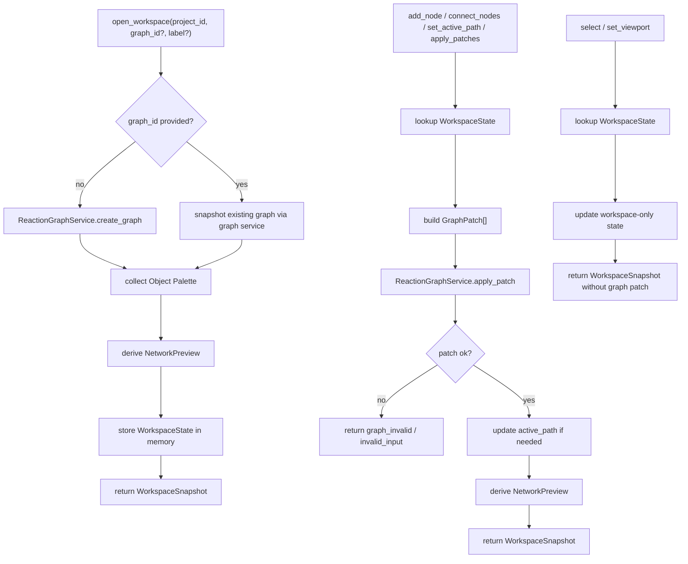

# graph-editor-workspace design

## 0. 术语约定

| 术语 | 定义 | 防冲突结论 |
|---|---|---|
| Graph Editor Workspace | 围绕一个 ReactionGraph 的编辑会话状态与编排服务 | 新增 workspace 层；不替代 ReactionGraphService |
| Workspace Snapshot | 平台壳层/agent 可直接读取的 graph、对象面板、selection、viewport 和 preview 快照 | 新增只读输出结构；不是 Project Manifest |
| Object Palette | 可拖入图谱的已登记 ChemicalObject 引用列表 | 来源于已确认导入对象或调用方传入对象；不重新解析 raw file |
| Canvas Viewport | 画布平移、缩放等视图状态 | 新增 workspace 状态；不写入 ReactionGraph |
| Workspace Selection | 当前选中的 node、edge 或 path id 集合 | 新增 workspace 状态；不进入 GraphPatch |
| Network Preview | 从当前 ReactionGraph 派生的网络预览数据，包括节点、边、paths、active path 和诊断 | 不是渲染图，也不是能量曲线 |
| Active Path | 当前 workspace 选中的 ReactionPath | 存在于 workspace 状态；path 本身仍由 ReactionGraph.paths 承载 |

术语 grep 结果：当前代码已有 `ReactionGraphService`、`GraphPatch`、`ReactionNode.position`、`ImportRegistryWorkflow`、`ImportBatch`、`EnergyProfileEngine`。没有 `GraphEditorWorkspace`、`WorkspaceSnapshot`、`CanvasViewport`、`WorkspaceSelection` 或 `NetworkPreview`。

## 1. 决策与约束

### 需求摘要

本 feature 的目标是把已有 GraphPatch 协议包装成一个可被真实 UI 和 agent 共用的图谱编辑 workspace。完成后，核心层应能：

1. 打开或创建一个围绕 ReactionGraph 的编辑 workspace。
2. 从已登记 ChemicalObject 生成可拖入画布的 Object Palette。
3. 通过 workspace API 添加对象节点、annotation/group 节点、连接节点、设置路径和应用原始 GraphPatch。
4. 保存 selection、viewport、active path 等画布编辑状态。
5. 返回实时 Network Preview，供平台壳层渲染图谱、路径列表和诊断信息。
6. 保持 ReactionGraphService、ImportRegistryWorkflow 和 EnergyProfileEngine 的职责边界清晰。

面向对象是后续 Web/桌面/CLI 壳层、图谱画布、项目侧边栏和 agent 图谱编辑入口。成功标准是：不拍板前端技术栈、不实现真实浏览器 canvas，也能用 Python API 完成“对象面板 → 放置节点 → 连线 → 选择路径 → 读取预览”的 workspace 闭环。

明确不做：

- 不实现真实 Web UI、CLI 命令、桌面窗口、浏览器路由、canvas 渲染或拖拽事件处理。
- 不选择 React、Next.js、Electron、Tauri、SwiftUI 或其它端侧框架。
- 不持久化 Workspace Snapshot、Viewport、Selection 或 ReactionGraph 到 Project Manifest。
- 不导入 raw file、不调用 ParserRegistry、不确认 ImportItem；导入仍由 ImportRegistryWorkflow 负责。
- 不调用 EnergyProfileEngine，不绘制能量曲线，也不生成 EnergyProfile。
- 不生成 ExportArtifact、PNG、CDXML 或 Excel。
- 不新增自动布局算法、自动反应路径搜索、化学合理性判断或计量系数字段。

### 复杂度档位

按“UI/agent 共用的 headless workspace 编排层”推进。偏离默认项：

- 编排复杂度 = workflow：需要串联 ReactionGraphService、可用对象集合、workspace state 和 preview 派生。
- UI 状态 = headless contract：selection / viewport / active path 需要结构化，但不得绑定具体 UI 框架。
- Agent ergonomics = required：每个编辑动作应可由 agent 构造、回放和诊断。
- 可测试性 = tested：节点放置、连线、路径选择、palette 过滤、viewport/selection 和范围守护都需要单元测试。

### 关键决策

1. **Workspace 是 GraphPatch 的壳层，不是平行 graph 实现**：所有 graph 结构变化最终落到 ReactionGraphService.apply_patch，workspace 只补画布状态、对象面板和 preview。
2. **ReactionNode.position 是节点布局的领域承载点**：节点坐标继续写在 ReactionNode；viewport、selection 和 active path 属于 workspace 状态。
3. **Object Palette 只暴露已登记对象**：默认从已确认 import items 的 registered_object_ids 派生，也允许调用方传入已加载 ChemicalObject；needs_confirmation / failed item 不可直接建 graph node。
4. **Network Preview 是结构化快照，不是渲染层**：preview 提供 nodes、edges、paths、active path、disconnected nodes 和 warnings；具体视觉布局、颜色、缩放手势由平台壳层实现。
5. **能量曲线暂不进入 workspace**：本 feature 只选择 path 并暴露 active_path_id；EnergyProfileEngine 集成和图表显示留给后续 graph energy panel 或 report/export feature。
6. **Workspace 当前为内存状态**：关闭进程后只保留已有 core service 可持有的 graph/import/registry 内存状态；跨进程恢复留给 project state 持久化 feature。

### 已确认的产品假设

- 假设 A：第一版 `graph-editor-workspace` 做 headless workspace/API，不做真实网页/桌面画布；真实 UI 等主技术栈拍板后再接。
- 假设 B：实时预览先指网络结构预览，不包含能量曲线；能量曲线需要明确 UI 图表和 path-energy 联动后再做。
- 假设 C：对象拖入画布时，默认创建 `species` node；过渡态、group、annotation 由调用方显式指定。
- 假设 D：节点位置使用二维画布坐标 `(x, y)`，不做自动布局；agent 或 UI 可以自己给坐标。
- 假设 E：Object Palette 的默认来源是 confirmed import item 的 registered_object_ids；后续对象持久化落地后再改为从 Project State 列对象。

### 前置依赖

roadmap item `graph-editor-workspace` 依赖 `reaction-graph-protocol` 和 `import-registry-workflow`，当前均已 `done`。现有实现已提供 `ReactionGraphService`、`GraphPatch`、`ReactionNode.position`、`ImportRegistryWorkflow.list_batches`、`ChemicalRegistry.get_object` 和 `EnergyProfileEngine`，但本 feature 不直接调用 EnergyProfileEngine。

## 2. 名词与编排

### 2.1 名词层：值对象 / 实体 / 接口契约

**现状**：

- `ReactionGraphService` 可以创建 graph、应用 GraphPatch、列出 paths，但不保存 selection、viewport 或 active path。
- `ReactionNode.position` 已可保存节点二维位置，但没有 workspace 级视图状态。
- `ImportRegistryWorkflow` 能返回 ImportBatch / ImportItem，其中 registered item 包含 registered_object_ids，但没有对象面板视图。
- `ChemicalRegistry.get_object(project_id, object_id)` 可按 id 读取对象，但没有项目级 list_objects。
- `EnergyProfileEngine` 能根据 graph/path/object 计算 EnergyProfile，但当前 graph editor roadmap item 未声明对 energy engine 的依赖。

**变化**：

- 新增 `CanvasViewport(x=0.0, y=0.0, zoom=1.0)`。
- 新增 `WorkspaceSelection(node_ids=(), edge_ids=(), path_ids=())`。
- 新增 `ObjectPaletteItem(object_id, label, formula, charge, spin_multiplicity, method, source_file_id, energy_keys)`。
- 新增 `NetworkPreview(graph_id, active_path_id, nodes, edges, paths, disconnected_node_ids, warnings)`。
- 新增 `WorkspaceSnapshot(workspace_id, project_id, graph, palette, selection, viewport, active_path_id, preview)`。
- 新增 `NodePlacement(kind, label, chemical_object_ids=(), position=None, metadata={})`，用于从 palette 或 annotation/group 创建 node。
- 新增 `GraphEditorWorkspaceService(graph_service, import_workflow=None, chemical_registry=None)`。
- 新增 workspace 入口：`open_workspace(project_id, graph_id=None, label=None, objects=())`、`add_node(...)`、`connect_nodes(...)`、`set_active_path(...)`、`apply_patches(...)`、`select(...)`、`set_viewport(...)`、`snapshot(...)`。

**接口示例：打开 workspace 并放置对象节点**

```python
workspace = GraphEditorWorkspaceService(
    graph_service=ReactionGraphService(),
    import_workflow=import_workflow,
    chemical_registry=registry,
)

opened = workspace.open_workspace("project-a", label="main route")
placed = workspace.add_node(
    "project-a",
    opened.value.workspace_id,
    NodePlacement(
        kind="species",
        label="Reactant",
        chemical_object_ids=("object-r",),
        position=(120.0, 80.0),
    ),
)

assert placed.ok
assert placed.value.graph.nodes[0].position == (120.0, 80.0)
```

**接口示例：连线、设置 active path 并读取预览**

```python
connected = workspace.connect_nodes(
    "project-a",
    workspace_id,
    from_node_id="node-r",
    to_node_id="node-ts",
    label="TS search",
)

snapshot = workspace.set_active_path(
    "project-a",
    workspace_id,
    path_id="path-main",
    node_ids=("node-r", "node-ts"),
)

assert snapshot.ok
assert snapshot.value.active_path_id == "path-main"
assert snapshot.value.preview.paths[0].id == "path-main"
```

**接口示例：只更新 UI 状态**

```python
snapshot = workspace.select(
    "project-a",
    workspace_id,
    WorkspaceSelection(node_ids=("node-r",), edge_ids=(), path_ids=()),
)

assert snapshot.ok
assert snapshot.value.graph == previous_graph
assert snapshot.value.selection.node_ids == ("node-r",)
```

### 2.2 编排层：主流程与控制流



**现状**：

当前调用方要直接创建 GraphPatch 并维护自己的 UI 状态。对象来自 import confirmation 后的 registered ids，但没有统一 palette，也没有“当前 path / selection / viewport / preview”的可观察快照。

**变化**：

- 新增 open workspace workflow：创建或绑定 graph → 收集 palette → 派生 preview → 返回 snapshot。
- 新增 graph editing workflow：高层动作转换为 GraphPatch → ReactionGraphService 校验和写入 → workspace 派生新 preview。
- 新增 workspace-only workflow：selection / viewport 只改 workspace state，不触发 GraphPatch。
- 新增 palette workflow：从 confirmed import batches 或传入 objects 生成 ObjectPaletteItem。
- 新增 preview workflow：从当前 graph 派生 path 列表、active path、孤立节点和 warnings。

**跨层纪律**：

- 错误语义：workspace/project 缺失返回 `invalid_input`；GraphPatch 失败透传 `graph_invalid` / `invalid_input`。
- 顺序性：一组 workspace graph edits 只通过 ReactionGraphService.apply_patch 写入；patch 失败时 workspace graph 和 active path 不更新。
- 幂等性：select / set_viewport 可重复设置；set_active_path 对同一 path id 复用 GraphPatch("set_path") 覆盖旧 path。
- 边界约束：GraphEditorWorkspaceService 可以调用 ReactionGraphService、ImportRegistryWorkflow.get/list batch、ChemicalRegistry.get_object；不得调用 ParserRegistry、ProjectStore.add_raw_file、EnergyProfileEngine 或 Export Service。
- 可观测点：每次成功动作返回完整 WorkspaceSnapshot，agent 可以直接读取 graph、palette、selection、viewport 和 preview。

### 2.3 挂载点清单

- Workspace state dataclasses：新增 CanvasViewport、WorkspaceSelection、ObjectPaletteItem、NetworkPreview、WorkspaceSnapshot、NodePlacement。
- GraphEditorWorkspaceService：新增 open/edit/select/viewport/snapshot 的 workspace 编排入口。
- Palette adapter：新增 ImportBatch / ChemicalRegistry → ObjectPaletteItem 的只读边界。
- Network preview builder：新增 ReactionGraph → NetworkPreview 的派生边界。
- GraphPatch bridge：新增 workspace 高层动作到 ReactionGraphService.apply_patch 的桥接层。

### 2.4 推进策略

1. **Workspace 状态名词骨架**：定义 viewport、selection、palette item、preview、snapshot 和 node placement。
   - 退出信号：可构造包含空 graph、空 palette、默认 viewport 和空 preview 的 WorkspaceSnapshot。
2. **Open workspace 与 snapshot workflow**：串接 ReactionGraphService 创建/绑定 graph，并返回 workspace snapshot。
   - 退出信号：打开新 workspace 后 graph id/project id 可读，selection/viewport 默认值稳定。
3. **Palette adapter**：从 confirmed import items 或传入 ChemicalObject 生成 ObjectPaletteItem，并过滤未登记 item。
   - 退出信号：confirmed object 出现在 palette，needs_confirmation/failed item 不出现。
4. **Graph edit bridge**：实现 add_node、connect_nodes、set_active_path、apply_patches 到 GraphPatch 的转换和错误透传。
   - 退出信号：可通过 workspace API 生成 nodes/edges/paths，invalid object 或 missing node 返回现有错误语义。
5. **Workspace-only 状态与 preview**：实现 select、set_viewport 和 NetworkPreview 派生。
   - 退出信号：selection/viewport 更新不改变 graph；preview 能列出 active path、paths 和 disconnected nodes。
6. **范围守护与回归测试**：覆盖不触碰 parser/project-store/energy/export/UI，并保留 graph/import/fixture 回归。
   - 退出信号：workspace tests、graph tests、import workflow tests、energy tests、fixture tests 全部通过。

## 3. 验收契约

### 关键场景清单

1. 输入 project id 且不提供 graph id → `open_workspace` 创建空 ReactionGraph，返回默认 viewport、空 selection、空 preview。
2. 提供已有 graph id → `open_workspace` 绑定既有 graph，不重复创建 graph。
3. confirmed import object → 出现在 Object Palette，包含 label、formula、method、source_file_id 和 energy_keys。
4. needs_confirmation / failed import item → 不出现在 Object Palette。
5. 调用 `add_node` 使用 palette 中 object id → 创建 species node，保留 label、chemical_object_ids、position、metadata。
6. 调用 `add_node` 创建 annotation/group 且不传 object id → 成功。
7. 调用 `add_node` 使用不存在 object id → 返回 `graph_invalid`，workspace graph 不改变。
8. 调用 `connect_nodes` 连接两个已存在 node → graph 增加 edge，preview 同步包含该 edge。
9. 调用 `connect_nodes` 指向 missing node → 返回 `graph_invalid`，workspace graph 不改变。
10. 调用 `set_active_path` 设置 path node_ids → graph.paths 包含该 path，snapshot.active_path_id 更新。
11. 多次 `set_active_path` 不同 path → graph 保存多条 paths，preview 可列出分叉路径。
12. 调用 `select` 或 `set_viewport` → 只更新 workspace state，不调用 graph patch，不改变 graph。
13. 删除节点后读取 snapshot → preview 不再包含被级联删除的 edge/path，disconnected diagnostics 更新。
14. `NetworkPreview` 对没有 edge 连接的多个节点返回 disconnected_node_ids。
15. 现有 `run_core_fixture_vertical_slice()`、ReactionGraphService、ImportRegistryWorkflow 和 EnergyProfileEngine 行为不变。

### 明确不做的反向核对项

- 不新增真实 UI 组件、Web route、CLI 命令、桌面窗口、canvas 渲染或拖拽事件代码。
- 不引入 React、Next.js、Electron、Tauri、SwiftUI、Three.js 或图形布局库。
- 不写 Project Store，不新增 manifest resource，不持久化 workspace/graph/object/profile 内容。
- 不调用 ParserRegistry、GaussianLogPlugin、OrcaOutputPlugin、XyzPlugin 或 Maple parser。
- 不调用 ProjectStore.add_raw_file 或 ImportRegistryWorkflow.import_files / confirm_import。
- 不调用 EnergyProfileEngine，不生成 EnergyProfile 或能量曲线。
- 不生成 ExportArtifact、PNG、CDXML 或 Excel。
- 不新增自动布局、化学计量系数、自动路径搜索或化学合理性判定。

## 4. 与项目级架构文档的关系

Acceptance 阶段需要把下列内容归并回 architecture：

- 名词：Graph Editor Workspace、Workspace Snapshot、Object Palette、Canvas Viewport、Workspace Selection、Network Preview、Active Path。
- 动词骨架：open workspace → collect palette → graph edits through GraphPatch → update workspace state → derive network preview。
- 跨层纪律：workspace 状态和 graph 领域状态分离；真实 UI/平台壳层不在 core workspace 内；energy curve 不在本 feature 内。

关联架构文档：

- `codestable/architecture/core-platform.md`：新增 Graph Editor Workspace 当前能力、数据状态、错误语义和边界约束。
- `codestable/architecture/ARCHITECTURE.md`：更新 Graph Editor 与 GraphPatch / workspace / preview 的关系。
