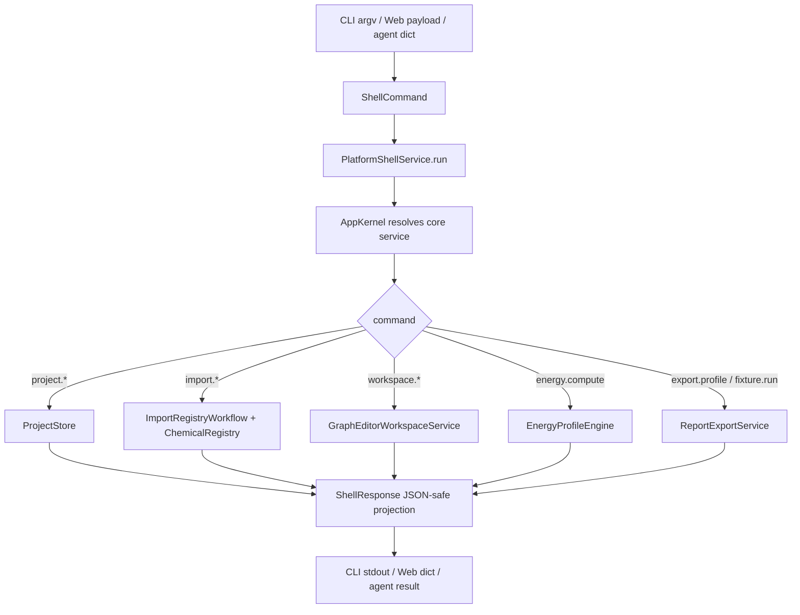

# platform-shell-baseline design

## 0. 术语约定

| 术语 | 定义 | 防冲突结论 |
|---|---|---|
| Platform Shell | Web、CLI、桌面 app 等端侧入口的薄适配层，只负责参数、文件路径、交互和输出形态 | 新增 platform 层；不把核心业务逻辑搬进 shell |
| App Kernel | 把 ProjectStore、ParserRegistry、ChemicalRegistry、ReactionGraphService、GraphEditorWorkspaceService、EnergyProfileEngine 和 ReportExportService 装配到一起的进程内服务容器 | 新增装配层；不是持久化数据库或全局单例 |
| Platform Session | 一个 shell 进程或 Web request/session 内的运行态，保存 import batch、registry、workspace、graph/profile/export artifact 等内存状态 | 解决当前对象内容未持久化的现实边界；不伪装跨进程恢复 |
| Shell Command | agent、CLI 或 Web adapter 传入的结构化命令，包含 command name 和 JSON-safe args | 新增命令协议；不复用 GraphPatch，因为它覆盖范围更大 |
| Shell Response | shell 层统一输出，包含 ok/data/error/warnings/artifacts，必须可 JSON 序列化 | 新增 DTO；不替代核心 Result |
| Shell Artifact | 面向端侧的 artifact 描述，包含 format、path、metadata 和可选 base64 bytes | 从 ExportArtifact 投影而来；避免 JSON 中默认塞二进制 |
| Web Payload Adapter | 把 HTTP/Web worker 可接收的 dict payload 转为 Shell Command，再把 Shell Response 转回 dict | 只定义 Python 侧 adapter；不创建真实 Web route |
| CLI Entry | `python3 -m rxnflow.cli ...` 的标准库命令入口 | 新增最小 CLI；不新增 packaging console_scripts |

术语 grep 结果：当前代码已有 `GraphEditorWorkspaceService` 的 headless workspace、`ReportExportService` 的 bytes-first artifact、`run_core_fixture_vertical_slice` 的核心 fixture 入口，以及 ProjectStore / ImportRegistryWorkflow / EnergyProfileEngine 等核心服务。当前没有 `PlatformShell`、`AppKernel`、`ShellCommand`、`ShellResponse`、`rxnflow.platform` 或真实 CLI/Web 入口。

## 1. 决策与约束

### 需求摘要

本 feature 的目标是建立第一版端侧薄壳层。完成后，调用方应能：

1. 通过 Python API 运行结构化 shell command，并得到 JSON-safe response。
2. 通过标准库 CLI 执行最小可观察命令，例如 fixture 演示、项目创建、导入预览和导出。
3. 让未来 Web/Vercel、macOS app、Windows exe、Linux CLI 共用同一套命令协议和 response shape。
4. 在 shell 层复用已有核心服务，不复制 parser、registry、graph、energy 或 export 逻辑。

明确不做：

- 不引入 Next.js、React、Vercel Functions、FastAPI、Flask、Django 或任何真实 Web route/server。
- 不实现 macOS app、Windows exe、Linux packaging、Electron/Tauri/SwiftUI/Qt 壳层或安装包。
- 不实现真实浏览器 UI、桌面窗口、文件选择器、拖拽、画布渲染或报告预览。
- 不新增数据库、账号、权限、云同步、多用户会话或后台任务队列。
- 不把 ChemicalObject、ReactionGraph、WorkspaceSnapshot、EnergyProfile 或 ExportArtifact 内容写入 Project Manifest；当前跨进程恢复仍只保证 manifest/raw file resource。
- 不修改 Parser Plugin 字段映射、ChemicalRegistry 去重/校正策略、ReactionGraphService patch 语义、EnergyProfileEngine 计算规则或 ReportExportService writer 能力。
- 不新增导出格式，不实现 CDX/CSV/PDF/PPTX/SVG。
- 不让 CLI 执行任意 Python 代码或 shell 命令。

### 复杂度档位

按“薄壳层 + JSON DTO + 标准库 CLI”推进。偏离默认项：

- 端侧优先但不绑定框架：当前只落地 Python 端 JSON payload adapter；真实 Web/桌面框架留给后续 feature/decision。
- 会话状态显式化：当前核心对象内容未持久化，因此 shell session 是进程内状态；CLI 跨进程命令只承诺 project manifest/raw file 级持久化。
- CLI 是可测试入口：优先支持 `python3 -m rxnflow.cli`，暂不要求 packaging metadata 或 console script。
- 输出默认 JSON-safe：bytes artifact 默认只输出 metadata/path；需要内联 bytes 时用 base64 并由 options 显式开启。

### 关键决策

1. **App Kernel 只做装配，不做业务**：Platform Shell 可以装配核心服务并串联 workflow，但 parser 字段映射、对象登记、图谱修改、能量计算、导出生成仍由各自核心模块负责。
2. **CLI 是第一 concrete shell**：它能验证 command protocol、exit code、stdout/stderr 和文件输出；Web/桌面后续可复用相同 command handler。
3. **Web 只先做 payload adapter**：当前不选 Next.js 或 Vercel 目录结构，避免技术栈未拍板时绑定单一端形态。
4. **session-scoped state 不伪装持久化**：ImportBatch、ChemicalObject、ReactionGraph、WorkspaceSnapshot、EnergyProfile 当前仍在内存；CLI 单次命令可以完成一条 workflow，但多次 CLI 调用之间不保证恢复这些对象。
5. **Fixture command 作为端到端烟测**：用内置 fixture 跑 project/object/graph/profile/export 的最窄闭环，给 CLI/Web/agent 一个稳定可验证入口。
6. **JSON 投影和核心 dataclass 分离**：Shell Response 负责把 dataclass 投影为 JSON-safe dict；核心模型仍保持 Python dataclass，不为某个前端框架改字段命名。

### 待用户确认的假设

- 假设 A：第一版接受“Web 友好的 payload adapter”，不要求本 feature 直接创建 Next/Vercel 应用。
- 假设 B：第一版 CLI 接受 `python3 -m rxnflow.cli` 形式，等包管理/发布方式拍板后再加 console_scripts。
- 假设 C：在完整项目内容持久化之前，CLI 的多步流程以单进程 command 为主；跨进程恢复对象/graph/profile 留给后续 persistence feature。
- 假设 D：CLI 首批命令优先覆盖 project create/load、fixture run/export、import preview/register all、workspace snapshot/graph edit 的可测试闭环，不追求交互式 TUI。

### 前置依赖

roadmap item `platform-shell-baseline` 依赖 `report-export-baseline`，当前前置已完成。现有实现已提供核心服务和 dataclass，但没有统一 app kernel、shell command/response DTO、JSON 投影、Web payload adapter 或 CLI entry。

## 2. 名词与编排

### 2.1 名词层：值对象 / 实体 / 接口契约

**现状**：

- `rxnflow.result.Result` 和 `RxnFlowError` 已统一核心服务错误语义，但不是 JSON response。
- `ProjectStore` 可创建/加载项目目录，当前持久化 manifest 和 raw file resource。
- `ImportRegistryWorkflow`、`ChemicalRegistry`、`GraphEditorWorkspaceService`、`EnergyProfileEngine` 和 `ReportExportService` 都是 Python API，没有端侧 command handler。
- `ExportArtifact.bytes` 可包含二进制，不能直接 JSON 序列化。
- 项目没有 `pyproject.toml`、console script、Web route 或 desktop entry。

**变化**：

- 新增 `ShellCommand(name, args={})`，例如 `fixture.run`、`project.create`、`project.load`、`import.preview`、`import.register_all`、`workspace.open`、`workspace.add_node`、`workspace.connect`、`workspace.set_path`、`energy.compute`、`export.profile`。
- 新增 `ShellResponse(ok, data=None, error=None, warnings=(), artifacts=())`，作为 CLI/Web/agent 共享 response。
- 新增 `ShellArtifact(id, format, path=None, bytes_base64=None, metadata={})`，从 ExportArtifact 投影而来。
- 新增 `PlatformSession(id, project_path=None, project_id=None, workspace_id=None, graph_id=None, profile_id=None, object_ids=(), artifact_ids=())`，显式记录当前进程内 shell 状态。
- 新增 `AppKernel` 或等价 factory，集中装配 ProjectStore、ParserRegistry 默认插件、ChemicalRegistry、ImportRegistryWorkflow、ReactionGraphService、GraphEditorWorkspaceService、EnergyProfileEngine、ReportExportService。
- 新增 `PlatformShellService.run(command) -> ShellResponse`。
- 新增 `handle_platform_payload(payload: dict) -> dict`，作为未来 Web route / desktop bridge 的纯 Python adapter。
- 新增 `rxnflow.cli`，提供 `main(argv=None) -> int` 和 `python3 -m rxnflow.cli` 入口。

**接口示例：Web/agent payload**

```python
response = handle_platform_payload(
    {
        "command": "fixture.run",
        "args": {
            "export_formats": ["png", "xlsx"],
            "destination_dir": "/tmp/rxnflow-out",
            "basename": "fixture",
        },
    }
)

assert response["ok"] is True
assert response["data"]["profile"]["id"] == "profile-a-b-electronic"
assert response["artifacts"][0]["format"] == "png"
```

**接口示例：CLI**

```bash
python3 -m rxnflow.cli fixture --json --export-format png --export-dir /tmp/rxnflow-out
python3 -m rxnflow.cli project create --name demo --location /tmp/rxnflow-demo
```

### 2.2 编排层：主流程与控制流



**现状**：

现在所有核心服务都只能由 Python 测试或内部代码直接调用。端侧如果要接入，需要自己装配服务、处理 Result、序列化 dataclass、决定 exit code 和 artifact bytes 行为，容易导致 Web、CLI、桌面各自复制业务流程。

**变化**：

- 新增 command dispatch workflow：解析 command name → 校验 args → 调用对应核心服务 → 投影为 ShellResponse。
- 新增 app kernel workflow：统一创建默认 parser registry 和各核心服务，避免每个 shell 自己拼装依赖。
- 新增 fixture workflow：调用 `run_core_fixture_vertical_slice()`，可选调用 `ReportExportService.export()`，返回 project/object/graph/profile/artifact 摘要。
- 新增 project workflow：`project.create` / `project.load` 映射到 ProjectStore，并输出 manifest summary。
- 新增 import workflow：在单个 Platform Session 中调用 ImportRegistryWorkflow，输出 batch/item/preview；`import.register_all` 可在同一 session 中确认全部可解析对象。
- 新增 workspace workflow：围绕 session 中的 graph/object 打开 workspace，支持 add node / connect / set active path，并输出 WorkspaceSnapshot 投影。
- 新增 energy/export workflow：从 session 中已存在 graph/object/profile 计算或导出；缺少前置状态时返回 `invalid_input`。
- 新增 CLI workflow：用 argparse 把 argv 转成 ShellCommand，ShellResponse JSON 写 stdout，错误写 JSON 或摘要并返回非 0 exit code。

**跨层纪律**：

- 错误语义：未知 command、缺少必填 args、session 缺少 graph/profile/object 时返回 `invalid_input`；核心服务错误原样投影；CLI 对 `ok=False` 返回非 0。
- JSON 边界：ShellResponse 必须通过 `json.dumps`；dataclass、Path、bytes、tuple 都要投影成 JSON-safe 类型。
- Artifact 边界：默认不内联二进制 bytes；`include_bytes=True` 时 ShellArtifact 使用 base64 字符串，并记录 encoding。
- 状态边界：Platform Session 只在进程内有效；跨进程 CLI 不承诺恢复 import batch、chemical registry、workspace、graph 或 profile 内容。
- 顺序性：单个 command 内按固定顺序执行；任一步失败返回错误，不继续后续核心调用。
- 可观测点：ShellResponse data 记录 command、session_id、project_id、workspace_id、graph_id、profile_id、object_count、artifact_count。

### 2.3 挂载点清单

- Platform shell contracts：新增 ShellCommand、ShellResponse、ShellArtifact、PlatformSession。
- App Kernel：新增统一服务装配入口，供 CLI/Web/agent 复用。
- Command handler：新增 PlatformShellService.run 和 handle_platform_payload。
- CLI entry：新增 `rxnflow.cli` 的标准库 argparse 入口。
- Platform shell tests：新增 JSON 序列化、CLI exit code、fixture/export、scope guard 和核心回归测试。

### 2.4 推进策略

1. **Shell DTO 骨架**：落地 ShellCommand、ShellResponse、ShellArtifact、PlatformSession 和 JSON-safe 投影 helper。
   - 退出信号：未知 command / 空 command 返回 invalid_input；response 可 `json.dumps`。
2. **App Kernel 装配**：集中装配 ProjectStore、默认 ParserRegistry、ChemicalRegistry、ImportRegistryWorkflow、ReactionGraphService、GraphEditorWorkspaceService、EnergyProfileEngine、ReportExportService。
   - 退出信号：同一 kernel 内可创建 session，并能运行 fixture command 返回 project/profile summary。
3. **Project / fixture commands**：实现 `project.create`、`project.load`、`fixture.run`，fixture 可选导出 artifact。
   - 退出信号：project create 写 manifest；fixture.run 返回 object/graph/profile/artifact 摘要。
4. **Import / workspace / energy commands**：实现 session-scoped import preview/register_all、workspace open/add/connect/set_path、energy compute。
   - 退出信号：单进程 session 可从 import objects 打开 workspace、设置 path，并计算 EnergyProfile。
5. **CLI entry**：实现 `python3 -m rxnflow.cli` 的 argparse 映射、JSON stdout、非 0 错误 exit code 和 export-dir 文件输出。
   - 退出信号：subprocess 调用 fixture/project/import preview 命令可验证输出与 exit code。
6. **Web payload adapter 与范围守护**：实现 `handle_platform_payload(dict) -> dict`，补齐无 Web framework/desktop packaging 的反向测试和全量回归。
   - 退出信号：payload adapter 与 CLI 共用 command handler；现有核心 101 个测试继续通过。

## 3. 验收契约

### 关键场景清单

1. `ShellCommand("", {})` → `ShellResponse.ok=False`，error code 为 `invalid_input`。
2. 未知 command → `invalid_input`，target 指向 `command`。
3. `fixture.run` → 返回 project id、object_count、graph id、profile id 和 profile point count。
4. `fixture.run` + export formats `("png", "xlsx")` → 返回两个 ShellArtifact，顺序与 formats 一致，metadata 保留 profile id。
5. `project.create` + name/location → 写入 `.rxnflow/manifest.json`，response data 含 project id/name/schema_version。
6. `project.load` + project path → 返回 manifest summary，不解析 raw file。
7. `import.preview` + source file → 返回 batch/item/preview，失败 item 保留 error，成功 item 保留 parser id/object_count/warnings。
8. `import.register_all` 在同一 session 中确认 preview → response data 含 registered object ids；重复确认幂等。
9. `workspace.open` 在 session 中使用已登记 objects → 返回 palette 和 preview 的 JSON 投影。
10. `workspace.add_node` / `workspace.connect` / `workspace.set_path` → 返回更新后的 snapshot，graph patch 错误仍按 `graph_invalid` 投影。
11. `energy.compute` 在 session 中使用 active path 和 objects → 返回 EnergyProfile summary；缺少 graph/path/object 时返回 `invalid_input`。
12. `export.profile` 在 session 中导出 `png`/`cdxml`/`xlsx` → 返回 ShellArtifact，默认不内联 bytes。
13. `export.profile` + `include_bytes=True` → artifact 使用 base64 bytes 和 encoding metadata。
14. `handle_platform_payload({"command": "fixture.run", "args": {}})` → 返回 JSON-safe dict，不依赖 Web framework。
15. CLI `python3 -m rxnflow.cli fixture --json` → exit code 0，stdout 是 JSON，含 profile id。
16. CLI `python3 -m rxnflow.cli fixture --json --export-format png --export-dir <dir>` → 写出 PNG 文件，stdout artifact path 非空。
17. CLI 缺少必填参数或未知命令 → exit code 非 0，输出可读错误。
18. JSON 投影不包含 Python dataclass、Path、bytes 或 tuple 对象；`json.dumps(response_dict)` 成功。
19. 现有 ProjectStore、ParserRegistry、ChemicalRegistry、ReactionGraphService、GraphEditorWorkspaceService、EnergyProfileEngine、ReportExportService 行为不变。

### 明确不做反向核对

- 不新增 Next.js、React、Vercel Functions、FastAPI、Flask、Django 或任何真实 Web route/server。
- 不新增 macOS app、Windows exe、Linux packaging、Electron/Tauri/SwiftUI/Qt 入口或安装包。
- 不新增 UI 组件、桌面窗口、文件选择器、浏览器 canvas、拖拽、真实报告预览。
- 不新增数据库、账号、权限、云同步、后台队列或异步任务系统。
- 不新增 ProjectResource 持久化 ChemicalObject / ReactionGraph / EnergyProfile / ExportArtifact 内容。
- 不修改 parser/import/registry/graph/energy/export 的核心业务语义。
- 不新增导出格式，不实现 CDX/CSV/PDF/PPTX/SVG。

## 4. 后续衔接

- architecture 归并：验收时在 `codestable/architecture/ARCHITECTURE.md` 和 `codestable/architecture/core-platform.md` 补 Platform Shell、App Kernel、Shell Command、Shell Response、CLI Entry、Web Payload Adapter 的当前能力与边界。
- requirement 回写：这是第一个真实用户/agent 可触发入口，验收后建议 backfill 一份核心产品使用需求，记录“为什么需要 Web/CLI 薄壳层”和“哪些端侧还未实现”。
- decision 候选：主技术栈、包管理方式、Web/Vercel 框架、桌面分发方案仍未拍板；本 feature 不替代后续 `cs-decide`。
