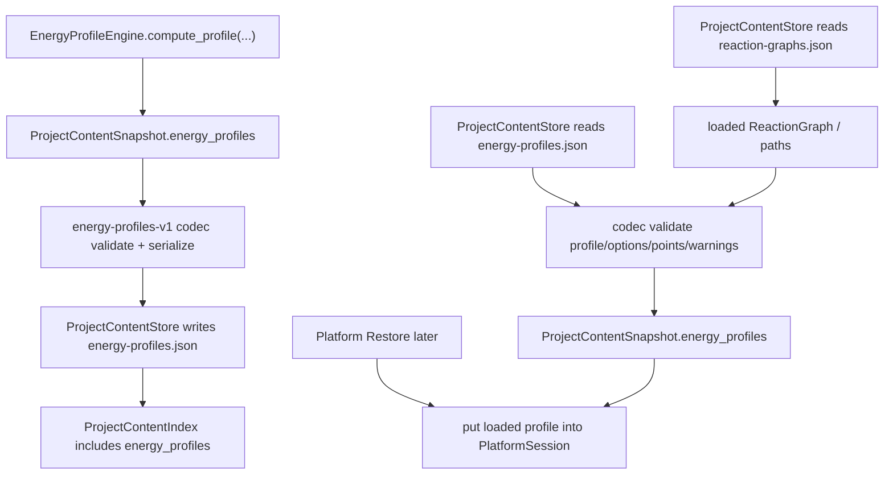

# energy-profile-persistence design

## 0. 术语约定

| 术语 | 定义 | 防冲突结论 |
|---|---|---|
| Energy Profile Persistence | `energy-profiles-v1` section 对 EnergyProfile / EnergyOptions / EnergyPoint / warnings 的长期保存与加载协议 | 区分于 EnergyProfileEngine 的实时计算 |
| Stored EnergyProfile | 写入 `.rxnflow/state/energy-profiles.json` 的已计算 profile 快照 | 不是计算任务，也不是自动重算 recipe |
| Stored EnergyOptions | 写入 profile 的计算选项，包含 output unit、correction 开关、energy key 和 baseline | 复用 `EnergyOptions` 语义，不新增热化学表达式 |
| Stored EnergyPoint | path 上一个 node 的物化能量点，包含 absolute/relative energy 或 missing reason | 不保存 ChemicalObject 内容 |
| Profile Reference Validation | 加载时校验 profile.graph_id / path_id / point node 序列是否仍能对上已加载 ReactionGraph | 不深校验 ChemicalObject energy 是否仍一致 |
| Profile Warning | EnergyProfile 中可持久化的 `RxnFlowWarning` | 非结构化 warning 不进入长期 schema |
| energy-profiles-v1 | Project Content 中 energy profile section 的 schema version | 与 `project-content-v1` index schema 区分 |

术语 grep 结果：当前已有 `EnergyProfile`、`EnergyOptions`、`EnergyPoint`、`EnergyProfileEngine`、`energy-profiles-v1` 基础私有 serializer 和 ProjectContentSnapshot.energy_profiles。当前没有独立 energy profile codec、profile 引用校验、warnings shape 校验，也没有 EnergyProfileEngine 的 stateful restore API。

## 1. 决策与约束

### 需求摘要

本 feature 是 `rxnflow-project-persistence` roadmap 的第五步。完成后，核心层应能：

1. 把 `ProjectContentSnapshot.energy_profiles` 保存为长期 `energy-profiles-v1` section。
2. 保存 EnergyProfile 的 id、graph_id、path_id、options、points 和 warnings。
3. 保存 EnergyOptions 的 output_unit、include_corrections、energy_key 和 baseline_node_id。
4. 保存 EnergyPoint 的 node_id、label、absolute_energy、relative_energy 和 missing_reason。
5. 加载时按已加载 ReactionGraph 校验 graph_id、path_id 和 point node 顺序，避免 profile 和 graph/path 悄悄错位。
6. 对坏 section schema、project id mismatch、profiles/points/warnings shape 错误、重复 profile id、缺失 graph/path/node 引用、energy value 裸 float、unsupported unit、point energy/missing_reason 不一致返回结构化 Result error。
7. 继续保持 ProjectContentStore 不改 manifest、不登记 ProjectResource、不读取或解析 raw file、不调用 EnergyProfileEngine、ParserRegistry、ChemicalRegistry、ReactionGraphService.apply_patch、ImportRegistryWorkflow 或 ReportExportService。

明确不做：

- 不重新计算 EnergyProfile，不根据当前 ChemicalObject / Correction 自动刷新 profile。
- 不把 EnergyProfile 写入 Project Manifest 或登记为 ProjectResource。
- 不持久化计算任务、任务队列、能量计算历史、undo/redo、公式表达式或 provenance graph。
- 不新增 EnergyProfileEngine state/cache，也不新增 `restore_profiles` 服务；EnergyProfileEngine 当前是无状态计算服务。
- 不新增 CLI/Web/desktop command、真实 profile 面板、交互式曲线、图表配置、browser storage adapter、cloud adapter、project bundle 或 migration。
- 不新增 stoichiometric coefficient、热化学表达式、反应速率、微观动力学、自动路径搜索或 profile stale 自动修复。
- 不持久化 ExportArtifact index，不改 PNG/CDXML/XLSX export writer。

### 复杂度档位

按“已计算 profile 的长期 section + graph/path 引用校验”推进。偏离默认项：

- 引用完整性 = required：`graph_id`、`path_id` 和 `points[].node_id` 必须能对上已加载 ReactionGraph。
- 数值严谨度 = required：absolute/relative energy 必须显式保存 `{value, unit, reference}`，不接受裸 float。
- 缺失点语义 = strict：missing point 必须有 `missing_reason` 且没有 absolute/relative energy；非 missing point 必须同时有 absolute/relative energy。
- 可测试性 = tested：正常往返、missing point、warnings、重复 save checksum、坏 schema 和引用错误都要有单元测试。

### 关键决策

1. **energy-profiles-v1 保存物化快照，不重新计算**：load 只恢复 EnergyProfile dataclass，不调用 EnergyProfileEngine.compute_profile，也不比较当前 ChemicalObject energy/corrections 是否变更。
2. **EnergyProfileEngine 不新增 restore API**：engine 是无状态服务；profile 的恢复入口是 ProjectContentSnapshot.energy_profiles，后续 Platform Restore 可把 loaded profile 放进 PlatformSession。
3. **Graph/path 引用硬校验**：load 时已能先加载 ReactionGraph，因此 profile.graph_id/path_id 和 point node 顺序可立即校验；不一致说明 snapshot 内部不一致。
4. **baseline_node_id 可为空**：为空表示计算时使用 path 第一个 node 作为默认 baseline；如果非空则必须属于 selected path。
5. **point 能量单位应匹配 output_unit**：profile point 的 absolute/relative energy 是 EnergyProfileEngine 输出单位下的物化值；如果存在，unit 必须等于 options.output_unit。
6. **warnings 只保存 RxnFlowWarning shape**：当前 `EnergyProfile.warnings` 类型仍是 tuple[Any]，但长期 section 只接受 `RxnFlowWarning` 或等价 JSON shape，避免静默丢 warning。

### 需要确认的技术假设

- 假设 A：保存的是“当时算好的 EnergyProfile”，加载时不自动重算；如果对象能量或 graph 后来变了，stale 检测留给后续 validation/migration 或显式 recompute。
- 假设 B：profile 的 points 必须与当前保存的 path node_ids 顺序一致；不一致时 hard error，而不是只给 warning 后继续加载。
- 假设 C：`baseline_node_id = None` 继续合法，表示默认 path 第一个 node；如果持久化时有明确 baseline id，则必须属于 path。
- 假设 D：missing point 不允许混有 absolute/relative energy；非 missing point 不允许缺 absolute 或 relative energy。

### 前置依赖

roadmap item `energy-profile-persistence` 依赖 `project-content-store-v1` 和 `reaction-graph-workspace-persistence`，当前均已 `done`。现有实现已提供：

- `ProjectContentStore.save_snapshot/load_snapshot` 和 `.rxnflow/state/` section 文件协议。
- `reaction-graphs-v1` codec，可先恢复 ReactionGraph/ReactionPath 并提供 path node_ids 校验依据。
- `EnergyProfileEngine.compute_profile`，已输出 EnergyProfile、EnergyOptions、EnergyPoint、missing_reason 和 RxnFlowWarning。
- `ProjectContentSnapshot.energy_profiles` 已是 `tuple[EnergyProfile, ...]`。
- `content_store.py` 当前已有 `energy-profiles-v1` 基础私有 serializer，但缺少独立 codec 和严格 validation。

## 2. 名词与编排

### 2.1 名词层：值对象 / 实体 / 接口契约

**现状**：

- `EnergyOptions` 包含 output_unit、include_corrections、energy_key、baseline_node_id。
- `EnergyPoint` 包含 node_id、label、absolute_energy、relative_energy、missing_reason。
- `EnergyProfile` 包含 id、graph_id、path_id、options、points、warnings。
- `ProjectContentStore` 当前会写 `energy-profiles.json`，但 serializer 是 content_store 私有函数，只做浅层读写，不校验 graph/path/point 引用、重复 profile id、energy shape 或 warnings shape。
- `EnergyProfileEngine` 是无状态计算服务，没有 list/restore profile state。

**变化**：

- 新增 Energy Profile section codec，负责 `energy-profiles-v1` 的 serialize/deserialize/validate。
- ProjectContentStore 的 energy_profiles section 改用长期 codec。
- `energy-profiles-v1` 保存 Stored EnergyProfile、Stored EnergyOptions、Stored EnergyPoint 和 Profile Warning。
- ProjectContentStore load workflow 在 ReactionGraph section 恢复后校验 energy profile graph/path/node 引用。
- ProjectContentStore 保存 energy_profiles 不再依赖 content_store 内部 ad hoc serializer。

**接口示例：保存 computed profiles**

```python
profile = EnergyProfileEngine().compute_profile(project_id, graph, path_id, objects, options).value
snapshot = ProjectContentSnapshot(
    project_id=project_id,
    chemical_objects=objects,
    reaction_graphs=(graph,),
    energy_profiles=(profile,),
)

saved = ProjectContentStore().save_snapshot(project_path, snapshot)
assert saved.ok
```

**接口示例：恢复后供 export 使用**

```python
loaded = ProjectContentStore().load_snapshot(project_path).value

profile = loaded.energy_profiles[0]
assert profile.graph_id == loaded.reaction_graphs[0].id
assert profile.points[0].relative_energy.value == 0
```

**接口示例：missing point 往返**

```python
point = loaded.energy_profiles[0].points[2]

assert point.missing_reason == "missing_energy"
assert point.absolute_energy is None
assert point.relative_energy is None
```

### 2.2 编排层：主流程与控制流



**现状**：

当前 ProjectContentStore 保存 EnergyProfile 时只调用私有 `_energy_profile_to_dict`。加载时 `_energy_profile_from_dict` 直接索引字段，坏 shape 可能抛异常或静默产生不一致对象；profile 和 graph/path 的关系没有校验。

**变化**：

- save workflow：调用方提供 EnergyProfile tuple → energy profile codec 校验 id/options/points/warnings 和 graph/path/point 引用 → ProjectContentStore 写 `energy-profiles.json`。
- load workflow：先加载 ChemicalObject 和 ReactionGraph → 读取 energy profiles → 校验 graph/path/point sequence → 返回 ProjectContentSnapshot.energy_profiles。
- restore workflow：本 feature 不新增 engine restore；后续 Platform Restore 直接消费 loaded profiles。

**跨层纪律**：

- 错误语义：schema 错误、project id 不一致、重复 profile id、坏 options、坏 point energy、missing/energy 语义冲突、warnings shape 错误、graph/path/node 引用缺失返回 `invalid_input` 或既有 graph 引用错误。
- 幂等性：同一 profile snapshot 重复保存得到稳定 JSON/checksum。
- 顺序性：profiles 和 points 按输入顺序保存和加载；points 必须与 selected path node_ids 顺序一致。
- 单位纪律：EnergyValue 必须显式 `{value, unit, reference}`；point energy unit 必须匹配 `options.output_unit`。
- 计算边界：load/save 不调用 EnergyProfileEngine，不重新计算 relative energy，不检查当前 ChemicalObject energy/corrections 是否仍匹配。
- Export 边界：ReportExportService 可消费 loaded profile，但本 feature 不调用或修改 export writer。

### 2.3 挂载点清单

- Energy Profile section codec：`energy-profiles-v1` 的 serialize/deserialize/validate 边界。
- ProjectContentStore energy_profiles section：`.rxnflow/state/energy-profiles.json` 写入和加载。
- ProjectContentSnapshot.energy_profiles：已计算 EnergyProfile 的长期项目内容入口。
- Profile reference validation：EnergyProfile 与 loaded ReactionGraph/path/node sequence 的一致性校验。
- Profile warning/energy value codec：RxnFlowWarning 和 EnergyValue 的长期 JSON 表达。

### 2.4 推进策略

1. **Energy profile codec 骨架**：实现 EnergyProfile / EnergyOptions / warnings 的 `energy-profiles-v1` 往返。
   - 退出信号：profile id/graph_id/path_id/options/warnings 往返一致；坏 schema/project id 返回 Result error。
2. **EnergyPoint 与 EnergyValue 严格校验**：实现 point absolute/relative/missing_reason 和 EnergyValue shape/unit validation。
   - 退出信号：正常点和 missing point 往返一致；裸 energy、unsupported unit、point 语义冲突返回 Result error。
3. **Graph/path 引用校验**：基于 loaded ReactionGraph 校验 graph_id、path_id 和 point node 顺序。
   - 退出信号：缺失 graph/path/node 或 point sequence mismatch 返回 structured error。
4. **ProjectContentStore 接入**：将 energy_profiles section 改用长期 codec，保持 index/path/checksum 行为稳定。
   - 退出信号：ProjectContentStore.save_snapshot/load_snapshot 可恢复真实 EnergyProfile，且 chemical/import/graph/workspace sections 不回退。
5. **错误与范围守护**：覆盖重复 profile id、warnings shape、重复 save checksum，以及不碰 parser/import/registry/graph mutation/engine/export 的边界。
   - 退出信号：新增 energy profile persistence tests 和现有全量 unittest 均通过。

## 3. 验收契约

### 关键场景清单

1. EnergyProfileEngine.compute_profile 产生 profile → ProjectContentStore.save_snapshot 写入 `energy-profiles.json`，保留 profile id、graph_id、path_id、options、points 和 warnings。
2. 上述 snapshot load 后 → `ProjectContentSnapshot.energy_profiles` 字段恢复 EnergyProfile / EnergyOptions / EnergyPoint。
3. 正常 EnergyPoint 保存/加载后保留 node_id、label、absolute_energy、relative_energy，energy unit 与 options.output_unit 一致。
4. missing EnergyPoint 保存/加载后保留 missing_reason，absolute_energy 和 relative_energy 均为 None。
5. profile warnings 保存/加载后保留 warning code/message/target。
6. 同一 energy profile snapshot 重复保存 → energy-profiles section checksum 稳定，index path/kind 不变。
7. `energy-profiles.json` schema_version 不是 `energy-profiles-v1` → load_snapshot 返回 `invalid_input`。
8. section project_id 与 ProjectContentIndex.project_id 不一致 → 返回 `invalid_input`。
9. 同一 section 内重复 profile id → 返回 `invalid_input`。
10. profile.graph_id 引用缺失 ReactionGraph → 返回 structured error。
11. profile.path_id 引用缺失 ReactionPath → 返回 structured error。
12. points[].node_id 顺序与 selected path.node_ids 不一致 → 返回 structured error。
13. EnergyOptions.output_unit 不是 `kcal_mol` / `kj_mol` 或 energy_key 为空 → 返回 `invalid_input`。
14. EnergyValue 使用裸 float、缺 value/unit 或 unsupported unit → 返回 `invalid_input`。
15. 非 missing point 缺 absolute_energy 或 relative_energy → 返回 `invalid_input`。
16. missing point 同时包含 absolute_energy 或 relative_energy → 返回 `invalid_input`。
17. warning entry 字段缺失或 shape 错误 → 返回 `invalid_input`。
18. save/load 不修改 `.rxnflow/manifest.json`，不新增 ProjectResource，不读取或解析 `inputs/raw/`。
19. 本 feature 不调用 EnergyProfileEngine.compute_profile、ParserRegistry、ImportRegistryWorkflow、ChemicalRegistry.register、ReactionGraphService.apply_patch 或 ReportExportService。
20. 现有 ProjectContentStore、Energy Engine、Graph Workspace、Import Ledger、Report Export 和 Platform Shell 测试继续通过。

### 明确不做的反向核对项

- 不重新计算 EnergyProfile，不根据当前 objects/corrections 自动刷新 profile。
- 不新增 EnergyProfileEngine state/cache/list/restore API。
- 不把 EnergyProfile 写入 Project Manifest 或登记 ProjectResource。
- 不持久化 ExportArtifact index 或 artifact bytes。
- 不新增 UI、CLI/Web/desktop command、browser storage、cloud adapter、project bundle、migration、增量保存、并发锁或冲突合并。
- 不新增热化学表达式、计量系数字段、速率模型、自动路径搜索或 profile stale 自动修复。
- 不改 EnergyProfileEngine 的计算规则、unit conversion 常量或 correction inclusion 语义。

## 4. 与项目级架构文档的关系

验收时需要回写：

- `codestable/architecture/ARCHITECTURE.md`：补 Energy Profile Persistence、`energy-profiles-v1` 长期 section、profile reference validation、materialized profile 不自动重算的边界。
- `codestable/architecture/core-platform.md`：补 Project Content Store 已支持 energy-profiles-v1 长期 codec、EnergyProfile fields、错误语义、引用校验和范围边界。
- `codestable/requirements/project-content-persistence.md`：如用户故事/边界不变，可只更新 `last_reviewed` 或在验收报告说明无需更新。
- 不更新 AGENTS.md：本 feature 不新增通用命令或环境约束。

roadmap 回写：

- design 确认后把 `rxnflow-project-persistence-items.yaml` 中 `energy-profile-persistence` 从 `planned` 改为 `in-progress`，feature 填 `2026-05-06-energy-profile-persistence`。
- 验收时再改为 `done` 并同步 roadmap 主文档子 feature 清单。
