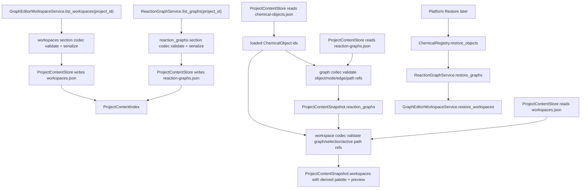

# reaction-graph-workspace-persistence design

## 0. 术语约定

| 术语 | 定义 | 防冲突结论 |
|---|---|---|
| Reaction Graph Persistence | `reaction-graphs-v1` section 对 ReactionGraph、ReactionNode、ReactionEdge、ReactionPath 的长期保存与加载协议 | 区分于 GraphPatch history；保存的是 materialized graph state |
| Stored ReactionGraph | 写入 `.rxnflow/state/reaction-graphs.json` 的 ReactionGraph JSON 记录 | 仍引用 ChemicalObject id，不复制 ChemicalObject 内容 |
| Workspace Persistence | `workspaces-v1` section 对 workspace-only 状态的保存与加载协议 | 不替代 ReactionGraph，也不保存 palette / preview |
| Stored Workspace | 写入 `.rxnflow/state/workspaces.json` 的 workspace_id、graph_id、selection、viewport、active_path_id 和 updated_at | 对应 roadmap 的 StoredWorkspace，实际 JSON 字段沿用当前 Python snake_case |
| Graph Reference Validation | 加载/恢复时校验 object、node、edge、path 引用完整性 | 复用 ReactionGraphService 的图谱语义，不引入化学合理性判断 |
| Workspace Reference Validation | 加载/恢复时校验 workspace 引用的 graph、selection、active path 和 viewport | 引用损坏返回结构化错误，不静默丢 selection |
| reaction-graphs-v1 | Project Content 中 ReactionGraph section 的 schema version | 与 `project-content-v1` index schema 区分 |
| workspaces-v1 | Project Content 中 Workspace section 的 schema version | 与 workspace API 的 `WorkspaceSnapshot` 区分 |

术语 grep 结果：当前已有 `ReactionGraphService`、`GraphPatch`、`ReactionGraph`、`ReactionNode`、`ReactionEdge`、`ReactionPath`、`GraphEditorWorkspaceService`、`WorkspaceSnapshot`、`CanvasViewport`、`WorkspaceSelection`、`ObjectPaletteItem`、`NetworkPreview`。`ProjectContentStore` 里已有 `reaction-graphs-v1` / `workspaces-v1` 的基础私有 serializer，但它还不是可复用的长期 codec，也没有 service-level snapshot/restore API。

## 1. 决策与约束

### 需求摘要

本 feature 是 `rxnflow-project-persistence` roadmap 的第三步。完成后，核心层应能：

1. 把真实 `ReactionGraph`、`ReactionNode`、`ReactionEdge` 和 `ReactionPath` 保存为 `reaction-graphs-v1` section。
2. 把 `WorkspaceSnapshot` 中的 workspace-only 状态保存为 `workspaces-v1` section：`workspace_id`、`graph_id`、`selection`、`viewport`、`active_path_id` 和 `updated_at`。
3. 从 `ProjectContentStore.load_snapshot` 恢复 graph tuple 和 workspace tuple；workspace 的 `palette` 从已加载 ChemicalObject 派生，`preview` 从已加载 ReactionGraph 派生。
4. 给 `ReactionGraphService` 提供项目级 graph snapshot/restore 入口，给 `GraphEditorWorkspaceService` 提供 workspace snapshot/restore 入口，供后续 Platform Shell 恢复服务状态。
5. 对坏 section schema、project id 不匹配、重复 graph/workspace/node/edge/path id、缺失 ChemicalObject 引用、坏 edge/path 引用、坏 selection、坏 active path 和非法 viewport 返回结构化 Result error。
6. 继续保持 ProjectContentStore 不改 manifest、不登记 ProjectResource、不读 raw file、不调用 parser/import/energy/export。

明确不做：

- 不持久化 GraphPatch history、undo/redo stack、画布事件日志或协同编辑操作。
- 不把 ChemicalObject 内容复制进 graph node；node 只保存 `chemical_object_ids`。
- 不持久化 ObjectPaletteItem 或 NetworkPreview；二者在 load/restore 后由 ChemicalObject 和 ReactionGraph 重新派生。
- 不新增节点计量系数、反应物/产物侧语义、自动布局、自动路径搜索或化学合理性判断。
- 不持久化 ImportBatch、ParsePreview、EnergyProfile 或 ExportArtifact index 的完整内容；这些由后续 roadmap items 处理。
- 不实现 CLI/Web/desktop command、真实画布 UI、浏览器 storage adapter、project bundle、migration、增量保存、并发锁或冲突合并。
- 不改变 EnergyProfileEngine 的能量计算规则；本 feature 只保证后续 profile 可以引用已恢复 graph/path。

### 复杂度档位

按“领域内容仓储 + headless service restore”推进。偏离默认项：

- 引用完整性 = required：graph object、edge、path、workspace selection 和 active path 的引用都必须可验证。
- 多服务恢复 = required：ProjectContentStore 负责 snapshot，ReactionGraphService / GraphEditorWorkspaceService 负责恢复运行态。
- UI 状态 = structured but derived：workspace section 保存最小 UI 状态，palette/preview 不做持久化缓存。
- 可测试性 = tested：section 往返、service restore、错误路径和不触碰 parser/import/energy/export 的范围守护都要有单元测试。

### 关键决策

1. **ReactionGraph 是持久化的唯一 graph 真相**：`reaction-graphs-v1` 保存 materialized graph state；workspace section 只引用 `graph_id`，不复制 nodes、edges 或 paths。
2. **Workspace 只保存不可从 graph 推导的画布状态**：`selection`、`viewport`、`active_path_id` 和 `updated_at` 进入 `workspaces-v1`；`palette` 和 `preview` 从 loaded objects/graph 重新生成，避免 stale cache。
3. **graph/workspace codec 从 ProjectContentStore 私有函数中独立出来**：图谱和 workspace section 的 serialize/deserialize/validate 形成可单测、可复用的 domain repository 边界，ProjectContentStore 只编排 section 文件读写。
4. **service restore 不回放 GraphPatch**：恢复 graph 时直接重建 `ReactionGraphService` 的项目 graph map；恢复 workspace 时直接重建 `_WorkspaceState` 所需信息，不触发 patch 语义或 id 生成。
5. **引用损坏是 hard error**：graph node 引用缺失 ChemicalObject、edge 引用缺失 node、path 引用缺失 node、workspace selection/active_path 引用缺失 graph item 时返回 `invalid_input` 或 `graph_invalid`，不静默丢弃用户选择。
6. **实际 JSON 字段沿用 snake_case**：roadmap 中的 TypeScript 契约使用 `schemaVersion` 表达语义；当前 Python JSON 已采用 `schema_version`，本 feature 继续保持一致，避免无意义迁移。

### 已确认 / 默认假设

- 假设 A：`species` 和 `transition_state` node 必须至少引用一个 ChemicalObject；`group` 和 `annotation` node 可以不引用 ChemicalObject。
- 假设 B：`ReactionNode.position` 已是节点布局坐标的持久化字段；`CanvasViewport` 只保存画布视口，不替代 node position。
- 假设 C：workspace selection 指向不存在的 node/edge/path 时按损坏项目处理，返回 error；不做“尽量打开并丢弃坏 selection”的容错。
- 假设 D：viewport zoom 必须为正数；x/y 可为任意 float。
- 假设 E：同一 project 下 `workspace_id` 唯一；多个 workspace 可以引用同一个 `graph_id`。

### 前置依赖

roadmap item `reaction-graph-workspace-persistence` 依赖 `project-content-store-v1` 和 `chemical-object-persistence`，当前均已 `done`。现有实现已提供：

- `ProjectContentStore.save_snapshot/load_snapshot` 和 `.rxnflow/state/` section 文件协议。
- `chemical-objects-v1` codec 和 `ChemicalRegistry.list_objects/restore_objects`。
- `ReactionGraphService.create_graph/apply_patch/list_paths`，但没有公开 `list_graphs/restore_graphs`。
- `GraphEditorWorkspaceService.open_workspace/snapshot/select/set_viewport`，但没有公开 `list_workspaces/restore_workspaces`。
- `content_store.py` 内部已有基础 `_reaction_graph_to_dict/_reaction_graph_from_dict/_workspace_to_dict/_workspaces_from_section`，但缺少严格字段 validation 和独立模块边界。

## 2. 名词与编排

### 2.1 名词层：值对象 / 实体 / 接口契约

**现状**：

- `rxnflow.models.ReactionGraph` 包含 `id`、`project_id`、`nodes`、`edges` 和 `paths`；nodes 通过 `chemical_object_ids` 引用 ChemicalObject。
- `ReactionGraphService` 在内存 `_projects` 中保存 graph，能创建 graph、应用 patch 和列出 paths；没有 project-level graph list/restore。
- `GraphEditorWorkspaceService` 在内存 `_workspaces` 中保存 workspace state，能打开 workspace、更新 graph、selection、viewport 和返回 snapshot；没有 project-level workspace list/restore。
- `WorkspaceSnapshot` 输出中包含 `graph`、`palette`、`selection`、`viewport`、`active_path_id` 和 `preview`。
- `ProjectContentStore` 已把 `reaction_graphs`、`workspaces` 放入 `ProjectContentSnapshot`，但 graph/workspace JSON 逻辑仍是私有基础实现。

**变化**：

- 新增或抽出 Graph / Workspace section codec，负责 `reaction-graphs-v1` 和 `workspaces-v1` 的 dict/JSON 往返和 validation。
- `ProjectContentStore` 的 `reaction_graphs` 和 `workspaces` section 改用该 codec。
- `ReactionGraphService` 新增 `list_graphs(project_id)`，返回该项目当前 graph tuple。
- `ReactionGraphService` 新增 `restore_graphs(project_id, graphs, object_ids=None, replace=False)`，恢复 graph map 并校验引用。
- `GraphEditorWorkspaceService` 新增 `list_workspaces(project_id)`，返回该项目 workspace snapshot tuple。
- `GraphEditorWorkspaceService` 新增 `restore_workspaces(project_id, workspaces, objects=(), replace=False)`，恢复 workspace-only 状态，并依赖已恢复的 graph service 读取 graph。
- `ProjectContentSnapshot.reaction_graphs/workspaces` 的字段语义收紧为长期持久化数据，而不是 fixture 级临时往返。

**接口示例：graph/workspace snapshot 到 ProjectContentSnapshot**

```python
objects = registry.list_objects("project-a").value
graphs = graph_service.list_graphs("project-a").value
workspaces = workspace_service.list_workspaces("project-a").value

snapshot = ProjectContentSnapshot(
    project_id="project-a",
    chemical_objects=objects,
    reaction_graphs=graphs,
    workspaces=workspaces,
)

saved = ProjectContentStore().save_snapshot(project_path, snapshot)
assert saved.ok
```

**接口示例：从 ProjectContentSnapshot 恢复运行态**

```python
loaded = ProjectContentStore().load_snapshot(project_path).value

registry.restore_objects(loaded.project_id, loaded.chemical_objects)
graph_service.restore_graphs(
    loaded.project_id,
    loaded.reaction_graphs,
    object_ids={obj.id for obj in loaded.chemical_objects},
)
workspace_service.restore_workspaces(
    loaded.project_id,
    loaded.workspaces,
    objects=loaded.chemical_objects,
)

assert workspace_service.snapshot(loaded.project_id, loaded.workspaces[0].workspace_id).ok
```

**接口示例：workspace section 不保存 derived data**

```python
loaded_workspace = store.load_snapshot(project_path).value.workspaces[0]

assert loaded_workspace.palette[0].object_id in {obj.id for obj in loaded.chemical_objects}
assert loaded_workspace.preview.graph_id == loaded_workspace.graph.id
```

### 2.2 编排层：主流程与控制流



**现状**：

当前 project-content load 可以恢复基础 graph/workspace dataclass，但 graph/workspace validation 不完整，且恢复出的 snapshot 还不能灌回 `ReactionGraphService` / `GraphEditorWorkspaceService` 的运行态。Platform Shell 后续即使读到文件，也缺少把服务恢复到可继续编辑状态的 API。

**变化**：

- save workflow：从 graph service/workspace service 获取 tuple → codec 校验并序列化 → ProjectContentStore 写 section。
- load workflow：先加载 ChemicalObject → 再加载并校验 ReactionGraph → 最后加载并校验 Workspace，workspace snapshot 的 palette/preview 即时派生。
- graph restore workflow：恢复 graph map，保留 graph id 和 path id，不调用 create_graph 或 apply_patch。
- workspace restore workflow：基于已恢复 graph service 和 loaded objects 重建 workspace state，保留 selection、viewport 和 active_path_id。

**跨层纪律**：

- 错误语义：section schema 错误、project id 不一致、字段 shape 错误和 workspace section 损坏返回 `invalid_input`；graph 内部引用损坏可返回 `graph_invalid`，但不得抛异常。
- 幂等性：同一 graph/workspace snapshot 重复保存得到稳定 JSON/checksum；同一集合重复 restore 不追加重复 graph/workspace。
- 顺序性：load 时必须先有 ChemicalObject ids，再校验 graph；必须先有 graph map，再校验 workspace。
- 来源边界：graph node 只保存 ChemicalObject id，不读取 raw file、不访问 import ledger。
- UI 状态边界：selection/viewport/active_path 只属于 workspace，不写入 ReactionGraph。
- 扩展点：后续 `energy-profile-persistence` 可以基于已恢复 graph/path 做 profile 引用校验；后续 `platform-shell-state-restore` 可以按 snapshot → service restore 的顺序接线。
- 可观测点：加载后的 `ProjectContentSnapshot.reaction_graphs` 可直接读取 nodes/edges/paths；`ProjectContentSnapshot.workspaces` 可直接读取 graph、selection、viewport、active_path_id、palette 和 preview。

### 2.3 挂载点清单

- Graph / Workspace section codec：`reaction-graphs-v1` 与 `workspaces-v1` 的 serialize/deserialize/validate 边界。
- ProjectContentStore graph/workspace sections：`.rxnflow/state/reaction-graphs.json` 和 `.rxnflow/state/workspaces.json` 使用长期 codec。
- ReactionGraphService public API：`list_graphs(project_id)` 和 `restore_graphs(project_id, graphs, object_ids=None, replace=False)`。
- GraphEditorWorkspaceService public API：`list_workspaces(project_id)` 和 `restore_workspaces(project_id, workspaces, objects=(), replace=False)`。
- Workspace derived snapshot builder：load/restore 后从 graph + ChemicalObject 派生 palette 和 preview。

### 2.4 推进策略

1. **Graph section codec**：实现 `reaction-graphs-v1` 往返和 graph-level validation。
   - 退出信号：graph id/project_id、nodes、edges、paths、node positions、metadata 和 object refs 往返一致；坏 graph 返回 Result error。
2. **Workspace section codec**：实现 `workspaces-v1` 往返，保存 workspace-only 状态并派生 palette/preview。
   - 退出信号：workspace_id、graph_id、selection、viewport、active_path_id 和 updated_at 往返一致；palette/preview 不写入 JSON 但加载后可观察。
3. **ProjectContentStore 接入**：将 reaction_graphs/workspaces section 改用长期 codec，保持 index/path/checksum 行为不变。
   - 退出信号：save_snapshot/load_snapshot 可恢复真实 graph/workspace，且 chemical object section 仍按既有 codec 工作。
4. **Graph service restore API**：新增 list/restore graph 入口，直接恢复 graph map 并保留 id。
   - 退出信号：新 `ReactionGraphService` restore 后可 list_paths/apply_patch 继续编辑已恢复 graph。
5. **Workspace service restore API**：新增 list/restore workspace 入口，恢复 selection/viewport/active_path 并重新派生 snapshot。
   - 退出信号：新 `GraphEditorWorkspaceService` restore 后 snapshot、select、set_viewport 和 graph edit 继续可用。
6. **错误与范围守护**：覆盖坏 schema、project id mismatch、重复 id、缺失 object/node/edge/path/workspace 引用、非法 viewport，以及不碰 parser/import/energy/export 的边界。
   - 退出信号：新增 graph/workspace persistence tests 和现有全量 unittest 均通过。

## 3. 验收契约

### 关键场景清单

1. ProjectContentStore.save_snapshot 保存含多个 nodes/edges/paths 的 ReactionGraph → `reaction-graphs.json` 保留 graph id、project_id、node kind/label/object ids/position/metadata、edge from/to/label/metadata 和 path node_ids。
2. ProjectContentStore.load_snapshot 加载上述 snapshot → `ProjectContentSnapshot.reaction_graphs` 与保存前关键字段一致。
3. graph node 引用已加载 ChemicalObject id → load_snapshot 成功；引用缺失 ChemicalObject id → 返回 structured error。
4. species / transition_state node 缺少 chemical_object_ids → 返回 `graph_invalid` 或等价 structured error。
5. edge 引用缺失 from_node 或 to_node → 返回 structured error。
6. path 为空或引用缺失 node → 返回 structured error。
7. 同一 graph section 内重复 graph id / node id / edge id / path id → 返回 `invalid_input`。
8. ProjectContentStore.save_snapshot 保存 WorkspaceSnapshot → `workspaces.json` 只保存 workspace_id、project_id、graph_id、selection、viewport、active_path_id、updated_at，不保存 palette 或 preview。
9. ProjectContentStore.load_snapshot 加载 workspace section → WorkspaceSnapshot 的 palette 从 loaded ChemicalObject 派生，preview 从 loaded ReactionGraph 派生。
10. workspace graph_id 引用缺失 graph → 返回 `invalid_input`。
11. workspace selection 引用缺失 node/edge/path → 返回 `invalid_input`。
12. workspace active_path_id 引用缺失 path → 返回 `invalid_input`。
13. viewport zoom 小于等于 0 或不可转为 number → 返回 `invalid_input`。
14. 同一 workspace section 内重复 workspace_id → 返回 `invalid_input`。
15. ReactionGraphService.list_graphs(project_id) → 返回该项目已创建/恢复的 graph tuple；未知项目返回空 tuple。
16. ReactionGraphService.restore_graphs(project_id, graphs, object_ids=...) → 新 service 可 list_paths，并可继续 apply_patch 到已恢复 graph。
17. GraphEditorWorkspaceService.list_workspaces(project_id) → 返回该项目 workspace snapshots；未知项目返回空 tuple。
18. GraphEditorWorkspaceService.restore_workspaces(project_id, workspaces, objects=...) → 新 service 可 snapshot，且 selection、viewport、active_path_id 保留。
19. 同一 graph/workspace snapshot 重复 save → reaction-graphs/workspaces section checksum 稳定，index path/kind 不变。
20. save/load 不修改 `.rxnflow/manifest.json`，不新增 ProjectResource，不读取或解析 `inputs/raw/`。
21. 本 feature 不调用 ParserRegistry、ImportRegistryWorkflow.confirm_import、EnergyProfileEngine 或 ReportExportService。
22. 现有 ProjectContentStore、ChemicalRegistry、Graph Workspace、Energy Engine、Report Export 和 Platform Shell 测试继续通过。

### 明确不做的反向核对项

- 不出现 GraphPatch history、undo/redo、operation log、CRDT 或协同编辑 schema。
- 不把 ChemicalObject 内容复制进 `reaction-graphs.json`。
- 不把 ObjectPaletteItem 或 NetworkPreview 写入 `workspaces.json`。
- 不新增 stoichiometry、reaction side、auto layout、auto path search 或化学合理性判断字段。
- 不新增 CLI/Web/desktop command、browser storage adapter、cloud adapter、project bundle 或 migration。
- 不改变 EnergyProfileEngine 的 profile 计算规则，也不持久化 EnergyProfile 新 schema。

## 4. 与项目级架构文档的关系

验收时需要回写：

- `codestable/architecture/ARCHITECTURE.md`：补 ReactionGraph / Workspace 长期持久化、graph/workspace codec、service restore API 和 derived palette/preview 决策。
- `codestable/architecture/core-platform.md`：补当前 Project Content Store 已支持 `reaction-graphs-v1` / `workspaces-v1` 的字段、错误语义、引用校验和运行态恢复入口。
- 不更新 AGENTS.md：本 feature 不新增通用命令或环境约束。

roadmap 回写：

- design 确认后把 `rxnflow-project-persistence-items.yaml` 中 `reaction-graph-workspace-persistence` 从 `planned` 改为 `in-progress`，feature 填 `2026-05-06-reaction-graph-workspace-persistence`。
- 验收时再改为 `done` 并同步 roadmap 主文档子 feature 清单。
