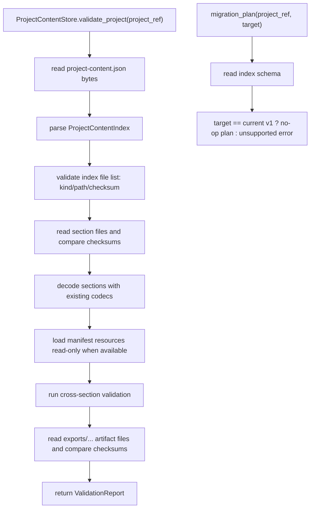

# project-content-validation-migration design

## 0. 术语约定

| 术语 | 定义 | 防冲突结论 |
|---|---|---|
| Project Content Validation | 对 `.rxnflow/state/` 中 project-content index、section files、schema、checksum、安全 path 和跨 section 引用做可观察校验 | 新增；不同于各 codec 在 save/load 中的单次 fail-fast 校验 |
| Validation Report | 一次校验的结构化结果，包含 project_id、schema_version、ok、issues 和 summary | 新增；用于 agent/CLI/UI 展示，不直接等同 `Result` error |
| Validation Issue | 单条 warning/error，包含 severity、code、message、target 和 details | 新增；需要 JSON-safe |
| Validation Severity | `"error"` / `"warning"` | 新增；error 使 report.ok=false，warning 不阻止加载 |
| Deep Check | 读取 section/export artifact bytes 并复算 checksum | 新增；本 feature 第一版默认对 state sections 做 checksum deep check，对 export artifacts 也做存在性/checksum check |
| Migration Plan | 对当前 project content schema 是否需要迁移的显式报告 | 新增；第一版只支持 `project-content-v1` no-op 和 unsupported target 错误 |
| Migration Entry | `ProjectContentStore` 上暴露的 migration plan / migrate API 边界 | 新增；不是 silent migration |

术语 grep 结果：当前有 `ProjectContentIndex`、`ProjectContentFile`、`ProjectContentSnapshot`、`ProjectContentStore`、各 section codec 和 `validate-yaml.py` 工具；没有 `ValidationReport`、`ValidationIssue`、Project Content validator 或 migration API。现有 `load_snapshot`/codec 已有 fail-fast schema/project/ref 校验，但没有一次性聚合报告、checksum mismatch 检查、export artifact 文件 checksum 复算或 migration 入口。

## 1. 决策与约束

### 需求摘要

本 feature 是 `rxnflow-project-persistence` roadmap 的第七步。完成后，核心层应能：

1. 对一个 project directory 生成 Project Content Validation Report。
2. 校验 `.rxnflow/state/project-content.json` 的 schema version、project_id、files shape、section kind/path 和重复 kind/path。
3. 校验 ProjectContentFile.path 是安全项目相对 POSIX path，并匹配当前 `SECTION_PATHS` 中的 canonical path。
4. 读取每个 section file，复算 bytes checksum，并与 ProjectContentIndex.files[].checksum 对比。
5. 复用现有 section codecs 读取 ChemicalObject、ReactionGraph、WorkspaceSnapshot、ImportBatch、EnergyProfile 和 ExportArtifactRecord，保留已有 shape/ref 错误语义。
6. 做跨 section 引用汇总校验：ChemicalObject source_file_id、Import registered_object_ids/raw_resource_id、ReactionGraph object refs、Workspace graph/selection refs、EnergyProfile graph/path/point refs、ExportArtifact path/checksum。
7. 对 ExportArtifactRecord.path 指向的 `exports/...` 文件做存在性和 checksum 校验。
8. 暴露显式 migration entry：当前 `project-content-v1` 迁移到 `project-content-v1` 返回 no-op plan；未知 target 或不兼容 source 返回结构化 error，不做 silent migration。
9. 保持 ProjectContentStore 不修改 manifest、不复制/删除 artifact、不解析 raw files、不调用 ParserRegistry / ImportRegistryWorkflow / ChemicalRegistry.register / ReactionGraphService.apply_patch / EnergyProfileEngine / ReportExportService。

明确不做：

- 不实现 `project-content-v2` 的真实迁移步骤。
- 不自动修复 checksum、path、project_id 或引用错误。
- 不写回 project-content index、section JSON、manifest、raw files 或 export artifacts。
- 不删除 orphan state file、raw file 或 export artifact。
- 不重新 parse raw files，不重新登记 ChemicalObject，不重新计算 EnergyProfile，不重新导出报告。
- 不校验计算化学语义正确性，例如能量物理合理性、几何、键级、虚频或反应路径化学合理性。
- 不实现 CLI/Web/desktop command、UI 报告面板、browser storage、cloud adapter 或 project bundle。
- 不把 validation issue 当异常抛出；可恢复的项目内容问题进入 Validation Report。

### 复杂度档位

按“核心层验证报告 + 显式 migration 入口”推进。偏离默认项：

- 报告聚合 = required：validation 不应遇到第一个坏引用就停止；能继续读的部分要继续收集 issues。
- checksum deep check = required：state section checksum 必须复算；export artifact checksum 也在本 feature 中读取 artifact bytes 复算。
- manifest 只读 = optional context：validation 可以读取 project manifest 的 resources 作为 raw_resource_id/source_file_id 锚点，但不得修改 manifest。
- migration = explicit no-op：只提供入口和 no-op/unsupported 语义，不做真实迁移。
- 可测试性 = broad：覆盖正常 report、checksum mismatch、missing section、unknown/canonical section path、cross refs、export artifact file checksum、migration no-op/unsupported 和范围守护。

### 关键决策

1. **新增独立 `ProjectContentValidator`，不把验证逻辑塞进 codec**：codec 继续负责单 section serialize/deserialize，validator 负责聚合、checksum、manifest context 和跨 section 报告。
2. **Validation Report 与 Result error 分层**：I/O internal error 仍走 `Result` error；内容不一致、缺文件、checksum mismatch、坏引用进入 `ValidationReport.issues`，`report.ok=false`。
3. **section checksum 在 validation 中复算**：当前 load 只读文件，不比较 index checksum；validation 才承担“项目内容是否被篡改/损坏”的检查。
4. **export artifact bytes checksum 在 validation 中复算**：前一 feature 明确把 artifact 文件深校验留给本 feature；validation 只读，不生成/复制/删除 artifact。
5. **source_file_id 缺失锚点第一版作为 warning**：fixture 和手工对象可能没有 manifest/import ledger 锚点；这类问题需要提示，但不阻断 report。
6. **已由 codec 硬校验的引用继续硬校验**：graph object refs、workspace refs、energy profile refs、import registered ids、export artifact path/checksum shape 仍通过现有 codec/validator 返回 error issue。
7. **migration entry 先定义协议，再做 no-op**：只有 `project-content-v1 -> project-content-v1` 成功，其他 target 返回 unsupported migration error。

### 已确认的技术假设

- A：validation 默认读取 `exports/...` artifact 文件并复算 checksum；缺文件或 mismatch 是 `error`。
- B：ChemicalObject.source_file_id 找不到 manifest raw_file resource 或 import ledger raw_resource_id 时先记 `warning`，不作为 hard error。
- C：ExportArtifactRecord.metadata 中常见的 `profile_id`、`graph_id`、`path_id` 只做 warning 级别 best-effort 校验；metadata 仍不是强 schema。
- D：本 feature 暴露 `ProjectContentStore.validate_project(project_ref)` 和 `ProjectContentStore.migration_plan(project_ref, target_schema_version="project-content-v1")`，但不新增 CLI 命令。
- E：migration 第一版不写文件；`migrate_project(...)` 如实现，只允许 no-op，否则返回 unsupported，不做 dry-run 之外的修改。

### 前置依赖

roadmap item `project-content-validation-migration` 依赖 ChemicalObject、ReactionGraph/Workspace、ImportLedger、EnergyProfile 和 ExportArtifactIndex persistence，当前均已 `done`。现有实现已提供：

- `ProjectContentStore.load_index/load_snapshot/save_snapshot`。
- `ProjectStorageBackend.read_object/list_objects/exists`。
- 各 section codec 的 schema/project/shape/ref 校验。
- Project Manifest / ProjectStore 的 raw file resource。

## 2. 名词与编排

### 2.1 名词层：值对象 / 实体 / 接口契约

**现状**：

- `ProjectContentStore.load_snapshot` 是 fail-fast；遇到坏 JSON、坏 schema、坏引用直接返回 `Result` error。
- `ProjectContentIndex.files[].checksum` 在写入时记录，但 load 时不复算比对。
- 各 section codec 已校验本 section schema/project id 和部分跨 section 引用，但没有汇总报告。
- roadmap 契约提到 `validate_snapshot`，实际未实现。
- migration 入口不存在；不兼容 schema 直接 `invalid_input`。

**变化**：

- 新增 `ProjectContentValidationIssue(severity, code, message, target, details)`。
- 新增 `ProjectContentValidationReport(project_id, schema_version, ok, issues, checked_at, summary)`。
- 新增 `ProjectContentMigrationPlan(current_schema_version, target_schema_version, needed, steps, issues)`。
- 新增 `ProjectContentValidator`，负责 project/index/snapshot/report 编排。
- `ProjectContentStore` 暴露 `validate_project(project_ref)` 和 `migration_plan(project_ref, target_schema_version=PROJECT_CONTENT_SCHEMA_VERSION)`。
- 可选新增 `validate_snapshot(snapshot, manifest_resources=(), artifact_infos=())` 作为无文件场景的核心校验入口，但文件 checksum/export artifact bytes 校验只在 `validate_project` 中做。

**接口示例：验证项目内容**

```python
report_result = ProjectContentStore().validate_project(project_path)

assert report_result.ok
report = report_result.value
assert report.project_id == "project-a"
assert report.ok is True
assert report.issues == ()
```

**接口示例：checksum mismatch 进入报告**

```python
report = ProjectContentStore().validate_project(project_path).value

assert report.ok is False
assert report.issues[0].code == "checksum_mismatch"
assert report.issues[0].severity == "error"
```

**接口示例：migration no-op**

```python
plan = ProjectContentStore().migration_plan(project_path, "project-content-v1").value

assert plan.needed is False
assert plan.steps == ()
```

### 2.2 编排层：主流程与控制流



**现状**：

ProjectContentStore 当前在 load path 上完成“能不能恢复 snapshot”的 fail-fast 检查。它不会告诉调用方完整问题清单，也不会验证 index checksum 是否匹配 section bytes。ExportArtifactRecord.checksum 只做字符串 shape 校验，没有读取 `exports/...` 文件复算。

**变化**：

- validate project workflow：读取 index → 检查 index schema/kind/path/checksum → 读取所有 section bytes → 复算 section checksum → 复用 section codec 解码 → 聚合跨 section 引用 → 校验 export artifact file 存在性和 checksum → 返回 report。
- validate snapshot workflow：对内存 snapshot 做跨 section 引用校验，跳过文件 checksum。
- migration plan workflow：读取 index schema → 判断 target → 返回 no-op plan 或 unsupported error；不写文件。

**跨层纪律**：

- 错误语义：validation 可收集的问题进入 `ValidationIssue`；backend internal I/O failure 保持 `Result` error。
- 幂等性：同一项目内容重复 validate 得到稳定 issue code/target/order。
- 顺序性：issues 按 index → sections → cross refs → artifacts 的顺序输出。
- 文件边界：validation 只读 `.rxnflow/state/`、`.rxnflow/manifest.json` 和 `exports/...`；不写、不删、不修。
- 兼容边界：unknown section kind 是 warning 还是 error 需可测试；canonical RxnFlow section kind path mismatch 是 error。
- migration 边界：无 silent migration；load_snapshot 不自动迁移。

### 2.3 挂载点清单

- Validation report contract：ValidationIssue / ValidationReport / summary 的 JSON-safe 数据结构。
- ProjectContentValidator：project/index/snapshot/checksum/cross-ref 验证编排边界。
- ProjectContentStore validation API：`validate_project` / optional `validate_snapshot`。
- Migration plan contract：MigrationPlan 与 no-op/unsupported migration 语义。
- Export artifact deep checksum validation：读取 `exports/...` 文件并校验 checksum 的只读边界。

### 2.4 推进策略

1. **Validation report 名词骨架**：落地 issue/report/summary/migration plan dataclass，保持 JSON-safe。
   - 退出信号：可构造 passed/failed report 和 no-op migration plan。
2. **Index 与 section checksum 骨架**：实现 validate_project 读取 index、校验 kind/path/checksum、读取 section bytes 并复算 checksum。
   - 退出信号：正常项目 report.ok=true；missing section、bad path、checksum mismatch 进入 issues。
3. **Section codec 复用与跨 section 校验**：复用现有 codecs 解码，汇总 graph/workspace/import/profile/export 的引用错误。
   - 退出信号：坏 project id/schema/refs 进入 report issues，正常 snapshot 不回退。
4. **Manifest/resource 与 export artifact deep check**：只读 manifest resources，校验 source_file_id/raw_resource_id warning，读取 exports 文件并复算 checksum。
   - 退出信号：source_file_id 缺锚点为 warning；artifact 缺文件或 checksum mismatch 为 error。
5. **Migration entry**：实现 migration_plan/no-op/unsupported，不改写任何项目文件。
   - 退出信号：v1->v1 returns no-op；unknown target returns structured error；load_snapshot 不自动 migration。
6. **错误与范围守护**：覆盖不写文件、不调用 parser/import/register/graph patch/energy/export、不引入 UI/CLI/cloud/bundle。
   - 退出信号：新增 validation/migration tests 和现有全量 unittest 均通过。

## 3. 验收契约

### 关键场景清单

1. 构造 ValidationIssue / ValidationReport / MigrationPlan → 字段 JSON-safe，report.ok 由 error issue 决定。
2. ProjectContentStore.validate_project 验证正常 fixture/content snapshot → 返回 ok Result，report.ok=true，issues 为空或只有明确允许的 warning。
3. ProjectContentIndex schema_version 非 `project-content-v1` → validation report 包含 schema error；migration_plan 对未知 source/target 返回 structured error。
4. ProjectContentIndex.files 不是 list、file entry 不是 object、kind 为空、path unsafe、重复 kind/path → report 包含 error issue。
5. canonical section kind 指向非 canonical path → report 包含 error issue。
6. section file 缺失 → report 包含 missing_section error。
7. section file bytes checksum 与 index checksum 不一致 → report 包含 checksum_mismatch error。
8. section JSON 损坏或不是 object → report 包含 bad_json error。
9. section schema_version 不匹配或 project_id mismatch → report 包含 section_schema/project_id error。
10. ReactionGraph 引用缺失 ChemicalObject → report 包含 graph ref error。
11. Workspace 引用缺失 graph/node/edge/path 或 viewport 非法 → report 包含 workspace ref error。
12. ImportLedger registered_object_ids 引用缺失 ChemicalObject → report 包含 import ledger ref error。
13. EnergyProfile 引用缺失 graph/path/node sequence mismatch → report 包含 energy profile ref error。
14. ExportArtifact path 不在 `exports/` 或 checksum shape 错误 → report 包含 export artifact error。
15. ExportArtifact path 指向文件不存在 → report 包含 artifact_missing error。
16. ExportArtifact file bytes checksum 与 record.checksum 不一致 → report 包含 artifact_checksum_mismatch error。
17. ChemicalObject.source_file_id 找不到 manifest raw_file resource 或 import ledger raw_resource_id → report 包含 warning。
18. Migration plan `project-content-v1 -> project-content-v1` → `needed=False`、steps 为空，不写任何文件。
19. Migration target 非 `project-content-v1` → 返回 unsupported migration error，不写任何文件。
20. validate_project / migration_plan 不修改 `.rxnflow/manifest.json`、state section、raw files 或 export files。
21. 本 feature 不调用 ParserRegistry、ImportRegistryWorkflow.import_files/confirm_import、ChemicalRegistry.register、ReactionGraphService.apply_patch、EnergyProfileEngine.compute_profile 或 ReportExportService。
22. 现有 ProjectContentStore、ChemicalObject、Graph/Workspace、Import Ledger、Energy Profile、Export Artifact Index、Platform Shell 和 Report Export 测试继续通过。

### 明确不做的反向核对项

- 不做真实 project-content-v2 migration。
- 不自动修复或重写任何 project 文件。
- 不删除 orphan files。
- 不重新 parse raw files、不重新 register objects、不重新 compute profile、不重新 export reports。
- 不实现 UI/CLI/Web/desktop command、browser storage、cloud adapter、project bundle 或 report viewer。
- 不做计算化学语义校验。

## 4. 与项目级架构文档的关系

验收时需要回写：

- `codestable/architecture/ARCHITECTURE.md`：补 Project Content Validation、Validation Report、Migration Plan 术语和 no-silent-migration 约束。
- `codestable/architecture/core-platform.md`：补 ProjectContentStore validation/migration API、ValidationIssue/Report/MigrationPlan fields、checksum/cross-ref/export artifact deep check 边界和错误语义。
- `codestable/requirements/project-content-persistence.md`：更新“怎么解决 / 边界”，说明项目内容可以生成验证报告，但不会自动修复或迁移。
- 不更新 AGENTS.md：本 feature 不新增通用命令或环境约束。

roadmap 回写：

- design 确认后把 `rxnflow-project-persistence-items.yaml` 中 `project-content-validation-migration` 从 `planned` 改为 `in-progress`，feature 填 `2026-05-08-project-content-validation-migration`。
- 验收时再改为 `done` 并同步 roadmap 主文档子 feature 清单。
