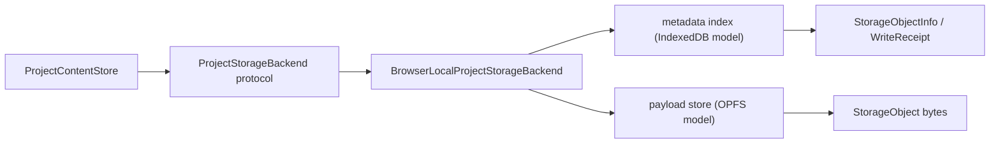

# Browser Local Storage Adapter Design

## 0. Terminology

- Browser Local Storage Backend: 实现 `ProjectStorageBackend` 协议的浏览器本地存储 adapter，逻辑上面向 IndexedDB / OPFS，当前先在核心层提供可测替身。
- Origin-local Project Ref: 浏览器同一 origin 内的项目键；对核心层是 opaque string，不是文件系统路径。
- Object Record: 以 `(project_ref, path)` 唯一定位的存储对象，包含 bytes、checksum、byte_size、metadata 和 updated_at。
- Metadata Index: 未来浏览器实现中可映射到 IndexedDB 的对象索引；当前替身用内存结构表示。
- Payload Store: 未来浏览器实现中可映射到 OPFS 的 bytes 存储；当前替身用内存 bytes 表示。
- Local-only Storage: 数据只属于当前浏览器 profile/origin，不承诺跨设备同步，也不能替代 project bundle 备份。

术语检索结果：roadmap 和 architecture 已有 `ProjectStorageBackend`、`LocalProjectStorageBackend`、`ProjectContentStore`、`browser local storage`、`IndexedDB / OPFS` 边界；代码中现有 backend 只有本地文件系统实现，`ProjectContentStore` 已支持 backend 注入。`content_store.py` 目前的 scope guard 明确不包含 IndexedDB / OPFS 字符串，因此浏览器替身应放在独立模块，不把 Web 术语和平台逻辑塞回 Project Content Store。

参考资料：

- MDN IndexedDB API: https://developer.mozilla.org/en-US/docs/Web/API/IndexedDB_API
- MDN Origin private file system: https://developer.mozilla.org/en-US/docs/Web/API/File_System_API/Origin_private_file_system
- MDN Storage quotas and eviction criteria: https://developer.mozilla.org/en-US/docs/Web/API/Storage_API/Storage_quotas_and_eviction_criteria

## 1. Decisions And Constraints

### Scope

本 feature 实现 roadmap item `browser-local-storage-adapter`：在不引入 Web UI、JS/TS 技术栈或云存储的前提下，为浏览器本地保存路径落地一个可由 Python 单元测试验证的 `ProjectStorageBackend` 替身。它的目标是证明 `ProjectContentStore` 的 bytes/path/checksum/backend contract 能在“非文件系统 project_ref”上工作，并把未来 IndexedDB / OPFS 实现需要遵守的行为固定下来。

### Decisions

1. **仍复用 ProjectStorageBackend 协议**：不新增第二套浏览器专用 content store；`ProjectContentStore(backend=...)` 应能直接使用浏览器本地 backend。
2. **第一版是核心协议替身，不是真浏览器实现**：当前仓库尚未拍板前端技术栈；因此先做 Python in-memory backend，模拟 IndexedDB metadata index + OPFS payload store 的行为。
3. **project_ref 是 opaque origin-local key**：浏览器 backend 不把 `project_ref` 解释为目录；它只要求非空，并用它隔离不同项目。
4. **path 规则与本地 backend 完全一致**：所有 object path 必须是项目相对 POSIX path，拒绝绝对路径、空路径、`.`、`..` 和反斜杠。
5. **对象生命周期与本地 backend 对齐**：`write_object` 写入或替换单个 path；`read_object` 读 bytes；`exists`、`list_objects`、`delete_object` 保持相同可观察语义。
6. **checksum 是跨 backend 的一致性锚点**：checksum 始终基于 object bytes 的 `sha256:` 字符串，不能基于浏览器 record metadata。
7. **list_objects 输出稳定排序**：给同一 prefix 返回按 POSIX path 排序的 `StorageObjectInfo`，方便 agent review、测试和未来 bundle/export 编排复用。
8. **模拟浏览器 quota 分支**：替身允许配置 `quota_bytes`；超过 quota 时返回结构化错误，帮助后续 Web UI 明确“本地浏览器空间不足”的失败语义。
9. **显式标注 local-only**：backend_id 和文档都必须表明这是浏览器本地能力，不是云同步、账号存储、团队协作或可靠备份。
10. **不接 Platform Shell 命令**：本 feature 只落 backend contract；不新增 CLI、shell command、Web route 或桌面入口。

### Non-goals

- 不实现真实 IndexedDB / OPFS JavaScript adapter、Service Worker、Web Worker、React/Next/Vercel route、文件选择器或拖拽 UI。
- 不实现云存储、账号、权限、团队协作、冲突合并、CRDT、加密备份或跨设备同步。
- 不修改 Project Content JSON schema，不新增 `.rxnflow/state/` 文件类型。
- 不替代 Project Bundle；浏览器本地数据仍需要用户导出 `.rxnflow.zip` 做手动备份。
- 不让 ProjectContentStore 理解 IndexedDB、OPFS、quota 或浏览器 API；这些属于 backend 适配层。
- 不让 browser backend 调用 ParserRegistry、ImportRegistryWorkflow、ChemicalRegistry、ReactionGraphService、EnergyProfileEngine 或 ReportExportService。

### Confirmation Needed

- 是否接受第一版只做 Python 核心协议替身，暂不写真实 JS/TS IndexedDB / OPFS 实现。
- 是否接受加入可配置 quota 模拟，用结构化错误表达浏览器本地空间不足。
- 是否接受不新增 Platform Shell / CLI 命令；未来 Web 壳层通过 backend 注入消费同一协议。
- 是否接受继续把 project bundle 作为早期网页版本的手动备份/迁移路径，而不是把浏览器本地存储描述成云备份。

## 2. Shape

### 2.1 Noun Layer

#### Existing State

- `ProjectStorageBackend` 已在 `rxnflow.content_store` 中定义，入口是 `read_object`、`write_object`、`exists`、`list_objects` 和 `delete_object`。
- `StorageObject`、`StorageObjectInfo` 和 `WriteReceipt` 已是跨 backend 的 bytes/checksum/metadata/updated_at 承载类型。
- `LocalProjectStorageBackend` 已把 `project_ref` 解释为本地 Project Directory，并通过 shared logical path 规则拒绝不安全 path。
- `ProjectContentStore` 构造函数已接受 backend 注入；save/load/validate/migration workflow 不要求 backend 必须是本地文件系统。
- 目前没有浏览器 local backend，也没有非文件系统 `project_ref` 的 contract test。

#### Changes

新增一个独立浏览器本地 backend surface：

```python
class BrowserLocalProjectStorageBackend:
    backend_id = "browser-local-indexeddb-opfs-test-v1"

    def __init__(self, *, quota_bytes: int | None = None) -> None: ...
    def read_object(self, project_ref, path: str) -> Result[StorageObject]: ...
    def write_object(self, project_ref, obj: StorageObject) -> Result[WriteReceipt]: ...
    def exists(self, project_ref, path: str) -> Result[bool]: ...
    def list_objects(self, project_ref, prefix: str) -> Result[tuple[StorageObjectInfo, ...]]: ...
    def delete_object(self, project_ref, path: str) -> Result[None]: ...
```

示例：

```python
backend = BrowserLocalProjectStorageBackend(quota_bytes=None)
store = ProjectContentStore(backend)
saved = store.save_snapshot("project-demo", snapshot)
loaded = store.load_snapshot("project-demo")
```

行为约束：

- `project_ref` 缺失或空白 → `invalid_input`，target=`project_ref`。
- `path` 不满足项目相对 POSIX path → `invalid_input`，target=`path`。
- 读取不存在 path → `invalid_input`，target=`path`，与本地 backend 对齐。
- 写入超过 quota → `storage_quota_exceeded`，target=`quota`，details 至少含 `quota_bytes` 和 `requested_bytes`。
- `metadata` 只作为 record 附加信息保存；checksum 永远由 bytes 计算。

### 2.2 Orchestration Layer



#### Existing State

当前 save/load/validate orchestration 都已经通过 backend interface 完成：

- save：snapshot codec → section JSON bytes → backend.write_object(section) → backend.write_object(index)
- load：backend.read_object(index) → backend.read_object(section files) → section codecs
- validate：backend.read_object(index/sections/manifest/export artifacts) → checksum and reference validation

这些流程没有理由知道底层是本地文件系统还是浏览器本地存储。

#### Changes

Browser backend 只接管 storage orchestration：

1. `write_object(project_ref, obj)` 校验 project_ref/path/bytes/quota，写入或替换 `(project_ref, obj.path)` record，返回 checksum、byte_size、fixed updated_at 和 backend_id。
2. `read_object(project_ref, path)` 校验 key/path，按 `(project_ref, path)` 找 record，返回 bytes、checksum 和 metadata。
3. `exists(project_ref, path)` 只判断 record 是否存在，不读取 domain semantics。
4. `list_objects(project_ref, prefix)` 支持 exact file 和 prefix subtree 两种语义，并按 path 排序。
5. `delete_object(project_ref, path)` 删除单个 record；不存在时仍返回 ok，与本地 backend 当前语义一致。

ProjectContentStore 的编排不变；PlatformShellService、ProjectBundleService、ProjectStore 不新增调用路径。

### 2.3 Mount Points

删除以下挂载点后，本 feature 应从系统视角消失：

1. **Browser Local Storage Backend module**：新增独立 backend 实现，承载 browser-local/test-double 语义。
2. **Storage path / checksum shared helper exposure**：若实现需要复用现有私有 helper，可把项目相对 path 校验和 checksum 逻辑收紧为 backend 共用边界；不得把浏览器语义放进 `ProjectContentStore`。
3. **ProjectContentStore backend contract tests**：新增非文件系统 backend 的 save/load/validate/quota/path 隔离测试。
4. **CodeStable docs**：acceptance 时同步 architecture、requirement、roadmap 状态和必要开发者指南。

不属于挂载点：真实 Web UI、CLI command、project bundle import/export、ProjectStore project directory workflow、domain codecs。

### 2.4 Progression Strategy

1. **Backend contract skeleton**：落地 browser local backend 的 project_ref/path validation、backend_id 和 Result error skeleton；退出信号是所有 unsafe project_ref/path cases 可测。
2. **Object lifecycle semantics**：补齐 write/read/exists/list/delete、project isolation、stable ordering 和 checksum；退出信号是 backend 不依赖文件系统即可通过 storage object round-trip。
3. **ProjectContentStore integration**：用该 backend 保存/加载 fixture snapshot，并覆盖 manifest/export artifact validation 读取路径；退出信号是 `ProjectContentStore` 无需分支即可复用。
4. **Browser-specific failure modeling**：补 quota_bytes 超限、replace 后用量更新、delete 后释放用量；退出信号是 quota 错误结构稳定。
5. **Scope guards and docs sync**：补 no UI/cloud/runtime coupling 的范围守护，更新 CodeStable 文档；退出信号是全量测试和 YAML 校验通过。

## 3. Acceptance Contract

正常路径：

1. 创建 `BrowserLocalProjectStorageBackend()`，写入 `.rxnflow/state/chemical-objects.json` → `WriteReceipt.backend_id` 为 browser local test backend，checksum 以 `sha256:` 开头。
2. 同一 project_ref 读取刚写入对象 → bytes、checksum、metadata 与写入结果一致。
3. `ProjectContentStore(BrowserLocalProjectStorageBackend()).save_snapshot("project-a", snapshot)` → 返回 `project-content-v1` index，随后 `load_snapshot("project-a")` 得到同一 project_id 和核心对象摘要。
4. 同一 backend 中 `project-a` 和 `project-b` 写相同 path → 互相隔离，list/read 不串项目。
5. 重复写同一 `(project_ref, path)` → 替换 bytes 和 checksum，不生成重复 list entry。
6. `list_objects("project-a", ".rxnflow/state")` → 只返回该 prefix 下对象，并按 path 稳定排序。
7. 写入 `.rxnflow/manifest.json` 和 `exports/profile.png` 后，ProjectContent validation 能通过 browser backend 读取 manifest/export bytes 并校验 artifact checksum。

边界与错误：

8. project_ref 为空或空白 → `invalid_input` target=`project_ref`。
9. path 为绝对路径、空路径、`.`、包含 `..` 或反斜杠 → `invalid_input` target=`path`。
10. read 不存在对象 → `invalid_input` target=`path`；exists 返回 `False`。
11. delete 不存在对象 → 返回 ok，不产生新 record。
12. 设置 `quota_bytes` 后写入超过 quota → 返回 `storage_quota_exceeded`，已有对象不被部分覆盖。
13. 替换大对象为小对象后再写入其他对象 → quota 用量按当前 record bytes 计算，不累计历史 bytes。

范围守护：

14. `ProjectContentStore` 不出现 IndexedDB / OPFS / browser quota 分支；这些只存在于 browser backend 模块和文档。
15. 新实现不引入 FastAPI、React、Next.js、Electron、Tauri、Supabase、S3、Vercel Blob、R2 或数据库 client。
16. 新 backend 不调用 ParserRegistry、ImportRegistryWorkflow、ChemicalRegistry、ReactionGraphService、EnergyProfileEngine、ReportExportService 或 ProjectBundleService。
17. 不新增 CLI command、Platform Shell command、Web route 或桌面入口。
18. 现有 Project Store、Project Bundle、Platform Shell restore/save 和全部 Project Content codec 行为继续通过测试。

## 4. Integration Notes

### Architecture / Requirement / Roadmap

Acceptance 阶段需要同步：

- `codestable/architecture/ARCHITECTURE.md`：补 Browser Local Storage Backend 术语和“local-only, not cloud sync”约束。
- `codestable/architecture/core-platform.md`：把核心能力从十二类扩展到十三类，补 browser backend module、协议和边界。
- `codestable/requirements/project-content-persistence.md`：补早期 Web 本地保存故事、quota/eviction/手动备份边界。
- `codestable/roadmap/rxnflow-project-persistence/*`：把 `browser-local-storage-adapter` 从 in-progress 回写为 done，并记录 feature 目录。
- `docs/dev/`：如新增公开 backend 类，补开发者指南说明如何在测试或未来 Web bridge 中注入 backend。

### Requirement Fit

对应 requirement：`project-content-persistence`。该 requirement 已包含“保存的数据可被后续 Web/桌面壳层复用”和“当前不提供浏览器本地存储 adapter”的边界；本 feature 会把浏览器本地 adapter 从边界中移出，但仍保持“无云同步、无真实 UI、需 project bundle 备份”的限制。

### Open Decisions

- 真实 Web 端后续选择把全部 bytes 存 IndexedDB，还是 metadata 存 IndexedDB、payload 存 OPFS，需要在前端技术栈 roadmap 中结合浏览器兼容性和大文件性能再拍板。本 feature 只固定核心 contract，不锁死 JS 实现细节。
- 是否需要用户可见的“请求持久存储权限 / StorageManager.persist”交互，由未来 Web UI roadmap 决定；本 feature 只把 local-only 和 quota failure 语义留给调用方。
