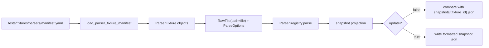

# Parser Fixture Harness Design

## 0. Terminology

- Parser Fixture Corpus：`tests/fixtures/parsers/` 下的 parser 回归样例集合，包含 manifest、输入文件和 golden snapshot。
- Fixture Manifest：机器可读 YAML 清单，记录 fixture id、program、format、task、parser_id、source、parse_options、snapshot 和容差。
- Golden Snapshot：`ParseResult` 和 warnings 的稳定 JSON 投影，用于判断 parser 语义是否变化。
- Parser Fixture Harness：测试边界的 loader / assertion helper，负责读 manifest、构造 `RawFile`、调用 `ParserRegistry`、比较 snapshot。
- Source Policy：样例来源、许可证、脱敏和可再分发状态的结构化记录；它保护仓库，不改变 runtime parser 行为。
- Snapshot Projection：从 `Result[ParseResult]` 抽取可比较字段的过程；默认不保存完整坐标，只保存对象摘要和必要抽样。

术语检索结果：现有代码已经有 `RawFile`、`ParseOptions`、`ParseResult`、`ParserRegistry`、`ParserPlugin`、`ChemicalObjectDraft`、`Provenance`、`RxnFlowWarning`。没有 fixture manifest、snapshot helper 或 `tests/fixtures/parsers/` 目录。本 feature 只补测试 harness，不新增第二套 parser contract。

## 1. Decisions And Constraints

### Scope

本 feature 实现 roadmap item `parser-fixture-harness`：建立 parser fixture corpus 的最小测试骨架，让后续 Gaussian / ORCA / XYZ / extxyz / MAPLE coverage feature 都复用同一套 manifest 和 snapshot 比较协议。

首个最小闭环使用 synthetic fixture，不引入第三方真实输出文件。优先选 MAPLE `.out` 或 standard XYZ，因为当前 parser 已可解析，且不会触发 cclib / ASE 真实依赖问题。

### Decisions

1. **Harness 放在测试边界**：第一版 helper 放在 `tests/` 或 `tests/support/`，不作为 `rxnflow` runtime API 暴露。parser fixture corpus 是质量保障设施，不是产品运行时能力。
2. **Manifest 使用 YAML，snapshot 使用 JSON**：YAML 适合人工维护来源/许可证/标签；JSON 适合稳定 diff 和机器比较。
3. **不自动更新 snapshot**：默认测试只比较。显式 `update=True` 或专用本地命令才允许重写 snapshot，避免 CI 或普通测试掩盖回归。
4. **首轮只支持 positive parse snapshot**：最小 harness 先覆盖 `parse_ok=True` 的 supported fixture；unsupported / partial / expected error 留给后续 diagnostics feature 扩展。
5. **Parser 版本不做强失败锚点**：snapshot 记录 parser_id 和 parser_version，但默认只强校验 parser_id；版本变化如果语义没变，不应导致大面积无意义 snapshot churn。
6. **浮点比较由 manifest 控制**：energy 和 coordinate 的绝对容差写在 manifest，不在 snapshot 内散落策略。
7. **source policy 必填**：每个 fixture 都必须记录 `source.kind`、license、redistributable、redaction。即使是 synthetic fixture，也要明示来源。
8. **不改 runtime parser 行为**：如果最小 synthetic fixture 发现 parser 缺口，本 feature 只修使 harness 闭环必需的小问题；真实格式语义扩展留给后续 coverage feature。
9. **不引入大型依赖**：PyYAML 已可用时使用 `yaml.safe_load`；若环境缺失，feature design 阶段不承诺写完整 YAML fallback，必要时让测试显式跳过或失败并提示安装依赖。用户已要求安装过 PyYAML，当前路线接受它作为测试依赖。
10. **不接 import workflow**：本 feature 只调用 `ParserRegistry.parse`；Import Preview 回归由后续 `import-preview-parser-regression` 处理。

### Non-goals

- 不添加 Gaussian / ORCA / MAPLE 真实样例 corpus。
- 不 vendor ClickFF/MAPLE examples、cclib examples 或用户真实日志。
- 不设计完整 support matrix；只预留 manifest 字段。
- 不新增 runtime parser format、warning code 或 parser registry 行为。
- 不把 fixture harness 接到 CLI、Platform Shell、ProjectStore、ImportRegistryWorkflow、ChemicalRegistry、ReactionGraphService、EnergyProfileEngine 或 ReportExportService。
- 不让 snapshot 包含完整原始输出文本或完整坐标轨迹。
- 不在本阶段决定 MAPLE `.sum`、AutoNEB tree、MD thermo、IRC path 的化学语义。

### Complexity

- 健壮性 = L2：输入是仓库内测试 fixture，错误应清晰，但不需要防御任意用户路径。
- 结构 = small modules：helper 要与 parser runtime 分离，避免测试基础设施污染核心包。
- 可测试性 = tested：harness 自身要由至少一个真实 snapshot test 证明。
- Security = data hygiene：重点是禁止未脱敏/不可再分发样例悄悄进入自动 corpus。
- Extensibility = corpus-first：后续新增格式只加 manifest + file + snapshot，不复制测试编排。

## 2. Shape

### 2.1 Noun Layer

#### Existing State

- `rxnflow.parsers.contracts.RawFile` 支持 `id/name/path/content/mime_type/size`，可以直接代表 fixture file。
- `ParseOptions` 已有 `expected_format`、`strict` 和 `frame_policy`，可从 manifest 投影。
- `ParserRegistry.default()` 已装配 MAPLE、XYZ、Gaussian、ORCA 插件。
- `ParseResult` 包含 `objects` 和 `provenance`；warnings 存在于 `Result.warnings`。
- `ChemicalObjectDraft` 已有 label、formula、charge、spin_multiplicity、method、geometry、energies、thermochemistry。
- 现有 `test_parser_plugin_baseline.py` 只使用内联字符串和 fake cclib data，没有文件级 corpus 和 snapshot。

#### Changes

新增 fixture manifest 数据形状，按 roadmap 契约收紧为第一版必需字段：

```yaml
schema_version: parser-fixtures-v1
fixtures:
  - id: maple-sp-synthetic-minimal
    program: maple
    format: maple-output
    task: sp
    parser_id: maple-output
    file: files/maple/maple-sp-synthetic-minimal.out
    source:
      kind: synthetic
      url: null
      commit: null
      license: project-test-fixture
      redistributable: true
      redaction: none
    parse_options:
      expected_format: maple-output
      strict: true
      frame_policy: all
    expected_snapshot: snapshots/maple-sp-synthetic-minimal.json
    tolerances:
      energy_abs: 1.0e-10
      coordinate_abs: 1.0e-8
    support_status: supported
    tags: [maple, sp, synthetic]
    notes: null
```

新增 snapshot JSON 投影：

```json
{
  "schema_version": "parser-golden-v1",
  "fixture_id": "maple-sp-synthetic-minimal",
  "parser_id": "maple-output",
  "parse_ok": true,
  "object_count": 1,
  "provenance": {
    "parser_id": "maple-output",
    "parser_version": "0.1.0"
  },
  "objects": [
    {
      "label": "MAPLE sp",
      "formula": null,
      "charge": null,
      "spin_multiplicity": null,
      "method": "sp ani2x",
      "atom_count": 2,
      "elements": ["C", "H"],
      "geometry_sample": [
        {"index": 0, "element": "C", "x": 0.0, "y": 0.0, "z": 0.0, "unit": "angstrom"}
      ],
      "energy_keys": ["electronic"],
      "energies": {
        "electronic": {
          "value": -14.0923448397,
          "unit": "hartree",
          "reference": "Energy: -14.0923448397 Hartree"
        }
      },
      "thermochemistry_keys": [],
      "warning_codes": []
    }
  ],
  "warning_codes": []
}
```

新增测试 helper 入口：

```python
def load_parser_fixture_manifest(path: Path) -> ParserFixtureManifest:
    ...

def assert_parser_fixture_snapshot(
    registry: ParserRegistry,
    fixture: ParserFixture,
    *,
    update: bool = False,
) -> None:
    ...
```

行为约束：

- `ParserFixture.file` 和 `expected_snapshot` 都按 manifest 所在目录解析，不允许绝对路径或 `..` 逃逸。
- `source.redistributable=false` 且存在本地 `file` 时，manifest loader 应失败，避免不可再分发样例进入仓库。
- `support_status=reference-only` 的 fixture 不进入默认 snapshot test。
- `parse_ok=true` 的 snapshot 必须至少校验 object_count、parser_id、warning_codes、每个对象的 label/method/atom_count/elements/energy keys/energy unit/value。

### 2.2 Orchestration Layer



#### Existing State

当前 parser baseline tests 直接构造 `RawFile(content=...)` 并断言单个字段。测试重复编排 parser 调用，且没有统一 snapshot 文件可以显示“这次 parser 语义变了哪些字段”。

#### Changes

1. `load_parser_fixture_manifest(path)` 读取 YAML、校验 schema_version、解析每条 fixture、验证路径安全、验证 source policy。
2. 默认 snapshot test 过滤 `support_status in {"supported", "partial"}` 且有本地 file 的 fixture。
3. 对每条 fixture 构造 `RawFile(id=fixture.id, name=file.name, path=file_path)`，并从 `parse_options` 构造 `ParseOptions`。
4. 调用传入的 `ParserRegistry`；第一版用 `ParserRegistry.default()` 覆盖真实插件选择。
5. 将 `Result[ParseResult]` 投影为 JSON-safe dict，排序 energy keys、thermochemistry keys、warning_codes，减少无意义 diff。
6. 比较 snapshot：
   - 非浮点字段直接相等。
   - energy value 和 geometry sample 坐标按 manifest tolerances 比较。
   - `provenance.parser_version` 默认记录但不强制失败；如后续需要可加 strict flag。
7. `update=True` 时写入 `json.dumps(..., ensure_ascii=False, indent=2, sort_keys=True) + "\n"`，仅用于本地显式更新。

### 2.3 Mount Points

删除以下挂载点后，本 feature 应从系统视角消失：

1. `tests/fixtures/parsers/manifest.yaml`：parser corpus 的机器可读入口。
2. `tests/fixtures/parsers/files/...`：最小 synthetic parser 输入样例。
3. `tests/fixtures/parsers/snapshots/...`：对应 golden snapshot。
4. Parser fixture harness helper：读取 manifest、投影 snapshot、比较容差。
5. Parser corpus snapshot test：遍历 manifest 并调用 `ParserRegistry.default()`。

不属于挂载点：runtime parser API、ImportRegistryWorkflow、ProjectStore、ChemicalRegistry、ReactionGraph、EnergyProfile、ReportExport、Platform Shell。

### 2.4 Progression Strategy

1. **Corpus skeleton**：建立 `tests/fixtures/parsers/` 目录、manifest 和一个 synthetic MAPLE 或 XYZ fixture；退出信号是 fixture 路径和 source policy 能被 loader 读取。
2. **Snapshot projection**：实现 `Result[ParseResult]` 到 JSON-safe snapshot dict 的投影，并生成首个 golden snapshot；退出信号是 snapshot 文件稳定、字段覆盖当前最小对象摘要。
3. **Assertion helper**：实现 manifest loader、路径安全校验、source policy 校验、snapshot 比较和浮点容差；退出信号是 helper 能定位字段差异并拒绝不安全 fixture。
4. **Regression test wiring**：新增 snapshot test 遍历 manifest 中可执行 fixture，并确保 `ParserRegistry.default()` 通过；退出信号是 `python3 -m unittest discover` 通过。
5. **Scope guards**：补测试确认 harness 不调用 ProjectStore / registry / graph / energy / export 等 runtime workflow；退出信号是范围守护和 YAML 校验通过。

## 3. Acceptance Contract

正常路径：

1. `tests/fixtures/parsers/manifest.yaml` 存在，`schema_version=parser-fixtures-v1`，至少包含一个 `support_status=supported` 的 synthetic fixture。
2. fixture 的 `source.kind=synthetic`、`redistributable=true`、`redaction=none`，且 file 和 expected_snapshot 都是 corpus 目录内相对路径。
3. loader 读取 manifest 后返回 fixture 列表，并能把 parse_options 转成现有 `ParseOptions`。
4. snapshot test 用 `ParserRegistry.default()` 解析该 fixture，返回 `parse_ok=true` 且 parser_id 与 manifest 一致。
5. snapshot projection 包含 object_count、provenance.parser_id、objects[].label、method、atom_count、elements、energy_keys、energies、thermochemistry_keys 和 warning_codes。
6. energy value 比较使用 manifest `tolerances.energy_abs`，坐标 sample 比较使用 `tolerances.coordinate_abs`。
7. 普通测试运行不会重写 snapshot；只有显式 `update=True` 的 helper 调用才会写文件。

边界与错误：

8. manifest schema_version 不匹配 → loader 抛出清晰 assertion / validation error。
9. fixture id 重复 → loader 失败。
10. file 或 expected_snapshot 使用绝对路径、`..` 或反斜杠逃逸 corpus → loader 失败。
11. `redistributable=false` 但配置了本地 file → loader 失败。
12. `support_status=reference-only` 的 fixture 不进入默认 snapshot test。
13. snapshot parser_id 与 manifest parser_id 不一致 → snapshot test 失败。
14. parser 返回 unsupported / parse_failed 但 snapshot 声明 `parse_ok=true` → snapshot test 失败。

范围守护：

15. 本 feature 不新增 Gaussian / ORCA / MAPLE 真实第三方输出文件。
16. harness helper 不放进 `rxnflow.parsers` runtime API，不改变 ParserRegistry / ParserPlugin contract。
17. harness 不调用 ProjectStore、ImportRegistryWorkflow、ChemicalRegistry、ReactionGraphService、EnergyProfileEngine、ReportExportService、PlatformShellService 或 ProjectBundleService。
18. 不新增 CLI command、Web route、桌面入口或外部计算调用。
19. `.DS_Store`、大型二进制轨迹、checkpoint、缓存文件不得出现在 parser fixture corpus。

## 4. Integration Notes

### Architecture / Requirement / Roadmap

Acceptance 阶段需要同步：

- `codestable/roadmap/rxnflow-parser-fixture-corpus/rxnflow-parser-fixture-corpus-items.yaml`：把 `parser-fixture-harness` 从 in-progress 回写为 done。
- `codestable/architecture/core-platform.md`：补充 parser baseline 已有真实 fixture harness，但仍未完成各格式真实 corpus。
- `codestable/architecture/ARCHITECTURE.md`：如总入口待补项需要收紧，可改为“真实格式覆盖矩阵待补”，而不是“fixture harness 待补”。
- Requirement：当前无单独 parser format support requirement；acceptance 阶段建议补一份 parser/import format support 现状文档，但不在本 design 阶段创建。

### Requirement Fit

无对应 requirement。该 feature 是 parser 可靠性基础设施，不改变用户可见导入行为。用户可见价值会在后续 format coverage 和 import preview regression 中出现。

### Open Decisions

- 后续是否把 `tests/support/` 作为统一测试 helper 目录，需要 implement 时结合现有测试结构决定；设计只要求 helper 不进入 runtime API。
- 如果 MAPLE synthetic fixture 比 standard XYZ 更能证明 roadmap 价值，优先用 MAPLE；如果 implementation 发现 MAPLE parser snapshot 需要额外修复，可先用 standard XYZ 跑通 harness，再把 MAPLE 留给 `maple-fixture-coverage`。
