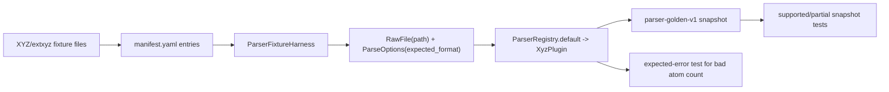

# XYZ / extxyz Fixture Coverage Design

## 0. Terminology

- Standard XYZ Fixture：普通 XYZ 文本样例，第一行为 atom count，第二行为 comment，后续为元素和 3D 坐标。
- ASE extxyz Fixture：含 `Properties=` / `Lattice=` 等扩展 XYZ comment 的样例，当前通过 ASE `read(..., format="extxyz")` 解析。
- Geometry-only XYZ：只可靠提供元素和 3D 坐标的 XYZ；缺少 energy 时返回 `missing_section` warning。
- extxyz Energy Metadata：extxyz comment 或 ASE calculator results 中的 `energy`，当前按 eV 读入并转换为 hartree。
- Charge / Spin Metadata：extxyz comment 中可被 ASE 放入 `atoms.info` 的 `charge`、`spin_multiplicity` 或 `spin`。
- Bad XYZ Count Fixture：atom count 与坐标行数不一致的错误样例，用于固定 `parse_failed` 行为。

术语检索结果：现有代码已有 `XyzPlugin`、`parse_xyz_frames`、`RawFile`、`ParseOptions`、`ParseResult`、`ParserFixtureManifest`、`assert_parser_fixture_snapshot`。本 feature 只补 XYZ/extxyz fixture coverage，不新增 parser runtime API。

## 1. Decisions And Constraints

### Scope

本 feature 实现 roadmap item `xyz-extxyz-fixture-coverage`：在已落地的 parser fixture harness 上补 standard XYZ 和 ASE extxyz 样例，覆盖 geometry、energy metadata、charge/spin metadata、atom count mismatch 和 metadata 缺失 warning。

目标是把当前 `XyzPlugin` 的可见行为从内联单测迁移到文件级 corpus + golden snapshot，使后续 parser 改动能用稳定 diff 看到 XYZ/extxyz 语义是否变化。

### Decisions

1. **优先使用 synthetic fixture**：XYZ/extxyz 格式足够小，首轮不需要引入第三方真实文件或用户数据。
2. **复用现有 Parser Fixture Harness**：新增 fixture 进入 `tests/fixtures/parsers/manifest.yaml`，使用现有 `assert_parser_fixture_snapshot()` 比较 snapshot。
3. **standard XYZ 覆盖 geometry-only 正常路径**：期望 `parse_ok=true`、一个对象、元素/坐标稳定，且 warning_codes 包含 `missing_section`。
4. **extxyz 覆盖 metadata 正常路径**：期望 `label`、`charge=0`、`spin_multiplicity=1`、geometry、`electronic` energy 和 `unit_assumed` warning 稳定。
5. **bad atom count 作为 expected-error fixture**：在 manifest 中登记错误 fixture，并用专门测试断言 projected snapshot 为 `parse_ok=false` / `parse_failed`；它不进入默认 supported fixture loop。
6. **metadata 缺失 warning 走 snapshot**：standard XYZ 缺 energy 和 extxyz 缺 energy 都应通过 warning_codes 表达，不把缺失 energy 填成 0。
7. **不扩大 extxyz 字段语义**：cell、pbc、forces、stress、magmom 等 ASE 可读字段不在本 feature 建模；后续支持矩阵阶段再决定是否成为正式字段。
8. **不改 Project / Import / Registry**：本 feature 只通过 parser registry 做文件级解析回归，不接 ImportRegistryWorkflow。

### Non-goals

- 不新增真实 Gaussian / ORCA / MAPLE fixture。
- 不运行 ASE 计算、不生成 extxyz、不调用外部程序。
- 不把所有 ASE extxyz metadata 都映射进 `ChemicalObjectDraft`。
- 不改变 `EnergyValue` 单位策略；extxyz energy 继续按当前 parser 规则从 eV 转 hartree。
- 不修改 Project Content schema、Import Ledger、Chemical Registry、ReactionGraph、EnergyProfile 或 Export。
- 不新增 CLI、Web route、桌面入口或批量导入 UI。

### Complexity

- 健壮性 = L2：样例来自仓库内 synthetic 文本，但错误样例需要固定失败语义。
- 结构 = focused coverage：复用现有 harness，不新增第二套 fixture helper。
- 可测试性 = tested：每个新增 fixture 都要有 snapshot 或 expected-error 证据。
- Security = low data risk：仅 synthetic 文本，无用户路径或第三方许可问题。
- Extensibility = corpus-first：后续真实 XYZ/extxyz 样例只追加 manifest + file + snapshot。

## 2. Shape

### 2.1 Noun Layer

#### Existing State

- `rxnflow.parsers.xyz.XyzPlugin` 已支持 standard XYZ 与 ASE extxyz。
- standard XYZ 当前从 comment 读取可选 `Energy = ...`；缺失 energy 时返回 `missing_section` warning。
- extxyz 当前通过 ASE 读取 `geometry`、`label`、`charge`、`spin_multiplicity` / `spin` 和 `energy` metadata；energy 按 eV 转 hartree 并返回 `unit_assumed` warning。
- `tests/fixtures/parsers/manifest.yaml` 当前只有一个 synthetic MAPLE fixture。
- `tests/parser_fixture_harness.py` 已能投影 success 和 failure snapshot，并按 manifest tolerance 比较 energy / geometry sample。

#### Changes

新增四类 XYZ/extxyz corpus 条目：

```yaml
- id: xyz-water-geometry-missing-energy
  program: xyz
  format: xyz
  task: geometry
  parser_id: xyz-ase
  file: files/xyz/xyz-water-geometry-missing-energy.xyz
  support_status: supported
  expected_snapshot: snapshots/xyz-water-geometry-missing-energy.json

- id: extxyz-h2-energy-charge-spin
  program: ase-extxyz
  format: extxyz
  task: geometry-energy
  parser_id: xyz-ase
  file: files/extxyz/extxyz-h2-energy-charge-spin.xyz
  support_status: supported
  expected_snapshot: snapshots/extxyz-h2-energy-charge-spin.json

- id: extxyz-h2-missing-energy
  program: ase-extxyz
  format: extxyz
  task: geometry
  parser_id: xyz-ase
  file: files/extxyz/extxyz-h2-missing-energy.xyz
  support_status: partial
  expected_snapshot: snapshots/extxyz-h2-missing-energy.json

- id: xyz-bad-atom-count
  program: xyz
  format: xyz
  task: invalid-atom-count
  parser_id: xyz-ase
  file: files/xyz/xyz-bad-atom-count.xyz
  support_status: unsupported
  expected_snapshot: snapshots/xyz-bad-atom-count.json
```

接口行为示例：

```python
manifest = load_parser_fixture_manifest(Path("tests/fixtures/parsers/manifest.yaml"))
fixture = next(item for item in manifest.fixtures if item.id == "extxyz-h2-energy-charge-spin")
assert_parser_fixture_snapshot(ParserRegistry.default(), fixture)
```

### 2.2 Orchestration Layer



#### Existing State

`test_parser_plugin_baseline.py` 已有内联 standard XYZ、extxyz energy metadata 和 atom count mismatch 单测，但这些用例不在 fixture corpus 中，也不能为后续支持矩阵提供 fixture id。

#### Changes

1. 在 corpus 中新增 `files/xyz/` 和 `files/extxyz/` synthetic 样例。
2. 在 manifest 中登记对应 fixture、source policy、parse_options 和 tolerances。
3. 生成对应 golden snapshot，固定 object_count、elements、geometry_sample、charge/spin、energy value/unit/reference 和 warning_codes。
4. 新增或扩展 snapshot regression test，让 supported / partial XYZ/extxyz fixtures 走 `assert_parser_fixture_snapshot()`.
5. 为 `xyz-bad-atom-count` 添加 targeted expected-error test，断言 projected snapshot 为 `parse_ok=false`、error.code=`parse_failed`。
6. 保留内联 baseline 单测作为轻量 parser unit coverage；不要求本 feature 删除旧测试。

### 2.3 Mount Points

删除以下挂载点后，本 feature 应从系统视角消失：

1. `tests/fixtures/parsers/files/xyz/*` 和 `tests/fixtures/parsers/files/extxyz/*`。
2. `tests/fixtures/parsers/snapshots/xyz-*.json` 和 `tests/fixtures/parsers/snapshots/extxyz-*.json`。
3. `tests/fixtures/parsers/manifest.yaml` 中新增的 XYZ/extxyz fixture entries。
4. `tests/test_parser_fixture_harness.py` 中新增的 XYZ/extxyz snapshot / expected-error coverage。

不属于挂载点：`rxnflow.parsers.xyz` runtime API、Project Store、Import Workflow、Chemical Registry、ReactionGraph、EnergyProfile、ReportExport、Platform Shell。

### 2.4 Progression Strategy

1. **Corpus entries**：新增 `files/xyz/`、`files/extxyz/` synthetic 输入和 manifest entries；退出信号是 manifest loader 能读到 5 个 fixture 且新增路径安全。
2. **Golden snapshots**：用当前 ParserRegistry 生成 standard XYZ、extxyz energy/charge/spin、extxyz missing energy 和 bad count snapshots；退出信号是 projection 文件稳定且字段覆盖设计要求。
3. **Regression wiring**：扩展 fixture harness tests，默认跑 supported/partial XYZ/extxyz snapshots，bad count 单独断言 expected error；退出信号是 focused tests 通过。
4. **Scope guards**：补范围守护，确认未新增真实第三方输出、未改 runtime parser API、未调用外部计算或 import/project/registry/graph/energy/export；退出信号是全量 unittest 和 YAML 校验通过。

## 3. Acceptance Contract

正常路径：

1. manifest 中新增 standard XYZ geometry-only fixture，source 为 synthetic，`support_status=supported`。
2. standard XYZ snapshot `parse_ok=true`，object_count=1，elements 为 `["O", "H", "H"]`，warning_codes 包含 `missing_section`。
3. manifest 中新增 extxyz energy/charge/spin fixture，source 为 synthetic，`support_status=supported`。
4. extxyz energy/charge/spin snapshot `parse_ok=true`，label、charge、spin_multiplicity、geometry、`electronic` energy 和 warning_codes 稳定。
5. extxyz energy value 为 hartree，数值等于 eV 输入乘以 `EV_TO_HARTREE`，warning_codes 包含 `unit_assumed`。
6. manifest 中新增 extxyz missing energy fixture，`support_status=partial`，snapshot `parse_ok=true` 且 warning_codes 包含 `missing_section`，energies 为空。
7. manifest 中新增 bad atom count fixture，`support_status=unsupported`，targeted test 断言 snapshot `parse_ok=false` 且 error.code=`parse_failed`。

边界与错误：

8. 新增 fixture 的 file / snapshot 均为 corpus 内相对路径，loader 安全校验通过。
9. supported / partial fixture 进入 default executable fixtures；unsupported bad count 不进入 default executable fixtures。
10. 任何新增 snapshot 都不保存完整轨迹，只保存对象摘要和必要 geometry sample。

范围守护：

11. 本 feature 不新增真实第三方 XYZ/extxyz 文件或用户数据。
12. 本 feature 不修改 `rxnflow.parsers.xyz` 公共 contract，除非 snapshot 暴露实现 bug 且修复被限制在 parser 行为内。
13. 本 feature 不调用 ProjectStore、ImportRegistryWorkflow、ChemicalRegistry、ReactionGraphService、EnergyProfileEngine、ReportExportService、PlatformShellService 或 ProjectBundleService。
14. 不新增 CLI command、Web route、桌面入口或外部计算调用。

## 4. Integration Notes

### Architecture / Requirement / Roadmap

Acceptance 阶段需要同步：

- `codestable/roadmap/rxnflow-parser-fixture-corpus/rxnflow-parser-fixture-corpus-items.yaml`：把 `xyz-extxyz-fixture-coverage` 从 in-progress 回写为 done。
- `codestable/roadmap/rxnflow-parser-fixture-corpus/rxnflow-parser-fixture-corpus-roadmap.md`：同步第 5 节子 feature 状态。
- `codestable/architecture/core-platform.md`：补充 parser fixture corpus 已覆盖 standard XYZ / ASE extxyz synthetic fixtures；仍未完成 Gaussian/ORCA/MAPLE 真实 fixture coverage。
- `codestable/architecture/ARCHITECTURE.md`：如待补项需要收紧，可把 XYZ/extxyz 从“待补真实 fixture coverage”中移出，保留 Gaussian/ORCA/MAPLE 和支持矩阵待补。
- Requirement：当前无 parser format support requirement；本 feature 仍是测试覆盖增强，不改变用户可见导入行为。format support requirement 可在支持矩阵或 import preview 回归完成后 backfill。

### Requirement Fit

无对应 requirement。该 feature 固定 parser 行为和样例覆盖，不改变导入 UI、Import Registry Workflow 或已登记 ChemicalObject 的用户可见语义。

### Open Decisions

- 是否把 inline `test_standard_xyz_content_parses_geometry` / `test_extxyz_parses_energy_metadata` 精简为 fixture-driven test，留给 implement 阶段判断；设计不要求删除旧单测。
- 如果 ASE 在某些环境缺失，现有 extxyz parser 会返回 `internal_error`。当前仓库测试已依赖 ASE 可用，本 feature 不新增 dependency fallback。
