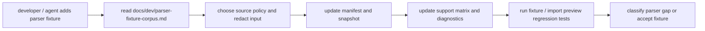

# Parser Corpus Docs Design

## 0. Terminology

- Parser Corpus Developer Guide：面向开发者和 agent 的任务型文档，落点为 `docs/dev/parser-fixture-corpus.md`。
- Fixture Addition Workflow：新增 parser fixture 时的步骤，包括准备输入、填写 manifest、生成/核对 snapshot、更新 support matrix 和运行回归。
- Source Policy：fixture 来源与再分发策略，覆盖 synthetic、user-redacted、external-reference、vendored-third-party。
- Redaction Checklist：真实用户或第三方输出进入仓库前必须检查的脱敏项目，例如绝对路径、用户名、主机名、scratch 路径、license key、课题敏感信息。
- Snapshot Update Procedure：parser 语义有意变化后更新 golden snapshot 的流程；默认不自动重写 snapshot。
- Parser Gap Triage：解析失败或字段缺失时判断是 parser bug、unsupported format/task、fixture 问题还是支持矩阵缺口的分流规则。

术语检索结果：roadmap 已定义 Corpus Documentation；现有 `docs/dev/` 已有 dev-guide frontmatter 风格。当前没有 parser fixture corpus 开发者指南。

## 1. Decisions And Constraints

### Scope

本 feature 实现 roadmap item `parser-corpus-docs`：把已落地的 parser fixture corpus、support matrix、diagnostic catalog 和 import preview regression 固化为可执行的开发者/agent 指南，说明如何新增样例、记录许可证与脱敏状态、更新 snapshot、更新 support matrix、运行校验，以及如何处理 parser gap。

### Decisions

1. **落点使用 docs/dev**：新增 `docs/dev/parser-fixture-corpus.md`，frontmatter 使用现有 `doc_type: dev-guide` 风格。
2. **只写任务型指南**：文档按“怎么做”组织，不复制完整 roadmap/design 历史，不写用户手册。
3. **以现有 schema 为权威**：manifest、snapshot、support matrix 字段语义来自 `tests/fixtures/parsers/` 和 roadmap 第 4 节；文档只引用并解释，不私自改字段。
4. **明确安全和许可证边界**：真实 Gaussian/ORCA/MAPLE 输出进入仓库前必须脱敏，并记录 license / redistributable / redaction；MAPLE example 输出继续保持“参考可用，vendoring 前确认许可证边界”。
5. **parser gap 走分流规则**：字段缺失先看 support matrix/known_limits 和 diagnostic code；超出当前边界时更新 docs/support matrix 或另起 feature/issue，不在指南中承诺完整格式支持。
6. **不新增运行时代码或测试 fixture**：本 feature 只新增/更新文档和 CodeStable 产物。

### Non-goals

- 不新增 parser fixture file、manifest entry、snapshot、support matrix entry 或 diagnostic code。
- 不修改 parser runtime、fixture harness、ImportRegistryWorkflow 或 PlatformShell。
- 不下载、vendor 或提交真实 Gaussian/ORCA/MAPLE/MAPLE examples 输出。
- 不新增用户指南、UI 文案、CLI command、Web route 或 import hint API。
- 不把当前 synthetic/reference-only corpus 描述成真实程序版本完整支持。

### Complexity

- 健壮性 = L1：文档能力，主要风险是把流程写错或扩大支持承诺。
- 结构 = docs/dev guide：与现有开发者指南同类。
- 可验证性 = docs review + command smoke：frontmatter 存在、关键章节存在、示例命令可对应现有文件路径。

## 2. Shape

### 2.1 Noun Layer

#### Existing State

- `tests/fixtures/parsers/manifest.yaml`、`support-matrix.yaml`、`snapshots/*.json` 和 `files/` 已形成 parser fixture corpus。
- `tests/parser_fixture_harness.py` 提供 manifest/support matrix loader 和 golden snapshot assertion。
- `tests/test_import_preview_parser_regression.py` 已把 fixture corpus 接入 Import Workflow / Platform Shell preview 回归。
- `docs/dev/` 有项目包、平台打开保存、浏览器本地存储等 dev-guide，但没有 parser corpus 指南。

#### Changes

新增 `docs/dev/parser-fixture-corpus.md`，建议 frontmatter：

```yaml
---
doc_type: dev-guide
slug: parser-fixture-corpus
component: parser-fixture-corpus
status: current
summary: 如何添加、校验和维护 RxnFlow parser fixture corpus
tags: [parser, fixture-corpus, testing, diagnostics]
last_reviewed: 2026-05-16
---
```

建议章节：

- 概述：fixture corpus 用途和不代表真实版本完整支持。
- 目录结构：`manifest.yaml`、`support-matrix.yaml`、`files/`、`snapshots/`。
- 新增 fixture 流程：准备输入、source policy、manifest、snapshot、support matrix、测试。
- 来源与脱敏：synthetic / user-redacted / external-reference / vendored-third-party 的边界。
- Snapshot 更新：默认不更新，语义变更时显式生成并 review diff。
- Support Matrix 与 diagnostic codes：字段状态、known_limits、observed warning/error codes。
- Parser gap triage：bug / unsupported / fixture issue / docs gap 的判断。
- 常用命令：focused tests、全量 unittest、YAML 校验。
- 禁止事项：不提交敏感日志、不提交大型二进制、不宣称未覆盖版本支持。

### 2.2 Orchestration Layer



#### Existing State

现在新增 fixture 的流程分散在 roadmap、feature design、acceptance 报告和测试 helper 里。后续 agent 想添加真实样例时，需要翻多份历史文档才能知道 source policy、redaction、snapshot 和 support matrix 的关系。

#### Changes

1. 把新增 parser fixture 的步骤集中到单份 dev guide。
2. 把许可证/脱敏要求写成可执行 checklist。
3. 把 snapshot/support matrix/import preview regression 三类验证命令放在同一处。
4. 把 parser gap triage 写成决策分支，避免把 unsupported format 误当 parser bug 或把 parser bug 写进 known_limits。

### 2.3 Mount Points

删除以下挂载点后，本 feature 应从系统视角消失：

1. `docs/dev/parser-fixture-corpus.md`。
2. 本 feature 的 CodeStable design/checklist/acceptance 与 roadmap/architecture 回写。

不属于挂载点：`tests/fixtures/parsers/` corpus 本身、fixture harness、support matrix、runtime parser modules、Import Workflow、Platform Shell、Project Content schema。

### 2.4 Progression Strategy

1. **Guide skeleton**：新增 dev-guide frontmatter、概述和 corpus 目录结构；退出信号是文档落点和受众清晰。
2. **Source policy and redaction**：补四类来源、license/redistributable/redaction 字段和脱敏 checklist；退出信号是用户/第三方真实输出进入仓库前的判断规则明确。
3. **Fixture maintenance workflow**：补 manifest、snapshot、support matrix、diagnostic codes 和 import preview regression 维护流程；退出信号是从新增 fixture 到测试回归的步骤可照做。
4. **Parser gap triage and commands**：补 parser bug/unsupported/fixture issue/docs gap 分流和常用命令；退出信号是常见失败能被定位到下一步动作。
5. **Scope guards and validation**：确认未新增 fixture/runtime/API，运行文档/测试相关校验；退出信号是 focused grep、YAML 校验和全量 unittest 通过。

## 3. Acceptance Contract

正常路径：

1. `docs/dev/parser-fixture-corpus.md` 存在，frontmatter 为 `doc_type: dev-guide`、`status: current`。
2. 文档说明 parser fixture corpus 的用途，并明确 synthetic/reference-only corpus 不代表真实程序版本完整支持。
3. 文档包含 corpus 目录结构和 manifest / snapshot / support matrix 的职责说明。
4. 文档给出新增 fixture 的 step-by-step workflow。
5. 文档覆盖 source policy：synthetic、user-redacted、external-reference、vendored-third-party。
6. 文档包含 redaction checklist，至少覆盖绝对路径、用户名、主机名、scratch 路径、license key、课题敏感信息。
7. 文档说明 snapshot 更新必须显式触发并 review diff，普通测试不自动重写 snapshot。
8. 文档说明 support matrix / diagnostic code 更新规则，partial 必须写 known_limits。
9. 文档说明 import preview regression 在新增或修改 parser fixture 后需要运行。
10. 文档包含 parser gap triage：parser bug、unsupported format/task、fixture issue、docs/support matrix gap。
11. 文档列出当前可用命令：fixture harness test、import preview regression test、全量 unittest、YAML 校验。

范围守护：

12. 本 feature 不新增或修改 parser fixture file、manifest entry、snapshot、support matrix entry 或 diagnostic code。
13. 本 feature 不修改 runtime parser modules、fixture harness、Import Workflow、Platform Shell、Project Content schema。
14. 本 feature 不新增用户指南、UI、CLI command、Web route 或 import hint API。
15. 本 feature 不提交真实第三方输出或用户日志。

## 4. Integration Notes

Acceptance 阶段需要同步：

- `codestable/roadmap/rxnflow-parser-fixture-corpus/rxnflow-parser-fixture-corpus-items.yaml`：把 `parser-corpus-docs` 从 `in-progress` 回写为 `done`。
- `codestable/roadmap/rxnflow-parser-fixture-corpus/rxnflow-parser-fixture-corpus-roadmap.md`：同步第 5/6/7 节状态。
- `codestable/architecture/core-platform.md`：在 Parser Fixture Harness / corpus 相关说明中补充 dev guide 链接或文档能力。
- `codestable/architecture/ARCHITECTURE.md`：如需，在 Parser Fixture Corpus 术语或模块索引中补充 docs/dev 指南已落地。
- Requirement：本 feature 是开发者/agent 维护文档，不新增用户可见导入能力；默认不新增 requirement。
