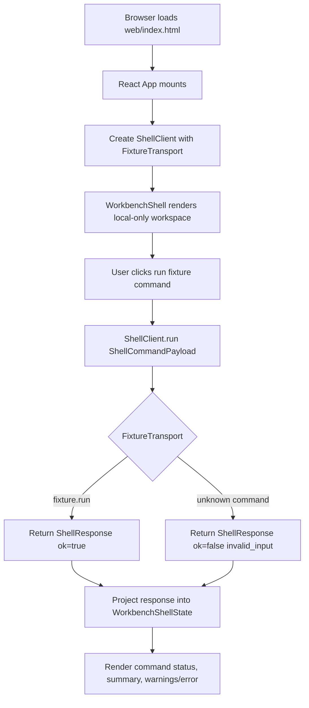

# web-app-shell-client design

## 0. 术语约定

| 术语 | 定义 | 防冲突结论 |
|---|---|---|
| Web App Shell | RxnFlow Web 工作台的第一版浏览器应用外壳，包含 app mount、基础布局、全局样式、ShellClient 接入和开发脚本 | 新增 `web/` 前端工程；不改变 Python core |
| ShellClient | 前端统一命令客户端，接收 `ShellCommandPayload`，调用 `ShellTransport`，返回 `ShellResponse` 并投影请求状态 | 复用 roadmap 4.1 契约；不直接 import Python core |
| ShellTransport | ShellClient 到 core runtime 或 fixture 的可替换通道，当前只实现 `in-process-test` fixture transport | 复用 Web Runtime Boundary；不新增 HTTP route 或 local-python bridge |
| Fixture Transport | 前端测试/演示用 transport，支持 `fixture.run` 和未知 command 错误路径 | 只用于 skeleton 闭环；不伪装成真实 parser/import/storage |
| Workbench Shell State | Web app shell 从 ShellResponse 派生的最小 domain projection，例如 session/profile/object/artifact counts、warnings 和 last error | 只保存投影，不把 ChemicalObject / ReactionGraph 领域模型硬写进 UI |
| Workbench Layout | 第一屏工作台布局：项目/对象入口、图谱画布区域、命令状态与能量/导出占位面板 | 是可操作工作台，不是营销页或 hero 页面 |
| Local-only Indicator | Web MVP 第一版的本地项目状态提示，提醒用户当前没有云同步 | 只做 UI 标识；不实现 Browser Project Repository |

术语 grep 结果：当前已有 `Shell Command`、`Shell Response`、`Shell Artifact`、`Web Payload Adapter`、`Web Runtime Boundary`、`Shell Transport`、`Browser Project Repository` 等架构术语。仓库当前没有 `web/`、`package.json`、`vite.config.*`、`tsconfig.json`、真实 TypeScript `ShellClient` 或浏览器 app mount。

## 1. 决策与约束

### 需求摘要

本 feature 的目标是建立 Web Workbench MVP 的最小前端闭环：

1. 创建独立 `web/` app skeleton。
2. 落地 TypeScript 版 ShellClient DTO 和可替换 transport 接口。
3. 用 fixture transport 跑通 `fixture.run` 成功和未知 command 错误路径。
4. 第一屏直接进入工作台布局，展示 local-only 状态、fixture command 状态、最小 domain summary 和后续 panel 的承载位置。
5. 提供可执行的前端 build/test/dev scripts，并用浏览器验证桌面与窄屏布局。

本设计把 React + TypeScript + Vite + npm 作为本 feature 的技术栈。该选择来自 `docs/dev/web-runtime-boundary.md` 的下一步建议，原因是第一版工作台偏 client-heavy、本地交互和状态投影，不需要 SSR 才能成立。

### 明确不做

- 不新增真实 HTTP API、Vercel route、FastAPI、Flask、Django 或 local-python bridge。
- 不实现 IndexedDB / OPFS Browser Project Repository。
- 不实现真实项目新建/打开/保存、bundle import/export、文件导入、parser preview 或 object registry。
- 不实现真实 graph canvas 编辑、自动布局、selection persistence、energy curve 或 report export UI。
- 不调用 Python core，不把 Python dataclass 或 parser/registry/graph/energy/export 逻辑复制到前端组件。
- 不新增账号、云存储、同步、权限、多人协作或外部量化计算任务调度。
- 不把 fixture transport 产生的数据描述成真实 Gaussian/ORCA/MAPLE 支持能力。
- 不创建 macOS/Windows/Linux desktop packaging。

### 复杂度档位

- Frontend structure：L2。新增独立 Web app shell、typed client、布局和测试，不接真实后端。
- Robustness：L2。覆盖 `fixture.run` 成功、未知 command 错误、JSON-safe DTO 和浏览器布局。
- Security：L1。无外部 API、无 secret、无文件系统 bridge、无云 provider SDK。
- UX risk：L2。第一屏是工作台，必须验证桌面和窄屏不重叠。
- Evolvability：L2。ShellTransport 可替换，后续能接 local-python bridge 或 http-api。

### 关键决策

1. **前端工程放在 `web/`**：避免污染 Python package 根目录，也让后续 Web/Vercel 部署边界清晰。
2. **ShellClient 先于业务面板**：先稳定命令 envelope、response shape 和请求状态，再让导入、对象、图谱、能量、导出面板复用。
3. **Fixture Transport 是唯一 runtime**：本 feature 不接 Python core；fixture transport 只证明前端能按 ShellResponse 消费数据。
4. **布局服务工作台而不是 landing**：首屏直接显示工作区、状态和可操作命令，不做 hero、营销文案或装饰性卡片堆叠。
5. **状态分 domain projection 和 UI-only state**：ShellResponse 派生的数据与 panel/viewport/selection 等 UI 状态分开。
6. **测试和浏览器验证都是退出条件**：`npm run build`、前端测试和浏览器桌面/窄屏检查都必须通过。

### 已确认的假设

- 假设 A：接受 React + TypeScript + Vite + npm 作为第一版 Web app shell 技术栈。
- 假设 B：接受 `web/` 作为前端工程目录，Python core 继续留在 `rxnflow/`。
- 假设 C：本 feature 的“调用闭环”接受 fixture transport，不要求直接调用 Python `handle_platform_payload`。
- 假设 D：第一版布局可以使用少量 fixture summary 和占位 panel，真实导入/图谱/能量/导出交互留给后续 roadmap items。

## 2. 名词与编排

### 2.1 名词层：值对象 / 实体 / 接口契约

**现状**：

- `rxnflow.platform.ShellCommand` / `ShellResponse` / `ShellArtifact` 已在 Python core 中定义 JSON-safe command/response 语义。
- `handle_platform_payload(payload)` 已有 Python POC，但没有 Web/TypeScript client。
- `docs/dev/web-runtime-boundary.md` 已确认 Web UI 只通过 Shell Client 调用 core runtime。
- 仓库没有前端 package、app mount、React component、ShellClient DTO 或 browser test。

**变化**：

- 新增 `web/` 前端工程，包含 Vite app entry、TypeScript config、npm scripts、测试环境和静态 HTML mount。
- 新增 TypeScript Shell DTO：
  - `JsonValue`
  - `ShellCommandName`
  - `ShellCommandPayload`
  - `ShellError`
  - `ShellWarning`
  - `ShellArtifact`
  - `ShellResponse<TData>`
- 新增 `ShellTransport` 接口和 `ShellClient` 实现：
  - ShellClient 只负责 request id、transport 调用、response normalization 和 command status。
  - Transport 负责具体 runtime；本 feature 只实现 `fixture` / `in-process-test` transport。
- 新增 minimal fixture projection：
  - `FixtureRunData`
  - `WorkbenchShellState`
  - `CommandStatus`
- 新增基础 React component 分层：
  - `App`
  - `WorkbenchShell`
  - `ProjectRail`
  - `GraphWorkspaceFrame`
  - `InspectorPanel`
  - `CommandStatusPanel`

**接口示例：ShellClient**

```ts
const response = await shellClient.run<FixtureRunData>({
  command: "fixture.run",
  args: {},
})

if (response.ok && response.data) {
  setWorkbenchShellState(projectFixtureResponse(response))
}
```

**接口示例：Fixture Transport 错误路径**

```ts
const response = await fixtureTransport.run({
  command: "missing.command",
  args: {},
})

assert(response.ok === false)
assert(response.error?.code === "invalid_input")
```

**接口示例：Workbench Shell State**

```ts
type WorkbenchShellState = {
  status: "idle" | "running" | "success" | "error"
  sessionId?: string
  projectId?: string
  profileId?: string
  objectCount: number
  artifactCount: number
  warnings: ShellWarning[]
  error?: ShellError
}
```

### 2.2 编排层：主流程与控制流



**现状**：

当前只有 Python shell POC。Web roadmap 中的 ShellClient DTO、Transport、Workbench State Projection 和 UI Layout Contract 还只是规划文本，没有真实前端工程或浏览器入口。

**变化**：

- 创建 Web app shell 入口，使浏览器打开后直接进入工作台。
- 在 app 初始化时创建 fixture transport 和 ShellClient。
- 用户点击 fixture command 后，ShellClient 发出 `fixture.run` payload，fixture transport 返回 ShellResponse。
- App 把 ShellResponse 投影为 `WorkbenchShellState`，渲染 project/session/profile/object/artifact summary、warnings 和错误状态。
- 未知 command 或 transport error 通过统一错误面板展示，不抛到 React root。
- 桌面和窄屏布局都保留可操作命令入口；窄屏把侧栏/inspector 改为 stacked 或 tabbed 布局，不能重叠。

**跨层纪律**：

- DTO 边界：ShellClient 类型必须只允许 JSON-safe payload；组件不能把 `File`、`Blob`、`Path` 或 class instance 直接传给 ShellClient。
- Runtime 边界：fixture transport 不访问 Python、文件系统、网络或 cloud SDK。
- State 边界：WorkbenchShellState 是 ShellResponse 投影，不是 ChemicalObject / ReactionGraph 的前端复制品。
- Error 边界：transport/domain error 都变成 ShellResponse 风格展示；UI 不吞掉 error code。
- UX 边界：第一屏是工作台，不能使用营销 hero；布局需服务编辑和扫描。
- 可卸载性：删除 `web/` 后本 feature 的 runtime surface 应消失，不影响 Python tests。

### 2.3 挂载点清单

- `web/package.json`：新增前端 package 与 scripts。
- `web/index.html`：新增浏览器 app mount。
- `web/src/main.tsx`：新增 React mount entry。
- `web/src/shell/`：新增 Shell DTO、ShellClient 和 fixture transport。
- `web/src/app/`：新增 Workbench shell component tree 和样式入口。

本 feature 不引入 backend route、database schema、cloud provider registration、desktop packaging 或 Python package entrypoint。

### 2.4 推进策略

1. **前端工程骨架**：创建 `web/` package、Vite/TypeScript/React 基础配置和 npm scripts。
   - 退出信号：`npm install` 后 `npm run build` 能产出静态 build。
2. **Shell DTO 与 Fixture Transport**：落地 TypeScript shell contracts、ShellClient、fixture response 和 unknown command 错误路径。
   - 退出信号：前端单测覆盖 `fixture.run` 成功、未知 command `invalid_input` 和 JSON-safe payload。
3. **Workbench Shell Layout**：实现第一屏工作台布局、local-only indicator、command status、summary panel 和后续面板占位。
   - 退出信号：浏览器打开后直接看到可操作工作台，点击 fixture command 会更新 UI state。
4. **前端测试与范围守护**：补 component/unit tests，确认没有 Python core 复制、没有 cloud/auth/http/server dependencies。
   - 退出信号：前端 test/build 通过，scope grep 无方案外依赖。
5. **浏览器验证**：启动本地 dev server，用浏览器检查桌面和窄屏布局。
   - 退出信号：桌面/窄屏无文本和控件重叠，第一屏不是 landing/hero。
6. **收口**：校验 CodeStable YAML、Python 单元测试和 git diff 范围，准备 acceptance 回写 architecture / requirement / roadmap。
   - 退出信号：实现证据足以支撑验收报告。

## 3. 验收契约

### 关键场景清单

1. `web/package.json` 存在，并包含 build/test/dev scripts。
2. `web/` app 使用 React + TypeScript + Vite + npm，且不修改 Python core package 边界。
3. `ShellCommandPayload`、`ShellResponse`、`ShellArtifact` 等 DTO 在 TypeScript 中有稳定定义。
4. `ShellClient.run({ command: "fixture.run", args: {} })` 通过 fixture transport 返回 `ok=true`。
5. 未知 command 通过 fixture transport 返回 `ok=false` 且 `error.code == "invalid_input"`。
6. fixture response 可投影为 `WorkbenchShellState`，UI 展示 session/profile/object/artifact summary。
7. App 首屏是工作台布局，不是 landing page、hero 页面或营销式介绍页。
8. UI 显示 local-only 状态，但不承诺云同步。
9. 用户点击 fixture command 后，command status 从 idle/running 更新到 success 或 error。
10. `npm run build` 通过。
11. 前端测试通过。
12. `python3 -m unittest discover` 继续通过。
13. 浏览器桌面 viewport 验证布局可用、无明显重叠。
14. 浏览器窄屏 viewport 验证布局可用、无明显重叠。

### 反向检查

- 不出现 FastAPI、Flask、Django、Vercel route、Express server 或 real HTTP API implementation。
- 不出现 Supabase、S3、R2、Vercel Blob、Firebase、Auth0、Clerk 或其他账号/云存储 SDK。
- 不新增 IndexedDB / OPFS Browser Project Repository 实现。
- 不在 Web component 内复制 parser、registry、reaction graph、energy 或 export 领域算法。
- 不新增真实导入、图谱编辑、能量计算或导出功能入口。
- 不修改 `rxnflow/parsers`、`rxnflow/registry.py`、`rxnflow/graph.py`、`rxnflow/energy.py`、`rxnflow/export.py` 的领域行为。

## 4. 与项目级架构文档的关系

- 本设计确认后生成 checklist，并把 roadmap item `web-app-shell-client` 更新为 `in-progress`。
- 实现完成并验收后，应新增或更新 Web 工作台架构现状。若 `codestable/architecture/web-workbench.md` 尚不存在，建议新建，记录 `web/` app shell、ShellClient、FixtureTransport、WorkbenchShellState 和布局边界。
- `codestable/architecture/ARCHITECTURE.md` 需要把 Web Workbench App Shell 加入已落地模块索引。
- `codestable/architecture/core-platform.md` 只需确认 Python core 未变；不要把前端 app 写成 core 能力。
- 本 feature 会新增用户可见的 Web 工作台壳层，acceptance 阶段应评估是否 backfill `codestable/requirements/web-workbench-shell.md`。
- 如果用户确认 React + TypeScript + Vite + npm，应在 acceptance 或独立 `cs-decide` 中沉淀为已拍板技术决定。
