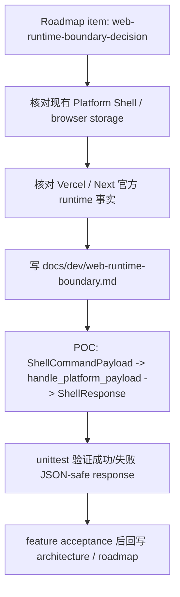

# web-runtime-boundary-decision design

## 0. 术语约定

| 术语 | 定义 | 防冲突结论 |
|---|---|---|
| Web Runtime Boundary | 浏览器 UI、Shell Client、Python core、local bridge、HTTP API、Browser Project Repository 之间的职责边界 | 本 feature 只拍运行时边界和最小 POC，不创建完整 Web app |
| Shell Transport | Shell Client 调用 core runtime 的传输方式，规划值为 `in-process-test`、`local-python-bridge`、`http-api` | 不替代已有 `PlatformShellService`；只是 Web 端到 shell command handler 的可替换通道 |
| Local-first Web Workbench | 项目内容优先保存在浏览器本地仓储和可导入/导出的 project bundle 中 | 不承诺账号、跨设备同步、云存储或多人协作 |
| Browser Project Repository | 未来 Web 端的真实本地项目仓储，负责 IndexedDB / OPFS 或等价浏览器存储 | 参考 `rxnflow.browser_storage` 的 Python 测试替身，但不是同一个运行时代码 |
| Stateless Python API | Vercel/http-api 方向的候选 runtime，只处理一次 command 请求或有限 compute/parse/export 动作 | 不作为长期项目文件系统、session authority 或数据库 |
| Runtime Boundary POC | 用现有 `handle_platform_payload` 跑通 JSON-safe shell command 的最小证据 | 不处理大文件上传、浏览器 File bridge、真实 HTTP route 或 UI 状态 |

术语 grep 结果：当前实现已有 `rxnflow.platform.ShellCommand`、`ShellResponse`、`PlatformShellService`、`handle_platform_payload`、`BrowserLocalProjectStorageBackend` 和 project bundle 能力。仓库当前没有真实 `web/` app、`package.json`、JavaScript/TypeScript ShellClient、IndexedDB/OPFS adapter 或 HTTP route。

## 1. 决策与约束

### 需求摘要

本 feature 的目标是为 Web Workbench MVP 明确运行时边界，并提供一个不绑定前端框架的 POC。完成后，后续 `web-app-shell-client` 可以据此创建真实 Web app skeleton，而不会把 Python 核心逻辑复制到 UI 组件里。

本设计推荐的边界如下：

1. Web MVP 是 local-first browser workbench：浏览器负责 UI 状态、项目列表、本地项目内容和下载/导入导出入口。
2. Python core 继续负责 parser、registry、workspace、reaction graph、energy profile 和 report export。
3. Web UI 只通过 Shell Client 发送 JSON-safe `ShellCommandPayload`，消费 JSON-safe `ShellResponse`。
4. `http-api` / Vercel Python runtime 可作为无状态 command executor 候选，但不得被设计成长期项目存储或跨请求 session 存储。
5. 下一条 Web app skeleton feature 建议采用 React + TypeScript + Vite + npm 的 client-heavy app 形态；该建议需要本设计确认后再落实到代码，不在本 feature 直接初始化前端工程。
6. 如果后续决定采用 Next.js，也必须保持 client-heavy workbench 和 ShellClient 边界；Next.js App Router / Server Components 不能成为领域状态 authority。

官方资料约束：

- Vercel Python Runtime 当前支持 ASGI/WSGI Python 应用和 FastAPI/Flask/Django 等框架；Python 版本由 `pyproject.toml`、`.python-version` 或 `Pipfile.lock` 指定，当前可用版本包括 3.12、3.13、3.14。
- Vercel Python Functions 默认会打包构建期可达的项目文件，Python function 最大未压缩 bundle size 为 500 MB，因此 parser fixture、测试数据和静态大文件必须有明确 exclude 策略。
- Next.js App Router 是基于文件系统的 React router，支持 Server Components、Suspense 和 Server Functions；它可作为未来选项，但 Web Workbench MVP 不需要 SSR 才能成立。

参考来源：

- [Vercel Python Runtime](https://vercel.com/docs/functions/runtimes/python)
- [Vercel Functions](https://vercel.com/docs/functions)
- [Next.js App Router](https://nextjs.org/docs/app)

### 明确不做

- 不创建 `package.json`、`web/`、Vite、Next.js、React、Tailwind、Playwright 或任何前端 scaffold。
- 不新增 FastAPI、Flask、Django、Vercel route 或真实 HTTP server。
- 不实现真实 IndexedDB / OPFS adapter。
- 不实现浏览器 File / Blob / ArrayBuffer 到 parser 的大文件桥接。
- 不修改 parser、chemical registry、reaction graph、energy engine 或 report export 的领域规则。
- 不新增云存储、账号、权限、同步、队列、后台任务或外部量化计算调度。
- 不把 roadmap item 状态改成 `in-progress`，直到本设计被用户确认。

### 复杂度档位

- Robustness：L2。决策文档 + 成功/失败两条 shell payload POC，覆盖 JSON-safe boundary。
- Structure：文档 + 小测试，不新增生产层级。
- Testability：POC 必须可由 `python3 -m unittest discover` 跑到。
- Security：不引入 secret、云 provider SDK、任意 shell 命令或任意文件执行。
- Evolvability：运行时 transport 可替换；Web app skeleton 后续只依赖 ShellClient 契约。

### 待用户确认的假设

- 假设 A：Web MVP 第一版接受 local-first，不购买云存储；云同步留给后续独立 roadmap。
- 假设 B：下一条 Web app skeleton 可以采用 React + TypeScript + Vite + npm；如果你更倾向 Next.js，可以在确认前改。
- 假设 C：Vercel/http-api 第一版只用于无状态 command executor，不保存长期项目内容。
- 假设 D：本 feature 的 POC 只证明 `handle_platform_payload` 的 JSON-safe command 边界，不解决 raw output 大文件上传。

## 2. 名词与编排

### 2.1 名词层：值对象 / 实体 / 接口契约

**现状**：

- `rxnflow.platform.ShellCommand` 表示 Python 侧 shell command，包含 command name 和 JSON-safe args。
- `rxnflow.platform.ShellResponse` 表示统一 response，包含 `ok`、`data`、`error`、`warnings`、`artifacts`。
- `rxnflow.platform.handle_platform_payload(payload)` 已能把 dict payload 转成 command 并返回 dict response。
- `rxnflow.browser_storage.BrowserLocalProjectStorageBackend` 是 Python 侧的浏览器本地仓储协议测试替身，不是真实浏览器 IndexedDB/OPFS 实现。
- 当前没有 Web ShellClient DTO、ShellTransport、真实 Browser Project Repository 或前端状态容器。

**变化**：

- 新增开发决策文档 `docs/dev/web-runtime-boundary.md`，记录 Web runtime boundary、transport 选择、local-first 持久化边界和 Vercel 注意事项。
- 新增最小 POC 测试，验证现有 shell command handler 可以作为 Web ShellClient 的后端 contract：
  - `fixture.run` 成功返回 JSON-safe response。
  - 未知 command 返回 `invalid_input`，而不是抛出未包装异常。
- 不新增 production runtime adapter；后续 Web app skeleton 才创建 TypeScript ShellClient 和 transport adapter。

**接口示例：现有 Python payload POC**

```python
response = handle_platform_payload({"command": "fixture.run", "args": {}})

assert response["ok"] is True
assert response["data"]["command"] == "fixture.run"
assert response["data"]["profile"]["id"]
```

**接口示例：错误路径**

```python
response = handle_platform_payload({"command": "missing.command", "args": {}})

assert response["ok"] is False
assert response["error"]["code"] == "invalid_input"
assert response["error"]["target"] == "command"
```

**接口示例：后续 TypeScript transport 形状**

```ts
type ShellTransportKind = "in-process-test" | "local-python-bridge" | "http-api"

type ShellTransport = {
  kind: ShellTransportKind
  run(payload: ShellCommandPayload): Promise<ShellResponse>
}
```

### 2.2 编排层：主流程与控制流



**现状**：

现在 Python 侧 shell command 边界已经存在，但 Web roadmap 还没有回答三件事：

1. 浏览器本地项目内容和 Python 计算/解析之间如何分工。
2. Vercel/http-api 能做什么，不能做什么。
3. 下一步前端工程是否可以按 client-heavy workbench 形态推进。

**变化**：

- 决策文档明确 Web UI、Shell Client、Browser Project Repository、Python core 和 HTTP/serverless runtime 的职责边界。
- POC 不新增 Web 技术栈，只验证现有 Python shell handler 足以作为下一步 ShellClient 的契约锚点。
- 验证范围包含反向守护：不得创建前端 scaffold、不得引入 cloud SDK、不得改领域核心规则。

**跨层纪律**：

- JSON 边界：Shell payload/response 必须可 `json.dumps`；Web 端未来不得传 class instance、Path、Blob 或 Python-only object。
- 状态边界：浏览器本地项目仓储是项目内容 authority；Vercel/http-api 不是长期 session 或 filesystem authority。
- 错误边界：transport failure 和 domain failure 要在 ShellClient 层区分；本 POC 只覆盖 domain-style `invalid_input`。
- 文件边界：raw output 大文件上传、chunking、OPFS object path 和 HTTP payload limit 另起 feature 处理。
- 架构边界：UI 不直接调用 parser/registry/graph/energy/export 模块；只通过 shell command/projection。

### 2.3 挂载点清单

- `docs/dev/web-runtime-boundary.md`：新增开发者决策文档，作为后续 Web feature 的边界输入。
- `tests/test_web_runtime_boundary.py`：新增 POC 回归测试，只调用 `rxnflow.platform.handle_platform_payload`。
- `codestable/features/2026-05-16-web-runtime-boundary-decision/web-runtime-boundary-decision-design.md`：本设计文档。
- 后续 acceptance 阶段再按实际实现回写 `codestable/architecture/` 和 roadmap item 状态。

本 feature 不新增 production runtime entrypoint，不新增 frontend app mount point。

### 2.4 推进策略

1. **运行时事实记录**：把 Vercel Python Runtime、Functions bundling 约束、Next.js App Router 可选性写入 `docs/dev/web-runtime-boundary.md`。
   - 退出信号：文档能回答 local-first、http-api、browser storage、未来 Web scaffold 的职责边界。
2. **边界决策固化**：记录推荐的 MVP 边界：client-heavy Web workbench + Browser Project Repository + Python shell command executor。
   - 退出信号：文档明确 serverless 不承担长期项目存储。
3. **Shell payload POC**：新增测试，直接调用 `handle_platform_payload` 的成功和失败路径。
   - 退出信号：`fixture.run` 和未知 command 都返回 JSON-safe dict。
4. **范围守护**：检查本 feature 没有创建前端 scaffold、云 SDK、HTTP route 或领域规则改动。
   - 退出信号：`git diff --name-only` 只包含设计/文档/POC 测试。
5. **验证与收口**：跑 YAML 校验和单元测试；验收后更新 architecture/roadmap。
   - 退出信号：feature acceptance 能证明 roadmap item 已完成。

## 3. 验收契约

### 关键场景清单

1. `docs/dev/web-runtime-boundary.md` 存在，并明确 Web MVP 的推荐 runtime boundary。
2. 文档说明浏览器本地仓储是第一版项目内容 authority，local-only 状态必须可见。
3. 文档说明 Vercel/http-api 是无状态 command executor 候选，不作为长期项目存储或跨请求 session authority。
4. 文档引用 Vercel Python Runtime、Vercel Functions、Next.js App Router 官方来源。
5. 文档明确下一步 Web app skeleton 的建议技术栈和可替代条件。
6. POC 测试调用 `handle_platform_payload({"command": "fixture.run", "args": {}})`，返回 `ok=True`。
7. POC 测试返回值可以被 `json.dumps`。
8. POC 测试未知 command 返回 `ok=False`，`error.code == "invalid_input"`。
9. 本 feature 没有创建 `package.json` 或真实前端 app 目录。
10. 本 feature 没有引入 FastAPI、Flask、Django、Vercel SDK、云存储 SDK 或账号权限依赖。
11. 本 feature 没有修改 parser、registry、graph、energy、export 的领域行为。
12. `python3 -m unittest discover` 通过。

### 反向检查

- `git diff --name-only` 不应出现 `package.json`、`web/`、`app/`、`src/` 前端 scaffold。
- `rg "supabase|s3|r2|blob|firebase|auth0|clerk" -S .` 不应因本 feature 新增云存储/账号依赖。
- `git diff -- rxnflow/parsers rxnflow/registry.py rxnflow/graph.py rxnflow/energy.py rxnflow/export.py` 不应有领域规则变更。
- `docs/dev/web-runtime-boundary.md` 不应承诺 serverless filesystem 可持久保存项目内容。

## 4. 与项目级架构文档的关系

- 本设计确认后生成 checklist，并把 roadmap item `web-runtime-boundary-decision` 更新为 `in-progress`。
- 实现完成并验收后，`codestable/architecture/` 应回写已落地的 Web runtime boundary 现状。
- 若最终实现只新增文档和 POC 测试，architecture 回写应保持克制：只记录已确认的 Web 边界和 shell command POC，不把未来 UI skeleton 写成现状。
- 本 feature 不新增用户可见能力，因此暂不需要新增 `codestable/requirements/` 文档。
- 如果用户确认 React + TypeScript + Vite 为下一步 Web skeleton 技术栈，应在验收或单独 `cs-decide` 中沉淀为已拍板技术决定。
