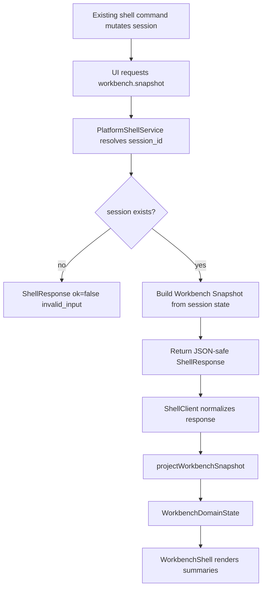

# web-workbench-state-projections design

## 0. 术语约定

| 术语 | 定义 | 防冲突结论 |
|---|---|---|
| Workbench Snapshot | Platform Shell 返回的只读工作台状态投影，汇总 session、project、objects、imports、workspace、profile、artifacts 和 counts | 新增 `workbench.snapshot` command；不等同于 `ProjectContentSnapshot` 持久化模型 |
| Workbench Domain State | Web 前端从 ShellResponse / Workbench Snapshot 投影出的业务可读状态 | 替代当前 `WorkbenchShellState` 的 fixture-only 摘要；不复制 ChemicalObject / ReactionGraph 算法 |
| Workbench UI State | 前端本地 UI-only 状态，例如 active panel、selection、viewport、pending command ids | 不进入 ShellResponse，不写 ReactionGraph；未来保存时转 WorkspaceSnapshot |
| Active Content | 当前 session 中被后续命令默认使用的 active workspace / graph / profile | 复用 `PlatformSession.workspace_id` / `graph_id` / `profile_id`，不新增领域选择规则 |
| Projection Summary | 面向 UI 扫描的对象、导入、workspace、profile 和 artifact 摘要 | 复用已有 `_object_summary`、`_import_batch_summary`、`_workspace_summary`、`_profile_summary` 等 helper 语义 |

术语 grep 结果：`WorkbenchShellState` 当前只在 `web/src/app/workbenchState.ts` 和 architecture 中出现；`workbench.snapshot` 已在 roadmap DTO 和前端 `ShellCommandName` 规划中出现，但 Python `PlatformShellService` 尚无 handler。`ProjectContentSnapshot` 已是持久化模型，不能借名做 UI 状态。

## 1. 决策与约束

### 需求摘要

本 feature 的目标是把 Web 工作台从 fixture-only 摘要推进到稳定的 read-only state projection：

1. 在 Platform Shell 增加 `workbench.snapshot` 只读命令，供 Web/agent 拉取当前 session 的工作台状态。
2. 定义 Python shell response 的 Workbench Snapshot JSON shape，复用现有 session restore、workspace、profile、import 和 artifact summary 语义。
3. 在 Web 前端新增 `WorkbenchDomainState` / `WorkbenchUiState` 类型和 response projector，让组件不再从零散 command response 反推领域状态。
4. fixture transport 支持 `workbench.snapshot`，保持当前 Web app 无真实 bridge 时仍可测试状态投影。
5. 让当前 WorkbenchShell 消费统一 domain state，首屏仍保持工作台结构，不新增真实导入、画布或能量曲线。

### 明确不做

- 不实现 Browser Project Repository、IndexedDB / OPFS、project refs 或真实浏览器本地持久化。
- 不实现 local-python bridge、HTTP API、Vercel route、FastAPI、Flask、Django 或 Express server。
- 不实现真实项目新建/打开/保存的 Web UI，不实现文件选择、parser preview、import register UI。
- 不实现 object drag/drop、graph canvas editing、selection persistence、energy curve 或 report export panel。
- 不改变 Project Content schema、ProjectContentSnapshot codec、GraphPatch、Energy Engine 或 Report Export 算法。
- 不让前端组件手写 fake ChemicalObject、ReactionGraph、EnergyProfile 或导出 artifact 作为业务真相。
- 不把 `workbench.snapshot` 作为持久化保存命令；保存仍由 `project.save_content` 承担。

### 复杂度档位

- Platform shell projection：L2。新增只读 command 和 JSON projection helper，不改核心领域算法。
- Frontend state：L2。新增 typed state/projector 并接入现有 shell UI，不做大型 UI 重构。
- Robustness：L2。覆盖 fixture、missing session、project open restore、import/workspace/energy/export command 后 snapshot 一致性。
- Security：L1。无外部 API、无文件系统 bridge、无 cloud provider SDK。
- UX risk：L1-L2。当前只更新已有工作台显示，仍需浏览器检查桌面/窄屏。

### 关键决策

1. **新增 `workbench.snapshot` 而不是让 UI 拼响应**：每个 shell command 的 `data` payload 都不同，前端自己从 `project.open`、`workspace.open`、`energy.compute` 等 response 拼状态会形成隐式领域副本。
2. **snapshot 只读、无副作用**：它只解析当前 process-local session state，不创建项目、不保存内容、不重新 parse、不重新计算、不导出。
3. **复用既有 summary helper**：对象、导入、workspace、profile、artifact 的 summary shape 先沿用 `rxnflow.platform` 现有投影语义，避免另造一套 UI-only 命名。
4. **前端分离 domain state 与 UI state**：`WorkbenchDomainState` 只来自 shell response；panel、selection、viewport 等留在 `WorkbenchUiState`。
5. **fixture transport 同步实现 snapshot**：Web 当前没有真实 Python bridge，因此测试和页面演示必须能走同一个 projection shape。

### 已确认的假设

- 假设 A：接受本 feature 新增 Python `workbench.snapshot` command，作为后续 Web 面板读取状态的主入口。
- 假设 B：当前 snapshot 可以返回 UI summary，不返回完整 ChemicalObject geometry、完整 raw parse result 或 ExportArtifact bytes。
- 假设 C：当前 UI 只展示 snapshot 的 summary/counts；对象面板、导入面板和画布细节留给后续 roadmap items。

## 2. 名词与编排

### 2.1 名词层：值对象 / 实体 / 接口契约

**现状**：

- `rxnflow.platform.PlatformShellService` 已有 process-local `_PlatformSessionState`，保存 session、objects、import batches、reaction graphs、workspaces、energy profiles、runtime artifacts 和 export artifact records。
- 现有 command response 使用 `_response_data` + 专项 summary：`_object_summary`、`_import_batch_summary`、`_workspace_summary`、`_profile_summary`。
- `project.open(load_content=True)` 已能返回 restored counts 和 active ids，但不返回完整 UI projection。
- `web/src/app/workbenchState.ts` 当前只接受 fixture response，字段不足以支撑 project sidebar / import inbox / object panel / graph canvas。
- `web/src/shell/types.ts` 已把 `workbench.snapshot` 放进 `ShellCommandName`，但 fixture transport 和 Python shell 都未实现。

**变化**：

新增 Shell command：

```python
response = service.run(
    ShellCommand("workbench.snapshot", {"session_id": "session-1"})
)
```

期望 `ShellResponse.data` shape：

```json
{
  "command": "workbench.snapshot",
  "session_id": "session-1",
  "project_id": "project-demo",
  "project_path": "/path/to/project",
  "workspace_id": "workspace-graph-a-b",
  "graph_id": "graph-a-b",
  "profile_id": "profile-a-b-electronic",
  "counts": {
    "objects": 2,
    "imports": 1,
    "graphs": 1,
    "workspaces": 1,
    "profiles": 1,
    "artifacts": 1
  },
  "project": {
    "id": "project-demo",
    "name": "demo",
    "schema_version": "project-v1",
    "resource_count": 1
  },
  "objects": [],
  "imports": [],
  "workspace": null,
  "profile": null,
  "artifacts": []
}
```

新增 / 调整前端类型：

```ts
type WorkbenchDomainState = {
  sessionId?: string
  project?: ProjectSummary
  projectPath?: string
  active: {
    workspaceId?: string
    graphId?: string
    profileId?: string
  }
  counts: {
    objects: number
    imports: number
    graphs: number
    workspaces: number
    profiles: number
    artifacts: number
  }
  objects: ObjectSummary[]
  imports: ImportBatchSummary[]
  workspace?: WorkspaceSummary
  profile?: EnergyProfileSummary
  artifacts: ShellArtifact[]
  warnings: ShellWarning[]
}

type WorkbenchUiState = {
  activePanel: "project" | "import" | "objects" | "graph" | "energy" | "export"
  pendingCommandIds: string[]
}
```

前端 projector 示例：

```ts
const response = await shellClient.run<WorkbenchSnapshotData>({
  command: "workbench.snapshot",
  args: { session_id: sessionId },
})

const domainState = projectWorkbenchSnapshot(response)
```

### 2.2 编排层：主流程与控制流



**现状**：

- Web app 点击 `Fixture Run` 后直接调用 `projectFixtureResponse(response)`，只能处理 fixture-specific shape。
- Platform Shell command handlers 每次返回当前命令的局部 payload；没有统一“当前工作台状态”读取点。
- `_PlatformSessionState` 已有足够内存内容生成 read-only projection，但 project summary 需要保留或按 `project_path` 只读加载 manifest。

**变化**：

- `PlatformShellService.run` 增加 `workbench.snapshot` 分支。
- 新增内部 helper，例如 `_workbench_snapshot_data(state)`，从 `_PlatformSessionState` 汇总：
  - session ids / active ids
  - project summary / project path
  - counts
  - object summaries
  - import batch summaries
  - active workspace summary
  - active profile summary
  - runtime artifacts + persisted export artifact records summaries
- `fixture.run` 后返回的 session 可以被 `workbench.snapshot` 读取。
- Web fixture transport 增加 `workbench.snapshot`，并让 `Fixture Run` 后的 UI 用统一 projector 更新 state。
- WorkbenchShell 继续保持现有三栏布局，只把数据来源从 fixture-only state 改成 domain state。

**跨层纪律**：

- Read-only：`workbench.snapshot` 不调用 parser/import register/workspace patch/energy compute/export/project save。
- JSON-safe：response 不包含 dataclass、Path、tuple、bytes、class instance。
- 权威边界：前端只读取 projection，不把它写回 core；编辑类动作仍走 `workspace.*`、`energy.compute`、`export.profile` 等命令。
- Missing session：缺少或不存在 `session_id` 返回 `invalid_input`，不自动创建 session。
- Projection 不等于 persistence：`Workbench Snapshot` 不保存项目内容，不替代 `ProjectContentSnapshot`。
- Evolvability：snapshot 字段以 summary 为主，后续面板需要更深字段时优先扩展 projection command，而不是让 UI 读取内部 Python state。

### 2.3 挂载点清单

- `rxnflow.platform`：新增 `workbench.snapshot` command handler 和 Workbench Snapshot projection helper。
- `tests/test_platform_shell_baseline.py` 或新增平台 shell projection 测试：覆盖 snapshot JSON shape、read-only 纪律和 missing session。
- `web/src/app/`：新增/调整 Workbench domain state、UI state 和 projector，WorkbenchShell 改为消费统一 projection。
- `web/src/shell/fixtureTransport.ts`：支持 `workbench.snapshot` fixture response。
- `web/src/shell/types.ts`：补齐 Workbench Snapshot 相关 TypeScript DTO export。
- `codestable/architecture/web-workbench.md` / `core-platform.md`：验收阶段回写已落地 projection command 和边界。

本 feature 不引入 backend route、browser storage adapter、cloud provider、desktop packaging、真实 import UI 或 graph canvas。

### 2.4 推进策略

1. **Platform Snapshot Contract**：在 Platform Shell 增加 `workbench.snapshot` 只读 command 和 JSON-safe projection helper。
   - 退出信号：Python 测试可从 fixture/project-open/import/workspace/energy/export session 读取 snapshot，并断言核心 counts / active ids / summaries 正确。
2. **Read-only Scope Guard**：补 missing session、manifest-only session 和 read-only 纪律测试。
   - 退出信号：测试证明 snapshot 不创建 session、不保存项目、不调用 parser/import register/energy/export。
3. **Frontend Domain Projection Types**：新增 `WorkbenchSnapshotData`、`WorkbenchDomainState`、`WorkbenchUiState` 和 projector。
   - 退出信号：前端单测能把 fixture snapshot 和 error response 投影成稳定 UI state。
4. **Fixture Transport Integration**：让 fixture transport 支持 `workbench.snapshot`，并让 WorkbenchShell 从统一 domain state 渲染。
   - 退出信号：点击 fixture command 后 UI 通过 snapshot/projector 展示 project/object/profile summary。
5. **Frontend / Browser Validation**：前端 test/build 通过，浏览器桌面和窄屏复核现有 shell 不回退。
   - 退出信号：`npm run test`、`npm run build`、浏览器 1280/390 viewport 验证通过。
6. **收口**：Python unittest、scope grep、CodeStable YAML、git diff 范围检查。
   - 退出信号：实现证据足以进入 acceptance。

## 3. 验收契约

### 关键场景清单

1. `PlatformShellService.run(ShellCommand("workbench.snapshot", {"session_id": ...}))` 对 fixture session 返回 `ok=true`。
2. snapshot response 可 JSON 序列化，且包含 command、session_id、project_id、active ids、counts、objects、workspace、profile、artifacts、warnings。
3. `workbench.snapshot` 缺少或不存在 session_id 时返回 `ok=false`，`error.code == "invalid_input"`，`target == "session_id"`。
4. `project.open(load_content=True)` 后调用 `workbench.snapshot` 能看到 restored object/graph/workspace/profile/artifact/import counts。
5. manifest-only session 的 snapshot 返回项目/session 基本信息，content counts 为 0。
6. import preview / register / workspace open / energy compute / export 后调用 snapshot，projection 与当前 session state 一致。
7. snapshot 不重新 parse raw files、不确认 import、不重新计算 energy、不导出报告、不保存 Project Content。
8. TypeScript 中存在 `WorkbenchSnapshotData` / `WorkbenchDomainState` / `WorkbenchUiState` 或等价稳定类型。
9. Web projector 能把 successful snapshot response 投影为 UI 可读 domain state。
10. Web projector 能保留 `ShellError` / `ShellWarning`，错误 code 在 UI 中可见。
11. fixture transport 支持 `workbench.snapshot`，unknown command 仍返回 `invalid_input`。
12. WorkbenchShell 首屏仍是工作台，不变成 landing/hero。
13. `npm run test` 通过。
14. `npm run build` 通过。
15. `python3 -m unittest discover` 通过。
16. 浏览器桌面 viewport 验证布局可用、无明显重叠。
17. 浏览器窄屏 viewport 验证布局可用、无明显重叠。

### 反向检查

- 不新增真实 HTTP API、Vercel route、FastAPI、Flask、Django、Express server 或 local-python bridge。
- 不新增 Supabase、S3、R2、Vercel Blob、Firebase、Auth0、Clerk 或其他账号/云存储 SDK。
- 不新增 IndexedDB / OPFS Browser Project Repository 实现。
- 不实现真实文件导入 UI、object drag/drop、graph canvas editing、energy curve 或 report export panel。
- 不修改 parser、registry、reaction graph、energy engine 或 report export 的核心算法。
- 不改变 Project Content schema 或持久化 codec。

## 4. 与项目级架构文档的关系

- 本设计确认后生成 checklist，并把 roadmap item `web-workbench-state-projections` 更新为 `in-progress`。
- 实现完成并验收后，`codestable/architecture/web-workbench.md` 应记录 Workbench Snapshot、WorkbenchDomainState、WorkbenchUiState 和前端 projector 现状。
- `codestable/architecture/core-platform.md` 应补充 `workbench.snapshot` 只读命令和 read-only projection 边界。
- `codestable/architecture/ARCHITECTURE.md` 术语表应补充 Workbench Snapshot / WorkbenchDomainState 当前含义。
- `codestable/requirements/web-workbench-shell.md` 在 acceptance 阶段评估是否 update：如果用户可见页面仍只是 shell 摘要，可能只需在变更日志中补充“状态投影改为统一 snapshot”。
