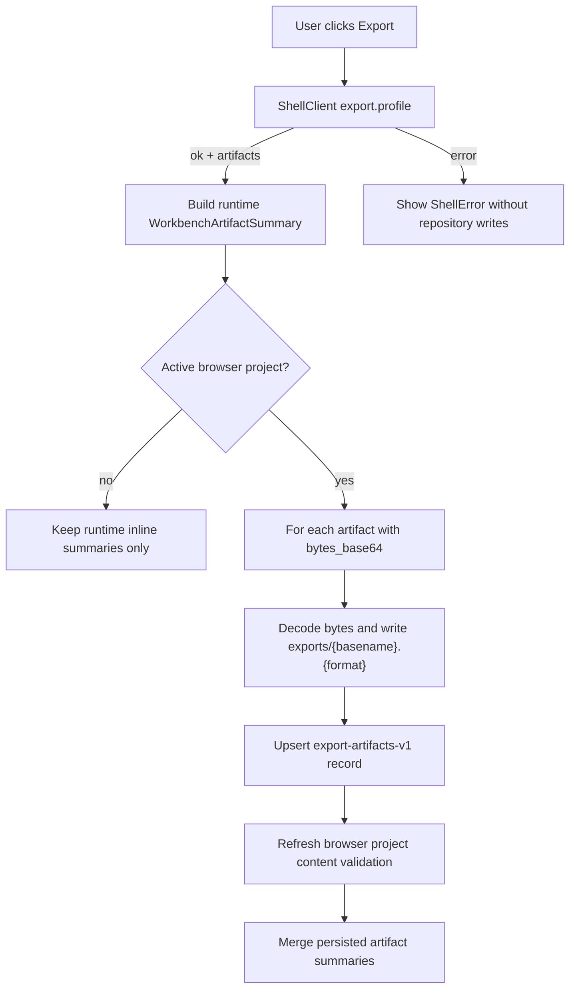

# web-export-artifact-persistence design

## 0. 术语约定

| 术语 | 定义 | 防冲突结论 |
|---|---|---|
| Web Export Artifact Persistence | Web Report Export Panel 把 ShellArtifact inline bytes 写入 Browser Project Repository 的显式持久化编排 | roadmap 已定义；不等同于 core ReportExportService writer |
| Browser Export Object | Browser Project Repository 中 `exports/...` 下的导出文件 bytes object | 只保存 bytes/checksum/metadata，不是 Project Manifest resource |
| Browser Export Artifact Record | `.rxnflow/state/export-artifacts.json` 中记录 Browser Export Object 的长期索引条目 | 对齐 core `ExportArtifactRecord` shape |
| Export Artifact Persistence Result | Web 对每个 artifact 的 persisted path/checksum/error 投影 | 只影响 Web artifact summary 和 project content files |
| Persisted Artifact Summary | `WorkbenchArtifactSummary.persisted=true` 且带 `path`/`checksum` 的 UI summary | 表示 browser-local persisted，不表示云同步 |

术语 grep 结果：core 已有 `ExportArtifact`、`ExportArtifactRecord`、`export-artifacts-v1` 和 `ShellArtifact`；Web 已有 Report Export Panel、`WorkbenchArtifactSummary` 和 Browser Project Repository。当前 Report Export Panel 只展示 inline download，不写 `exports/...` browser storage，也不更新 export artifact index。

## 1. 决策与约束

### 需求摘要

本 feature 让 Web 导出的 PNG/CDXML/XLSX runtime artifacts 在当前 browser-local project 中变成可追踪的本地对象。用户点击 Export 后，若当前有 active browser project 且 ShellResponse artifact 带 `bytes_base64`，Web 将 bytes 写入 `exports/{basename}.{format}`，计算 repository checksum，再更新 `.rxnflow/state/export-artifacts.json` 的 `artifacts[]` 记录。UI 随后显示 artifact 已持久化、path、checksum；Project Sidebar 重新 shallow validation，让更新后的 Project Content files 进入已保存状态。

### 明确不做

- 不新增 CDX、PDF、PPTX、SVG、CSV 或其他导出格式。
- 不在前端生成 PNG/CDXML/XLSX bytes；bytes 仍来自 ShellResponse `ShellArtifact.bytes_base64`。
- 不修改 Python ReportExportService、writer、ExportArtifact codec、ProjectContentStore 或 Project Bundle。
- 不把 browser-local artifact 写入 Project Manifest resources，也不复制到 Python filesystem。
- 不实现 file picker、File System Access API、OPFS、JSZip、云存储、账号或同步。
- 不实现报告预览、ChemDraw 编辑器、artifact 删除、重命名、批量管理或冲突 UI。
- 不在没有 active browser project 时自动创建 project。
- 不持久化缺少 inline bytes 的 artifact；include bytes 关闭时只保留 runtime summary。

### 复杂度档位

- Frontend orchestration：L2。需要在 export.profile success 后串联 Browser Repository 写入、export-artifacts section 更新和 Workbench artifact summary merge。
- Browser storage：L2。复用现有 IndexedDB-first repository，新增 `exports/...` object 与 section JSON 更新，不改 repository schema。
- Robustness：L2。需要处理无 active project、缺 inline bytes、base64 decode 失败、repository 写入失败、section 缺失/坏 JSON 和 duplicate artifact id/path。
- UX：L2。只增强 Report Export Panel 的 persisted/checksum/path/error 展示，不改整体布局或导出格式选择。
- Core integration：L1。不改 Python core，只对齐已有 Project Content export artifact record 形状。

### 关键决策

1. **自动持久化当前 browser project**：Export 成功后若存在 active browser project，Web 自动写 `exports/...`；没有 active project 时不写 repository，只保留 inline download。
2. **只持久化 inline bytes**：`bytes_base64` 为空时不能写文件，UI 保持 download unavailable / persisted no。
3. **同时更新 export-artifacts section**：只写 `exports/...` 文件不够，必须同步 `.rxnflow/state/export-artifacts.json` 才能让 Project Content Validation 和后续打开项目知道 artifact 存在。
4. **path 由 basename/format 生成**：第一版使用 `exports/{safeBasename}.{format}`，只允许 project-relative POSIX path，不接受 ShellArtifact 的绝对 path 或项目外 path。
5. **id/path upsert**：重复导出同一 artifact id 或同一路径时覆盖对应 record 和 repository object，不创建重复 index 条目。

## 2. 名词与编排

### 2.1 名词层：值对象 / 接口契约

**现状**：

- `ShellArtifact` 可带 `bytes_base64`，但 Web 只用它生成 data URL 下载。
- `WorkbenchArtifactSummary` 已有 `path`、`checksum`、`persisted`、`has_inline_bytes` 字段，但 runtime export summary 默认 `persisted=false`。
- Browser Project Repository 已支持 project-relative path bytes 写入，`exports/profile.png` 这类 path 已符合 repository path safety。
- `.rxnflow/state/export-artifacts.json` 初始为空 section；Project Content Validation 会检查 record.path 下的 artifact bytes checksum。

**变化**：

新增 Web 侧 helper 契约：

```ts
type BrowserPersistedArtifactRecord = {
  id: string
  format: "png" | "cdxml" | "xlsx"
  path: `exports/${string}`
  checksum: string
  created_at: string
  metadata: JsonObject
}

type ArtifactPersistenceResult = {
  artifactId: string
  persisted: boolean
  path?: string
  checksum?: string
  error?: ShellError
}
```

新增行为：

- `persistExportArtifacts(repository, projectRef, artifacts, options)` 解码 inline bytes，写 `exports/...` object，并 upsert `export-artifacts-v1` section。
- `WorkbenchShell` 用 persistence result 更新 `WorkbenchArtifactSummary`：成功时 `persisted=true`、`path` 和 `checksum` 来自 repository receipt；失败时保留 runtime summary 并显示 error/warning。
- `ProjectSidebarState` 在持久化后通过现有 `saveProjectContent/openProject` 语义刷新 validation/checksum，不新增 project session。

### 2.2 编排层：主流程与控制流



**跨层纪律**：

- ShellResponse 仍是 artifact bytes 来源；Web 不生成导出 bytes。
- Browser Project Repository 只保存 bytes 和 JSON section；不解释 PNG/CDXML/XLSX 内容。
- `export-artifacts-v1` record shape 对齐 core codec：id、format、path、checksum、created_at、metadata。
- 持久化失败不能抹掉 runtime artifact；用户仍可看到 export result 和可用 inline download。
- Project Content save/open bridge 不自动触发；本 feature 只更新 browser-local content files，后续用户仍可显式 Save Bridge Session 保存 core session。

### 2.3 挂载点清单

- `web/src/app/exportArtifactPersistence.ts`：新增 browser-local artifact persistence helper、base64 decode、safe path、export-artifacts section upsert。
- `web/src/app/WorkbenchShell.tsx`：在 `runReportExport` 成功路径接入 persistence helper，并 merge persisted summaries / warnings。
- `web/src/app/ReportExportPanel.tsx`、`web/src/app/i18n/messages.ts`、CSS：展示 persisted checksum / path / error 状态与双语文案。
- `web/src/app/*test.tsx`、`web/e2e/`：覆盖 active project 持久化、无 active project fallback、include bytes off 不写 repository、桌面/窄屏 flow。
- `codestable/architecture/*`、`requirements/*`、roadmap/checklist：验收后同步当前能力和边界。

### 2.4 推进策略

1. **Artifact persistence helper**：新增 `exports/...` path 生成、base64 decode、repository write、export-artifacts section read/upsert/write。
   - 退出信号：Vitest 覆盖写入 PNG/CDXML/XLSX objects、checksum、record upsert、缺 inline bytes skip、坏 base64/repository error。
2. **Workbench export orchestration**：`runReportExport` 成功后在 active browser project 下调用 helper，merge persisted summary 和 project sidebar validation。
   - 退出信号：component test 覆盖 active project export 后 artifact persisted/path/checksum 可见，repository 有 exports objects 和 index records。
3. **UI/i18n presentation**：Report Export Panel 显示 persisted checksum、browser-local path、persistence warning/error；中文/英文文案齐全。
   - 退出信号：Testing Library 覆盖中英文静态文案，长 id/path/checksum 不破坏布局。
4. **Scope guards and negative flows**：无 active project、include bytes off、no formats、shell error、repository quota/error 均可读且不误写。
   - 退出信号：测试确认无 active project 不写 repository，include bytes off 不写 `exports/...`，shell error 不调用 repository。
5. **QA and docs**：更新 architecture/requirement/roadmap/checklist，跑 Python/Web 自动化和浏览器桌面/窄屏 smoke。
   - 退出信号：`python3 -m unittest discover`、`npm run test`、`npm run build`、`npm run test:e2e` 与渲染 smoke 通过。

## 3. 验收契约

### 关键场景清单

1. active browser project + `export.profile` 返回 PNG/CDXML/XLSX inline bytes 时，Web 写入 `exports/rxnflow-profile.png`、`.cdxml`、`.xlsx`，receipt checksum 为 `sha256:<64 hex>`。
2. 成功持久化后 `.rxnflow/state/export-artifacts.json` 包含 3 条 records，id/format/path/checksum/metadata 与 artifact 对齐，重复导出覆盖同 id/path 不重复。
3. Report Export Panel 显示 persisted yes、browser-local path、checksum，并保留 inline download link。
4. 持久化后 Project Sidebar validation 仍为 valid，checksum 更新。
5. 没有 active browser project 时 Export 仍显示 runtime artifacts/download link，但不写 Browser Project Repository，persisted 仍为 no。
6. include bytes 关闭时 Export 显示 artifacts，但没有 download link，也不写 `exports/...` 或 export-artifacts record。
7. artifact `bytes_base64` 无效或 repository 写入失败时，UI 显示结构化 error/warning，runtime artifact 不丢失。
8. 生成的 artifact path 必须位于 `exports/` 下，禁止绝对路径、反斜杠、`.`、`..`。
9. `npm run test`、`npm run build`、`npm run test:e2e`、`python3 -m unittest discover` 通过，桌面/窄屏渲染无空白、无 framework overlay、无相关 console error。

### 反向检查

- 不新增导出格式，不实现 CDX/PDF/PPTX/SVG/CSV。
- 不在前端生成 PNG/CDXML/XLSX bytes。
- 不修改 Python ReportExportService、writer、ExportArtifact codec、ProjectContentStore 或 Project Bundle。
- 不把 artifact 写入 Project Manifest resources，不把 Browser Project Ref 当成 Python filesystem path。
- 不实现 file picker、File System Access API、OPFS、JSZip、云存储、账号或同步。
- 不自动创建 browser project，不自动调用 `project.save_content` 或 Save Bridge Session。

## 4. 与项目级架构文档的关系

- 验收后 `web-workbench.md` 应记录 Report Export Panel 可把 inline artifacts 写入 browser-local `exports/...` 并同步 `export-artifacts-v1` index。
- `ARCHITECTURE.md` 应更新 Web Report Export Panel / Browser Project Repository / Export Artifact Index 的关系。
- `project-content-persistence.md` 应补充 Web browser-local export artifact persistence 现状和仍非云备份的边界。
- `rxnflow-web-runtime-bridge` roadmap items 与主文档在 acceptance 阶段回写 `web-export-artifact-persistence` 为 done。
