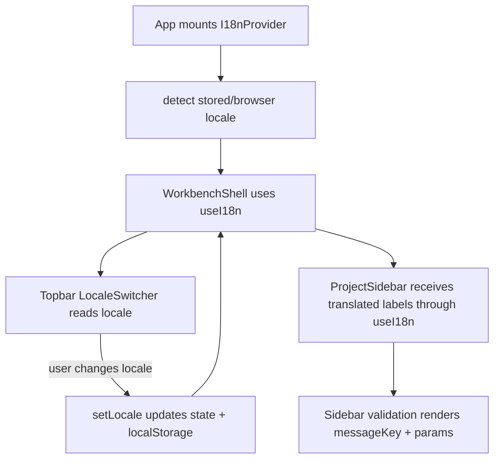

# web-i18n-foundation design

## 0. 术语约定

| 术语 | 定义 | 防冲突结论 |
|---|---|---|
| Supported Locale | Web UI 第一版支持的语言代码集合：`zh-CN` 和 `en-US` | 不等同于浏览器任意 `navigator.language` 值 |
| Message Key | 前端用户可见主文案的稳定 key，例如 `projectSidebar.title` | 不用于动态数据值、错误 code、checksum、命令名或文件名 |
| Message Catalog | 每个 locale 对应的一份 key/value 文案表，要求 key 完全一致 | 不接云端翻译，也不是 runtime 可编辑内容 |
| I18n Runtime | React app 内提供 `locale`、`setLocale` 和 `t(key, params)` 的上下文运行时 | 不进入 ShellResponse，不写 Project Content |
| Locale Preference | 用户手动选择的 locale，保存在浏览器本地 | 不依赖账号、云同步或项目文件 |
| Locale Switcher | 顶栏中的语言切换控件 | 不承担多地区路由或账号级偏好 |

术语 grep 结果：当前 `web/src` 没有 i18n / locale runtime；roadmap 已定义 `Web I18n Contract`。现有大量 UI 文案硬编码在 `WorkbenchShell.tsx`、`ProjectSidebar.tsx` 和测试中。

## 1. 决策与约束

### 需求摘要

本 feature 目标是先落一个足够小但可持续扩展的 Web i18n 基础：

1. 定义 `SupportedLocale = "zh-CN" | "en-US"`、typed `MessageKey`、`MessageCatalog` 和 `t(key, params)`。
2. 提供 React `I18nProvider` / `useI18n`，让 WorkbenchShell 与 ProjectSidebar 不直接读取全局变量。
3. 默认 locale 按浏览器语言选择：中文环境走 `zh-CN`，其他走 `en-US`。
4. 手动选择 locale 写入浏览器本地偏好，刷新后保留；不写入 Project Content。
5. 顶栏提供 locale switcher，覆盖已落地 Workbench / Project Sidebar 主文案。
6. 用测试约束 `zh-CN` / `en-US` catalog key 完全一致，并覆盖 locale detection、fallback 和 interpolation。

### 明确不做

- 不接云端翻译、AI 翻译、账号级语言偏好或 URL locale routing。
- 不引入 i18next、react-intl、FormatJS 或 ICU plural rules；第一版只需要轻量 key/value + `{param}` 插值。
- 不翻译 ChemicalObject id、project name、project_ref、checksum、错误 code、error target、命令名、文件名或动态数据值。
- 不猜测 ShellResponse / repository error message 的领域含义；错误 `message` 仍原样显示，后续如需翻译走单独 error mapping feature。
- 不修改 Python core、ShellResponse DTO、Browser Project Repository 数据结构或 Project Content schema。
- 不改变当前视觉风格、布局结构、Project Sidebar 行为或 fixture data。

### 复杂度档位

- Frontend state：L2。新增 React context 和 localStorage preference，但不引入全局状态库。
- Message coverage：L3。需要覆盖当前已落地主 UI 文案，并避免新增漏 key。
- UX：L2。语言切换控件必须可用且不挤压顶栏。
- Core integration：L1。不改 Python core 或 shell contract。

### 关键决策

1. **自建轻量 i18n runtime**：当前只需双语 catalog、typed keys 和简单插值，引入重型 i18n 库会增加长期 API 约束。
2. **英文作为 fallback locale**：缺 key 或异常 locale 统一回落 `en-US`；测试保证正常 catalog 不缺 key。
3. **Preference local-only**：手动选择写入浏览器 localStorage，符合 Web MVP local-first 边界，不进入项目内容。
4. **Provider 挂在 App 层**：WorkbenchShell / ProjectSidebar 通过 `useI18n()` 读取，后续 Import Inbox、Object Registry 等面板可复用。
5. **错误 code/target 原样显示**：错误 message 也暂时原样显示，避免基础 i18n 层误翻底层错误语义。

### 已确认 / 待确认假设

- 假设 A：第一版默认文案可以以中文环境显示简体中文、其他环境显示英文；用户可手动切换。
- 假设 B：localStorage 保存语言偏好可接受；当前不需要同步到 project 或云端。
- 假设 C：当前用户可见主文案先覆盖 WorkbenchShell 和 ProjectSidebar；测试夹具中的化学对象名、project name、error code 等动态数据不翻译。

## 2. 名词与编排

### 2.1 名词层：值对象 / 实体 / 接口契约

**现状**：

- `WorkbenchShell.tsx` 和 `ProjectSidebar.tsx` 直接写英文文案。
- `projectSidebarState.ts` 生成 validation message 英文文本。
- `WorkbenchShell.test.tsx` 直接按英文文案查询 UI。
- `web/src/app/` 没有 i18n runtime、message catalog 或 locale preference。

**变化**：

新增 Web i18n contract：

```ts
type SupportedLocale = "zh-CN" | "en-US"

type MessageKey = keyof typeof enUSMessages

type MessageCatalog = Record<MessageKey, string>

type I18nRuntime = {
  locale: SupportedLocale
  setLocale(locale: SupportedLocale): void
  t(key: MessageKey, params?: Record<string, string | number>): string
}
```

新增 helper 行为示例：

```ts
detectInitialLocale({ language: "zh-CN", storedLocale: null }) // "zh-CN"
detectInitialLocale({ language: "fr-FR", storedLocale: null }) // "en-US"
formatMessage("projectSidebar.stubMissing", { path: ".rxnflow/state/project-content.json" })
```

ProjectSidebar state message 调整：

```ts
type SidebarValidationStatus = {
  state: "unknown" | "missing" | "valid" | "error"
  messageKey: MessageKey
  messageParams?: Record<string, string | number>
  checksum?: string
  checkedAt?: string
}
```

保留边界：

- `BrowserProjectRepositoryErrorPayload.message` 仍是底层原文，UI 可通过 `t("error.message", { message })` 这种 pass-through key 显示，但不翻译 message 内容。
- `project.name`、`projectRef`、`checksum`、`state.error.code`、`state.error.target` 仍原样显示。

### 2.2 编排层：主流程与控制流



**现状**：

- App 只装配 ShellClient 和 BrowserProjectRepository。
- WorkbenchShell 顶栏没有 locale switcher。
- ProjectSidebar 的 label、heading、button、empty state、bundle unavailable 和 status label 均为硬编码英文。
- validation message 在 state helper 中拼字符串，无法随 locale 切换。

**变化**：

- `web/src/app/i18n/` 新增 message catalogs、runtime helpers、React provider/hook 和 tests。
- `App` 用 `I18nProvider` 包裹 `WorkbenchShell`。
- `WorkbenchShell` 使用 `useI18n` 渲染顶栏、status label、graph workspace、inspector、command status 和 locale switcher。
- `ProjectSidebar` 使用 `useI18n` 渲染静态 UI 文案，并用 `validation.messageKey/messageParams` 渲染 validation message。
- `projectSidebarState` 只保存 message key + params，不保存固定英文句子；repository error message 保留为动态值。
- 测试改用 locale-aware 查询：默认英文测试继续可读，新增中文切换测试确认 locale 生效。

**跨层纪律**：

- Catalog completeness：两个 locale 必须 key 完全一致，新增 key 必须同时补两份文案。
- Fallback：不支持的 locale 和缺失 storage value 回落 `en-US`；中文 browser language 匹配 `zh` 前缀。
- Persistence：locale preference 只写 localStorage；localStorage 不可用时 UI 仍可运行，只是不持久。
- Data boundary：动态领域数据不翻译；错误 code/target 原样显示。
- Component boundary：组件使用 `useI18n`，不直接 import 某个 locale catalog。
- Responsive：locale switcher 不得造成顶栏或窄屏重叠。

### 2.3 挂载点清单

- `web/src/app/i18n/`：新增 i18n runtime、message catalog、provider/hook 和 tests；删除该目录后 i18n 能力消失。
- `web/src/app/App.tsx`：挂载 `I18nProvider`。
- `web/src/app/WorkbenchShell.tsx` / `ProjectSidebar.tsx`：用户可见主文案改为 `t(...)`，顶栏加入 locale switcher。
- `web/src/app/projectSidebarState.ts` / tests：validation status 改为 message key + params。
- `codestable/architecture/web-workbench.md` / `ARCHITECTURE.md` / `requirements/web-workbench-shell.md`：acceptance 阶段记录 i18n runtime 当前能力和边界。

本 feature 不挂入 Python core、ShellResponse DTO、Browser Project Repository schema、Project Content Store、routing、cloud provider 或账号系统。

### 2.4 推进策略

1. **I18n Contract And Catalogs**：新增 SupportedLocale、MessageKey、catalogs、format/detect/persistence helpers。
   - 退出信号：单测覆盖 key completeness、fallback、zh detection、stored locale 和 `{param}` 插值。
2. **Provider And Locale Switcher**：新增 I18nProvider/useI18n，并在 App / WorkbenchShell 顶栏挂载 locale switcher。
   - 退出信号：component test 能看到默认英文 switcher，切换到中文后顶栏文案更新。
3. **Workbench Copy Migration**：WorkbenchShell 的主 UI 文案迁移到 `t(...)`。
   - 退出信号：fixture run、invalid command、status label、inspector 文案在英文测试中保持可查询，中文切换测试覆盖关键文案。
4. **Project Sidebar Copy Migration**：ProjectSidebar 和 sidebar validation message 迁移到 `t(...)` + message key/params。
   - 退出信号：create/open/save/error/bundle tests 仍通过；缺 stub message 能随 locale 切换。
5. **Verification And Scope Guard**：跑 Web test/build，真实浏览器桌面/窄屏验证语言切换无重叠。
   - 退出信号：`npm run test`、`npm run build` 通过；scope grep 确认未引入 i18n 库、cloud translation 或 route locale。

## 3. 验收契约

### 关键场景清单

1. `I18nProvider` 默认按 browser language 选择 locale：`zh*` -> `zh-CN`，其他 -> `en-US`。
2. localStorage 中已有合法 locale 时优先使用 stored locale。
3. localStorage 缺失、不可用或值非法时不崩溃，fallback 到 `en-US` 或 browser detection。
4. `zh-CN` 和 `en-US` message catalog key 完全一致。
5. `t(key, params)` 支持 `{param}` 插值；缺失 param 不导致页面崩溃。
6. 顶栏显示 locale switcher，用户可在 `中文` / `English` 间切换。
7. 切换到 `zh-CN` 后 Workbench 顶栏、Project Sidebar heading、按钮、empty state、bundle unavailable、status label 等主文案变为简体中文。
8. 切换回 `en-US` 后主文案恢复英文。
9. Project Sidebar validation message 使用 message key + params；stub missing path 能插值显示。
10. repository error code、target 和 message 原样显示，不被 i18n runtime 改写。
11. project name、projectRef、checksum、fixture object/profile ids 等动态数据原样显示。
12. `npm run test` 通过。
13. `npm run build` 通过。
14. 真实浏览器桌面 viewport 验证 locale switcher 可用，无顶栏/侧栏重叠。
15. 真实浏览器窄屏 viewport 验证 locale switcher 和 sidebar 文案无水平溢出。

### 反向检查

- 不引入 i18next、react-intl、FormatJS、ICU plural runtime 或其他 i18n 库。
- 不接云端翻译、AI 翻译、账号偏好、URL locale routing 或多地区路由。
- 不修改 Python core、ShellResponse DTO、Browser Project Repository schema 或 Project Content schema。
- 不翻译 error code、error target、project name、project_ref、checksum、文件名或命令名。
- 不改变 Project Sidebar 的 create/open/save 行为、bundle disabled 边界或 Workbench fixture flow。

## 4. 与项目级架构文档的关系

- 本 design 落盘后把 roadmap item `web-i18n-foundation` 更新为 `in-progress`。
- 实现完成并验收后，`codestable/architecture/web-workbench.md` 应记录 i18n runtime、catalogs、provider、localStorage preference、locale switcher 和双语覆盖范围。
- `codestable/architecture/ARCHITECTURE.md` 应补充 Web I18n Runtime / Message Catalog / Locale Preference 术语和 Web Workbench 已落地能力。
- `codestable/requirements/web-workbench-shell.md` 应补充用户可切换简体中文/英文，语言偏好只保存在浏览器本地。
- roadmap acceptance 阶段把 `web-i18n-foundation` 标为 `done`，下一项 `web-import-inbox` 保持 planned。
