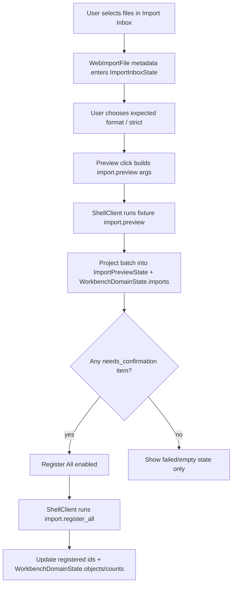

# web-import-inbox design

## 0. 术语约定

| 术语 | 定义 | 防冲突结论 |
|---|---|---|
| Import Inbox | Web 工作台中接收待导入文件、展示 parser preview 批次和确认登记动作的 UI 面板 | 不等同于 parser plugin，也不直接解析文件 |
| Web Import File | 浏览器选择到的文件元信息和可选 storage path / bytes envelope | 不直接穿过 ShellClient，ShellClient 仍只收 JSON-safe args |
| Import Preview Projection | `import.preview` ShellResponse 中的 batch/items/preview/warnings/errors 在前端的只读投影 | 不登记 ChemicalObject |
| Import Registration Action | 对已有 preview batch 执行 `import.register_all` 的 UI 命令入口 | 第一版只支持全量确认，不做对象级勾选 |
| Import Bridge | 浏览器 File/bytes 到 Python core `source_path` 或 HTTP payload 的桥接 | 本 feature 不实现，后续单独 feature 决策 |

术语 grep 结果：Python core 已有 `ImportRegistryWorkflow`、`ParsePreview`、`ImportBatch`、`import.preview` 和 `import.register_all`；Web 侧 `ShellCommandName` 已声明两条 import command，但 fixture transport 尚不支持，UI 也没有 Import Inbox。

## 1. 决策与约束

### 需求摘要

本 feature 目标是让 Web Workbench 出现可操作的 Import Inbox 骨架，并能通过 ShellClient/fixture transport 跑通 preview/register 的前端闭环：

1. 定义前端 `WebImportFile`、`ImportPreviewState`、`ImportInboxState` 和 import command projection 类型。
2. 在 Workbench 中新增 Import Inbox 面板，支持文件选择/批量列表、expected format、strict 选项、preview、register all 和状态清空。
3. fixture transport 支持 `import.preview` / `import.register_all`，返回 JSON-safe batch/items，覆盖 success item、failed item、warning 和 registered ids。
4. UI 原样展示 item status、parser_id、object_count、raw resource path/checksum、warnings 和 errors。
5. 复用 i18n catalog，新增文案同时覆盖 `zh-CN` 和 `en-US`。
6. 保持 WorkbenchDomainState 来自 ShellResponse 投影；preview 成功后更新 imports/counts，register 成功后更新 objects/counts。
7. 真实浏览器桌面/窄屏验证 Import Inbox 不重叠，preview/register 按钮状态可理解。

### 明确不做

- 不实现真实 browser File bytes 到 Python core parser 的桥接；不把浏览器 file path 假装成 Python 可访问路径。
- 不调用真实 `rxnflow.parsers`、cclib、ASE 或 MAPLE parser runtime；fixture transport 只提供前端可验证的 ShellResponse。
- 不新增 HTTP API、local-python-bridge、serverless route、Web Worker、OPFS chunking 或云上传。
- 不登记对象级选择；第一版 register action 等价于 `import.register_all`。
- 不修改 Python core 的 `ImportRegistryWorkflow`、PlatformShellService、parser plugins、ProjectStore 或 Import Ledger schema。
- 不承诺真实 Gaussian/ORCA/MAPLE/XYZ/extxyz 版本完整支持；UI 只展示 core 返回的 parser metadata / warnings / errors。
- 不改变 Project Sidebar、Browser Project Repository、Graph Canvas、Energy/Profile 或 Report Export 行为。

### 复杂度档位

- Frontend state：L2。新增本地 UI state + ShellResponse projection，不引入全局状态库。
- Shell projection：L2。扩展 fixture transport 和前端 DTO，但不新增真实 transport。
- UX：L3。文件选择、批次列表、错误/warning、register 状态和窄屏布局需要同时清晰。
- Core integration：L1。本 feature 不改 Python core。

### 关键决策

1. **先做 UI/投影闭环，不伪造 bytes bridge**：当前 roadmap 已指出 `import.preview` 接受 file path；真实 browser bytes 桥接需要单独决策。前端不应把 `<input type=file>` 的 name/path 当作 core 可读路径。
2. **fixture transport 提供 import preview baseline**：为了让 UI 行为可测，Web 测试用 ShellClient 接收结构化 import batch，后续真实 transport 必须遵守相同投影。
3. **Import Inbox 自有 UI state，Domain state 只收 ShellResponse 结果**：selected files、expected format、strict 和 pending 状态属于 UI；imports/objects/counts 来自 command response projection。
4. **warnings/errors 原样显示**：`missing_section`、`unit_assumed`、`parse_failed` 等 code 不隐藏、不翻译 code，只翻译 UI label。
5. **register all 后刷新工作台投影**：fixture register response 更新 object summaries 和 counts；真实 core 后续可用 `workbench.snapshot` 或 command response 达到同样效果。

### 已确认 / 待确认假设

- 假设 A：第一版 Import Inbox 可以先在 fixture transport 上证明 UI/状态/错误展示；真实 browser bytes bridge 另起 feature。
- 假设 B：首版 register action 只做 all，不需要对象级选择、取消单个 item 或批次编辑。
- 假设 C：expected format 第一版使用手动 select，选项覆盖 `auto`、Gaussian log、ORCA output、XYZ、extxyz、MAPLE output 和 MAPLE xyz；这只是传参 UI，不声明真实支持矩阵。

## 2. 名词与编排

### 2.1 名词层：值对象 / 实体 / 接口契约

**现状**：

- `web/src/shell/types.ts` 只有松散 `ImportBatchSummary`，`items` 为 `JsonValue[]`。
- `fixtureTransport.ts` 只支持 `fixture.run` 和 `workbench.snapshot`。
- `WorkbenchShell.tsx` 中没有 import panel，`WorkbenchUiState.activePanel` 虽含 `"import"` 但未使用。
- `web/src/app/i18n/messages.ts` 没有 import inbox 文案。

**变化**：

新增前端 import UI / projection contract：

```ts
type WebImportFile = {
  id: string
  name: string
  size: number
  mimeType?: string
  lastModified?: number
  storagePath?: string
}

type ImportPreviewItemSummary = {
  id: string
  source_path: string
  status: "needs_confirmation" | "failed" | "registered" | string
  raw_resource?: {
    id: string
    kind: string
    path?: string | null
    checksum?: string | null
  } | null
  preview?: {
    raw_resource_id: string
    parser_id: string
    parser_version: string
    object_count: number
    warnings: ShellWarning[]
  } | null
  registered_object_ids: string[]
  error?: ShellError | null
  warnings: ShellWarning[]
}

type ImportPreviewState = {
  status: "idle" | "selecting" | "previewing" | "ready" | "registering" | "registered" | "error"
  selectedFiles: WebImportFile[]
  expectedFormat: string
  strict: boolean
  activeBatch?: ImportBatchSummary
  registeredObjectIds: string[]
  warnings: ShellWarning[]
  error?: ShellError
}
```

Shell command args 示例：

```ts
shellClient.run({
  command: "import.preview",
  args: {
    session_id: workbenchState.sessionId,
    source_paths: ["inbox/water.xyz", "inbox/bad.xyz"],
    expected_format: "xyz",
    strict: false,
  },
})
```

边界：

- `WebImportFile` 可以保存 browser selected file metadata，但不把 `File`、`Blob`、`ArrayBuffer` 直接传进 ShellClient。
- `source_paths` 第一版在 fixture transport 中作为演示 logical path；真实 source path/bytes resolution 由后续 Import Bridge 决定。
- Import preview item 中的 `error.code`、`warning.code`、`parser_id`、`parser_version`、`raw_resource.path` 原样显示。

### 2.2 编排层：主流程与控制流



**现状**：

- WorkbenchShell 只有 fixture run/invalid command 两个按钮。
- Workbench snapshot 中 `imports` 为空，counts.imports 为 0。
- Project Sidebar 的 file/bundle entry disabled，不承担 raw computational output import。
- 真实 Python `import.preview` 需要 project session + source path；浏览器 file bytes 未桥接。

**变化**：

- 新增 Import Inbox UI 组件，挂在工作台中部 graph workspace 的上方或同一面板内，作为导入操作入口。
- WorkbenchShell 维护 `ImportInboxState`，提供 `onImportFilesSelected`、`onPreviewImport`、`onRegisterImportBatch`、`onClearImportInbox`。
- `fixtureTransport` 新增 `import.preview` / `import.register_all` response，模拟一个 supported preview item、一个 failed item 和 warning/error。
- WorkbenchShell 用 import command response 更新 `workbenchState.imports`、`counts.imports`，register 成功后更新 `objects`、`counts.objects` 和 `counts.imports`。
- i18n catalog 新增 import inbox label、format option、status、warning/error、register copy。
- Tests 覆盖选择文件、preview 成功、failed item、warnings/errors、register all、中文文案和按钮 disabled 状态。

**跨层纪律**：

- Data boundary：selected browser `File` 只作为 UI metadata；真实 bytes 不进入 ShellClient。
- Error visibility：preview/register command 失败显示 ShellError code/message/target。
- Warning visibility：item warnings 和 preview warnings 必须显示 code/message/target，不只显示数量。
- Idempotency：register all 对已 registered batch 在 fixture transport 中可重复调用并返回同一 registered ids。
- Scope guard：不 import Python parser、cclib/ASE、OPFS、cloud SDK 或 routing。
- I18n：新增主 UI 文案必须同时补 `zh-CN` / `en-US`。
- Responsive：文件名、source path、checksum、warning/error message 必须 overflow-wrap，窄屏不横向撑开。

### 2.3 挂载点清单

- `web/src/app/ImportInbox.tsx` / import state helper：新增 Import Inbox 可见 UI 和状态投影；删除后导入面板消失。
- `web/src/app/WorkbenchShell.tsx`：挂载 Import Inbox，并把 preview/register action 编排到 ShellClient 和 WorkbenchDomainState。
- `web/src/shell/types.ts` / `fixtureTransport.ts`：补 import preview/register typed projection 和 fixture command response。
- `web/src/app/i18n/messages.ts`：新增 import inbox 双语文案。
- `web/src/app/workbench.css`：新增 Import Inbox 响应式样式。
- `codestable/architecture/web-workbench.md` / `requirements/web-workbench-shell.md`：acceptance 阶段记录 Import Inbox 当前能力和 bytes bridge 边界。

本 feature 不挂入 Python core、parser plugins、ProjectStore、Import Ledger codec、Browser Project Repository schema、HTTP route、OPFS、cloud storage 或账号系统。

### 2.4 推进策略

1. **Import Projection Types And Fixture Commands**：补 import item/preview/register DTO，fixture transport 支持 `import.preview` / `import.register_all`。
   - 退出信号：ShellClient tests 可得到 JSON-safe preview batch、failed item、warning 和 repeated register ids。
2. **Import Inbox State And UI**：新增 Import Inbox 组件和本地 state，支持 file selection metadata、format/strict、preview/register/clear。
   - 退出信号：component test 能选择两个文件并看到 queued list、按钮状态和 preview batch。
3. **Workbench Integration**：WorkbenchShell 挂载 Import Inbox，preview/register 更新 WorkbenchDomainState imports/objects/counts。
   - 退出信号：preview 后 counts.imports 更新，register 后 objects/counts.objects 更新，fixture graph/workbench 仍可运行。
4. **I18n And Error/Warning Rendering**：新增双语文案，item warning/error/code/target/raw resource metadata 原样展示。
   - 退出信号：英文/中文测试均能查询 Import Inbox 主文案，warning/error code 可见。
5. **Verification And Scope Guard**：跑 Web test/build、Python 单测、真实浏览器桌面/窄屏验证，无 prohibited bridge/cloud/parser scope。
   - 退出信号：`npm run test`、`npm run build`、`python3 -m unittest discover` 通过；browser 无重叠；scope grep 通过。

## 3. 验收契约

### 关键场景清单

1. Import Inbox 首屏可见，显示 selected files empty state、expected format、strict toggle、Preview 和 Register All 按钮。
2. 用户选择多个文件后，UI 展示文件名、size、mime/lastModified 可用信息；动态文件名不翻译。
3. 没有 selected files 时 Preview disabled；没有 needs_confirmation batch 时 Register All disabled。
4. 点击 Preview 时通过 ShellClient 调用 `import.preview`，args 包含 `session_id`、`source_paths`、`expected_format` 和 `strict`。
5. Preview 成功后显示 batch id、item status、parser_id、parser_version、object_count、raw resource path/checksum。
6. Preview item warnings 显示 code、message、target；warning code 不被隐藏或翻译。
7. Preview failed item 显示 error code、message、target。
8. Preview 成功后 WorkbenchDomainState 的 `imports` 和 `counts.imports` 更新。
9. 有 needs_confirmation item 时 Register All enabled。
10. 点击 Register All 时通过 ShellClient 调用 `import.register_all`，args 包含 active batch id。
11. Register 成功后显示 registered object ids，并更新 WorkbenchDomainState 的 `objects` 和 `counts.objects`。
12. repeated register all 不产生前端异常，保持同一 registered ids。
13. 中文 locale 下 Import Inbox 主 UI 文案变为简体中文；parser_id、warning/error code、文件名保持原样。
14. Shell command error 路径显示 error code/message/target。
15. `npm run test` 通过。
16. `npm run build` 通过。
17. `python3 -m unittest discover` 通过。
18. 真实浏览器桌面 viewport 验证文件列表/preview/register/status 无重叠。
19. 真实浏览器窄屏 viewport 验证长文件名、warning/error、按钮不会水平溢出。

### 反向检查

- 不实现真实 browser File bytes 到 Python source path / parser 的桥接。
- 不引入 OPFS、Web Worker、HTTP API、serverless route、cloud storage SDK 或账号系统。
- 不修改 Python `ImportRegistryWorkflow`、PlatformShellService、parser plugins、ProjectStore、Import Ledger schema。
- 不把 fixture preview 描述成真实 Gaussian/ORCA/MAPLE/XYZ/extxyz 完整支持。
- 不隐藏 preview warnings/errors/code/target。
- 不把 Project Sidebar bundle import/export 当作 raw computational output import 来实现。

## 4. 与项目级架构文档的关系

- 本 design 落盘后把 roadmap item `web-import-inbox` 更新为 `in-progress`。
- 实现完成并验收后，`codestable/architecture/web-workbench.md` 应记录 Import Inbox UI、fixture import.preview/register projection、warning/error display、WorkbenchDomainState imports/objects/count 更新，以及真实 browser bytes bridge 仍未实现。
- `codestable/architecture/ARCHITECTURE.md` 应补充 Web Workbench 已包含 Import Inbox，但 Python core import workflow 和 parser plugins 仍是 core 边界。
- `codestable/requirements/web-workbench-shell.md` 应补充用户可在 Web 工作台中看到导入收件箱和 parser preview 投影，但真实浏览器文件解析桥接仍待后续。
- roadmap acceptance 阶段把 `web-import-inbox` 标为 `done`，下一项 `web-object-registry-panel` 保持 planned。
