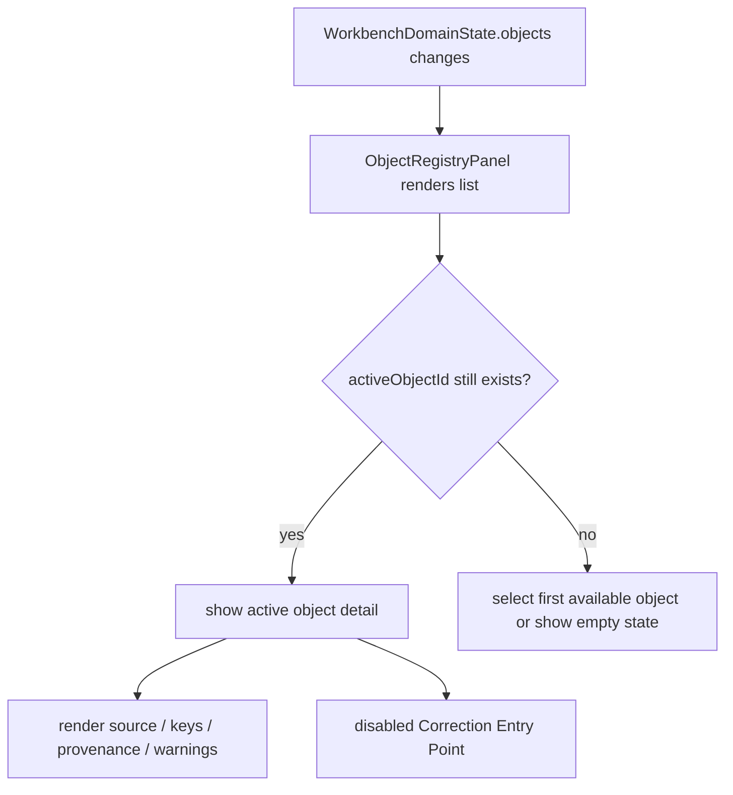

# web-object-registry-panel design

## 0. 术语约定

| 术语 | 定义 | 防冲突结论 |
|---|---|---|
| Object Registry Panel | Web 工作台中展示已登记 ChemicalObject 投影的只读对象面板 | 不等同于 core `ChemicalRegistry` 服务 |
| Object Summary Projection | ShellResponse / WorkbenchDomainState 中面向 UI 扫描的 object summary | 不复制完整 geometry、energy value 或 ChemicalObject dataclass |
| Active Object | UI 中当前被选中查看详情的 object id | 只存在前端 UI state，不写 Project Content |
| Correction Entry Point | 校正项入口按钮/占位 | 本 feature 不写 correction，不调用 `ChemicalRegistry.apply_correction` |
| Object Warning | 与对象或导入来源相关的 warning 投影 | 当前来自 ShellResponse/import preview summary，不由 UI 生成化学诊断 |

术语 grep 结果：core 已有 `ChemicalObject`、`ChemicalRegistry`、`ObjectPaletteItem`；Web 侧当前只有 `ObjectSummary` 的 id/label/source_file_id/energy_keys。roadmap 要求对象面板展示 charge/spin/method/thermochemistry/provenance/warnings 和校正项入口，但当前 Shell `_object_summary` 尚未给出完整字段。

## 1. 决策与约束

### 需求摘要

本 feature 目标是在 Web Workbench 中新增 Object Registry Panel 的可用只读 MVP：

1. 扩展 Web `ObjectSummary` projection，使其可承载 formula、charge、spin_multiplicity、method、thermochemistry_keys、provenance、correction_count 和 warnings。
2. 扩展 fixture transport 中的对象摘要，覆盖 fixture run 和 import register 后的 object list。
3. 新增 Object Registry Panel UI，展示对象列表、active object detail、source_file_id、energy keys、thermochemistry keys、provenance parser/version、warnings 和 correction entry point。
4. 选中对象只改变前端 UI state；不写 Project Content、不改 core registry。
5. 校正项入口第一版显示为 disabled / unavailable，占位给后续 core shell correction feature。
6. 新增 i18n 双语文案，动态 object id、label、parser_id、warning code 不翻译。
7. 浏览器桌面/窄屏验证列表、详情、长 id/source/warning 不水平溢出。

### 明确不做

- 不实现新增/编辑/删除 ChemicalObject。
- 不实现 correction form，不调用 `ChemicalRegistry.apply_correction`，不新增 correction shell command。
- 不展示完整 geometry 坐标、energy numeric values、thermochemistry numeric values 或 3D viewer。
- 不从 Import Preview pending/failed item 直接创建对象；只展示 `WorkbenchDomainState.objects` 中已登记对象。
- 不修改 Python core ChemicalRegistry、ChemicalObject codec、Project Content schema 或 parser plugins。
- 不把 UI 内 selection 写入 Project Content；Object Panel selection 是前端 UI-only。
- 不实现 Graph Canvas drag/drop；对象拖入画布留给 `web-graph-canvas-mvp`。

### 复杂度档位

- Frontend state：L2。新增 active object selection 和只读 detail，不引入全局状态库。
- Projection：L2。扩展前端 DTO 和 fixture summary，暂不改 Python core summary。
- UX：L3。对象列表、详情、warnings、disabled correction entry 和窄屏布局需要可扫描。
- Core integration：L1。本 feature 不改 Python core。

### 关键决策

1. **先扩展 Web projection，不改 Python core `_object_summary`**：当前 Web 仍使用 fixture transport；真实 core summary 扩展应在后续真实 bridge 或 projection enhancement 中做，避免本 UI feature 修改 Python contract。
2. **Object Registry Panel 只读**：已登记对象来自 `WorkbenchDomainState.objects`；UI 不生成 ChemicalObject、不修正 registry。
3. **Active Object 是 UI-only**：选择对象用于详情面板，不写 ShellResponse/Project Content。
4. **Correction 入口 disabled**：保留产品路径和信息架构，但不假装已支持校正项写入。
5. **动态化学数据原样显示**：object id、label、energy key、parser id/version、warning code 不翻译。

### 已确认 / 待确认假设

- 假设 A：第一版对象详情可基于 summary projection，不需要完整 geometry/energy value。
- 假设 B：correction entry point 先用 disabled 占位可接受；真正写 correction 需要独立 shell command/feature。
- 假设 C：对象面板应该出现在右侧 inspector 或中间工作流中；本 feature 优先放在右侧 inspector，以服务高频扫描和后续 graph canvas 从中读取对象列表。

## 2. 名词与编排

### 2.1 名词层：值对象 / 实体 / 接口契约

**现状**：

- `web/src/shell/types.ts` 的 `ObjectSummary` 只有 `id`、`label`、`source_file_id`、`energy_keys`。
- `fixtureTransport.ts` 对象摘要只给 `electronic` energy key。
- `ProjectSidebar` 只展示 objects count，不显示对象列表。
- `InspectorPanel` 显示 command/profile/status，没有 object registry。
- core `ObjectPaletteItem` 已有 formula/charge/spin/method/source_file_id/energy_keys，但 Web snapshot object summary 尚未对齐。

**变化**：

扩展前端只读投影：

```ts
type ObjectSummary = {
  id: string
  label?: string | null
  formula?: string | null
  charge?: number | null
  spin_multiplicity?: number | null
  method?: string | null
  source_file_id?: string | null
  energy_keys?: JsonValue[]
  thermochemistry_keys?: JsonValue[]
  provenance?: {
    source_file_id: string
    parser_id: string
    parser_version: string
    parsed_at?: string | null
  } | null
  correction_count?: number
  warnings?: ShellWarning[]
}
```

新增 UI state：

```ts
type ObjectRegistryPanelState = {
  activeObjectId?: string
}
```

边界：

- `ObjectSummary` 是 UI summary，不是 ChemicalObject 完整持久化格式。
- `warnings` 是 summary 投影；UI 不做化学规则诊断。
- correction entry point 只显示 disabled action 和 correction_count。

### 2.2 编排层：主流程与控制流



**现状**：

- `Fixture Run` 后 WorkbenchDomainState.objects 有两个 fixture objects，但 UI 只用 objects count 和 graph placeholder 展示。
- `Import Inbox register_all` 后 WorkbenchDomainState.objects 合并 imported object，但 UI 只显示 registered id 和 count。
- 没有 active object selection。

**变化**：

- 新增 `ObjectRegistryPanel` 组件，接收 `objects`、`activeObjectId`、`onSelectObject`。
- WorkbenchShell 维护 `activeObjectId`；objects 变化时如果 active id 不存在，则自动选择第一个 object；objects 为空时显示 empty state。
- InspectorPanel 或右侧区域挂载 Object Registry Panel，并保留 command/profile/status。
- fixture object summaries 补 formula、charge、spin、method、provenance、thermochemistry_keys、correction_count 和 warnings。
- register imported object 后，Object Registry Panel 列表出现 imported object，用户可查看其 source/provenance/energy keys。

**跨层纪律**：

- Read-only：Object Registry Panel 不调用 ShellClient、不写 registry、不保存 project。
- Projection boundary：只读 `WorkbenchDomainState.objects`，不从 import pending item 或 graph node 反推 ChemicalObject。
- I18n：静态 label 文案进 catalog；动态 object 数据原样。
- Selection：active object 是 UI-only state；刷新/snapshot 可重置，不承诺持久化。
- Responsive：object id/source/provenance/warning 必须 overflow-wrap；列表和详情在窄屏纵向堆叠。

### 2.3 挂载点清单

- `web/src/app/ObjectRegistryPanel.tsx` / optional state helper：新增对象面板可见 UI 和 selection 行为。
- `web/src/app/WorkbenchShell.tsx`：维护 active object selection，并在 inspector 挂载对象面板。
- `web/src/shell/types.ts` / `fixtureTransport.ts`：扩展 ObjectSummary projection 和 fixture object metadata。
- `web/src/app/i18n/messages.ts`：新增对象面板双语文案。
- `web/src/app/workbench.css`：新增对象列表/详情/disabled correction entry 响应式样式。
- `codestable/architecture/web-workbench.md` / `requirements/web-workbench-shell.md`：acceptance 阶段记录 Object Registry Panel 当前能力和只读边界。

本 feature 不挂入 Python core、ChemicalRegistry、parser plugins、Project Content codec、Graph Canvas、Energy Engine 或 Report Export。

### 2.4 推进策略

1. **Object Projection Enrichment**：扩展 Web ObjectSummary type 和 fixture objects metadata。
   - 退出信号：ShellClient/workbench tests 仍能读取 objects，fixture/imported object 带 formula/charge/spin/method/provenance。
2. **Object Registry Panel UI**：新增对象列表、empty state、active object detail、source/keys/provenance/warnings/correction entry。
   - 退出信号：component test 能看到 fixture objects、选择对象、查看详情和 disabled correction entry。
3. **Workbench Integration**：WorkbenchShell 维护 active object id，并在 objects 更新后保持或修正 selection。
   - 退出信号：fixture run 后自动选择第一个 object；import register 后 imported object 出现在列表且可选。
4. **I18n And Responsive Styling**：新增双语文案和对象面板响应式样式。
   - 退出信号：中文测试覆盖主文案，长 id/source/warning 不撑破布局。
5. **Verification And Scope Guard**：跑 Web test/build、Python 单测、真实浏览器桌面/窄屏验证。
   - 退出信号：`npm run test`、`npm run build`、`python3 -m unittest discover` 通过；scope grep 未触碰 core registry/correction。

## 3. 验收契约

### 关键场景清单

1. 首屏无对象时 Object Registry Panel 显示 empty state，correction entry disabled。
2. 运行 Fixture 后对象面板显示 Object A / Object B 列表和对象总数。
3. 有对象时自动选中第一个对象，详情显示 id、label、source_file_id、energy keys。
4. 详情显示 formula、charge、spin_multiplicity、method；缺失字段显示 unavailable。
5. 详情显示 provenance parser_id、parser_version、source_file_id、parsed_at 可用信息。
6. 详情显示 thermochemistry keys 和 correction_count；校正项入口 visible but disabled。
7. 点击另一个对象只改变 active object detail，不调用 ShellClient。
8. Import Inbox register all 后 imported object 出现在对象列表，并可选中查看 source/provenance/energy key。
9. Object warnings 显示 warning code/message/target，不被隐藏或翻译。
10. 中文 locale 下对象面板静态文案变为简体中文；object id、label、parser_id、warning code 保持原样。
11. 不从 pending/failed import item 生成对象卡片；只展示 WorkbenchDomainState.objects。
12. 不实现 correction form 或 registry write；disabled correction entry 不触发 Shell command。
13. `npm run test` 通过。
14. `npm run build` 通过。
15. `python3 -m unittest discover` 通过。
16. 真实浏览器桌面 viewport 验证对象列表/详情无重叠。
17. 真实浏览器窄屏 viewport 验证长 object id/source/provenance/warning 无水平溢出。

### 反向检查

- 不修改 Python ChemicalRegistry、ChemicalObject codec、Project Content schema、parser plugins 或 Energy Engine。
- 不新增 correction shell command、HTTP API、cloud SDK 或账号系统。
- 不把 Object Registry Panel 当作 Graph Canvas object drag/drop 实现。
- 不显示 pending/failed import preview item 为已登记对象。
- 不翻译 object id、label、source_file_id、energy key、parser id/version 或 warning/error code。

## 4. 与项目级架构文档的关系

- 本 design 落盘后把 roadmap item `web-object-registry-panel` 更新为 `in-progress`。
- 实现完成并验收后，`codestable/architecture/web-workbench.md` 应记录 Object Registry Panel 当前只读能力、ObjectSummary projection、UI-only active object selection 和 correction entry disabled 边界。
- `codestable/architecture/ARCHITECTURE.md` 应补充 Web Workbench 已包含 Object Registry Panel，但 core ChemicalRegistry / corrections 仍在 core 边界。
- `codestable/requirements/web-workbench-shell.md` 应补充用户可查看已登记对象列表和详情，校正写入仍未实现。
- roadmap acceptance 阶段把 `web-object-registry-panel` 标为 `done`，下一项 `web-graph-canvas-mvp` 保持 planned。
