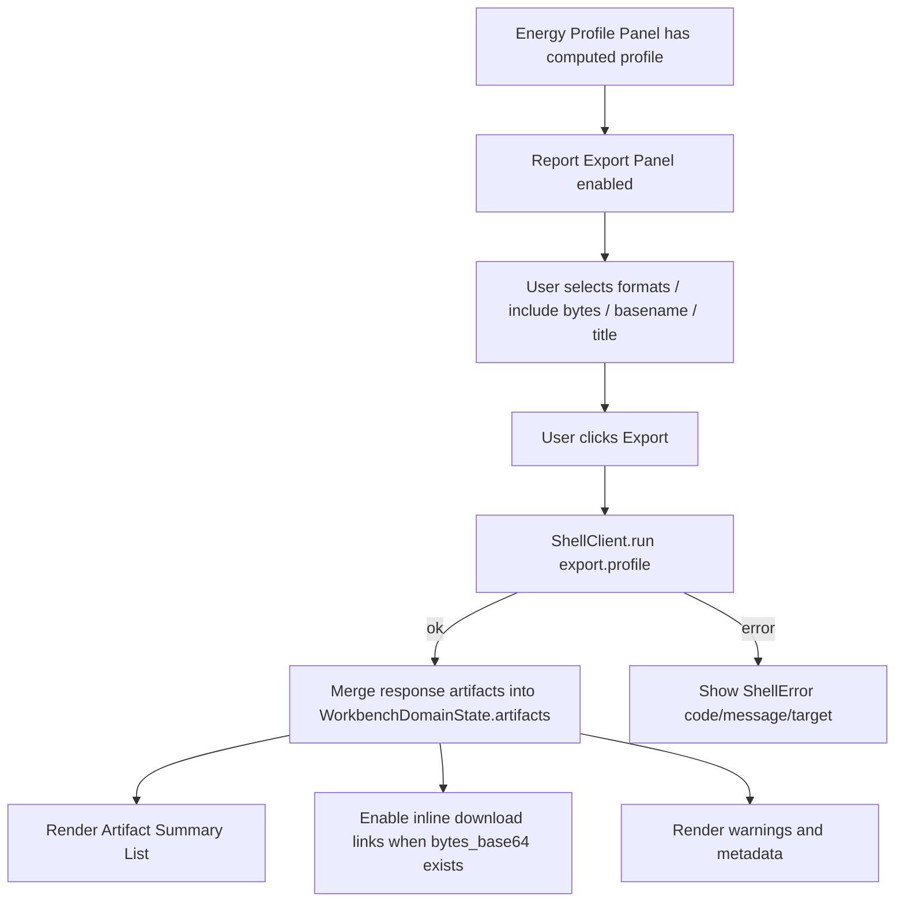

# web-report-export-panel design

## 0. 术语约定

| 术语 | 定义 | 防冲突结论 |
|---|---|---|
| Report Export Panel | Web 工作台右侧 inspector 中触发 profile 导出的面板 | 不等同于 core `ReportExportService` |
| Export Profile Command | Web UI 通过 ShellClient 提交的 `export.profile` 命令 | 前端不生成 PNG/CDXML/XLSX |
| Export Format Selection | PNG、CDXML、XLSX 三个 checkbox / toggle 的 UI-only 选择 | 直接映射 roadmap `ExportProfileArgs.formats` |
| Inline Artifact Download | 基于 ShellArtifact `bytes_base64` 在浏览器创建的下载链接 | 不写 Browser Project Repository |
| Artifact Summary List | Web 中展示 id、format、path、inline/persisted 和 metadata 的 artifact 列表 | 不等同于 Project Content `export-artifacts-v1` |
| Export Options | formats、include bytes、basename、title 的 UI 输入 | 不包含 destination_dir 第一版 |

术语 grep 结果：core 已有 `ReportExportService`、`ExportArtifact`、`ShellArtifact`、`export.profile`、`ExportArtifactRecord`；Web 侧当前只有 `ShellArtifact` / `WorkbenchArtifactSummary` 类型和 command status artifact count，没有 Report Export Panel。该 feature 新增 Web UI 面板和 fixture command，不改 core export service。

## 1. 决策与约束

### 需求摘要

本 feature 目标是在 Web Workbench 中补齐能量剖面后的导出闭环：

1. 扩展 Web shell DTO，增加 `ExportProfileData` 和可供 UI 使用的 artifact projection helper 类型。
2. 扩展 fixture transport 支持 `export.profile`，按 formats 返回 JSON-safe `ShellArtifact[]`，支持 inline bytes 和 missing profile / missing format 错误。
3. 新增 Report Export Panel，提供 PNG/CDXML/XLSX 选择、include bytes、basename、title 和 Export 按钮。
4. 点击 Export 后调用 ShellClient `export.profile`，成功后把 response artifacts 合并进 `WorkbenchDomainState.artifacts` 并更新 `counts.artifacts`。
5. 展示 artifact id、format、path、inline bytes 状态、metadata，以及 bytes inline 时的浏览器下载链接。
6. 新增 `zh-CN` / `en-US` 双语文案；artifact id、format、path、metadata key、warning/error code 原样显示。
7. 浏览器桌面/窄屏验证 Report Export Panel、artifact list、download link 和 command status 不重叠且无水平溢出。

### 明确不做

- 不修改 Python `ReportExportService`、PNG/CDXML/XLSX writer、CDXML schema、XLSX 表格模板或 Export Artifact codec。
- 不在前端生成 PNG/CDXML/XLSX bytes；前端只处理 ShellArtifact projection。
- 不调用 `project.save_content`，不把 runtime artifact 转为长期 ExportArtifactRecord。
- 不把 artifact bytes 写入 Browser Project Repository，不实现 `exports/...` browser storage。
- 不接 file picker、File System Access API、OPFS、JSZip、云存储、账号或同步。
- 不实现报告预览渲染、ChemDraw 编辑器、CDX、PDF、PPTX、SVG 或 CSV。
- 不传 `destination_dir`；Web 第一版只走 `include_bytes=true` 的 inline download path。
- 不翻译 artifact id、format、path、metadata key/value、warning/error code 或底层 error message。

### 复杂度档位

- Frontend orchestration：L3。需要基于当前 session/profile 组装 `export.profile` args，处理 success/error/warnings/artifacts。
- Fixture transport：L2。新增 fixture export command，覆盖 multiple formats、inline bytes、missing profile 和 missing formats。
- UX：L3。右侧 inspector 要展示多格式选择、artifact metadata、download 链接和窄屏布局。
- Core integration：L1。本 feature 不改 Python core，只对齐已有 shell command contract。

### 关键决策

1. **导出权威仍在 ShellClient**：Report Export Panel 只提交 `export.profile`，成功后使用 response artifacts 更新 WorkbenchDomainState。
2. **默认 include bytes**：Web 第一版默认 `include_bytes=true`，因为没有 destination_dir 和 browser exports 存储；下载链接只在 artifact 带 `bytes_base64` 时启用。
3. **format 选择至少一项**：UI 保持至少一个 format selected；fixture 也返回 missing formats error，覆盖防御路径。
4. **artifact merge 只按 id 去重**：重复导出同一 artifact id 时用最新 projection 覆盖旧 projection，不创建重复列表项。
5. **metadata 原样展示**：metadata keys/values 都是 shell projection，不在 UI 中解释化学/导出语义。

## 2. 名词与编排

### 2.1 名词层：值对象 / 实体 / 接口契约

**现状**：

- roadmap 第 4.7 已定义 `ExportProfileArgs`：`session_id`、`formats`、`destination_dir`、`basename`、`title`、`include_bytes`。
- `web/src/shell/types.ts` 已有通用 `ShellArtifact` 和 `WorkbenchArtifactSummary`，但没有 `ExportProfileData`。
- `WorkbenchDomainState.artifacts` 只来自 snapshot，目前 UI 只显示 artifact count。
- `PlatformShellService._run_export_profile` 返回 `ShellResponse.artifacts`，并在 data 中返回 profile summary / artifact_count。

**变化**：

新增 Web export command data 类型：

```ts
type ExportFormat = "png" | "cdxml" | "xlsx"

type ExportProfileData = JsonObject & {
  command: "export.profile"
  session_id: string
  profile?: EnergyProfileSummary
  artifact_count: number
}
```

新增 UI-only state：

```ts
type ReportExportOptions = {
  formats: ExportFormat[]
  includeBytes: boolean
  basename: string
  title: string
}
```

边界：

- `ShellArtifact` 是 runtime projection，不等同于长期 `ExportArtifactRecord`。
- `WorkbenchArtifactSummary` 仍用于 snapshot / persisted summary；本 feature 成功后把 runtime `ShellArtifact` 转成 Web summary 存入 `WorkbenchDomainState.artifacts`。
- `bytes_base64` 只用于浏览器下载链接；下载文件名来自 `basename + format` fallback，不写 repository。

### 2.2 编排层：主流程与控制流



**现状**：

- Energy Profile Panel 已能产生 active profile projection。
- Web shell types 已有 `ShellArtifact`，但 fixture transport 不支持 `export.profile`。
- Workbench UI 没有导出面板，只有 command status 中的 artifact count。

**变化**：

- `WorkbenchShell` 新增 `runReportExport` handler，读取 `sessionId`、active profile 和 Report Export options，调用 `export.profile`。
- Export 成功后把 `response.artifacts` 转成 `WorkbenchArtifactSummary[]` 并按 id merge 到 `WorkbenchDomainState.artifacts`，更新 `counts.artifacts` 和 warnings。
- `ReportExportPanel` 展示 options、Export 按钮、artifact list、metadata、warnings 和 inline download link。
- `fixtureTransport` 支持 `export.profile`，无 session 返回 `invalid_input/session_id`，无 active profile 返回 `invalid_input/profile_id`，无 formats 返回 `invalid_input/formats`。

**跨层纪律**：

- Command authority：artifact 只来自 ShellResponse，不在前端生成文件 bytes。
- Persistence boundary：不调用 `project.save_content`，不写 Browser Project Repository。
- Download boundary：只有 `bytes_base64` 存在时显示 download link；没有 bytes 时显示不可下载状态。
- Error visibility：`export.profile` 失败写入 `WorkbenchDomainState.error`，显示 error code/message/target。
- Responsive：artifact id/path/metadata 长文本允许换行或内部滚动，但页面不能整体水平溢出。

### 2.3 挂载点清单

- `web/src/shell/types.ts` / `fixtureTransport.ts`：新增 export profile command data、fixture `export.profile` 和 artifact projection。
- `web/src/app/ReportExportPanel.tsx`：新增导出面板 UI、format controls、artifact list、metadata 和 download link。
- `web/src/app/WorkbenchShell.tsx`：新增 report export options state、export handler，并把 panel 挂到右侧 inspector。
- `web/src/app/i18n/messages.ts`：新增 Report Export Panel 双语文案。
- `web/src/app/workbench.css`：新增 report export panel、format controls、artifact list 和 responsive 样式。
- `codestable/architecture/web-workbench.md` / `requirements/web-workbench-shell.md`：acceptance 阶段记录导出面板当前能力和边界。

本 feature 不挂入 Python Report Export、Project Content codec、Browser Project Repository write path、Project Bundle、HTTP/cloud/账号系统。

### 2.4 推进策略

1. **Export Projection And Fixture Command**：扩展 Web shell DTO 和 fixture transport，支持 `export.profile` success/error/inline bytes paths。
   - 退出信号：ShellClient tests 能调用 `export.profile`，返回 JSON-safe PNG/CDXML/XLSX artifacts；missing formats/profile 返回结构化错误。
2. **Report Export Panel UI Skeleton**：新增 Report Export Panel，显示 format selection、include bytes、basename/title、empty state 和 artifact list。
   - 退出信号：Workbench tests 能看到导出面板、format controls、artifact metadata 和 inline download state。
3. **Command Integration**：WorkbenchShell 编排 `export.profile`，成功后合并 artifacts/counts，失败时显示 shell error。
   - 退出信号：测试能点击 Export，artifact count/list 更新；无 session/profile 或无 formats 时 export disabled/error 可见。
4. **I18n And Responsive Styling**：新增双语文案和响应式样式，长 artifact id/path/metadata 不撑破布局。
   - 退出信号：中文测试覆盖主文案；桌面/窄屏浏览器无水平溢出。
5. **Verification And Scope Guard**：跑 Web test/build、Python 单测、真实浏览器桌面/窄屏验证和范围 grep。
   - 退出信号：`npm run test`、`npm run build`、`python3 -m unittest discover` 通过；scope grep 未触碰 core export/project save/browser repository write/cloud。

## 3. 验收契约

### 关键场景清单

1. 首屏无 session / profile 时 Report Export Panel 显示可见空态，Export disabled。
2. Fixture Run 后 Report Export Panel 可见，默认选中 PNG/CDXML/XLSX，include bytes 默认开启。
3. 点击 Export 调用 `export.profile`，成功后展示 3 个 artifacts，artifact count 更新。
4. Artifact list 显示 format、id、path、inline/persisted 状态和 metadata。
5. `bytes_base64` 存在时显示 download link，link 使用 data URL 或 Blob URL，download filename 包含 basename 和 format。
6. include bytes 关闭后导出仍显示 artifacts，但 download link disabled / unavailable。
7. basename 和 title 输入按原样进入 command args；UI 不解释导出标题或文件命名规则。
8. 取消全部 format 时 Export disabled；fixture missing formats error 可由 ShellClient test 覆盖。
9. 缺失 session / profile 的 `export.profile` error 显示 error code/message/target。
10. ShellResponse warnings 可见，不吞掉。
11. 中文 locale 下 Report Export Panel 静态文案变为简体中文；artifact id、format、path、metadata key、warning/error code 保持原样。
12. 不直接 mutate workspace graph、objects、imports、profile 或 Browser Project Repository。
13. 不调用 `project.save_content`。
14. 不修改 Python ReportExportService、writer、ExportArtifact codec、Project Content codec 或 Project Bundle。
15. `npm run test` 通过。
16. `npm run build` 通过。
17. `python3 -m unittest discover` 通过。
18. 真实浏览器桌面 viewport 验证 options、artifact list、download link 和 warnings 无重叠。
19. 真实浏览器窄屏 viewport 验证长 artifact id/path/metadata 无水平溢出。

### 反向检查

- 不在前端生成 PNG/CDXML/XLSX bytes。
- 不把 artifact bytes 写入 Browser Project Repository。
- 不新增 file picker、File System Access API、OPFS、JSZip、云存储或账号系统。
- 不实现报告预览、ChemDraw 编辑器、CDX、PDF、PPTX、SVG 或 CSV。
- 不翻译 artifact id、format、path、metadata key/value、warning/error code。

## 4. 与项目级架构文档的关系

- 本 design 落盘后把 roadmap item `web-report-export-panel` 更新为 `in-progress`。
- 实现完成并验收后，`codestable/architecture/web-workbench.md` 应记录 Report Export Panel、fixture `export.profile`、artifact list、inline download 和 UI-only options 边界。
- `codestable/architecture/ARCHITECTURE.md` 应补充 Web Workbench 已包含命令驱动的 Report Export Panel，但导出生成仍在 core Report Export Service。
- `codestable/requirements/web-workbench-shell.md` 应补充用户可从 active profile 导出 PNG/CDXML/XLSX artifacts 并下载 inline bytes。
- roadmap acceptance 阶段把 `web-report-export-panel` 标为 `done`，下一项为 `web-workbench-e2e-qa`。
