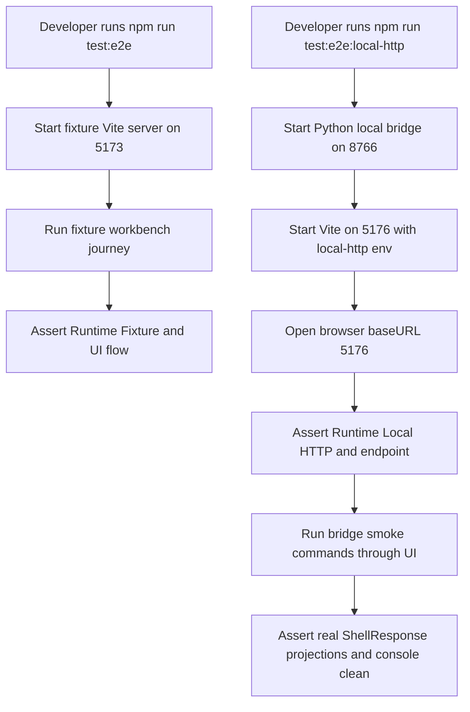

# web-runtime-bridge-qa design

## 0. 术语约定

| 术语 | 定义 | 防冲突结论 |
|---|---|---|
| Bridge QA Harness | 围绕 local HTTP bridge、Web http-api transport 和浏览器 smoke 的回归验证集合 | roadmap 已定义；不是新的产品 runtime |
| Fixture E2E Mode | 默认 `npm run test:e2e`，Vite 不设置 local-http env，Web 使用 `in-process-test` fixture transport | 继续作为默认 Web UI 编排回归 |
| Local HTTP E2E Mode | 新增的独立 Playwright 模式，同时启动 Python bridge 和带 local-http env 的 Vite dev server | 只服务本地开发 QA，不改变默认 runtime |
| Runtime Mode Isolation | fixture 和 local-http 的 server、env、baseURL、测试文件和断言互不污染 | 防止默认 fixture 回归被真实 bridge 依赖拖慢或拖挂 |
| Bridge Smoke Scenario | 浏览器中确认 `Runtime Local HTTP`、`fixture.run -> workbench.snapshot`、inline import preview、项目内容 open/save 与 export persistence 能经 bridge 跑通 | 收敛真实 bridge 主链路，不替代每个 feature 的单元测试 |
| Bridge Unavailable Smoke | local-http transport 在 bridge 不可达时返回 `transport_unavailable` 并由 UI 显示错误 | 只验证错误语义，不实现自动重连或启动 bridge |

术语 grep 结果：当前代码已有 `Local HTTP Shell Bridge`、`http-api` transport、`Runtime Indicator`、`Web E2E QA Harness` 和默认 `test:e2e`。还没有独立的 local-http Playwright config / script；默认 E2E 只覆盖 fixture mode。

## 1. 决策与约束

### 需求摘要

本 feature 把 runtime bridge 的回归验证固定成可重复命令。默认 `npm run test:e2e` 继续只跑 fixture 模式；新增 local-http E2E 模式独立启动 `rxnflow.local_bridge` 和 Vite，并在真实浏览器里验证 Web 页面确实通过 HTTP bridge 调用 Python `PlatformShellService`。同时补齐 bridge contract 与 Web transport 的边界测试，让 payload 过大、CORS local origin、HTTP 错误 shell response、bridge 不可达等行为有自动化证据。

### 明确不做

- 不新增 Web 用户功能、UI 面板、导出格式或 parser 支持声明。
- 不改变默认 runtime；没有 bridge server 时默认 Web 仍应使用 fixture transport。
- 不把 local HTTP bridge 变成生产公网服务，不新增认证、权限、TLS、云存储或 Vercel route。
- 不实现自动寻找空端口、长期后台 daemon、自动重连或 GUI 启停 bridge。
- 不把 local-http E2E 混入默认 fixture E2E，不要求普通前端 UI smoke 依赖 Python bridge。
- 不新增大文件 chunking、OPFS、browser_storage adapter、Service Worker 或 Worker pool。
- 不修改核心 parser、registry、graph、energy、export 领域算法。

### 复杂度档位

- QA orchestration：L2。需要新增一个独立 Playwright 配置，管理 Python bridge 和 local-http Vite server 的启动顺序。
- Python contract：L1。补现有 HTTP bridge 边界测试，不改 bridge API 形状。
- Web transport：L1。补 `http-api` response normalization 和 unavailable 语义测试，不改 ShellTransport contract。
- Browser smoke：L2。复用现有 workbench helper，覆盖桌面主链路和错误态，保持 fixture/local-http 测试隔离。
- Docs / workflow：L1。更新架构和需求中的 QA 命令与边界，不新增长期决策。

### 关键决策

1. **新增独立命令而不是改默认 E2E**：默认 `npm run test:e2e` 继续使用 `http://127.0.0.1:5173/` 和 fixture runtime；local-http QA 使用单独 script 与 Playwright config。
2. **固定本地 QA 端口**：local-http E2E 使用固定 bridge/dev server 端口，便于 agent 和开发者复现；端口冲突由 Playwright webServer 报告，不在本 feature 做动态端口协调。
3. **多 webServer 启动真实依赖**：Playwright local-http config 同时启动 Python bridge 和 Vite，Vite 通过 `VITE_RXNFLOW_SHELL_TRANSPORT=local-http` 与 endpoint env 绑定到 bridge。
4. **只做 smoke，不复制全部 fixture journey**：local-http 浏览器测试覆盖 bridge 主链路与模式身份，不把 fixture E2E 的所有布局/交互断言逐字复制。
5. **失败语义以 ShellResponse 为准**：bridge 或 fetch 层失败统一显示 `transport_unavailable`；Python core 返回的领域错误保持原样穿透。
6. **显式选择 bridge Python 解释器**：local-http E2E bridge 优先使用 `RXNFLOW_E2E_PYTHON`，其次使用 `CONDA_PREFIX/bin/python3`，最后才回退到 `python3`，避免 Playwright shell path 与开发者验证环境不一致导致 Pillow / XlsxWriter 等导出依赖缺失。

## 2. 名词与编排

### 2.1 名词层：值对象 / 接口契约

**现状**：

- `rxnflow.local_bridge` 已提供 `GET /health`、`POST /api/shell`、CORS local origin、payload size limit 和 ShellResponse-shaped errors。
- `web/src/shell/httpTransport.ts` 已提供 `createHttpShellTransport({ endpoint, timeoutMs, fetchImpl })`，失败时返回 `transport_unavailable`。
- `web/playwright.config.ts` 只配置默认 fixture E2E，`web/package.json` 只有 `test:e2e`。
- `web/e2e/workbench-helpers.ts` 的 helper 默认按英文 UI 与 fixture projection 编写，可被 local-http smoke 部分复用。

**变化**：

新增 QA 契约：

```ts
type WebRuntimeQaMode = "fixture-e2e" | "local-http-e2e"

type LocalHttpE2EPorts = {
  bridge: 8766
  vite: 5176
}
```

新增行为：

- `npm run test:e2e` 仍只运行 fixture mode。
- `npm run test:e2e:local-http` 运行 local-http Playwright config，启动：
  - `PYTHONPATH=<repo> <resolved-python> -c "from rxnflow.local_bridge import serve_local_bridge; serve_local_bridge('127.0.0.1', 8766)"`
  - `VITE_RXNFLOW_SHELL_TRANSPORT=local-http VITE_RXNFLOW_SHELL_ENDPOINT=http://127.0.0.1:8766/api/shell npm run dev -- --host 127.0.0.1 --port 5176`
- `<resolved-python>` 的选择顺序是 `RXNFLOW_E2E_PYTHON`、`CONDA_PREFIX/bin/python3`、`python3`。
- local-http spec 断言 runtime badge/title 指向 bridge endpoint，并通过 UI 执行真实 bridge smoke。
- Python contract tests 补齐 payload size / CORS 这类 HTTP 边界。
- Web transport tests 补齐 endpoint missing、HTTP status 与 ShellResponse shape 的隔离语义。

### 2.2 编排层：主流程与控制流



**跨层纪律**：

- Playwright local-http config 是 QA 入口，不进入 production runtime path。
- Fixture E2E 和 local-http E2E 使用不同 baseURL 与测试文件，避免测试数据和 server env 交叉污染。
- Browser storage reset 继续只清当前 test context 的 IndexedDB/localStorage，不影响用户真实浏览器 profile。
- local-http smoke 不绕过 UI 直接 import Python core；浏览器必须通过 Web ShellClient 和 `http-api` transport 调 bridge。
- Python bridge contract 继续返回 JSON-safe ShellResponse；测试不能依赖 traceback 或非 JSON body。

### 2.3 挂载点清单

- `tests/test_local_http_shell_bridge.py`：补 bridge contract 缺口，尤其 CORS local origin、preflight 与 payload size error。
- `web/src/shell/ShellClient.test.ts`：补 http-api transport normalization 的边界断言。
- `web/playwright.local-http.config.ts`、`web/e2e/local-http-bridge.spec.ts`、`web/package.json`：新增独立 local-http E2E mode 和 smoke spec。
- `web/e2e/workbench-helpers.ts`：仅在需要时抽出可复用 helper，不改变默认 fixture journey 语义。
- `codestable/architecture/*`、`requirements/*`、roadmap/checklist：验收后同步 QA 命令、模式隔离和当前能力边界。

### 2.4 推进策略

1. **Contract and transport guard tests**：补 Python bridge HTTP 边界与 Web http-api response normalization 测试。
   - 退出信号：单元测试覆盖 CORS local origin、payload_too_large、endpoint missing、HTTP non-ok + ShellResponse 的可观察语义。
2. **Local HTTP E2E harness**：新增独立 Playwright config 和 npm script，固定启动 bridge 与 local-http Vite。
   - 退出信号：命令 `npm run test:e2e:local-http -- --list` 能只发现 local-http spec，默认 `test:e2e` 不包含它。
3. **Bridge smoke browser flow**：新增 local-http browser smoke，验证 runtime badge、fixture.run/snapshot、inline import preview、project content bridge 和 export persistence。
   - 退出信号：local-http smoke 在真实 Chromium 通过，console clean、无水平溢出，且能看到真实 `xyz-ase` preview 与 persisted artifacts。
4. **Bridge unavailable smoke**：覆盖 local-http endpoint 不可达时 `transport_unavailable` 能被 UI 展示，不污染默认 fixture mode。
   - 退出信号：组件或浏览器测试证明 fetch failure 显示 `transport_unavailable` / `http-api`。
5. **Docs and workflow closure**：更新 architecture、requirement、roadmap/checklist，并跑完整验证命令。
   - 退出信号：Python unittest、Web Vitest、build、fixture E2E、local-http E2E、YAML validation 与浏览器验证通过或记录明确 fallback 原因。

## 3. 验收契约

### 关键场景清单

1. 默认 `npm run test:e2e` 仍使用 fixture runtime，能看到 `Runtime Fixture`，且不要求 Python bridge server。
2. 新增 `npm run test:e2e:local-http` 会启动 local bridge 与 local-http Vite，浏览器页面显示 `Runtime Local HTTP`，title/endpoint 指向 `http://127.0.0.1:8766/api/shell`。
3. local-http browser smoke 点击 `Fixture Run` 后通过真实 bridge 得到 `Fixture Minimal Reaction`、2 个 objects、workspace graph 和 profile projection。
4. local-http browser smoke 选择小 `water.xyz` 后使用 inline bytes preview，返回 `xyz-ase` parser preview，而不是 fixture-only `import-batch-fixture-web-1` 断言。
5. local-http browser smoke 可创建 browser-local project，显式 Open Bridge / Save Bridge Session 不报错，Project Sidebar 显示 bridge/open/save 状态。
6. local-http browser smoke 可计算 energy profile 并导出 PNG/CDXML/XLSX inline artifacts，active browser project 下显示 persisted path/checksum。
7. bridge contract tests 覆盖 CORS local origin / OPTIONS preflight、payload_too_large 和 ShellResponse-shaped error body。
8. Web http-api transport tests 覆盖 endpoint missing、fetch failure、malformed response、HTTP non-ok shell error 穿透和 HTTP non-ok ok-response normalization。
9. local-http endpoint 不可达时，Web 层可观察到 `transport_unavailable` 且 target 为 `http-api`。
10. fixture 与 local-http 两套 E2E 的 baseURL、server env、测试文件互相隔离；local-http spec 不进入默认 `test:e2e`。
11. `python3 -m unittest discover`、`npm run test`、`npm run build`、`npm run test:e2e`、`npm run test:e2e:local-http` 通过，浏览器无空白、无 framework overlay、无相关 console error。

### 反向检查

- 不新增 Web 用户功能、UI 面板、导出格式或 parser 支持声明。
- 不改变默认 runtime，不让普通 Web dev server 依赖 Python bridge。
- 不把 local HTTP bridge 改造成生产公网服务，不新增认证、权限、TLS、云存储或 Vercel route。
- 不实现自动端口发现、后台 daemon、自动重连或 GUI 启停 bridge。
- 不实现大文件 chunking、OPFS、browser_storage adapter、Service Worker 或 Worker pool。
- 不修改核心 parser、registry、graph、energy、export 领域算法。

## 4. 与项目级架构文档的关系

- 验收后 `web-workbench.md` 应记录 Web E2E QA Harness 已拆成 fixture mode 与 local-http mode，并列出两个 npm 命令。
- `ARCHITECTURE.md` 应补充 Bridge QA Harness 的当前能力和 local-http E2E 隔离边界。
- `web-workbench-shell.md` 应把 local-http bridge smoke 纳入“可重复真实浏览器回归命令”的现状，但仍说明它不是完整真实 parser/产品验收。
- `rxnflow-web-runtime-bridge` roadmap items 与主文档在 acceptance 阶段回写 `web-runtime-bridge-qa` 为 done。
