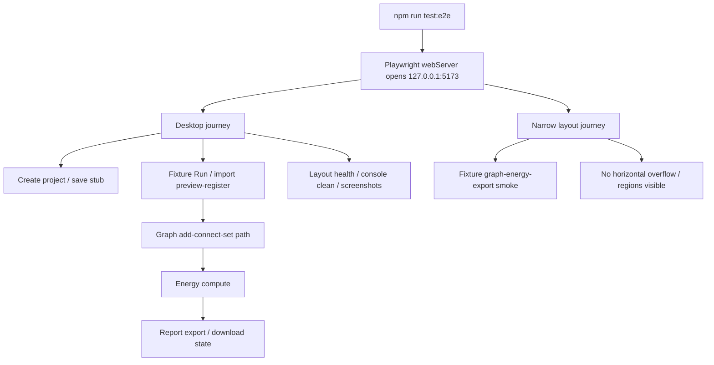

# web-workbench-e2e-qa design

## 0. 术语约定

| 术语 | 定义 | 防冲突结论 |
|---|---|---|
| Web E2E QA Harness | `web/` 内可重复运行的真实浏览器测试入口 | 不等同于 Vitest component tests |
| Workbench Journey | 从打开 Web Workbench 到 fixture/import/graph/energy/export 的用户级流程 | 只覆盖已落地 fixture UI |
| Layout Health Check | 对 viewport、水平溢出、console warning/error、关键区域可见性做断言 | 不是截图像素 diff |
| QA Artifact | Playwright 自动保存的 screenshot / trace / report | 不进入 Project Content 或 Browser Project Repository |
| E2E Project Config | Playwright 配置、npm script、testDir、webServer 和 output 位置 | 不改变 Vite runtime 或 app 业务逻辑 |

术语 grep 结果：当前没有 repo 内正式 Playwright config 或 `web/e2e/` 测试；历史 feature acceptance 里已有多段临时 Playwright QA 脚本和 `/tmp/rxnflow-*.png` 截图证据。该 feature 将这些临时验证收敛成可重复命令。

## 1. 决策与约束

### 需求摘要

本 feature 目标是把 Web Workbench MVP 已经手工/临时脚本验证过的主流程固化为 repo 内可重复 E2E：

1. 新增 `npm run test:e2e`，运行 Playwright Chromium。
2. Playwright 自动启动或复用 `http://127.0.0.1:5173/`，不使用 `file://`。
3. 覆盖首屏 page identity、非空白、无 framework overlay、无 console warning/error。
4. 覆盖桌面 viewport 的完整 workbench journey：创建 project / 保存 stub、Fixture Run、导入 preview/register、对象选择、图谱 add/connect/set path、energy compute、report export。
5. 覆盖窄屏 viewport 的核心 flow 和 layout health：Fixture Run、图谱、能量、导出区域可见，无水平溢出。
6. 对关键 UI 区域做 layout health check，包含 graph canvas、energy table/curve、report artifact list、warning 区域。
7. 输出 screenshots / traces 到 Playwright output，不把 QA artifact 写入 Project Content 或 Browser Project Repository。
8. 更新 Web Workbench architecture / requirement，记录正式 E2E harness 的命令和边界。

### 明确不做

- 不实现新的业务 UI、shell command、parser bridge、Python bridge、HTTP API 或真实云/账号能力。
- 不把临时 QA 脚本写入根目录或 `/tmp` 作为长期入口；长期入口应是 `web/e2e/` + `npm run test:e2e`。
- 不做像素级视觉回归、截图 golden diff、跨浏览器矩阵、移动真机或无障碍全量审计。
- 不验证真实 Gaussian/ORCA/MAPLE/XYZ/extxyz parser 文件内容；Import Inbox 仍使用 fixture preview/register。
- 不把 screenshot/trace/report 纳入 git 跟踪，也不写到 Browser Project Repository。
- 不修改 app 视觉风格、布局密度、组件结构或 i18n 文案，除非 E2E 暴露真实 bug 且必须修复。

### 复杂度档位

- Test harness：L3。需要真实浏览器、dev server、viewport、console、storage 和多步骤 UI workflow。
- UI behavior：L2。只覆盖已有 UI，不新增交互能力。
- Architecture/docs：L2。需要把临时 QA 经验归并为长期命令和边界。
- Core integration：L1。不触碰 Python core。

### 关键决策

1. **Playwright 是长期 E2E 入口**：Browser 插件仍用于交互式验收，但 repo 内自动化入口使用 Playwright config 和 npm script。
2. **fixture flow 是当前 E2E authority**：真实 import/parser/bridge 尚未接入，E2E 只证明 Web UI / ShellClient / fixture projection 主链路。
3. **布局健康用 DOM + viewport 断言**：检查水平溢出、关键区域可见、console clean 和截图保留；不做 brittle pixel diff。
4. **screenshots/traces 不进 git**：Playwright output 是 QA artifact，默认写到 `web/test-results/` 或等价 output dir，并加入忽略规则。
5. **E2E 不替代 unit tests**：`npm run test` 继续覆盖 DTO、状态投影和组件边界；`npm run test:e2e` 覆盖真实浏览器主流程。

## 2. 名词与编排

### 2.1 名词层：值对象 / 实体 / 接口契约

**现状**：

- `web/package.json` 只有 `dev`、`build` 和 `test` scripts。
- `web/` 已安装 Playwright dependency，但没有 Playwright config、`web/e2e/` testDir 或长期 E2E helper。
- 历史验收使用临时 Node/Playwright 脚本验证桌面/窄屏，截图写到 `/tmp/rxnflow-*.png`。
- `AGENTS.md` 要求 Web 工作台预览必须 `cd web && npm run dev` 后打开 `http://127.0.0.1:5173/`。

**变化**：

新增测试入口：

```json
{
  "scripts": {
    "test:e2e": "playwright test"
  }
}
```

新增 Playwright project config 概念：

```ts
type WebE2EConfig = {
  testDir: "./e2e"
  baseURL: "http://127.0.0.1:5173"
  webServer: {
    command: "npm run dev"
    url: "http://127.0.0.1:5173/"
    reuseExistingServer: true
  }
  projects: [{ name: "chromium" }]
}
```

新增 E2E helper 概念：

```ts
type LayoutHealthResult = {
  scrollWidth: number
  clientWidth: number
  consoleIssues: string[]
  visibleRegions: string[]
}
```

边界：

- E2E 使用真实浏览器 IndexedDB，但每个测试需隔离或清理 storage state，避免用户手动页面数据污染测试。
- E2E 可以使用 `setInputFiles` 注入 synthetic File；这只验证 Web Import Inbox UI，不声明真实 parser 支持。
- E2E screenshots/traces 是测试产物，不是 RxnFlow report export artifact。

### 2.2 编排层：主流程与控制流



**现状**：

- Component tests 已覆盖每个面板的主要行为，但不跑真实 browser layout、IndexedDB、file input 和 scrolling。
- 临时 Playwright QA 能证明局部 flow，但命令不可复用，也不进入 `npm run test` / `npm run build` 的标准验证口径。

**变化**：

- 新增 Playwright config，`test:e2e` 自动运行 Chromium。
- 新增 E2E helper：清理 IndexedDB/localStorage、收集 console issues、断言无水平溢出、保存截图。
- 新增 desktop journey spec：项目侧边栏 create/save、fixture/import/object/graph/energy/export 全链路。
- 新增 narrow layout spec：390px viewport 下运行核心 flow，验证关键面板可见、无水平溢出。
- 在 architecture / requirement 中记录 `npm run test:e2e` 是当前 Web Workbench 真实浏览器回归入口。

**跨层纪律**：

- Runtime boundary：E2E 只能通过 UI 操作和已落地 ShellClient fixture flow，不 import Python core。
- Storage boundary：测试可清理本测试上下文中的 IndexedDB/localStorage，但不写 Project Content 或 Browser Project Repository 语义外对象。
- Error visibility：console warning/error、framework overlay 和 command error 必须显式失败或记录。
- Responsive：每个 viewport 都检查 `documentElement.scrollWidth <= clientWidth` 和关键面板可见性。
- Artifact boundary：E2E screenshot/trace/report 只属于 Playwright output，不是 Report Export artifact。

### 2.3 挂载点清单

- `web/package.json`：新增 `test:e2e` script。
- `web/playwright.config.ts`：新增 Playwright E2E 配置、webServer、output/report 边界。
- `web/e2e/`：新增 helper 与 workbench journey specs。
- `.gitignore`：忽略 Playwright output/report。
- `codestable/architecture/web-workbench.md` / `requirements/web-workbench-shell.md`：acceptance 阶段记录 E2E harness 当前命令和覆盖边界。

本 feature 不挂入 React app runtime、fixture transport、Browser Project Repository implementation、Python core、Project Content codec、report export writer 或云/账号系统。

### 2.4 推进策略

1. **E2E Project Setup**：新增 Playwright config、`npm run test:e2e` 和 ignored output paths。
   - 退出信号：`npm run test:e2e -- --list` 能列出 tests，dev server 使用 `http://127.0.0.1:5173/`。
2. **E2E Helpers**：新增清理 storage、console capture、layout overflow、region visibility 和 screenshot helper。
   - 退出信号：helper 能在空页面和 workbench 页面返回稳定断言，不依赖临时 `/tmp` 脚本。
3. **Desktop Workbench Journey**：覆盖 project create/save、Fixture Run、import preview/register、object selection、graph add/connect/set path、energy compute、report export。
   - 退出信号：Chromium 1280x720 下 journey 通过，关键文本/状态和 no-overflow 断言成立。
4. **Narrow Layout Journey**：覆盖 390x840 下 fixture -> graph/energy/export smoke 和关键区域布局健康。
   - 退出信号：窄屏测试通过，graph surface、energy table/curve、artifact list 和 warnings 无水平溢出。
5. **Verification And Docs**：运行 `npm run test:e2e`、`npm run test`、`npm run build`、`python3 -m unittest discover`，回写 architecture/requirement/roadmap 验收文档。
   - 退出信号：全部命令通过；CodeStable checklist/checks 更新；没有新增业务范围改动。

## 3. 验收契约

### 关键场景清单

1. `npm run test:e2e -- --list` 能在 `web/` 下列出 Playwright tests。
2. `npm run test:e2e` 会启动或复用 `http://127.0.0.1:5173/`，不使用 `file://`。
3. E2E page identity 验证 title 为 `RxnFlow Workbench`，main region 可见，页面非空白。
4. E2E 捕获 console warning/error；相关 app warning/error 会导致测试失败。
5. 桌面 flow 能创建 browser-local project、保存 stub，并看到 Persisted / Valid / checksum。
6. 桌面 flow 能 Fixture Run，并看到 fixture project、Object Registry、Graph Canvas、Energy Profile Panel 和 Report Export Panel。
7. 桌面 flow 能用 Import Inbox 注入 `water.xyz` / `bad-count.xyz`，Preview 后看到 batch、raw resource、warnings/errors，Register All 后看到 `object-imported-water`。
8. 桌面 flow 能选择 imported water object，Add Node、Connect、Set Path，最终 active path 为 `path-web-main`，path text 包含 `node-a -> node-b -> node-web-3`。
9. 桌面 flow 在 imported water path 上 Compute 后显示 `missing_energy`，不把 missing point 当作 0。
10. 桌面 flow 能在默认 fixture profile 上 Export，看到 PNG/CDXML/XLSX 3 个 artifacts、download links、metadata 和 `chemdraw_cdxml_only` warning。
11. E2E 覆盖 include bytes disabled：导出 artifacts 可见但 Download link 为 0，`Download unavailable` 为 3。
12. 窄屏 flow 在 390x840 下能完成 fixture -> graph add/connect/set path -> energy compute -> report export smoke。
13. 桌面和窄屏均断言无 document/body 水平溢出。
14. 桌面和窄屏均保存截图到 Playwright output；截图不进入 git tracked source。
15. `npm run test` 通过。
16. `npm run build` 通过。
17. `python3 -m unittest discover` 通过。

### 反向检查

- 不新增业务 UI / shell command / parser bridge / Python bridge / HTTP route。
- 不修改 Report Export、Energy Engine、Graph Workspace、Import Workflow 或 Browser Project Repository 业务实现。
- 不把 Playwright screenshots/traces 写入 Project Content、Browser Project Repository 或 git tracked source。
- 不新增云存储、账号系统、JSZip、OPFS、File System Access API、real parser fixture 声明或外部网络依赖。
- 不把 E2E 中的 synthetic file flow 描述成真实 Gaussian/ORCA/MAPLE/XYZ/extxyz 完整支持。

## 4. 与项目级架构文档的关系

- 本 design 落盘后把 roadmap item `web-workbench-e2e-qa` 更新为 `in-progress`。
- 实现完成并验收后，`codestable/architecture/web-workbench.md` 应记录 `npm run test:e2e`、Playwright config、desktop/narrow journey 覆盖和 output 边界。
- `codestable/architecture/ARCHITECTURE.md` 如无全局新术语可不更新；若新增 Web E2E QA Harness 稳定术语，则补入术语表。
- `codestable/requirements/web-workbench-shell.md` 应补充当前 Web 工作台有可重复真实浏览器回归入口，覆盖工作台主流程和响应式布局健康。
- roadmap acceptance 阶段把 `web-workbench-e2e-qa` 标为 `done`，Web Workbench MVP roadmap 的实现项进入完成状态。
