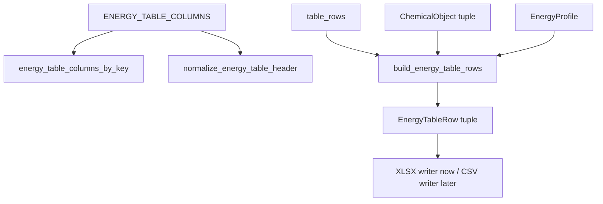

# export-energy-table-contract design

## 0. 术语约定

| 术语 | 定义 | 防冲突结论 |
|---|---|---|
| Energy Table Contract | 报告导出层的结构能量表稳定协议，包含列顺序、字段 key、单位、来源和缺失语义 | 现有 `EnergyTableColumn` / `EnergyTableRow` 已有雏形，本 feature 固化和补强 |
| Energy Table Schema Version | 能量表契约版本，用于 metadata、docs 和后续 CSV/XLSX 共用 | 新增常量，不等同于 Project Content schema |
| Workbook Header Mapping | 用户样表表头到 RxnFlow column key 的映射规则 | 新增 helper；不读取或保存用户私有 workbook |
| Manual Table Row | 调用方显式提供的 `EnergyTableRow`，用于 basis function、shermo/Whitesides 等当前 parser 未结构化字段 | 已有 `table_rows` 参数；本 feature 明确它优先级最高 |
| Structure Name | 能量表第一列的人类可读结构名称 | 必须来自 `EnergyTableRow.structure_name`、object label/id 或 profile point label，不用 object/node id 替代 |
| Blank Missing Value | 未解析或未提供字段保持空白/absent | 不写 0，不猜测修正项 |
| CSV Energy Table | 复用同一 table contract 的后续纯文本导出 | 本 feature 只保持 schema CSV-safe，不开放 `csv` ExportFormat |

术语 grep 结论：当前代码已有 `ENERGY_TABLE_COLUMNS`、`EnergyTableColumn`、`EnergyTableRow`、`build_energy_table_rows`，没有 schema version、header mapping 或 public column lookup helper。

## 1. 决策与约束

### 需求摘要

本 feature 目标是把 report export baseline 里的能量表从“可写 XLSX 的列清单”提升为稳定契约。完成后，核心层应能：

1. 给出版本化的 energy table column schema。
2. 明确第一列是结构名称，后续列按 Gas / Shermo / Solution / Profile 分组。
3. 把用户样表中的常见表头归一到 RxnFlow column key，例如 `Egas`、`basis function`、`Ggas+1M`、`Ggas(shermo+1M)`、`Esol`、`Gsol`。
4. 合并 manual table rows、ChemicalObject rows 和 EnergyProfile rows 时保持可预测优先级。
5. 缺失值保持 blank / absent，不补 0，不自动套用 `+0.003019` 或 entropy 公式。
6. 为 XLSX writer 和后续 CSV writer 提供同一套列定义和 row builder。

明确不做：

- 不新增 `csv`、`cdx`、PDF、PPTX、SVG 或其他 ExportFormat。
- 不修改 PNG/CDXML writer 或 diagram route。
- 不读取、复制或提交用户提供的 workbook 原文件。
- 不实现 Excel 公式、图表、宏或模板套版。
- 不解析 Gaussian/ORCA/MAPLE 输出里的 basis function 或 entropy 原始字段。
- 不新增 ChemicalObject 字段或 Project Content schema。
- 不修改 Web Report Export Panel 格式枚举。

### 复杂度档位

默认小型核心契约 feature。偏离点：

- 表格字段属于跨 writer contract，必须写在 core export 模块，而不是 XLSX writer 内部。
- 需要吸收计算化学样表习惯，但不把用户 workbook 当 runtime 输入。
- manual row 优先级必须明确，否则后续 parser 结构化字段和用户手工校正会互相覆盖。

### 关键决策

1. **schema-first**：把 `ENERGY_TABLE_COLUMNS` 视为公共契约，补 schema id/version 和 helper，而不是让 XLSX writer 隐式拥有列顺序。
2. **manual rows 优先**：调用方显式传入的 `table_rows` 不被 object/profile 自动覆盖；profile merge 只用 `setdefault` 补充相对能量。
3. **object rows 不猜字段**：ChemicalObject 只映射现有 energies/thermochemistry key；basis function、shermo/Whitesides 原始熵项暂由 manual rows 提供。
4. **header mapping 是导入/文档辅助**：mapping helper 只返回 column key，不直接读 workbook，也不参与 export runtime 自动推断。
5. **CSV-safe 但不开放 CSV**：列名、row values 和 warning semantics 保持可写 CSV；格式枚举仍只允许 PNG/CDXML/XLSX。

## 2. 名词与编排

### 2.1 名词层：值对象 / 实体 / 接口契约

**现状**：

- `rxnflow/export.py` 已有 `EnergyTableColumn`、`EnergyTableRow` 和 `ENERGY_TABLE_COLUMNS`。
- `ENERGY_TABLE_COLUMNS[0]` 是 `structure_name` / `Structure`，但没有版本号、按 key 查询 helper 或模板 header mapping。
- `build_energy_table_rows()` 当前顺序是 manual rows → object rows → profile merge；profile merge 对 existing row 用 `setdefault`，已接近 manual 优先策略。
- 用户 workbook 里实际表头包括 `Egas`、`basis function` / `basis f`、`Ggas`、`Ggas+1M`、`Ggas（shermo）`、`Ggas（shermo+1M）`、`Esol`、`Gsol`、`Sgau,tran`、`Swhit,tran`、`T*(Sgau,tran -Swhit,tran)/1000` 等。

**变化**：

- 新增 `ENERGY_TABLE_SCHEMA_VERSION = "energy-table-v1"`。
- 新增 `energy_table_columns_by_key() -> dict[str, EnergyTableColumn]`，供 writer/tests/docs 统一查列。
- 新增 `normalize_energy_table_header(header: str, *, context: str | None = None) -> str | None`，把样表表头归一到 column key；无法稳定映射的 entropy 原始列返回 `None`。
- `EnergyTableColumn.source` 继续记录 `"row"`、`"table_rows"`、`"profile"`、`"energies.*"` 或 `thermochemistry.*`，并保持所有列 key 唯一。
- `ExportArtifact.metadata` 后续由 XLSX writer 带出 `energy_table_schema_version`，本 feature 可先在 `_artifact_metadata` 中对 xlsx 设置。

**接口示例：列契约查询**

```python
columns = energy_table_columns_by_key()
assert columns["structure_name"].label == "Structure"
assert columns["egas_hartree"].unit == "hartree"
```

**接口示例：样表 header mapping**

```python
assert normalize_energy_table_header("Egas", context="hartree") == "egas_hartree"
assert normalize_energy_table_header("basis f", context="solution") == "solution_basis_functions"
assert normalize_energy_table_header("Sgau,tran") is None
```

**接口示例：manual row 优先**

```python
row = EnergyTableRow("TS1", {"relative_energy": 99.0}, node_id="node-ts")
rows = build_energy_table_rows(objects=(), profile=profile, table_rows=(row,))
assert rows[0].values["relative_energy"] == 99.0
```

### 2.2 编排层：主流程与控制流



**现状**：

当前 XLSX writer 直接遍历 `ENERGY_TABLE_COLUMNS`，测试只检查第一列和少量字段。样表字段映射和 entropy/basis function 边界只存在于历史 design 文本，没有可执行契约。

**变化**：

- schema helper 在 writer 之外公开列 key 查询和唯一性约束。
- header mapping helper 只处理稳定 header；重复 header 依赖 `context` disambiguate。
- row builder 行为通过测试固定：manual rows 先出现，object rows 追加，profile-only 时从 points 生成 rows，profile merge 不覆盖 existing values。
- `_artifact_metadata` 对 XLSX artifact 标记 `energy_table_schema_version` 和 `energy_table_column_count`，便于 Web/agent 审计。

**跨层纪律**：

- 错误语义：helper 遇到未知 header 返回 `None`，不抛异常；duplicate column key 在测试中失败而不是 runtime 容忍。
- 幂等性：同一输入 rows/profile 生成同样 row 顺序和 values。
- 扩展点：后续 CSV writer 只能复用 `ENERGY_TABLE_COLUMNS` 和 `build_energy_table_rows`。
- 安全边界：不读取用户 workbook path，不保留用户路径或私有 workbook 内容。

### 2.3 挂载点清单

- Energy table schema constants/helpers：`ENERGY_TABLE_SCHEMA_VERSION`、`energy_table_columns_by_key()`、`normalize_energy_table_header()`。
- Energy table row builder behavior：manual/object/profile merge 的优先级和缺失值语义。
- XLSX artifact metadata：schema version / column count。
- Report export tests：字段唯一性、header mapping、manual row 优先、CSV/CDX 未开放守护。

### 2.4 推进策略

1. **Schema helper**：新增 schema version、column lookup helper 和 column uniqueness tests。
   - 退出信号：所有 column key 唯一，第一列仍为 `structure_name`。
2. **Header mapping**：新增样表 header normalization helper，覆盖 gas/solution/shermo/profile 常见列和未知 entropy 列。
   - 退出信号：用户 workbook 表头中的稳定列能映射，`Sgau/Swhit/RT` 原始列返回 `None`。
3. **Row merge contract**：补 manual rows / object rows / profile rows 的优先级测试，确保不补 0、不覆盖手工 relative energy。
   - 退出信号：manual row 的 existing values 保持，missing field 不出现在 values。
4. **Artifact metadata**：XLSX artifact metadata 带 schema version 和 column count，格式枚举仍不含 CSV/CDX。
   - 退出信号：XLSX export metadata 可审计，`csv` / `cdx` 仍 `invalid_input`。
5. **验证与范围守护**：跑 report export tests、全量 Python tests 和 roadmap YAML 校验。
   - 退出信号：测试通过，未触碰 PNG/CDXML/Web 格式枚举或 parser/import/project schema。

## 3. 验收契约

### 关键场景清单

1. `ENERGY_TABLE_SCHEMA_VERSION` 为稳定字符串，XLSX metadata 带出该值。
2. `ENERGY_TABLE_COLUMNS` 所有 key 唯一，第一列 key 为 `structure_name`、label 为 `Structure`。
3. `energy_table_columns_by_key()["egas_hartree"]` 返回 Hartree 列，unit/source 正确。
4. `normalize_energy_table_header("Egas", context="hartree")` 返回 `egas_hartree`。
5. `normalize_energy_table_header("basis function", context="solution")` 返回 `solution_basis_functions`。
6. `normalize_energy_table_header("Ggas（shermo+1M）", context="hartree")` 返回 `ggas_shermo_1m_hartree`。
7. `normalize_energy_table_header("Sgau,tran")` 返回 `None`，不把 entropy 原始列误映射成能量列。
8. ChemicalObject 只有 electronic energy 时，row 写入 `egas_hartree` / `egas_kcal_mol`，不写 basis function。
9. ChemicalObject 有 `thermochemistry["ggas_1m"]` 时，row 写入 Ggas+1M 成对列。
10. Manual `EnergyTableRow` 中已有 `relative_energy` 时，profile merge 不覆盖该值。
11. Profile-only 输入时，rows 来自 EnergyPoint label，missing point 保留 `missing_reason`。
12. 请求 `csv` 或 `cdx` 仍返回 unsupported/invalid format。

### 明确不做的反向核对项

- 不新增 ExportFormat，不开放 CSV/CDX。
- 不读取用户 workbook 原文件。
- 不修改 PNG/CDXML writer 或 Web Report Export Panel。
- 不新增 parser、ChemicalObject、Project Content 或 Web repository 字段。
- 不把缺失 basis/entropy/standard-state 字段写成 0。

## 4. 与项目级架构文档的关系

- architecture 归并：验收时更新 `codestable/architecture/core-platform.md` 和 `ARCHITECTURE.md`，说明 Energy Table Contract 已有 version/helper/header mapping，CSV 仍未开放。
- requirement 回写：用户可见导出能力已由 `web-workbench-shell` 记录；本 feature 是核心契约补强，不新增 requirement。
- roadmap 回写：验收通过后把 `rxnflow-report-export-quality` 的 `export-energy-table-contract` 标为 `done`，并同步主文档子 feature 状态。
