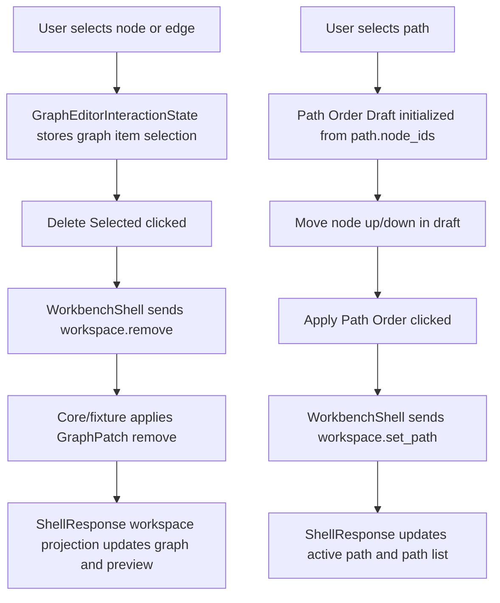

# graph-editor-edge-path-editing design

## 0. 术语约定

| 术语 | 定义 | 防冲突结论 |
|---|---|---|
| Graph Item Selection | `GraphEditorInteractionState.selection` 中的 node/edge/path id 选择集合 | 不等同于 core `WorkspaceSelection` 持久化；当前仍是 Web UI-only state |
| Workspace Remove Command | `workspace.remove` shell command，删除已存在 graph node 或 edge | 不等同于 Project Content 删除，也不删除 ChemicalObject |
| Edge Selection Target | Graph Canvas 中可点击/可测的 edge hit target | 不等同于自由绘线或 ChemDraw bond 编辑 |
| Path Order Draft | 用户在 Web 侧临时调整的某条 path 的 ordered node ids | 不进入 ShellResponse、Project Content 或 localStorage；点击 apply 后才转成 `workspace.set_path` |
| Active Path Reorder Intent | 把 Path Order Draft 提交为 `workspace.set_path(path_id, node_ids)` | 不新增新的 core path reorder primitive |

术语 grep 结果：`GraphEditorInteractionState.selection.edgeIds/pathIds` 已存在但 UI 未生产 edge/path selection；`ReactionGraphService` 已支持 `GraphPatch("remove")` 和 `GraphPatch("set_path")`；Platform Shell 尚无 `workspace.remove`；Web fixture transport 尚无 `workspace.remove`。

## 1. 决策与约束

### 需求摘要

本 feature 目标是把 Graph Canvas 从“只能添加/连接/移动节点”推进到第一版 edge/path editing：

1. Edge line 在 Graph Canvas 中可以被选择，选中状态可见，并进入 `GraphEditorInteractionState.selection.edgeIds`。
2. 选中 node 或 edge 后，用户可以点击 Delete Selected；Web 只发送 `workspace.remove`，不在前端推断 cascade。
3. 删除 node 时由 core/fixture projection 返回级联后的 graph：相关 edge 和包含该 node 的 path 被移除，disconnected diagnostics 同步更新。
4. Path list item 可以被选择，选中 path 的 node order 可以在 Network Preview 中用上移/下移进行受控调整。
5. 提交 path order draft 时复用现有 `workspace.set_path`；成功后 active path 和 path list 只从 ShellResponse workspace projection 更新。
6. 既有 connect mode、object drop、node dragging、energy/report panel 行为不回退。

### 明确不做

- 不实现自由绘线、拖拽端点改边、edge rerouting、edge label 编辑或 bezier/orthogonal routing。
- 不实现删除 path、批量框选、多选快捷键、键盘 Delete、undo/redo 或 clipboard。
- 不实现 path 拖拽排序、自动拓扑排序、最短路径推断、环检测或化学合理性判定。
- 不把 path draft、selection、hover、edge hitbox 或 delete pending state 写入 Project Content、Browser Project Repository、localStorage 或 ShellResponse。
- 不改变 Energy Profile 对 active path 的计算规则；它仍只消费 ShellResponse 中的 workspace active path / path list。
- 不新增第三方 diagramming/canvas library。

### 复杂度档位

- Shell contract：L2。新增最窄 `workspace.remove` command，复用 core `GraphPatch("remove")` cascade 语义。
- Frontend interaction：L3。涉及 edge/path selection、delete button、path draft reorder 和 ShellResponse 更新。
- Persistence：L1。只修改 runtime graph/path projection；保存/恢复仍留给 `graph-editor-workspace-persistence`。
- Testability：tested。Python workspace/platform、fixture transport、interaction helper、React component test 和浏览器 smoke 均可覆盖。

### 关键决策

1. **remove command 使用 id arrays**：`workspace.remove` 接收 `node_ids?: string[]` 和 `edge_ids?: string[]`，不新增 path 删除。
2. **删除 cascade 只信 core/fixture projection**：node 删除导致 edge/path cascade 时，Web 不自行计算，只显示返回的 graph。
3. **避免重复 remove cascade 冲突**：如果同一请求同时包含 selected node 和 incident edge，workspace 层应只提交 node remove 或过滤 incident edge，避免 edge 被 node cascade 后再次 remove。
4. **path order draft 是 UI-only**：用户调整顺序时不改 domain graph；点击 Apply 后才发送 `workspace.set_path`。
5. **路径顺序编辑只改 existing path**：第一版只对已存在 path 的 `node_ids` 上移/下移，不创建任意子路径编辑器。

## 2. 名词与编排

### 2.1 名词层：值对象 / 实体 / 接口契约

**现状**：

- `GraphEditorInteractionState.selection` 已包含 `nodeIds`、`edgeIds`、`pathIds`，但现有 UI 只生产 node selection。
- `ReactionGraphService` 已支持 `GraphPatch("remove", id=...)`，node remove 会级联删除相关 edge 和包含该 node 的 path。
- `GraphEditorWorkspaceService` 只有通用 `apply_patches`，没有 remove graph item 的专用 shell-facing 方法。
- `PlatformShellService` / Web fixture / `WorkspaceCommandData` 只支持 `workspace.open`、`workspace.add_node`、`workspace.move_node`、`workspace.connect`、`workspace.set_path`。
- `PathList` 只展示 path，不支持选择、reorder 或 apply。

**变化**：

新增 shell command args：

```ts
type WorkspaceRemoveArgs = {
  session_id: string
  node_ids?: string[]
  edge_ids?: string[]
}
```

扩展 command projection：

```ts
type WorkspaceCommandData = {
  command:
    | "workspace.open"
    | "workspace.add_node"
    | "workspace.move_node"
    | "workspace.remove"
    | "workspace.connect"
    | "workspace.set_path"
  session_id: string
  workspace: WorkspaceSummary
}
```

Path draft 使用 Web helper 表达，不进入 Shell DTO：

```ts
type GraphPathOrderDraft = {
  pathId: string
  nodeIds: string[]
}

moveGraphPathDraftNode(draft, nodeId, "up" | "down")
```

边界：

- `workspace.remove` 至少包含一个 node id 或 edge id；空 selection 返回 `invalid_input target=selection`。
- 未知 node/edge 由 core/fixture 返回 `graph_invalid`，不更新 workspace graph。
- 删除 node/edge 不删除 ChemicalObject，不修改 object registry/import/profile/export state。
- `workspace.set_path` 继续要求 `path_id` 和非空 `node_ids`，node 缺失返回 `graph_invalid`。

### 2.2 编排层：主流程与控制流



**现状**：

- Node click 只选择单个 node； edge layer 是 `aria-hidden` SVG，不能选择。
- Delete graph item 没有 shell command，也没有 UI command。
- Set Path 当前使用当前 graph node 顺序提交 `path-web-main`，不能编辑 existing path order。
- `pruneGraphEditorInteractionState` 已会清理 stale edge/path selection。

**变化**：

- `graphEditorInteractionState` 增加 edge/path selection helper，并保持 node/edge/path 单类互斥选择。
- `GraphEdgeLayer` 改为可点击 edge target，选中 edge 有 visible style 和测试可定位 label。
- `GraphCanvas` 增加 Delete Selected command，只有 node/edge selection 非空时可用。
- `WorkbenchShell.removeSelectedGraphItems` 调 `workspace.remove`，并用 `applyWorkspaceResponse(response)` 更新 domain state。
- `PathList` 支持选择 path；选中 path 后显示 Path Order Draft controls，调整顺序只改 UI draft。
- `WorkbenchShell.applyPathOrderDraft` 调既有 `workspace.set_path`，不新增 core path reorder primitive。
- fixture transport 支持 `workspace.remove`，与 core 一样处理 node cascade 和 edge delete。

**跨层纪律**：

- Command authority：GraphCanvas / PathList 不直接 mutate `workspace.graph.nodes/edges/paths`。
- Error semantics：空 remove selection 是 `invalid_input target=selection`；unknown id 是 `graph_invalid`；`workspace.set_path` 继续透传 path/node validation。
- Idempotence：重复 connect 保持已有幂等；remove 对已删除 id 不伪造成功，返回结构化 error。
- Cascade authority：node remove 的 edge/path cascade 只来自 ReactionGraphService / fixture projection。
- Persistence boundary：selection、path draft、hover 和 delete pending 都是 UI-only。

### 2.3 挂载点清单

- Platform Shell workspace command dispatcher：新增 `workspace.remove`。
- GraphEditorWorkspaceService：新增 remove selected graph items 的领域壳层方法。
- Web fixture transport：新增 `workspace.remove` fixture command 和 cascade projection。
- Graph Editor Interaction State：新增 edge/path selection helper 和 tests。
- GraphCanvas / WorkbenchShell：新增 edge/path selection、Delete Selected、Path Order Draft 和 apply 编排。

本 feature 不新增 route、repository schema、Project Content section、localStorage key、第三方 canvas/diagramming 库、Energy/Profile/Report command 或真实文件 IO。

### 2.4 推进策略

1. **Shell Remove Contract**：在 core workspace/platform shell 和 fixture transport 增加 `workspace.remove`，并补 Python / ShellClient tests。
   - 退出信号：remove node 级联 edge/path，remove edge 保留 node/path；空 selection / unknown id 返回结构化错误。
2. **Selection And Path Draft Helpers**：扩展 graph editor interaction selection helper，并新增 path order draft helper 和单元测试。
   - 退出信号：helper tests 覆盖 node/edge/path 单类互斥选择、stale prune、path draft move up/down/no-op。
3. **Canvas Edge Delete Interaction**：GraphCanvas 支持 edge selection 和 Delete Selected，WorkbenchShell 调 `workspace.remove`。
   - 退出信号：component test 选择 edge 后删除，edge count/preview 更新；选择 node 后删除时 cascade path/disconnected diagnostics 来自 ShellResponse。
4. **Path Order Editing UI**：PathList 支持 path selection、draft reorder 和 Apply，通过 `workspace.set_path` 更新 active path。
   - 退出信号：component test 选中 path、调整 node order、Apply 后发送 `workspace.set_path` 并显示更新后的 order。
5. **Verification And Scope Guard**：跑 Web tests/build、Python 单测和浏览器主链路。
   - 退出信号：测试通过；Browser/Playwright 验证页面非空白、console clean、edge delete/path reorder 可观察；scope grep 未新增持久层、viewport、undo 或第三方 diagramming 库。

## 3. 验收契约

### 关键场景清单

1. Platform Shell `workspace.remove(node_ids=[...])` 删除 node 后，返回 workspace graph 中目标 node 不存在，相关 edge 和包含该 node 的 path 由 core cascade 消失。
2. Platform Shell `workspace.remove(edge_ids=[...])` 删除 edge 后，nodes 保留，NetworkPreview disconnected diagnostics 反映断开的 node。
3. `workspace.remove` 空 selection、未知 node id 或未知 edge id 返回结构化错误，不更新 workspace graph。
4. Web fixture transport 支持 `workspace.remove`，返回 JSON-safe `WorkspaceCommandData.command="workspace.remove"`。
5. Graph Canvas 中点击 edge 会选择 edge，node selection 被清空，Delete Selected 发送 `workspace.remove(edge_ids=[edgeId])`。
6. Graph Canvas 中选择 node 后 Delete Selected 发送 `workspace.remove(node_ids=[nodeId])`，可见 graph 使用 ShellResponse cascade 结果。
7. 现有 Connect flow 仍可从 selected source 连接 clicked target，重复 connect 仍幂等。
8. Path list 选中 path 后，Path Order Draft 可以把 node 顺序上移/下移；Apply 发送 `workspace.set_path(path_id, node_ids)`。
9. Path draft 调整期间不改变 `WorkbenchDomainState.workspace.graph.paths`；只有 ShellResponse 成功后可见 path order 更新。
10. 不新增 path delete、freehand edge draw、edge label edit、viewport command、undo/redo、Project Content schema、localStorage persistence 或第三方 diagramming/canvas library。
11. 不改变 Object Registry drag payload、Object Drop 创建节点语义、Node Drag `workspace.move_node`、Import Inbox、Energy Profile 或 Report Export 行为。
12. `npm run test` 通过。
13. `npm run build` 通过。
14. `python3 -m unittest discover` 通过。
15. Browser dev preview 验证页面非空白、无 framework overlay、console error/warn clean；edge delete 和 path reorder 有可观察变化。

### 反向检查

- 不把 selection、path draft、hover、delete pending 或 edge hitbox state 写入 Project Content、Browser Project Repository、localStorage 或 ShellResponse。
- 不让前端自行推断 node delete cascade；必须来自 ShellResponse workspace projection。
- 不新增 ChemicalObject 删除、ImportBatch 删除、EnergyProfile 删除或 export artifact 删除。

## 4. 与项目级架构文档的关系

- acceptance 阶段应在 `codestable/architecture/core-platform.md` 记录 `workspace.remove` command 和 GraphEditorWorkspaceService remove graph items 能力。
- acceptance 阶段应在 `codestable/architecture/web-workbench.md` 记录 Graph Canvas 已支持 edge selection/delete 和 Path Order Draft；并继续声明 selection/draft 是 UI-only。
- requirement `web-workbench-shell` 应补充用户可删除选中 node/edge、调整 active path 顺序，这是用户可见能力变化。
- roadmap acceptance 阶段把 `graph-editor-edge-path-editing` 标为 `done`，后续 `graph-editor-workspace-persistence` 可复用删除与 path order projection。
