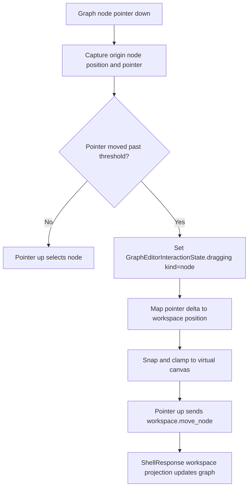

# graph-editor-node-layout design

## 0. 术语约定

| 术语 | 定义 | 防冲突结论 |
|---|---|---|
| Graph Node Layout Position | graph node 的 workspace/layout 坐标，序列化为 `[x, y]` | 不等同于 DOM `left/top` 百分比，也不写 ChemicalObject |
| Node Move Intent | 用户拖动已有 graph node 后形成的移动意图，包含 node id 和目标 position | 不等同于 Object Drop；Object Drop 创建新节点，Node Move 移动已有节点 |
| Node Layout Command | `workspace.move_node` shell command，更新已有 node 的 `position` 字段 | 不新增前端本地 graph patch authority |
| Virtual Canvas Bounds | Web Graph Canvas 用于坐标换算的固定 workspace 尺寸和 grid | 当前仅服务节点显示/拖动，不是 viewport/pan/zoom |

术语 grep 结果：`ReactionNode.position`、`GraphNodeSummary.position`、`WorkspaceAddNodeArgs.position` 已存在；`workspace.move_node` 当前不存在；`ReactionGraphService` 已支持 `GraphPatch("update_node", patch={"position": ...})`。

## 1. 决策与约束

### 需求摘要

本 feature 目标是建立第一版已有节点拖动与位置更新：

1. Graph Canvas 中已有 node card 可用 pointer/mouse 拖动。
2. 拖动过程中 UI 使用 `GraphEditorInteractionState.dragging` 表达 transient node drag，不直接写 `WorkbenchDomainState.workspace.graph`。
3. drop/release 时将目标位置 snap 到基础 grid 并 clamp 到 Virtual Canvas Bounds。
4. 位置更新通过 `workspace.move_node` shell command 进入 Platform Shell / fixture transport。
5. 成功后只使用 ShellResponse workspace projection 更新可见 graph；失败仍走现有 shell error panel。
6. 节点显示使用稳定的 workspace position → CSS percent 映射，hover/selected/pending/path 状态不得改变布局尺寸。

### 明确不做

- 不实现自动布局、碰撞避让、edge rerouting、路径排序、删除节点/边、框选、多选、undo/redo 或键盘 nudging。
- 不实现 pan/zoom/fit/reset、viewport persistence 或移动时自动滚动画布。
- 不把 transient drag state 写入 ShellResponse、Project Content、Browser Project Repository、localStorage 或 ReactionGraph 之外的私有持久层。
- 不把 node position 写入 ChemicalObject、Object Registry、Import Inbox、Energy Profile 或 Report Export。
- 不实现跨端真实触控手势矩阵；本 feature 只做 pointer/mouse 可用的 Web MVP。

### 复杂度档位

- Frontend interaction：L3。涉及 pointer drag、坐标换算、snap/grid 和 release 后命令提交。
- Shell contract：L2。新增最窄 `workspace.move_node` command，复用 ReactionGraph `update_node` patch。
- Persistence：L1。本 feature 只更新已有 `ReactionNode.position`，不新增 Project Content schema；保存/恢复闭环留给后续 `graph-editor-workspace-persistence`。
- Testability：tested。core shell、fixture transport、React component tests 和浏览器 smoke 都可覆盖。

### 关键决策

1. **新增最窄 shell command**：`workspace.move_node` 只接收 `session_id`、`node_id`、`position`，只更新 node position。
2. **复用核心 patch 能力**：Platform Shell 调 `GraphEditorWorkspaceService.move_node`，该方法内部使用 `GraphPatch("update_node", id=node_id, patch={"position": position})`。
3. **前端不本地 patch graph**：拖动中可以显示 ghost/temporary style，但 release 后可见 domain graph 以 ShellResponse 为准。
4. **固定虚拟坐标系**：Web Graph Canvas 先使用 `600 x 360` workspace 坐标和 `20` px grid；后续 viewport feature 再扩展 pan/zoom。
5. **不阻断 click selection**：短 click 仍选择节点；只有超过 drag threshold 的 pointer move 才提交 move intent。

## 2. 名词与编排

### 2.1 名词层：值对象 / 实体 / 接口契约

**现状**：

- `ReactionNode.position` / `GraphNodeSummary.position` 已存在，`workspace.add_node` 已能写入初始 position。
- `ReactionGraphService` 支持 `update_node` patch，允许更新 `position`。
- `GraphEditorWorkspaceService` 没有 move node 专用方法，但有 `apply_patches`。
- `PlatformShellService` / Web fixture / `WorkspaceCommandData` 只支持 `workspace.open`、`workspace.add_node`、`workspace.connect`、`workspace.set_path`。
- `GraphCanvas.nodePosition` 当前把 `[x, y]` 粗略映射到 CSS percent，不支持反向坐标换算或 drag。

**变化**：

新增 shell command args：

```ts
type WorkspaceMoveNodeArgs = {
  session_id: string
  node_id: string
  position: [number, number]
}
```

扩展 command projection：

```ts
type WorkspaceCommandData = {
  command:
    | "workspace.open"
    | "workspace.add_node"
    | "workspace.move_node"
    | "workspace.connect"
    | "workspace.set_path"
  session_id: string
  workspace: WorkspaceSummary
}
```

前端布局 helper 使用固定坐标契约：

```ts
type GraphNodeLayoutPosition = {
  x: number
  y: number
}

const graphNodeLayoutBounds = { width: 600, height: 360, grid: 20 }

snapGraphNodeLayoutPosition({ x: 127, y: 173 })
// { x: 120, y: 180 }
```

边界：

- `position` 必须是两个 finite number；无效 position 返回 `invalid_input target=position`。
- 缺失 node id 返回 `graph_invalid target=node_id` 或核心已有 graph error。
- move 只改变 `position`，不改变 label/kind/object ids/metadata/edges/paths。

### 2.2 编排层：主流程与控制流



**现状**：

- Node card click 只调用 `onSelectNode(node.id)`。
- `GraphEditorInteractionState.dragging` 类型已预留 `kind: "node"`，但没有 Web drag producer。
- shell response 更新后 `pruneGraphEditorInteractionState` 会清理失效 selection。

**变化**：

- `GraphCanvas` 为 node card 增加 pointer down/move/up/cancel 编排。
- 拖动时 `GraphEditorInteractionState.dragging` 持有 node ids、origin/current canvas point；GraphCanvas 可用该状态显示 dragging class。
- release 后 `GraphCanvas` 调 `onMoveNode({ nodeId, position })`。
- `WorkbenchShell.moveGraphNode` 调用 `workspace.move_node` 并 `applyWorkspaceResponse(response)`。
- fixture transport 支持 `workspace.move_node`，用于 Web tests 和 Browser smoke。
- Platform Shell 支持 `workspace.move_node`，用于 local-http bridge 和后续多端壳层。

**跨层纪律**：

- Command authority：GraphCanvas 不直接 mutate `workspace.graph.nodes`。
- Validation：node id 必填；position 必须 finite；unknown node 不产生前端本地 fallback。
- Idempotence：移动到相同 position 可以返回 ok，同一 node 保持一个节点记录。
- Persistence boundary：position 仍属于 ReactionNode / workspace graph projection；显式保存由后续 Project Content bridge 流程处理。
- Accessibility fallback：click selection 不回退；拖动不是选择节点的唯一方式。

### 2.3 挂载点清单

- Platform Shell workspace command dispatcher：新增 `workspace.move_node`。
- GraphEditorWorkspaceService：新增 move node 领域壳层方法。
- Web fixture transport：新增 `workspace.move_node` fixture command。
- GraphCanvas node card：新增 pointer drag producer 和 drop/release handler。
- WorkbenchShell：新增 move handler，把前端 move request 编排到 ShellClient。

本 feature 不新增 route、repository schema、Project Content section、localStorage key、第三方 canvas/diagramming 库或全局事件监听。

### 2.4 推进策略

1. **Shell Move Contract**：在 core workspace/platform shell 和 fixture transport 增加 `workspace.move_node`，并补 Python / ShellClient tests。
   - 退出信号：move node 更新 position；missing node / invalid position 有结构化错误；connect/path 行为不回退。
2. **Layout Coordinate Helper**：抽出 Web graph node layout 坐标换算、snap/clamp helper 和单元测试。
   - 退出信号：helper tests 覆盖 existing position、fallback position、snap、clamp、CSS percent 映射。
3. **Canvas Node Drag Interaction**：GraphCanvas 支持已有节点 pointer drag，WorkbenchShell 调 move command，click selection 保留。
   - 退出信号：component test 能拖动 `node-b`，发送 `workspace.move_node` 并看到 node position 更新；普通 click 仍选中。
4. **Verification And Scope Guard**：跑 Web tests/build、Python 单测和浏览器主链路。
   - 退出信号：测试通过；Browser/Playwright 验证节点拖动页面非空白、console clean；scope grep 未新增持久层或方案外 graph command。

## 3. 验收契约

### 关键场景清单

1. Platform Shell 接收 `workspace.move_node` 后，返回 ShellResponse workspace graph 中目标 node 的 `position` 更新为请求值。
2. `workspace.move_node` 缺失 node id、未知 node id 或 invalid position 时返回结构化错误，不更新 workspace graph。
3. Web fixture transport 支持 `workspace.move_node`，返回 JSON-safe `WorkspaceCommandData.command="workspace.move_node"`。
4. Graph Canvas 中拖动已有 `node-b` 到新位置，会发送 `workspace.move_node(node_id, position)`，成功后 node card 根据 ShellResponse 新 position 显示。
5. 普通 click node 仍执行 selection，不误发 move command。
6. position snap/grid 和 clamp 稳定：越界拖动不会生成负数或超出 Virtual Canvas Bounds 的 position。
7. 不新增 `workspace.remove`、edge/path edit、viewport command、auto layout、Project Content schema 或 localStorage persistence。
8. 不直接 mutate `WorkbenchDomainState.workspace.graph.nodes`，graph 更新只来自 ShellResponse。
9. `npm run test` 通过。
10. `npm run build` 通过。
11. `python3 -m unittest discover` 通过。
12. Browser dev preview 验证页面非空白、无 framework overlay、console error/warn clean；节点拖动交互有可观察位置变化。

### 反向检查

- 不把 transient pointer position、dragging state 或 hover state 写入 Project Content、Browser Project Repository 或 ShellResponse。
- 不改变 Object Registry drag payload、Object Drop 创建节点语义或 Import Inbox 行为。
- 不新增第三方 diagramming/canvas library。

## 4. 与项目级架构文档的关系

- acceptance 阶段应在 `codestable/architecture/core-platform.md` 记录 `workspace.move_node` command 和 GraphEditorWorkspaceService move node 能力。
- acceptance 阶段应在 `codestable/architecture/web-workbench.md` 记录 Graph Canvas 已支持已有节点拖动，位置通过 `workspace.move_node` 和 ShellResponse projection 更新。
- requirement `web-workbench-shell` 应补充用户可拖动已有 graph node 重新布局，这是用户可见能力变化。
- roadmap acceptance 阶段把 `graph-editor-node-layout` 标为 `done`，后续 `graph-editor-edge-path-editing` / `graph-editor-workspace-persistence` 可复用 node position 更新契约。
