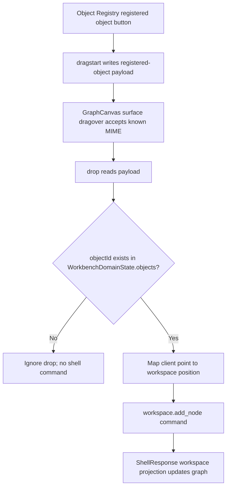

# graph-editor-object-drop design

## 0. 术语约定

| 术语 | 定义 | 防冲突结论 |
|---|---|---|
| Graph Object Drag Payload | 从 Object Registry 拖出的 JSON-safe payload，只能引用已登记对象 | 不等同于 Import Inbox item、raw resource 或 parser preview |
| Graph Drop Target | Graph Canvas drop 位置，包含 graph id 和 canvas position | position 是 workspace/layout 数据，不写 ChemicalObject |
| Drop-created Node | drop 成功后由 ShellResponse workspace projection 返回的 graph node | UI 可显示 drop intent，但不得本地 patch graph |

术语 grep 结果：roadmap 第 4.3 已定义 `GraphObjectDragPayload` / `GraphDropTarget`；当前代码没有 drag/drop 实现，Object Registry 只支持 click selection，Graph Canvas 只支持 toolbar Add Node。

## 1. 决策与约束

### 需求摘要

本 feature 目标是建立第一版对象拖入画布创建节点：

1. Object Registry 中每个已登记对象按钮设置 `draggable`，drag start 写入 `application/x-rxnflow-graph-object` payload。
2. Graph Canvas surface 支持 drag over / drop，drop 只接受 `kind=registered-object` 且 object id 存在于 `WorkbenchDomainState.objects`。
3. drop 位置按 canvas surface bounding rect 转为 `workspace.add_node` 的 `position: [x, y]`。
4. drop 后仍调用 ShellClient `workspace.add_node`，成功后只使用 ShellResponse 更新 `WorkbenchDomainState.workspace`。
5. click-driven Add Node 保留为键盘/agent 友好的备用路径。

### 明确不做

- 不让 Import Inbox pending/failed item、raw resource、parser preview item 或浏览器文件直接拖成 graph node。
- 不实现拖动已有 graph node、snap/grid、自动布局、selection 多选、drag ghost 持久化或 undo/redo。
- 不新增 Python shell command，不修改 `workspace.add_node` core 语义，不新增 `workspace.move_node`。
- 不把 drag payload、hover/drop intent 或 transient pointer position 写入 ShellResponse、Project Content、Browser Project Repository 或 ReactionGraph。
- 不改变 Object Registry active object selection 的语义；点击对象仍只改变 active object。

### 复杂度档位

- Frontend interaction：L3。涉及 HTML5 drag/drop、DataTransfer payload 校验和坐标映射。
- Robustness：L2。只处理 Web UI 内部 payload，但要拒绝 malformed / unknown object payload。
- Testability：tested。用 Testing Library fireEvent 覆盖 drag/drop payload；浏览器做主链路 smoke。

### 关键决策

1. **自定义 MIME type**：使用 `application/x-rxnflow-graph-object`，避免误读普通文本拖拽或文件拖拽。
2. **payload 最小化**：只传 `kind`、`objectId`、`label`；对象完整数据仍来自 `WorkbenchDomainState.objects`。
3. **drop command 复用 add_node**：不新增 shell command，`onAddObjectNode` 扩展为可接收 object id 和 position。
4. **坐标映射局限在 UI**：Graph Canvas 只负责把 client pointer 映射成 workspace position；后续 node layout feature 再处理 snap/grid/drag move。

## 2. 名词与编排

### 2.1 名词层：值对象 / 实体 / 接口契约

**现状**：

- `ObjectRegistryPanel` 渲染对象按钮，点击调用 `onSelectObject(object.id)`。
- `GraphCanvas` 的 Add Node toolbar 调用 `onAddObjectNode()`，由 `WorkbenchShell` 根据 `activeObjectId` 和当前 node count 生成默认 position。
- `WorkspaceAddNodeArgs` 已支持 `position?: [number, number]`。

**变化**：

新增前端 drag payload helper：

```ts
type GraphObjectDragPayload = {
  kind: "registered-object"
  objectId: string
  label: string
}

const graphObjectDragMimeType = "application/x-rxnflow-graph-object"
```

扩展 Graph Canvas add handler：

```ts
type AddObjectNodeRequest = {
  objectId?: string
  position?: [number, number]
}

onAddObjectNode(request?: AddObjectNodeRequest): void
```

接口示例：

```ts
serializeGraphObjectDragPayload({ kind: "registered-object", objectId: "object-b", label: "Object B" })
// '{"kind":"registered-object","objectId":"object-b","label":"Object B"}'

parseGraphObjectDragPayload(text)
// { kind: "registered-object", objectId: "object-b", label: "Object B" } | null
```

边界：

- parser 返回 `null` 表示 malformed / unsupported payload；GraphCanvas drop 不报 shell error。
- `objectId` 必须在 `WorkbenchDomainState.objects` 中存在；否则忽略 drop。
- `label` 可用于 drag UI/diagnostics，但 node label 以当前 object summary 为准。

### 2.2 编排层：主流程与控制流



**现状**：

- 用户只能先选择 active object，再点击 Add Node。
- GraphCanvas surface 没有 drag/drop event handlers。
- 测试只覆盖 click-driven Add Node。

**变化**：

- `ObjectRegistryPanel` 对对象按钮增加 `draggable` 和 `onDragStart`，同时保留 click selection。
- `GraphCanvas` 对 surface 增加 `onDragOver` / `onDrop`；drag over 仅在可用 session + valid MIME 时 preventDefault。
- `WorkbenchShell.addObjectNode` 接收可选 `{ objectId, position }`，drop path 用 payload object id；toolbar path 继续用 active object 和默认 position。
- drop 成功后的可见 node 必须来自 `applyWorkspaceResponse(response)`。

**跨层纪律**：

- Command authority：drop 不直接 mutate `workspace.graph.nodes`。
- Payload validation：malformed JSON、kind 不匹配、object id 不存在时忽略，不发 shell command。
- Accessibility fallback：click-driven Add Node 保留，drag/drop 不是唯一创建节点方式。
- Error visibility：`workspace.add_node` 失败仍走现有 shell error panel。

### 2.3 挂载点清单

- `ObjectRegistryPanel` 对象按钮：新增 draggable 行为和 drag payload 写入。
- `GraphCanvas` surface：新增 drop target event handlers。

本 feature 不新增 route、shell command、repository schema、Project Content section、runtime env、第三方库或全局事件监听。

### 2.4 推进策略

1. **Drag Payload Helper**：新增 MIME type、serialize/parse helper 和单元测试。
   - 退出信号：helper tests 覆盖 valid、malformed、wrong kind、empty object id。
2. **Registry Drag Source**：Object Registry 对已登记对象按钮写入 drag payload，click selection 不回退。
   - 退出信号：component test 能读取 dragstart DataTransfer payload，object selection 测试仍通过。
3. **Canvas Drop Target**：Graph Canvas surface 接受 valid registered-object drop，计算 position 并调用 add handler。
   - 退出信号：WorkbenchShell test 能 drop Object B 到 canvas 后看到新 node。
4. **Verification And Scope Guard**：跑 Web tests/build、Python 单测和浏览器主链路。
   - 退出信号：测试通过；Browser smoke 覆盖 drag/drop add node；scope grep 未新增 shell/core/persistence 改动。

## 3. 验收契约

### 关键场景清单

1. Fixture Run 后 Object Registry 的 `Object B` 按钮可拖拽，drag payload 为 `registered-object/object-b`。
2. 将 `Object B` drop 到 Graph Canvas surface 后，会调用 `workspace.add_node` 并显示来自 ShellResponse 的新 node，object id 为 `object-b`。
3. malformed payload、wrong kind payload、未知 object id drop 不调用 shell command，不产生 graph node。
4. click-driven Add Node 仍可用，保留 agent/键盘友好路径。
5. pending/failed import item、raw resource、parser preview item 没有 draggable graph object payload。
6. 不新增 `workspace.move_node`、`workspace.remove` 或 Python shell command。
7. 不把 drag payload、drop intent 或 transient pointer position 写入 ShellResponse、Project Content、Browser Project Repository 或 localStorage。
8. `npm run test` 通过。
9. `npm run build` 通过。
10. Browser dev preview 完成 object drag/drop 到 canvas，页面非空白、无 framework overlay、console error/warn clean。

### 反向检查

- 不实现已有 graph node 拖动、snap/grid、自动布局、多选、undo/redo、viewport 持久化。
- 不把 Import Inbox item 或浏览器文件拖拽当作 graph node creation source。
- 不新增第三方 diagramming/canvas library。

## 4. 与项目级架构文档的关系

- acceptance 阶段应在 `codestable/architecture/web-workbench.md` 记录 Object Registry 已登记对象可作为 Graph Canvas drag source，drop 仍走 `workspace.add_node(position)` 和 ShellResponse projection。
- requirement `web-workbench-shell` 应补充用户可拖入已登记对象到画布创建节点，这是用户可见能力变化。
- roadmap acceptance 阶段把 `graph-editor-object-drop` 标为 `done`，后续 `graph-editor-node-layout` / `graph-editor-e2e-qa` 可复用 drag payload 和 drop target。
