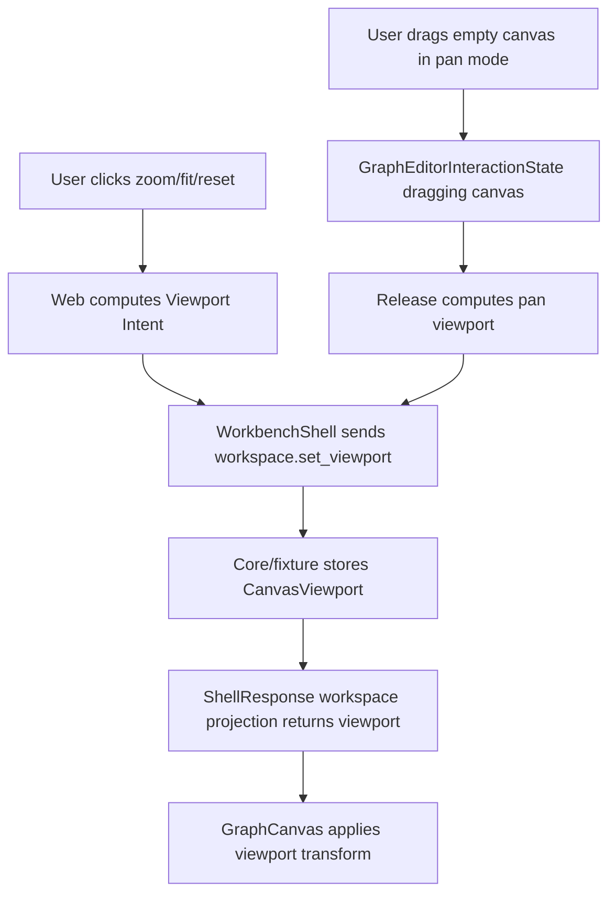

# graph-editor-viewport-controls design

## 0. 术语约定

| 术语 | 定义 | 防冲突结论 |
|---|---|---|
| Canvas Viewport | workspace-only `{x, y, zoom}` 投影，用于把 Web 虚拟画布映射到可视区域 | 复用 core `CanvasViewport`，不等同于 browser window viewport |
| Viewport Intent | Web UI 中 zoom in/out、fit、reset 或 pan 产生的目标 viewport | 不等同于 GraphPatch；不修改 ReactionGraph |
| Viewport Transform | GraphCanvas 上的 CSS transform / 坐标换算，用于显示当前 viewport | 不写 Project Content，也不进入 ShellResponse |
| Fit To View | 根据当前 graph nodes 的包围盒生成一个 viewport intent，让节点尽量进入当前画布区域 | 不做自动布局、碰撞避让或重新计算 node positions |
| Pan Mode | Graph editor 的 `mode="pan"` 和 canvas dragging state | 不等同于 node dragging；pan 后只提交 `workspace.set_viewport` |

术语 grep 结果：core 已有 `CanvasViewport`、`GraphEditorWorkspaceService.set_viewport`、`workspaces-v1` viewport 持久化和 `GraphEditorMode="pan"`；Platform Shell / Web Shell DTO / fixture transport 尚无 `workspace.set_viewport`；GraphCanvas 当前直接使用固定 `600 x 360` 虚拟画布坐标，无 pan/zoom transform。

## 1. 决策与约束

### 需求摘要

本 feature 目标是让 Web Graph Canvas 有第一版 viewport controls：

1. 用户可通过 toolbar 按钮执行 Zoom In、Zoom Out、Fit 和 Reset。
2. 用户可进入 Pan mode，在 graph canvas 空白区域拖动画布，release 后提交 viewport。
3. Web UI 根据当前 viewport 显示缩放/平移后的节点、边和 edge hitbox。
4. object drop、node dragging 和 pan 都使用同一套 viewport 坐标换算，提交给 shell 的 node position 仍是虚拟画布坐标。
5. `workspace.set_viewport` 成功后，WorkbenchDomainState 只从 ShellResponse workspace projection 更新 viewport。
6. 既有 object drop、node drag、edge delete、path order、energy/report 行为不回退。

### 明确不做

- 不实现 minimap、惯性滚动、滚轮缩放、pinch、键盘快捷键、viewport undo/redo 或 viewport history。
- 不实现自动布局、碰撞避让、edge rerouting、fit 后自动保存、拖动实时写盘或 Project Content schema 变更。
- 不把 transient pan drag、hover、selection、fit 计算中间值或 DOM 尺寸写入 Project Content、Browser Project Repository、localStorage 或 ShellResponse。
- 不改变 ReactionGraph node position 语义；viewport 只改变显示和坐标换算。
- 不新增第三方 diagramming/canvas library。

### 复杂度档位

- Shell contract：L2。新增最窄 `workspace.set_viewport` command，复用已有 core `GraphEditorWorkspaceService.set_viewport`。
- Frontend interaction：L3。涉及坐标换算、CSS transform、pan drag 和 toolbar control 状态。
- Persistence：L1。core 已有 workspace viewport persistence，本 feature 不新增保存触发；长期保存仍由后续 `graph-editor-workspace-persistence` 和显式 Save Bridge Session 承担。
- Testability：tested。Python platform tests、fixture ShellClient tests、viewport helper tests、React component tests 和浏览器 smoke 覆盖。

### 关键决策

1. **viewport 使用 workspace 虚拟坐标**：`x/y` 是 `600 x 360` 虚拟画布单位中的平移量，`zoom` 是缩放倍率。
2. **ShellResponse authority**：toolbar/pan 先产生 intent，发送 `workspace.set_viewport`；成功后可见 viewport 来自 ShellResponse。
3. **Graph structure 不受影响**：viewport 不调用 GraphPatch，不改 nodes/edges/paths，不影响 Energy/Profile/Report。
4. **坐标 helper 集中化**：drop、node drag、pan 和 fit 共享 `graphViewport` helper，避免每个交互自己写换算。
5. **zoom clamp 在 Web 和 Shell 双边一致**：第一版限制 `0.35 <= zoom <= 2.5`；Web 先 clamp，Shell 对 non-finite 或非正 zoom 返回 `invalid_input`。

## 2. 名词与编排

### 2.1 名词层：值对象 / 实体 / 接口契约

**现状**：

- `rxnflow.workspace.CanvasViewport` 已包含 `x`、`y`、`zoom`，默认 `{0, 0, 1}`。
- `GraphEditorWorkspaceService.set_viewport(project_id, workspace_id, viewport)` 已存在，并保证不修改 graph。
- Project Content `workspaces-v1` 已能保存/加载 viewport，且校验 `zoom > 0`。
- Platform Shell 没有 `workspace.set_viewport` command，`_workspace_summary` 也没有投影 viewport。
- Web `WorkspaceSummary` 没有 `viewport` 字段，fixture transport 没有 viewport state。
- GraphCanvas 当前把 pointer/drop 坐标直接映射为固定虚拟画布坐标，不考虑 viewport。

**变化**：

新增 shell command args：

```ts
type WorkspaceSetViewportArgs = {
  session_id: string
  viewport: {
    x: number
    y: number
    zoom: number
  }
}
```

扩展 workspace projection：

```ts
type CanvasViewportSummary = {
  x: number
  y: number
  zoom: number
}

type WorkspaceSummary = {
  workspace_id: string
  project_id: string
  viewport: CanvasViewportSummary
  // existing graph / preview / active_path_id ...
}
```

Web helper：

```ts
type GraphViewport = {
  x: number
  y: number
  zoom: number
}

screenPointToGraphPoint(point, surfaceSize, viewport)
graphViewportCssTransform(viewport)
zoomGraphViewport(viewport, direction)
panGraphViewport(viewport, delta)
fitGraphViewportToNodes(nodes, surfaceSize)
```

边界：

- `workspace.set_viewport` 必须有 `viewport.x/y/zoom`，且三者为 finite number，`zoom > 0`。
- Web 第一版 clamp zoom 到 `0.35..2.5`；x/y 保持 finite，fit/reset 生成有限值。
- `WorkspaceSummary.viewport` 缺失时 Web fallback 为 `{x:0,y:0,zoom:1}`，用于旧 fixture / 旧响应兼容。

### 2.2 编排层：主流程与控制流



**现状**：

- `GraphEditorInteractionState` 已支持 `mode="pan"` 和 `dragging.kind="canvas"` 类型，但 UI 没有生产 pan。
- GraphCanvas command bar 已有 5 个 graph commands，没有 viewport controls。
- Node pointer drag、object drop 和 edge hitbox 都假设 screen surface 与虚拟画布一一对应。
- WorkbenchShell 只发送 workspace add/move/remove/connect/set_path 等 graph commands。

**变化**：

- `graphViewport.ts` 新增 viewport clamp、坐标换算、CSS transform、zoom/pan/fit/reset helpers。
- Web Shell DTO、fixture transport 和 Platform Shell 增加 `workspace.set_viewport`。
- GraphCanvas 渲染一个 viewport toolbar：Pan、Zoom In、Zoom Out、Fit、Reset，并显示当前 zoom 百分比。
- GraphCanvas 把 nodes/edges 放进 viewport-transformed content layer；edge hitbox 与 node card 使用同一 transform。
- GraphCanvas 空白区域 pointer drag 在 pan mode 下更新 transient canvas dragging；pointer up 发送 `workspace.set_viewport`。
- object drop 和 node drag release 使用 `screenPointToGraphPoint`，确保 zoom/pan 后提交的 position 仍是虚拟画布坐标。
- WorkbenchShell `setGraphViewport` 发送 `workspace.set_viewport` 并只用 `applyWorkspaceResponse` 更新 domain state。

**跨层纪律**：

- Command authority：GraphCanvas 不直接 mutate `WorkbenchDomainState.workspace.viewport`。
- Error semantics：缺 viewport 或非法 zoom 返回 `invalid_input target=viewport` / `viewport.zoom`。
- Idempotence：重复 reset 仍返回 `{0,0,1}`；zoom 已到边界时重复 zoom 不产生非法值。
- Persistence boundary：viewport 投影属于 workspace-only state；本 feature 不自动调用 Save Bridge Session 或写 Browser Project Repository。
- Interaction isolation：node drag 和 pan drag 互斥；node card pointer 事件不会触发 pan。

### 2.3 挂载点清单

- Platform Shell workspace command dispatcher：新增 `workspace.set_viewport`。
- Web shell DTO / fixture transport：新增 `CanvasViewportSummary`、`workspace.set_viewport` projection 和 fixture state。
- Graph viewport helper：集中坐标换算、clamp、fit/reset/zoom/pan。
- GraphCanvas / WorkbenchShell：新增 viewport controls、pan mode drag 和 ShellResponse 编排。
- i18n / styles / component tests：新增中英文按钮文案、稳定尺寸和交互测试。

本 feature 不新增 route、repository schema、Project Content section、localStorage key、third-party diagramming library、Energy/Profile/Report command 或真实文件 IO。

### 2.4 推进策略

1. **Shell Viewport Contract**：在 core platform shell、Web DTO 和 fixture transport 增加 `workspace.set_viewport`，并补 Python / ShellClient tests。
   - 退出信号：set viewport 返回 JSON-safe workspace projection；非法 viewport 不更新 graph；workspace graph nodes/edges/path 不变。
2. **Viewport Helper**：新增 Web viewport helper，覆盖 clamp、screen/graph 坐标换算、zoom、pan、fit、reset。
   - 退出信号：helper tests 覆盖 zoom clamp、pan delta、fit bounds、screen point conversion 和 fallback viewport。
3. **Canvas Controls And Transform**：GraphCanvas 接入 Pan/Zoom/Fit/Reset controls、viewport transform 和坐标换算。
   - 退出信号：component test 点击 zoom/fit/reset 发送 `workspace.set_viewport`；zoom 后 Add/Drop/Drag 坐标仍是 graph coordinates。
4. **Pan Interaction**：GraphCanvas 空白区域 pan drag 通过 interaction state 表达 transient drag，release 后提交 viewport。
   - 退出信号：component test 在 pan mode 拖动画布，发送 `workspace.set_viewport`；node drag 不触发 pan。
5. **Verification And Scope Guard**：跑 Web tests/build、Python 单测和浏览器主链路。
   - 退出信号：测试通过；Browser/Playwright 验证页面非空白、console clean、zoom/fit/reset/pan 有可观察变化；scope grep 未新增持久层、auto layout、undo 或第三方 diagramming 库。

## 3. 验收契约

### 关键场景清单

1. Platform Shell `workspace.set_viewport(viewport={x,y,zoom})` 返回 workspace projection 中相同 viewport，graph nodes/edges/paths 不变。
2. Platform Shell 对缺失 viewport、non-finite x/y/zoom 或 `zoom <= 0` 返回结构化 `invalid_input`，不更新 workspace viewport。
3. Web fixture transport 支持 `workspace.set_viewport`，返回 JSON-safe `WorkspaceCommandData.command="workspace.set_viewport"`。
4. `WorkspaceSummary.viewport` 在 fixture run、workbench snapshot 和 workspace command response 中可见；缺失时 Web helper fallback 到默认 viewport。
5. GraphCanvas Zoom In/Out 按钮发送 clamped viewport；重复 zoom 不越过 `0.35..2.5`。
6. GraphCanvas Reset 发送 `{x:0,y:0,zoom:1}`；重复 reset 仍可用且无错误。
7. GraphCanvas Fit 根据当前 nodes 生成有限 viewport，让 fixture node A/B 在桌面 viewport 中可见。
8. Pan mode 下拖动画布空白区域发送 `workspace.set_viewport`；node drag 不发送 pan viewport command。
9. zoom/pan 后 object drop 和 node drag release 仍提交虚拟画布坐标，不提交 screen pixel 坐标。
10. viewport controls 不改变 nodes/edges/paths、active path、object registry、import inbox、energy profile 或 report export state。
11. 不新增 auto layout、collision avoidance、Project Content schema、localStorage persistence、undo/redo、minimap、wheel/pinch 或第三方 diagramming/canvas library。
12. `npm run test` 通过。
13. `npm run build` 通过。
14. `python3 -m unittest discover` 通过。
15. Browser dev preview 验证页面非空白、无 framework overlay、console error/warn clean；zoom/fit/reset/pan 有可观察变化。

### 反向检查

- 不把 transient pan drag、viewport intent、surface DOM size 或 fit 中间结果写入 ShellResponse、Project Content、Browser Project Repository 或 localStorage。
- 不让 Web 直接 patch domain workspace viewport；必须等待 ShellResponse projection。
- 不新增 ReactionGraph GraphPatch op 或 ChemicalObject / EnergyProfile / ExportArtifact 改动。

## 4. 与项目级架构文档的关系

- acceptance 阶段应在 `codestable/architecture/core-platform.md` 记录 Platform Shell `workspace.set_viewport` command 和 workspace viewport projection。
- acceptance 阶段应在 `codestable/architecture/web-workbench.md` 记录 Graph Canvas viewport controls、`graphViewport.ts` helper、pan mode 和 viewport transform；并继续声明 viewport intent/transient pan 是 UI-only。
- requirement `web-workbench-shell` 应补充用户可缩放、平移、fit/reset 图谱画布，这是用户可见能力变化。
- roadmap acceptance 阶段把 `graph-editor-viewport-controls` 标为 `done`；后续 `graph-editor-workspace-persistence` 可复用 viewport projection。
