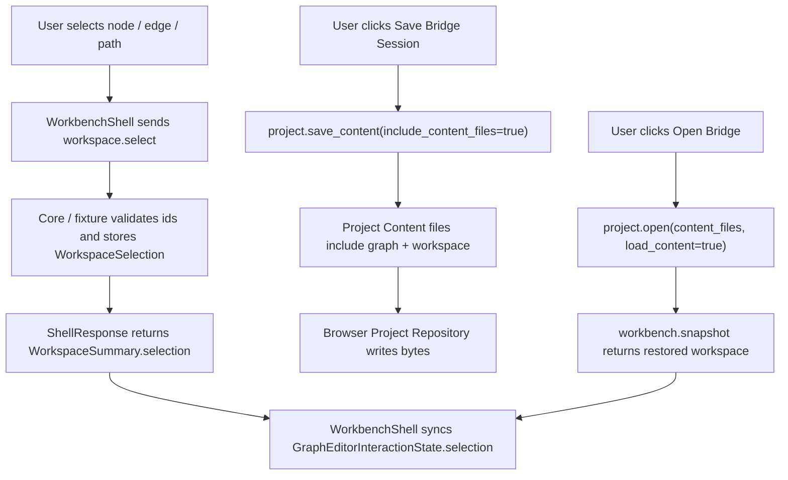

# graph-editor-workspace-persistence design

## 0. 术语约定

| 术语 | 定义 | 防冲突结论 |
|---|---|---|
| Workspace Selection | core `WorkspaceSelection` / Web `WorkspaceSelectionSummary`，只保存 node/edge/path id 集合 | 不等同于 hover、dragging、pending edge 或 Object Registry active object |
| Workspace Persistence Bridge | Web graph editor 状态到 Project Content open/save bridge 的恢复闭环 | 复用现有 `.rxnflow/state/workspaces.json`，不新建 Web 私有 schema |
| Save Bridge Session | Project Sidebar 显式触发 `project.save_content(include_content_files=true)` 并写回 Browser Project Repository | 不做自动保存或拖动实时写盘 |
| Restored Graph Interaction | Web 从 ShellResponse `workspace.selection` 初始化 GraphEditorInteractionState 的过程 | 只恢复 selection；mode/hover/dragging/pendingEdge 仍是 UI-only |

术语 grep 结果：core 已有 `WorkspaceSelection`、`WorkspaceSnapshot.selection`、`CanvasViewport`、`active_path_id` 和 `workspaces-v1` codec；Web 已有 `GraphEditorInteractionState.selection`，但 Shell DTO / fixture / Platform Shell workspace summary 还没有 selection 投影，也没有 `workspace.select` command。

## 1. 决策与约束

### 需求摘要

本 feature 目标是让 Web Graph Canvas 已落地的布局、视口、选择和 active path 能通过显式 Project Content open/save bridge 恢复：

1. 用户选择 node、edge 或 path 后，Web 通过 `workspace.select` 把 selection 写入 core workspace state。
2. `WorkspaceSummary` 返回 `selection`，WorkbenchShell 用 ShellResponse projection 同步 GraphCanvas selection。
3. `project.save_content(include_content_files=true)` 返回的 content files 包含当前 node positions、viewport、selection 和 active path。
4. 后续 `project.open(content_files, load_content=true)` / `workbench.snapshot` 能恢复同一 workspace 状态，Web 画布可见 selection、viewport、node layout 和 path order。
5. fixture transport 也支持同一 open/save 语义，保证 Web component tests 不依赖 Python bridge。

### 明确不做

- 不实现自动保存、后台同步、云存储、账号、多端冲突合并或 CRDT。
- 不把 hover、dragging、pending edge、path order draft、surface DOM size、toolbar pressed state 或 Object Registry active object 写入 Project Content。
- 不新建浏览器私有 graph layout schema，不用 localStorage 保存图谱状态。
- 不改变 Project Content `project-content-v1` / `workspaces-v1` schema；只补 Shell projection 和 Web fixture 恢复链路。
- 不新增 undo/redo/history、完整 E2E 矩阵或 bundle import/export IO；完整真实浏览器 save/open 回归交给后续 `graph-editor-e2e-qa`。

### 复杂度档位

- Shell contract：L2。新增 `workspace.select` command 和 `WorkspaceSummary.selection` 投影，复用 core `GraphEditorWorkspaceService.select`。
- Web orchestration：L3。selection 从 UI-only interaction 变成可持久化 projection，需要避免恢复后被旧 fallback 选择覆盖。
- Fixture persistence：L3。fixture 需要把当前 graph/workspace 序列化为 Project Content files，并从 content files 恢复，服务 Web tests。
- Persistence schema：L1。长期 schema 已存在，本 feature 不迁移 Project Content。

### 关键决策

1. **复用 WorkspaceSnapshot**：node positions 仍在 `ReactionGraph.nodes[].position`，viewport/selection/active path 仍在 `WorkspaceSnapshot`。
2. **显式保存**：拖动、缩放、选择、path order apply 后只更新 shell session；只有 Save Bridge Session 才写 Browser Project Repository。
3. **ShellResponse authority**：GraphCanvas 可先乐观更新交互态，但最终 selection、viewport、graph 和 active path 都以 ShellResponse workspace projection 为准。
4. **恢复不自动补选**：有 workspace projection 时 Web 不再为了旧 click-driven flow 强制选第一个 node；只有用户点击才产生 selection。
5. **fixture content files 可读写**：fixture open/save 至少覆盖 `.rxnflow/state/reaction-graphs.json` 和 `.rxnflow/state/workspaces.json` 的当前状态，其他 section 保持空 section。

## 2. 名词与编排

### 2.1 名词层：值对象 / 实体 / 接口契约

**现状**：

- `rxnflow.workspace.WorkspaceSelection` 已保存 `node_ids`、`edge_ids`、`path_ids`。
- `rxnflow.graph_workspace_codec` 已能序列化 `selection`、`viewport` 和 `active_path_id`。
- `ProjectContentStore` 已保存 `reaction-graphs-v1` 和 `workspaces-v1`。
- Platform Shell `_workspace_summary` 尚未投影 `selection`，dispatcher 尚无 `workspace.select`。
- Web `GraphEditorInteractionState.selection` 是 UI-only state，选择 node/edge/path 当前不进入 Shell session。
- Fixture `project.save_content` 目前不能反映当前 fixture graph/workspace 的真实状态，`project.open(content_files)` 也不从 content files 恢复 fixture workspace。

**变化**：

新增 shell command args：

```ts
type WorkspaceSelectArgs = {
  session_id: string
  selection: {
    node_ids?: string[]
    edge_ids?: string[]
    path_ids?: string[]
  }
}
```

扩展 workspace projection：

```ts
type WorkspaceSelectionSummary = {
  node_ids: string[]
  edge_ids: string[]
  path_ids: string[]
}

type WorkspaceSummary = {
  selection: WorkspaceSelectionSummary
  viewport: CanvasViewportSummary
  active_path_id: string | null
  graph: GraphSummary
}
```

Web helper：

```ts
interactionStateFromWorkspaceSelection(workspace, previous)
```

边界：

- `workspace.select` 只接受当前 graph 中存在的 node/edge/path id；缺失引用返回结构化错误。
- 空 selection 合法，用于取消选择。
- selection 的长期保存只发生在 Save Bridge Session 之后；command 本身只更新当前 shell session。

### 2.2 编排层：主流程与控制流



**现状**：

- Node drag release 已经发送 `workspace.move_node`；viewport controls 已经发送 `workspace.set_viewport`；path order apply 已经发送 `workspace.set_path`。
- WorkbenchShell `applyWorkspaceResponse` 只更新 domain workspace，不同步 core selection projection。
- GraphEditorInteractionState prune 会清理失效引用，但旧逻辑容易在 graph 有 node 时回落到第一个 node。
- Project Sidebar 的 open/save bridge 已存在，但 fixture content files 不反映当前 workspace 状态。

**变化**：

- Platform Shell 增加 `workspace.select`，并在 `_workspace_summary` 投影 `selection`。
- Web Shell DTO 增加 `WorkspaceSelectionSummary` 和 `workspace.select` command typing。
- WorkbenchShell 在 node/edge/path 选择时调用 `workspace.select`；connect 目标点击仍优先发送 `workspace.connect`。
- WorkbenchShell 在 workspace projection 变化后，从 `workspace.selection` 恢复 GraphEditorInteractionState selection，并保留 mode / pendingEdge / dragging 的 UI-only 边界。
- Fixture transport 支持 `workspace.select`、selection 校验、remove 后 selection prune，以及 project content files 保存/恢复当前 graph/workspace。
- Project Content open/save bridge 继续由 Project Sidebar 显式按钮触发；GraphCanvas 不直接调用 repository。

**跨层纪律**：

- Error semantics：缺 selection 返回 `invalid_input target=selection`；未知 node/edge/path 返回 `graph_invalid target=node_id|edge_id|path_id`。
- Idempotence：重复选择同一 id 或重复保存 content files 不创建重复 graph/workspace。
- Ordering：Web command response 先更新 WorkbenchDomainState，再由 selection sync 更新 GraphEditorInteractionState。
- Persistence boundary：Browser Project Repository 只保存 shell 返回 bytes；Web 不解释或重写 core Project Content 领域语义，fixture 仅作为测试替身生成同 schema bytes。
- Scope guard：不保存 transient interaction state，不引入 cloud/backend account，不改 parser/import/energy/export 语义。

### 2.3 挂载点清单

- Platform Shell workspace command dispatcher：新增 `workspace.select` 和 `selection` projection。
- Web shell DTO / fixture transport：新增 selection DTO、fixture command、fixture content files save/open 恢复。
- WorkbenchShell / graph interaction helper：selection command 编排与 restored selection sync。
- Project Content Bridge tests：覆盖 Save/Open Bridge Session 对 graph/workspace 状态的恢复。
- Architecture / requirement / roadmap acceptance 文档：记录可见能力和边界。

本 feature 不新增 Project Content section、repository schema、localStorage key、route、cloud storage SDK、third-party diagramming library 或 report/export writer。

### 2.4 推进策略

1. **Design And Roadmap Gate**：落盘 design/checklist，回写 roadmap item 为 in-progress。
   - 退出信号：design status approved；checklist YAML 和 roadmap items YAML 校验通过。
2. **Shell Selection Contract**：在 core Platform Shell 和 Web DTO/fixture 增加 `workspace.select` 与 `WorkspaceSummary.selection`。
   - 退出信号：Python / ShellClient tests 覆盖选择、空选择、缺失引用和 JSON-safe projection。
3. **Web Selection Sync**：WorkbenchShell 把 node/edge/path 选择提交到 shell，并从 workspace projection 恢复 GraphEditorInteractionState。
   - 退出信号：component tests 覆盖 node/edge/path selection command、Open Bridge 后 restored selection 可见，connect/path draft 不回退。
4. **Fixture Content Restore**：fixture save/open content files 序列化并恢复当前 graph/workspace 状态。
   - 退出信号：Web tests 证明 Save Bridge 后的 content files 包含 node position、viewport、selection、active path，重新 Open Bridge 后状态恢复。
5. **Verification And Scope Guard**：跑 Web tests/build、Python 单测和浏览器主链路。
   - 退出信号：测试通过；Browser/Playwright 验证页面非空白、console clean、保存/恢复有可观察结果；scope grep 未新增自动保存、localStorage graph state 或云同步。

## 3. 验收契约

### 关键场景清单

1. Platform Shell `workspace.select(selection={node_ids:[...]})` 返回 workspace projection 中相同 selection。
2. Platform Shell 允许空 selection，并清空 workspace selection。
3. Platform Shell 对未知 node/edge/path id 返回结构化错误，不更新 selection。
4. `WorkspaceSummary.selection` 在 fixture run、workbench snapshot、workspace command response 和 project open/save 后可见。
5. Web fixture transport 支持 `workspace.select`，返回 JSON-safe `WorkspaceCommandData.command="workspace.select"`。
6. GraphCanvas 选择 node、edge、path 后会发送 `workspace.select`；connect 目标点击仍发送 `workspace.connect`，不被 select command 抢占。
7. Save Bridge Session 生成的 Project Content files 能反映当前 node positions、viewport、selection 和 active path。
8. Open Bridge / restored snapshot 后，GraphCanvas 恢复 node position、viewport、selected node/edge/path 和 path order。
9. 删除 node/edge 后 restored selection 不保留失效 id，cascade 仍来自 ShellResponse / fixture state。
10. 不保存 hover、dragging、pending edge、path order draft、surface DOM size、toolbar pressed state 或 Object Registry active object。
11. 不新增 Project Content schema、browser-local graph layout schema、localStorage persistence、自动保存、云同步或账号系统。
12. `npm run test` 通过。
13. `npm run build` 通过。
14. `python3 -m unittest discover` 通过。
15. Browser dev preview 验证页面非空白、无 framework overlay、console error/warn clean；保存/恢复链路有可观察结果。

### 反向检查

- 不让 Web 直接 patch `WorkbenchDomainState.workspace.graph`、`viewport`、`selection` 或 `active_path_id` 绕过 ShellResponse。
- 不把 Browser Project Repository 当作领域模型 store；它只写 shell 返回的 content file bytes。
- 不把 fixture 生成 content files 的测试替身误写成真实浏览器持久化 schema。

## 4. 与项目级架构文档的关系

- acceptance 阶段应在 `codestable/architecture/core-platform.md` 记录 Platform Shell `workspace.select` command 和 selection projection。
- acceptance 阶段应在 `codestable/architecture/web-workbench.md` 记录 Graph Canvas selection 可通过 WorkspaceSnapshot 保存/恢复，并继续声明 hover/drag/pending edge 是 UI-only。
- requirement `web-workbench-shell` 应补充用户可显式保存并恢复图谱布局、视口、选择和 active path。
- roadmap acceptance 阶段把 `graph-editor-workspace-persistence` 标为 `done`；后续 `graph-editor-e2e-qa` 复用该保存/恢复链路做真实浏览器矩阵。
