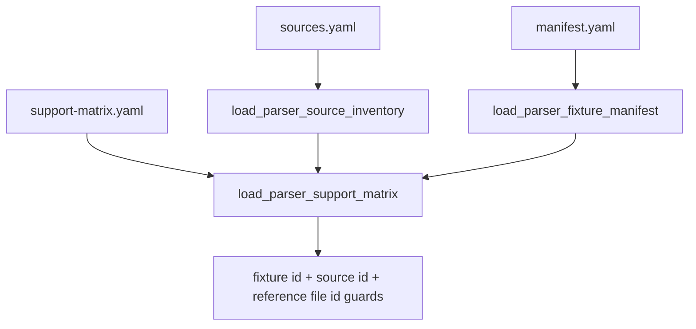

# parser-corpus-source-metadata design

## 0. 术语约定

| 术语 | 定义 | 防冲突结论 |
|---|---|---|
| Fixture Source Metadata | `manifest.yaml` 单个 executable fixture 的 `source` 块 | 已存在；本 feature 增强第三方来源字段 |
| Vendored Third-party Fixture | 许可证允许提交、已复制进 `tests/fixtures/parsers/files/` 的第三方样例 | 当前没有实际条目；先加 schema guard |
| Source Path | 第三方上游仓库中的原始文件路径，例如 `example/sp/sp.out` | 不等同于本地 `file` path |
| Source Hash | 上游原始文件 bytes 的 `sha256:<64 hex>` | 不能用本地脱敏后 fixture hash 混用 |
| Source Size | 上游原始文件 bytes 大小 | 用于 fixture 体积 guard 和 review |
| Support Matrix Source Links | `support-matrix.yaml` entry 中的 `source_ids` / `reference_file_ids` | 指向 `sources.yaml`，不替代 `fixture_ids` |

术语 grep 结论：现有 `Parser Source Inventory`、`Fixture Manifest`、`Parser Support Matrix` 已落地；本 feature 在这三者之间加交叉校验，不改 parser runtime。

## 1. 决策与约束

### 需求摘要

本 feature 目标是让后续真实/公开 fixture 接入时不能绕过来源元数据：

1. `ParserFixtureSource` 支持 `source_path`、`source_sha256`、`source_size_bytes`。
2. `source.kind=vendored-third-party` 时必须提供 `url`、`commit`、`source_path`、`source_sha256`、`source_size_bytes`，且 `redistributable=true`。
3. `support-matrix.yaml` 支持 `source_ids` 和 `reference_file_ids`。
4. loader 可在传入 `ParserSourceInventory` 时校验 `source_ids`、`reference_file_ids` 是否存在，且 `reference_file_ids` 指向 `fixture_policy=reference-only` 的 source file。
5. 当前 synthetic executable fixture 保持兼容，不强制补第三方元数据。

明确不做：

- 不新增或 vendor MAPLE/cclib-data executable fixture。
- 不改 `parser-fixtures-v1` 和 `parser-support-matrix-v1` 的 schema version。
- 不修改 parser runtime、golden snapshot、ImportRegistryWorkflow、Platform Shell 或 Web UI。
- 不自动判断第三方许可证是否可再分发；只做字段存在和形状校验。
- 不把 support matrix 的 source links 当成真实软件版本认证。

### 复杂度档位

测试侧 schema guard 小 feature。偏离点：

- 要保持旧 synthetic manifest 兼容，不能把所有 fixture 都强制绑定 source inventory。
- `reference_file_ids` 语义比普通字符串列表更强，必须 cross-check 到 `sources.yaml` 的 file policy。

### 关键决策

1. **可选字段 + 条件必填**：source metadata 字段对 synthetic 可选，对 `vendored-third-party` 强制。
2. **support matrix 只链接来源，不复制来源细节**：entry 只存 `source_ids` / `reference_file_ids`，具体 URL/hash/size 仍在 `sources.yaml`。
3. **loader 向后兼容**：`load_parser_support_matrix(path, manifest)` 仍可用；只有传入 source inventory 时才做交叉校验。
4. **不升级 schema version**：这是向后兼容字段增强；schema name 保持 `parser-fixtures-v1` / `parser-support-matrix-v1`。

## 2. 名词与编排

### 2.1 名词层：值对象 / 实体 / 接口契约

**现状**：

- `ParserFixtureSource` 只包含 `kind`、`url`、`commit`、`license`、`redistributable`、`redaction`。
- `ParserSupportMatrixEntry` 只包含 `fixture_ids`，reference-only MAPLE entries 没有机器可读 source linkage。
- `ParserSourceInventory` 已能读取 source 和 file entries，但 support matrix 不校验它们。

**变化**：

- `ParserFixtureSource` 增加：
  - `source_path: str | None`
  - `source_sha256: str | None`
  - `source_size_bytes: int | None`
- `ParserSupportMatrixEntry` 增加：
  - `source_ids: tuple[str, ...]`
  - `reference_file_ids: tuple[str, ...]`
- `ParserSourceInventory` 增加 file lookup 能力，供 support matrix cross-check。
- `support-matrix.yaml` 给 MAPLE reference-only entries 和 ASE extxyz current entry 补 source links。

**接口示例：vendored third-party manifest source**

```yaml
source:
  kind: vendored-third-party
  url: https://github.com/ClickFF/MAPLE
  commit: 001636482646bca0d1e867fb257322d2a172cc86
  license: BSD-3-Clause plus academic/commercial notice
  redistributable: true
  redaction: none
  source_path: example/sp/sp.out
  source_sha256: sha256:<64 hex>
  source_size_bytes: 4253
```

**接口示例：support matrix source links**

```yaml
source_ids: [maple-dev-example]
fixture_ids: []
reference_file_ids: [maple-frequency-summary-reference]
```

### 2.2 编排层：主流程与控制流



**现状**：

manifest、support matrix 和 source inventory 可以分别读取，但 source linkage 不能被统一校验。

**变化**：

- manifest loader 对 vendored-third-party source 做条件必填 guard。
- support matrix loader 在有 source inventory 时校验 source linkage。
- docs/architecture 说明这是测试侧元数据 guard，不改变 parser 输出。

**跨层纪律**：

- 错误语义：继续使用 `AssertionError`，错误消息指出 fixture/source/support matrix 字段。
- 幂等性：loader 只读 YAML，不写文件、不访问网络。
- 扩展点：后续真实 fixture feature 可先在 `sources.yaml` 登记，再把 manifest/support matrix 链上。
- 可观测点：focused unittest 覆盖正向与拒绝分支。

### 2.3 挂载点清单

- `tests/parser_fixture_harness.py`：source metadata fields、vendored-third-party guard、support matrix source link validation。
- `tests/fixtures/parsers/support-matrix.yaml`：source_ids / reference_file_ids。
- `tests/test_parser_fixture_harness.py`：正向和拒绝分支测试。
- `docs/dev/parser-fixture-corpus.md`：manifest/support matrix source metadata 维护说明。
- `codestable/architecture/ARCHITECTURE.md` / `codestable/architecture/core-platform.md`：现状归并。

### 2.4 推进策略

1. **Design and roadmap gate**：建立 feature design/checklist，把 roadmap item 标为 in-progress。
   - 退出信号：feature checklist 与 roadmap YAML 通过。
2. **Manifest source metadata guard**：扩展 `ParserFixtureSource` 和 manifest loader。
   - 退出信号：vendored-third-party 缺少 upstream path/hash/size 会失败，synthetic fixture 仍通过。
3. **Support matrix source links**：扩展 support matrix entry 和 source inventory cross-check。
   - 退出信号：source_ids / reference_file_ids 能加载并拒绝未知或非 reference-only file id。
4. **Docs and acceptance**：回写 docs/architecture/roadmap，补验收报告并运行验证。
   - 退出信号：checks 全 passed，roadmap item done，YAML / focused unittest / full unittest 通过。

## 3. 验收契约

### 关键场景清单

1. Synthetic manifest fixtures 继续无需 `source_path/source_sha256/source_size_bytes`。
2. Temp vendored-third-party manifest source 带完整 metadata 时可加载，并能读出 path/hash/size。
3. Vendored-third-party source 缺少 `source_path` 时被拒绝。
4. Vendored-third-party source 缺少 malformed `source_sha256` 时被拒绝。
5. Vendored-third-party source 缺少或非法 `source_size_bytes` 时被拒绝。
6. Vendored-third-party source `redistributable=false` 时被拒绝。
7. `support-matrix.yaml` 可记录 `source_ids` 和 `reference_file_ids`。
8. `load_parser_support_matrix(..., source_inventory=inventory)` 能校验当前 support matrix。
9. support matrix 引用未知 source id 时被拒绝。
10. support matrix 引用未知 reference file id 时被拒绝。
11. support matrix 引用 candidate/vendored file id 作为 `reference_file_ids` 时被拒绝。
12. docs/architecture 明确 source metadata 是测试侧 guard，不新增 runtime parser 支持。

### 明确不做的反向核对项

- 不新增 MAPLE/cclib-data executable fixture。
- 不复制第三方 example/log 文件进 `tests/fixtures/parsers/files/`。
- 不改 parser runtime、ImportRegistryWorkflow、Platform Shell 或 Web UI。
- 不升级 schema version。
- 不把 source links 描述成完整版本认证。

## 4. 与项目级架构文档的关系

- architecture 归并：补 manifest vendored-third-party guard、support matrix source link guard 和 runtime 不变边界。
- guide 回写：`docs/dev/parser-fixture-corpus.md` 补 source metadata 字段和 support matrix source link 规则。
- roadmap 回写：验收通过后把 `parser-corpus-source-metadata` 标为 done。
